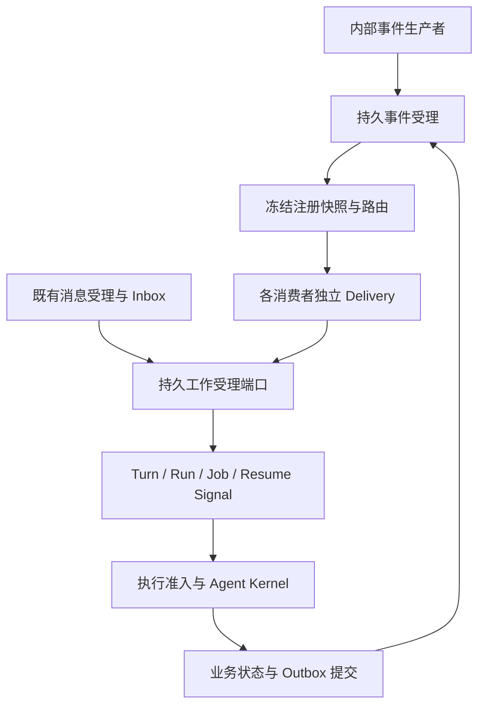

# ADR-098 Core 事件驱动与严格分层基础设施

## 1. 范围与依据

**Pudding 的基础执行模型是事件和消息驱动：输入被可靠受理后，按注册关系形成工作，由执行状态变化继续推进；Agent 心跳不是派发、续行或恢复的必要条件。** 本 ADR 状态为 Proposed，规定后续施工基线，不表示相应代码已经交付。

范围限于 PuddingAgent 自身：事件受理、订阅注册、队列保护、执行交接、提交后事件和 Hook 边界。外部客户端、协议接入、第三方平台、动态插件加载和新管理前端不在本期范围。内部事件生产者与测试替身足以完成验收。

遵循 [README](../../README.md) 的状态/事件/Effect 模型，以及[组件化交付规程](../10_conventions/组件化交付规程.md)。产品 Core 指整个后端进程，`PuddingCore` 只是现存共享程序集；不能把它的名称当成严格内核边界。

[审阅报告](../14_reports/2026-10-18-Core严格分层与Hook架构审阅.md)已定位：通用事件队列的生产 Dispatcher 未启用；订阅工具未接入派发；普通重投会重新激活终态记录；扇出按整事件重试；旧处理器直接运行 Agent Loop。消息 Fabric 和 canonical Turn 已有可复用的持久基础。

本 ADR 细化并优先于[内部事件概要](../12_features/Pudding内部事件受理与调度基础设施设计-2026-10-18.md)中的未定细节。既有[生命周期 Hook 代码设计](../12_features/Agent生命周期与Hook管道代码设计-2026-10-09.md)继续拥有 Agent 操作级扩展点；本 ADR 将可靠事件信封和投递持久化归入独立 Eventing 组件，普通 ObserverMailbox 不承担必需工作的可靠投递。

## 2. 决策

### D1 一个可靠受理模型，保留消息与事件各自语义

事件表示事实；消息表示有收发身份和内容的通信；命令表示执行意图；Hook 治理当前操作；领域事件记录已提交状态。消息通知不必启动模型，结构化事件也不必转换成用户聊天文本。

既有 Message Fabric 保持其存储与处理模式，不复制到通用事件队列。两者在**持久工作受理端口**会合，统一幂等、取消、预算与执行准入。一个业务动作只能有一个活动派发 owner；不能同时从旧 handler 和新消费者启动两次。

### D2 编译边界与运行时责任分开约束

新增叶子合同不引用现有 `PuddingCore`、Runtime、Host 或 Platform。应用协调器仅依赖内层合同；SQLite 和执行适配器实现内层端口。Host 只装配和监督，不放路由、去重或业务状态机。

| 目标组件 | 允许的项目引用 | 负责 |
|---|---|---|
| PuddingEventing.Contracts | 无 | 事件、注册、投递、工作回执与存储端口 |
| PuddingAgentKernel.Contracts | 无 | 既定 Hook 合同及通用类型化管道端口 |
| PuddingInvocationPipeline | AgentKernel.Contracts | 注册快照、Hook 顺序、超时/失败、一次 continuation |
| PuddingEventing | Eventing.Contracts、AgentKernel.Contracts | 受理、纯路由、状态规则、有限投递协调；经接口调用 Hook |
| PuddingEventing.Sqlite | Eventing.Contracts | 事务、唯一约束、配额、租约、恢复与查询 |
| PuddingEventing.Hosting | Eventing、Eventing.Contracts | 托管生命周期、配置文件适配、唤醒与有界恢复；不负责业务 |
| 既有 Platform/Runtime 中的执行适配器 | Eventing.Contracts 与所属域合同 | 对接已交付的 Turn、Run、Job；不反向引用 Eventing 实现 |

程序集缺少外层引用使越层类型调用无法编译；MSBuild allowlist 同时禁止通过新增 ProjectReference、Reference 或 FrameworkReference 绕过边界。独立测试只直接引用被测组件，传递依赖闭包也必须通过门禁。接口不得泄漏 DbContext、IServiceProvider、HTTP 类型或具体 Agent 服务。

目标 Agent Kernel 只依赖 AgentKernel.Contracts，通过 `IHookPipeline` 端口使用管道；不再直接引用管道实现。该方向细化既有 Hook 方案中的 Kernel→Pipeline 关系。本期不整体搬迁 7000 多行 Loop；先完成统一行为门禁，再按独立切片收敛。

### D3 成功回执必须对应持久事实

`Accepted` 和 `Duplicate` 返回持久 ReceiptId；`Rejected` 和 `RetryLater` 明确未受理。内存发布成功不等于受理成功。工作区和生产者身份由可信入口注入，不采信 payload 自报身份。

第一期采用**有界同步路由与同事务扇出**：注册快照读取、纯路由在事务外完成；提交时以快照 head CAS 校验，在一个短事务写 Inbox、冻结路由和所有 Delivery，并扣除配额。单事件最多 64 个消费者，超出在受理前拒绝。与概要中“先受理、随后异步路由”的可选设计相比，这个选择减少中间状态，并保证成功回执对应完整投递义务。

注册变化导致 CAS 冲突时最多重新准备 3 次，随后返回 RetryLater。Hook 不在事务内运行；准入 Hook 必须无副作用。幂等命中优先返回原回执，不重新执行路由或 Hook。

### D4 订阅是可检查的版本化注册

注册必须声明 ID、owner、workspace、事件类型与 schema、受限过滤器、目标能力及合同 hash、分区、重试/预算和输入映射。禁止注册任意脚本、委托持久化或通过容器动态查找业务实现。

内置声明由代码提供；用户长期订阅的期望配置写配置文件。激活后的不可变注册快照与 head 保存为数据库运行事实，受理回执引用其 Revision。工具只有在激活成功后才返回 Active；重启从期望配置协调恢复。旧快照及目标实现版本保留到关联投递完成，无法提供旧实现时显式 Suspended，不能偷偷换实现。

订阅路由是事实到后续工作的关系；Hook 注册是操作内部的接缝。两者使用一致的 owner、scope、版本与生命周期规则，但不是同一个回调列表。

### D5 每个消费者独立投递，工作执行单独记账

唯一键为工作区、ReceiptId、SubscriptionId 与注册版本。消费者 A 成功、B 失败，只重试 B。已完成 Delivery 不因同一事件再次提交而恢复 Pending。显式重放必须产生 ReplayId，保留 OriginalReceiptId；不能重置原账本。

Delivery 成功表示目标已持久接受工作。它不表示模型已经结束，更不表示所有后续义务 settled。后续运行状态由工作 owner 保存，通过事件/投影关联，队列不得长时间等待 Agent 完整输出。

目标受理使用稳定 CommandId 和输入 hash；同 ID 同输入返回原 Turn/Run/Job，异输入拒绝。跨数据库采用至少一次投递与目标去重，不引入分布式事务，不宣称任意外部副作用 exactly-once。

### D6 队列保护、顺序和恢复是内建不变量

受理设置记录数、载荷字节和 fan-out 配额；内存只保存有界唤醒提示，不保存唯一工作事实。按 workspace 和业务分区调度，不同分区有限并发，同一会话交给正式执行准入。

分区顺序默认是**目标受理顺序**；如需业务完成顺序，由工作流边或目标执行租约约束。Busy 表示 Deferred，不消耗业务失败重试预算。按优先级轮转并保留低优先级服务机会，不能让一个长任务占据全局出队循环。

领取、续租、确认、重试、取消都校验 owner/fence。租约过期后迟到结果不能改写账本。取消和提交具有明确线性化点；已经目标受理的工作通过目标取消端口处理，不能把本地 Delivery 改成 Cancelled 后宣称副作用已撤回。

事件提交信号负责低延迟，启动扫描、到期重试和租约回收负责恢复。**不注册 HeartbeatOrchestrator 的测试宿主仍须处理事件与消息。** 无待办时不得为了发现工作调用 LLM。

### D7 状态与 Outbox 在所属域同事务提交

事件库使用独立的 `pudding_events.db`，路径由 Host 从 DataRoot 路径服务计算并注入。领域状态仍在原数据库，其 outbox 必须和状态使用同一个连接及事务。不得先更新业务再异步“补写 outbox”。

源域桥只读取其持久 outbox，向事件受理端口提交；收到 Accepted/Duplicate 才确认源记录。Task/Goal 等已有 outbox 逐域审查并复用，禁止两个桥消费同一义务。无法原子化的内存事实不能宣传为可靠领域事件。

### D8 Hook 治理扩展，持久义务使用注册消费者

复用 `PuddingInvocationPipeline` 的类型化 Guard/Transform/Around/Observer：确定顺序、拒绝单调、独立 deadline、取消传播、声明失败策略。必需准入失败须阻断；可选观察错误不能改写已提交结果。

事件受理和路由仅开放无副作用的 Guard/投递视图变换；身份、幂等键、配额和 fence 不可由 Hook 修改。投递 around 只包裹**持久受理调用**，不可把模型执行塞进调度线程。必须完成的记忆维护、归档等注册成持久消费者，不使用可丢弃 ObserverMailbox。

Agent 侧先用共同场景锁定 Buffered/Streaming 的 Hook 一致性，再统一执行接缝。新增增强通过注册参与；Kernel 直接调用模型/工具的强类型端口仍是合法分层，不强迫基础函数调用经过事件总线。

### D9 分期替换，始终只有一个生产执行 owner

每个新组件按 S1–S4 独立交付；到 S5 才修改宿主引用、解决方案和 DI。先用内部事件驱动 fake 持久执行器，再对接已有 Turn/Run/Job。新入口与旧路径在同一切换单元改写；不以双跑 Agent 验证正确性。

旧队列记录在切换前盘点，已确认待办必须逐条导入或明确暂停并保留，不默默删除。导入是一次性、有收据的工具，不引入永久兼容读取层。切换后只回退到能读取新持久账本的版本；不兼容时停止领取、保留数据并向前修复。

## 3. 替代方案与代价

| 方案 | 取舍 |
|---|---|
| 直接启用旧 EventDispatcher | 不采纳；无法修复受理窗口、订阅断线、整事件重试与 Loop 越层 |
| 所有输入转换为聊天消息 | 不采纳；丢失结构化事件、通知与恢复信号语义 |
| 依赖 Heartbeat 扫描并让 Agent 判断待办 | 不采纳；延迟、模型开销和恢复正确性与心跳耦合 |
| 全部写一个全局 EventBus | 不采纳；把实时流、可靠义务、同步 Hook 混在一起 |
| 本期引入外部 Broker 或分布式事务 | 不采纳；当前本地 Core 用 SQLite 与目标幂等即可完成边界 |
| 本期整体替换 Message Fabric 和 Agent Loop | 不采纳；保留现有受理资产，逐能力接入并保证单 owner |

代价是增加独立组件、注册版本管理、持久投递记录和故障测试。收益是新增内部消费者不修改中央 Loop，生产接线可验证，丢失唤醒、重启和消费者失败都不再依赖心跳补救。

## 4. 完成判据

独立组件边界门禁、真实 SQLite 故障与竞争测试、真实 Host 组合测试全部通过；关闭 Agent 心跳仍可完成内部事件/消息→工作受理→执行→提交后消费。重复投递不重复创建工作，消费者失败互不连带，旧 fence 无法提交，停机/重启可恢复已确认义务。Hook 在流式与非流式主路径的顺序、阻断、取消和终态一致。

逐项目、逐文件、接口、数据表、阶段步骤与验收矩阵见[施工与代码设计](../12_features/Core事件驱动基础设施施工与代码设计-2026-10-18.md)。
