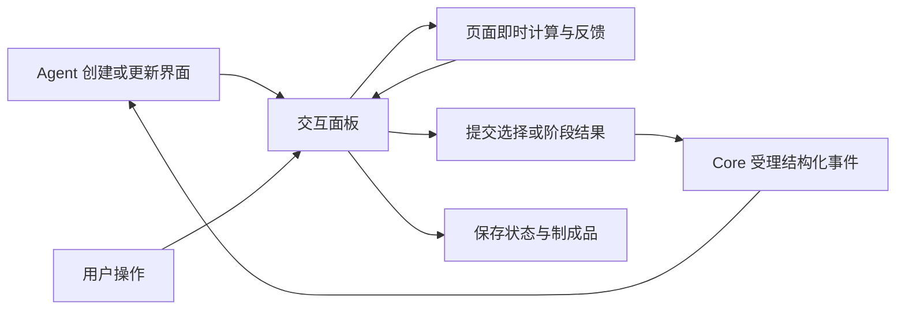

# ADR-099：Agent 驱动的通用交互面板与制成品归属

状态：**Proposed（审阅建议，未替代已接受的架构裁定，不代表已经实现）。**

## 1. 产品目标与适用范围

**产品目标：为用户提供由 Agent 完整编排的可交互区域，让用户直观看到、动手探索并参与实际设计。** Agent 根据任务决定界面布局、内容、控件、演示步骤和交互逻辑，并根据用户反馈持续修改界面。用户可以在面板内完成一段工作，聊天作为可选的解释和补充入口。

该产品方向来自用户明确要求；本 ADR 的协议、组件与施工方案仍为 Proposed。图片编辑与制品管理是通用面板的一种应用，通用能力必须包含可运行的 HTML/CSS/JavaScript、自定义交互和双向反馈。预置图片编辑器、表单或图表组件可供 Agent 复用，不能成为界面表达能力的上限。

| 场景 | Agent 提供 | 用户直接参与 |
|---|---|---|
| 方案设计 | 可切换的布局、配色、原型与比较视图 | 选择方案、拖动元素、圈出修改区域 |
| 参数探索 | 滑块、图表与计算/模拟逻辑 | 调整参数，即时观察结果，把选定状态交给 Agent 深化 |
| 分步演示 | 动画、流程图、说明和演示进度 | 播放/暂停、前后切换、展开细节、指定不理解的一步 |
| 共同编辑 | 图片、文本、表格或画布及对应工具 | 修改内容、标注、撤销、保存或继续迭代 |

完整体验闭环：



关键约束服务于这个闭环：

1. Shell 的文件系统能力不等于制成品业务归 Shell。保存、血缘、引用保护、删除和回收属于业务规则，遵守 [Shell / Web / Core 裁定](../12_features/ADR-Desktop-Shell-WebUI-Separate-Core-2026-09-29.md)。
2. Agent 发布的界面、用户正在操作的状态、模型生成版本和长期资产有不同生命周期，不能只用 `panelId + latest revision` 代替。
3. 一张图片一旦进入对话或被制成品引用，就不能按“最近 50 张临时文件”淘汰。图片事实沿用 [ADR-077](92ADR-077主代理原生视觉理解与多模态消息链路ADR.md) 的 Workspace Artifact 与 typed image parts。

代码事实与复现证据放在[审阅报告](../14_reports/2026-10-20-交互面板设计与代码审阅.md)，本文定义目标决策。

## 2. 责任归属

| 层 | 职责 | 不承担 |
|---|---|---|
| WinUI Shell | 工具区 tab、窗口与焦点、隔离 WebView2、文件选择/导出、用户动作的受控转发 | 制成品目录扫描与业务写入、资产引用计数、垃圾回收、模型提示词业务编排 |
| Agent | 编写/更新 HTML、样式和脚本，定义控件与动作，读取交互结果，决定下一步演示或设计 | 替用户隐式放弃输入、把页面自报数据当作额外权限 |
| 可信面板运行时（Web） | 承载生成页面、SDK/消息校验、资源代理、状态持久化适配、加载/失败/恢复与资产入口 | 固定每个任务的布局和业务控件、向生成页面交出登录凭据 |
| Core | 工作区/会话授权、面板状态与事件、Agent 调度、Artifact/制成品元数据与生命周期 | 依赖 WinUI 控件或 DOM |
| Agent 生成页面（隔离执行） | 自定义界面、脚本计算、动画、输入处理、本地状态；经 SDK 提交事件和使用已授予能力 | 直接取得登录态、通用 Shell 桥、控制令牌及任意本机资源 |

Desktop 工具区的外观和多 tab 容器可保留，内部承载可信面板运行时及 Agent 页面。前端 `SideArtifactPanel` 与 Desktop tab 是两种宿主表面，共享 Core 面板/资产服务；Agent 控制面板内的体验，运行时处理通用机制。

Core 存储仍可采用本地目录与 JSON，便于备份；“存本地”与“通过 Core 服务写入”并不冲突。Core 不可用时，Shell 继续提供启动修复；已下载文件可打开，业务保存明确显示不可用并保留草稿。

### 2.1 Agent 控制面与页面运行时

目标控制面覆盖创建/呈现、发现/读取、更新界面或状态、接收交互结果、保存/恢复及关闭。沿用现有面板工具的可复用部分；新增操作名称与 DTO 需要在独立组件中冻结，不能把下面的目标能力当成已有工具。

- 内容可采用自包含 HTML，复杂场景可扩展为入口 HTML + 受控资源包。允许脚本、SVG、Canvas、自定义组件与样式；组件模板只是便利入口。
- Agent 更新区分“界面版本更新”和“状态更新”。状态更新不重载整个 WebView2；替换界面前保存用户状态并核对 `expectedRevision`，不相容时保留旧分支并提示。
- Agent 可以读到已受理的选择、参数、表单与自定义状态，以及版本/错误摘要。只读取 HTML 源码无法代表用户操作结果；大对象通过 Artifact 引用获取。
- 面板提供加载、就绪、处理、失败与恢复状态。普通更新保留用户焦点与滚动位置；持续动画/进度使用页面脚本或数据更新，不靠高频整页替换。
- 用户始终可暂停 Agent 更新、关闭或恢复面板；页面脚本失效时运行时仍有恢复入口。Agent 对区域的完整控制包含内容和交互编排，用户对当前工作保有最终控制。

### 2.2 双向事件：用户直接在面板中推进任务

**新增受控 Panel SDK 双向通道是核心能力。** 原方案“只能由 Shell 拉取、页面一律不能发消息”的限制不足以支持任意表单、按钮与演示交互。SDK 允许页面发送类型化请求，经可信运行时转交 Core；不开放通用 native bridge。

| 动作 | 执行位置 | 是否调用 Agent |
|---|---|---|
| 滑块拖动、排序、动画播放、局部计算、视图切换 | Agent 编写的页面脚本 | 默认不调用，即时反馈 |
| 草稿检查点、滚动位置、参数状态保存 | 运行时 → Core | 不调用，只保存状态 |
| “采用此方案”“按当前参数优化”“继续下一步” | SDK → Core → 原 Agent 会话 | 有意义的提交触发一次处理；用户无需复制到聊天框 |
| 读取资源、导入/导出、生成图片等能力请求 | SDK → 可信运行时/Core → 既有能力入口 | 按需要处理；复用已有授权与执行规则 |

Agent 在面板清单中声明 action ID、载荷 schema、处理模式和所需能力。样式与布局由 Agent 自由生成，宿主只校验通用合同。面板内普通选择、编辑和提交沿用用户当前任务授权，不增加逐按钮确认；有外部副作用的动作继续走已有工具授权规则。

事件信封至少包含协议版本、`eventId / panelId / documentRevision / stateRevision / actionId / payload`。`workspaceId / conversationId / agentId / surfaceInstanceId` 由可信运行时与 Core 会话绑定补齐，不采信页面自报归属。运行时绑定具体表面与导航世代，校验 action/schema、数据预算和频率；不用通配消息接收代替来源绑定。

Core 持久受理后才 ACK；相同 `eventId` 与相同载荷重试复用结果，不同载荷冲突拒绝。旧页面世代、旧 action 定义或不相容 revision 返回明确冲突。Agent 忙碌时按既有会话调度排队或定向 steering，不能为每个事件并发启动一个修改同一状态的执行；界面展示排队/处理中与取消反馈。

页面自定义 JSON 作为有明确来源的交互数据进入 Agent 上下文，不伪装成用户新发的高权限指令；页面脚本自报“用户点击”不能扩大授权。普通本地交互不进入完整聊天转录；阶段提交与结果可在聊天中留简短可追溯摘要，操作仍在面板内完成。

### 2.3 通用状态与制成品

持久记录包括界面源码/资源清单、协议与运行时版本、应用 `stateSchemaVersion`、最新状态检查点、未完成提交和派生资产引用；不试图序列化任意 JS 堆对象。Agent 页面通过 SDK 显式导入/导出 JSON 状态，恢复失败时保留旧快照并报告原因。

交互式 HTML 本身可以成为制成品：保存入口、脚本/样式、资源引用和选定状态，重开后仍能继续交互。浏览器独立导出须另行处理资源打包与在线能力降级。图片、文档和交互应用共用收藏身份、来源和引用生命周期，类型专用保存器分别实现；不能把 HTML 截图当作交互制成品已完成。

## 3. 图片场景的 D1：复用可信工作台登录态

### 3.1 选定方向 A0

**图片附件首选 A0：由可信 Web 工作台/面板运行时复用现有图片上传和 typed parts 链路。** 这是图片场景的接入方案；通用面板事件按 §2.2 直接提交，不要求经过聊天输入框。

Desktop 已有生命周期/Bridge ControlToken；它不是现有 `[Authorize]` 业务 API 的 JWT。这个事实不能推导出应该扩大 ControlToken 权限，也不需要把用户 JWT 复制进 `desktop.json`。

“添加到对话”的最小接入流程（准备与发送分开）：

```text
用户在可信工具栏点击“添加到对话”
  → 固定来源图片、编辑草稿版本与目标会话，生成不可变提交快照
  → Shell 受控读取/转发有界图片数据和提交描述
  → 可信工作台验收提交身份，放入当前目标会话的附件草稿
  → 复用 uploadVisionArtifact 和 Core 图片校验
  → 得到 vision-*，保存带 typed image parts 和编辑描述的附件草稿及资源引用
  → 展示“已添加”，等待用户发送
用户在对话中发送
  → Core 持久受理消息及资产引用
  → 展示“已发送”
```

当前 `IntentConsole` 已有附件上传与 `onSendWithMetadata(..., imageParts)`，需要把可复用上传/附件服务抽到输入框和面板运行时共同调用的位置，补齐结构化接线、确认与失败恢复。图片面板可直接提供“生成修改版”，经同一上传服务和面板事件触发处理；“添加到对话”保留为另一种可选动作。Agent 页面只接触 SDK，不持有业务 JWT 或通用宿主桥。

具体要求：

- 受理方校验 `workspaceId / conversationId / editSessionId / submissionId / baseRevision`，不以点击完成时“当前正好打开的会话”替换原目标。目标切换时保留原草稿并提示。
- 上传前验证登录主体对工作区及会话的权限；工作区存在不等于有权写入。资源读取也须按主体授权。
- 转发目标限定可信工作台及其当前加载世代，禁止导航后向未知页面继续发数据。
- 图片 MIME、实际字节、像素数、解码后尺寸、标注数/轨迹点数和总字节上限由 Core 校验。路径不是上传权限。
- 传输实现必须有实测预算与失败码。1536 最长边/JPEG 是可选预览策略，不能替代字节预算，也不能作为 WebView2 固定容量保证。
- “添加到对话”只准备附件草稿，不自动发起模型调用。前端确认已接收草稿后才显示“已添加”；服务端持久受理后才显示“已发送”。

### 3.2 备选方案

| 方案 | 裁决 | 原因 |
|---|---|---|
| A0 可信 Web 登录态上传 | 首选 | 复用已有图片附件链路，避免新增长期凭据和第二套上传业务 |
| A1 Desktop 受限凭据 | 仅在明确需要脱离工作台的原生上传时采用 | 需要新增签发/撤销/作用域检查；当前代码没有这样的凭据 |
| A2 自制时间戳 + HMAC | 不采用 | 密钥仍需管理，还要处理重放、时钟与请求体绑定；当前需求没有新增协议的收益 |
| A3 匿名写入口 | 不采用 | 本机 UI 不能替代请求鉴权，且现有宿主可能有网络监听 |
| Desktop 直接写 vision 目录 | 不采用 | 绕过图片检查、幂等、Workspace 归属和引用生命周期 |

若后续采用 A1：通过已有受认证控制通道引导，签发仅内存保存、短期有效的 capability，绑定 Desktop/Core 连接世代、工作区、会话和允许动作；只在专用端点验证，限制请求体和频率，拒绝跨工作区、过期与重放。凭据不进入 HTML、前端存储、URL、环境变量、日志或诊断包；不把 ControlToken 加成普通业务 API 的通用认证方案。

## 4. 图片编辑专用状态与提交合同

### 4.1 分开四种身份

| 身份 | 含义 | 规则 |
|---|---|---|
| `panelId` | 一块展示表面 | 必须在工作区/会话范围内解析；不能从图片 ID 前 8 位充当全局唯一键 |
| `editSessionId` | 一次可恢复的编辑分支 | Core 创建完整随机 ID；同源可开多个分支 |
| `baseArtifactId + baseRevision` | 用户实际编辑的基图与发布版本 | 开始编辑时固定，提交时校验 |
| `draftRevision / submissionId` | 笔迹草稿版本与一次提交 | 草稿单调递增；提交 ID 幂等，同 ID 不同内容拒绝 |

服务端从可信执行上下文导出 owner 和工作区，不接受 HTML 自报归属。现有 `render_panel` 默认 `main` 的全局命名要在持久化、读取、推送、tab 与附件插入各段同时收口。

### 4.2 状态转移

```text
Clean → Dirty → Preparing → AttachmentReady → Submitted
           ↘ Failed（保留完整草稿，允许重试）
```

- 编辑图元持有稳定 ID、原始几何、文本与样式；涂鸦保存完整轨迹。坐标使用原图像素或连续的 0–1 坐标，显示时做视图变换。
- `<point>/<bbox>` 的 0–999 整数只是模型适配层投影；涂鸦降维为 bbox 不能覆盖编辑源数据。
- 拖拽分隔条、窗口缩放、DPI 变化与适应宽度只改变视图矩阵。点、框、箭头、文字、轨迹在预览和合成中使用同一几何定义。
- 当前草稿 `Dirty` 时收到新生成版本，显示“新版本可用”，允许另开分支或显式替换；禁止直接 `NavigateToString` 丢弃草稿。
- 关闭 tab 前持久保存草稿或显式放弃；tab 隐藏不等于关闭。重启后可恢复草稿与基图身份。
- `take()` 和 `compose()` 必须来自一次不可变快照，返回一致的 `draftRevision / baseArtifactId / imageHash`。基图改变、操作仍未落笔或版本不一致时拒绝提交。
- 图元超限、合成失败、上传失败、工作台未接收必须区分，禁止自动退回“无标注的画布引用”并显示成功。

### 4.3 模型输入

默认把带笔迹图作为唯一编辑参考，附明确的自然语言指令（例如移除标记线条）；坐标可作为同一张参考图的辅助定位。需要原图与标记图共同参考时，用有序 `referenceArtifactIds` 和角色映射明确“图一/图二”，不能同时列两个路径再让模型猜。

模型生成结果继续登记为 `vision-*`，再发布到指定编辑会话；生成失败保留原图与草稿。`craftId` 是资产收藏身份，继续编辑时由 Core 解析为对应的 Artifact，不让工具把 `craft-*` 当 `vision-*` 使用。

## 5. 制成品语义与图片保存规则

**制成品是用户显式收藏的可恢复版本，类型可为图片、文档或交互应用。** 以下细化图片类型：标注草稿作为编辑指令单独保存；交互应用的收藏合同见 §2.3。

- “保存到制品库”保存所选生成结果，默认不把临时标记烧进最终成品。若有标注，标明“保存原图；标注另存为编辑草稿”；用户可另选“导出标记图”。
- 保存自动使用来源标题与用户版本号，允许事后改名；不强制弹窗命名（D3）。
- `craftId` 使用完整随机身份，文件创建采用不覆盖语义，保存有幂等键。原始图片内容不可变；重命名只改元数据。
- 元数据至少含 `schemaVersion / workspaceId / craftId / title / artifactId / contentHash / createdAt / parentCraftId / sourceArtifactId / editSessionId / generationMetadata`。未知来源显式缺省，不能把预留字段存在写成“血缘已接通”。
- “继续编辑”基于保存的 Artifact 创建或恢复编辑会话，正确设置父制成品；恢复草稿时回放全部图元。
- 内容去重由 Core 的不可变资源存储与引用保护实现。先实现引用保护，再开启跨制成品共享字节；不能一边共享文件一边按单件制成品直接移动图片。
- JSON 与图片写入有提交点：先写并校验临时内容，再原子发布元数据。失败不返回成功，残留进入可识别 staging，不与已提交资产混淆。
- 读入磁盘 JSON 时重新验证 ID、文件名、相对路径、大小、尺寸及哈希。库外路径、`..`、绝对路径、重解析点越界均拒绝；删除不能使用 JSON 中未经验证的文件路径。
- 保存/改名/删除成功后失效对应工作区列表缓存；列表支持分页/虚拟化与缩略图，不能每张图加载一个无界原图。

## 6. D2：按引用保护资产，对临时缓存设上限

**选择有界临时缓存，但否决把所有烧录图统一裁成最近 50 张。**

| 类型 | 保留规则 |
|---|---|
| 未上传、未引用的临时合成文件 | 建议初始上限：最多 50 张、总计 128 MiB、最长 24 小时；三个约束同时满足，按最老优先回收 |
| 正在提交/上传的文件 | 操作租约保护；取消或失败后释放，进入临时缓存规则；崩溃租约到期后由 Core 恢复清理 |
| 已成功登记的上传临时副本 | 得到可解析 Artifact 和提交回执后即可删除重复临时字节 |
| 会话消息、待发送附件、编辑草稿、制成品引用的 Artifact | 被引用期间不按 N/TTL 删除；引用未知时保留并告警 |
| 已删除制成品 | 墓碑/回收站保留 7 天，可恢复；到期仅释放该制成品的引用，仍被其他对象引用的图片保留 |

50、128 MiB、24 小时是建议的可配置初值，后续按实测调整。活跃引用不受缓存淘汰影响；总空间到硬上限时拒绝新的写入并提示整理，不能以“清理缓存”为由删除用户资产。

清理由 Core 的唯一存储维护入口调度，沿用 [ADR-076](91ADR-076遥测与调试数据保留及Core存储管理ADR.md) 的单写入者原则；不在打开列表时隐式承担唯一清理职责。引用登记/释放与 GC 互斥或使用租约；未知目录不自动接管。存量 `panel-marks` 中可能已被文本路径引用的文件，先盘点与用户清理，不直接套新 TTL。

## 7. UI 与其余待决项

| 项目 | 建议 |
|---|---|
| 工具栏 | 宿主只保留关闭、恢复、权限/状态等通用控件；任务工具条由 Agent 生成或复用组件。图片工具组是可选组件，不能固定到所有面板 |
| D4 HTML 制成品 | HTML/JS 交互及其保存恢复纳入通用面板主线；独立浏览器离线导出可后续完善，不影响应用内交互和收藏 |
| D5 编辑序号 | 可显示用户版本号和未保存点；服务端 `revision` 只用于一致性，在详情中查看，不能把每次刷新计为一轮模型编辑 |
| D6 两个制成品入口 | 一个 Core 资产源、多个视图；分阶段接入，同一 ID 与权限语义，避免互相复制资产库 |
| 多图 | 显式选择目标 Artifact，不依据 DOM 中面积最大的图片猜测；未选择时禁用标注/提交 |
| 下载 | 按成品类型提供操作：图片原图/标记图、文档、交互应用包；未实现的导出能力明确不可用，应用内保存仍有独立合同 |
| 可访问性 | 工具有文字/快捷键提示、键盘操作与焦点状态；缩放不改变标注语义，提交有进行中/失败/可重试状态 |

## 8. 组件与交付顺序

建议新增独立面板领域组件（项目名在施工前登记），持有发布版本、状态检查点、交互事件/动作合同、会话归属及资产引用纯规则，通过端口访问存储/时钟；不引用 Desktop、Host 或 Platform。通用 Web 运行时/SDK 先独立验证消息来源、状态更新和脚本运行；图片编辑作为一个应用验证几何与合成。Core 适配器复用已有调度、工具与存储，Foundation 保持 Shell 展示与边界适配职责。

遵守[组件化交付规程](../10_conventions/组件化交付规程.md) S1–S5：先独立工程与测试、依赖边界和故障用例，再接入解决方案、宿主与 DI。抽取与行为修复分开提交，未通过组件门禁不改宿主装配。

建议实施顺序：

1. 修复误删与路径越界、未保存覆盖和失败伪成功，保护现有用户工作。
2. 独立验证通用 Panel SDK、版本化状态、事件受理与会话调度合同；按 S1–S5 接通“Agent 发布 → 用户操作 → Agent 更新”。
3. 用参数模拟、方案比较和分步演示验证通用性，支持自定义 HTML/JS 与可恢复状态；不以图片上传作为这些场景的前置门禁。
4. 接入交互式 HTML 制成品保存/重开与资产引用；让保存的应用保持交互能力。
5. 以图片编辑验证专用图元、A0 上传、typed parts 和生成结果回写；补齐制品库与清理，完善独立导出。

产品验收至少包含三条可见链路：拖动参数时本地立即改变图表，点击“按此优化”后 Agent 直接回写面板；在多方案中选择并修改偏好，Agent 更新对应方案且保留当前选择；保存带步骤/参数的 HTML 演示，关闭再打开可继续操作。上述任务都不要求用户把控件结果重新键入聊天。

协议验收覆盖本地高频交互不逐次调用模型、ACK 丢失重试不重复执行、旧页面事件拒绝、用户暂停更新可用、脚本失败可恢复，以及两个工作区/会话互不串写。图片与存储验收继续覆盖：刷新/关闭/重启恢复，五类图元缩放一致，数量/字节预算与路径拒绝，部分写入/GC 竞态不丢资产。像素与真实 WebView2 检验不能用脚本字符串断言代替。

部署采用隔离输出、独立 DataRoot 的两段式验收：外部控制器确认加载新构建，内部新会话完成真实模型功能 smoke，生命周期结论仍由外部判定。
