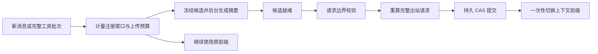

# 前缀缓存友好的会话压缩

## 设计边界

原始转录是持久事实，模型上下文是可替换的工作视图。摘要会损失细节，因此完整原文、覆盖清单、工具产物引用必须可回查。
容量与候选策略在只依赖 BCL 的 `PuddingContextPolicy`；Runtime 负责冻结输入、模型请求、执行锁与事务；Core 定义配置、状态和协议身份；Web 只展示服务端事实。



## 阈值与触发

`<DataRoot>/config/runtime.execution.json` 的 `contextCompaction` 是自动执行路径的配置入口：

```json
{
  "contextCompaction": {
    "prepareRatio": 0.60,
    "commitRatio": 0.65,
    "blockingRatio": 0.70,
    "targetRatio": 0.45,
    "minimumEpochRounds": 4,
    "uploadBlockingRatio": 0.95
  }
}
```

配置在 Core 启动后读取并缓存；修改后重启 Core。比例必须有序，非法组恢复默认；不含固定的模型 token 数量。

| 时机 | 行为 |
|---|---|
| 注册窗口 A 的 60% | 后台生成候选，当前请求继续，历史前缀不变 |
| A 的 65% | 下一个请求边界采用已就绪候选；未就绪则继续准备 |
| A 的 70% | 等待压缩完成，验证通过前不发下一次模型请求 |
| 压缩目标 | 约 A 的 45%，受到当前输入、最近完整单元、系统提示及工具定义的下限约束 |
| 终态后的空闲期 | 使用同一配置的 65% 阈值做可选维护；新前台需求可取消维护 |

A 来自当前 `LlmConfig.MaxContextTokens`（服务商模型注册的冻结快照）。切换模型立即使用对应容量；输入硬上限另取输出预留、安全余量、Provider 输入上限、WorkUnit 容量的约束。增长预测若表明下一轮会超过实际容量，也提前等待。

**上传预算是另一条轴。** DeepSeek Responses 当前有 512 KiB 的客户端保守文本预算，包含工具定义、系统提示、推理与续传载荷，不是 DeepSeek 官方窗口或请求大小限制。该轴在 60% 准备、65% 采用就绪候选、默认 95% 等待；硬上限始终阻止发送。不能把“70% 模型 token 窗口”误解为“70% 字节预算”：被保护的完整工具批次可能超过后者但仍可安全上传。大窗口下，字节预算可能先触发，这会限制实际能用到的 token 数量。

## 缓存与微压缩

DeepSeek 按共同前缀复用缓存。准备候选不修改请求前缀；正常轮次只追加已完成的新记录。系统提示、工具定义和现有 checkpoint 在同一代内保持稳定；模型或工具集合改变会让不适用的候选失效。[DeepSeek 缓存文档](https://api-docs.deepseek.com/zh-cn/guides/kv_cache/)

微压缩放在**新工具结果进入上下文时**：短结果原样保留；大结果保存完整文件和带 SHA-256 的 manifest，只注入有 UTF-8 字节上限的首尾预览及 `file_read` 引用。已经发送的历史不逐轮缩写或重排；原生 reasoning/function_call 也不能独立截断。

语义压缩会改变 checkpoint 之后的前缀，必然有缓存重新建立的成本。目标回落与至少四轮的可选维护冷却减少频繁切换；70% 容量保护和硬上限可以越过冷却。评估效果要同时看已记账的缓存命中 token、压缩调用成本、首块延迟、请求字节及提交频率，不能只看压缩比。这里的微压缩是本项目的入口限幅算法，不宣称复刻 Codex 未公开的内部算法。

## 并发与提交

每个执行只有一个候选，拥有独立的取消令牌和五分钟准备超时。准备阶段只访问冻结列表，不持有提交锁，不写当前请求估算槽位。达到同步阈值时，前台只等待候选；不取消已完成工具，也不允许新 LLM 请求越过门禁。

用户新消息继续走既有接收、排队、取消或插话通道。提交只能发生在完整工具批次之后的请求边界。允许追加式适配的条件是**整个冻结历史逐位不变**且代次、路由、工具与策略一致；新增尾部全部保留，不进行正文相似匹配。任何删改、插入、重排或代次变化都拒绝候选。此显式追加模式是对先前严格 revision 模式的扩展；原严格校验仍保留。

在压缩提交租约内重新读取代次，校验来源身份，按当前出站信封和工具清单重新计量真实摘要；先持久提交摘要、覆盖清单与归档，再替换内存。失败保持原历史。代次冲突不能通过在旧内存上重试生成来绕过；工具变化或新尾部造成容量不足可重新生成一次。未使用的候选在执行结束或取消时取消并回收，不跨执行偷偷改写上下文。

## Responses 协议

应用摘要带显式 `IsContextSummary`，运行时逻辑角色为 Assistant，以免改变当前用户输入判定；网关投影为 user 背景。摘要不能冒充模型推理输出。原生模型输出项、`reasoning_text`、调用 ID 和结果配对保持原样，摘要只覆盖完整执行单元。DeepSeek Responses 为无状态接口，必须由 Harness 回传正确历史。[DeepSeek Responses 指南](https://api-docs.deepseek.com/zh-cn/guides/responses_api)

## UI 与诊断

前端分别展示后台准备、候选就绪、等待整理、保存检查点；消息输入仍可用。只有服务端确认活跃的候选才显示运行动画，断线后显示待确认，不让历史 started 事件无限旋转。只有持久提交成功才显示已整理。

失败现场含冻结来源指纹、请求形状、分段摘要输入与输出、真实前后体积、覆盖解析和提交结果；文件有脱敏、容量与保留期限限制。达到配置阈值而无法压缩时，错误报告给出注册窗口、比例、绝对触发 token、当前 token、字节与压缩原因。日志入口见[调试手册](../08_how_debuge/14-案例-调度与Token内核.md)。
