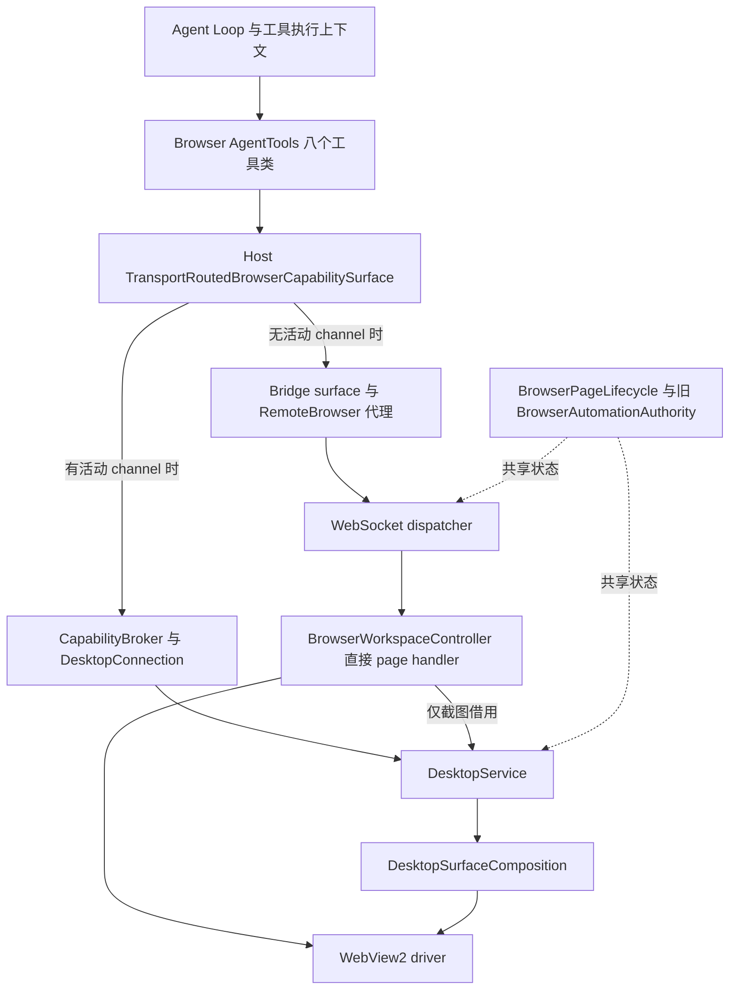

# 浏览器工具与浏览器控制能力——现有架构与一期实施入口

**一期目标是 Agent 在 PuddingDesktop 的真实浏览器中完成用户任务。** 下文描述现有代码结构，不把组件存在等同于产品可用。目标架构以 [ADR-097](111ADR-097Agent浏览器控制一期闭环与单一执行链ADR.md) 为准，施工依赖与验收见[一期方案](../12_features/Agent浏览器控制一期整体实施方案-2026-10-18.md)。

原快照的测试数字、R1–R6 状态、历史修复与复现命令移至[审阅报告](../14_reports/Agent浏览器控制架构与实现审阅-2026-10-18.md)，保留来源并限定证据范围；不能再将其概括为“只剩外部验收”。本页保留原文件名以维持既有引用。

## 1. 产品边界

- Core 子进程拥有 Agent Loop、工具、模型调用及工件存储；WinUI Shell 拥有窗口、浏览器表面和进程监督。
- `PuddingDesktop.WpfArchive/Browser` 的无 UI 源码由 WinUI 项目链接编译，因此它们仍属于生产调用链；WPF UI 不进入产品进程。
- 工具仅在 `DesktopChild && BrowserAutomationEnabled` 时注册。默认传输是认证 WebSocket Bridge；gRPC 能力通道可选开启。
- 用户的普通浏览器、Workbench 与 Agent WebView2 profile 分离；页面数据不是指令或授权来源。

## 2. 现有生产链路

图中 `DesktopService` 当前由能力通道组合根创建。**Bridge 普通页面操作与 channel 不是同一条执行管线**；截图又反向依赖 channel 的执行器。共享 lifecycle 不保证授权、排队复检和回执一致。

“不回退”的准确现状是：每次调用选择活动 channel 或 Bridge，已尝试的操作不跨传输重试；不是“只要配置启用 channel，Bridge 就不会被选择”。一期目标改为固定浏览器 Bridge 路由，同时将本地执行器与 channel 生命周期解耦。

## 3. 按层文件地图

| 层 | 当前入口 | 职责/限制 |
|---|---|---|
| 工具 | [AgentTools 地图](../../Source/PuddingBrowser.AgentTools/code_map.md) | 八个工具类、输入输出契约、调用身份作用域；canonical All 仍缺 screenshot |
| Core 组合根 | [BrowserBridgeServiceCollectionExtensions](../../Source/PuddingHost/BrowserBridge/BrowserBridgeServiceCollectionExtensions.cs) | 条件注册、路由、调用上下文、binding gate 与委派端口 |
| Host 代理 | [BridgeBrowserCapabilitySurface](../../Source/PuddingHost/BrowserBridge/BridgeBrowserCapabilitySurface.cs)、[RemoteBrowserPage](../../Source/PuddingHost/BrowserBridge/RemoteBrowserPage.cs) | typed capability 到旧 runtime/Bridge 命令映射；字段与结果尚有损失 |
| Bridge | [DesktopBrowserBridgeClient](../../Source/PuddingDesktop.WpfArchive/Browser/DesktopBrowserBridgeClient.cs)、[dispatcher](../../Source/PuddingDesktop.WpfArchive/Browser/BrowserBridgeCommandDispatcher.cs) | 握手/断连、期限、账本、当前的前置状态检查 |
| 页面 handler | [BrowserWorkspaceController](../../Source/PuddingDesktop.WpfArchive/Browser/BrowserWorkspaceController.cs) | UI 协调和 Agent 页面命令混在同一控制器；一期需拆开执行职责 |
| 执行/生命周期 | [DesktopService 地图](../../Source/Pudding.DesktopService/code_map.md) | channel 执行器、页面登记、旧权威、租约、任务绑定与命令账本 |
| 候选会话规则 | [Authorization 地图](../../Source/PuddingBrowser.Authorization/code_map.md) | 独立组件，无生产消费者；目标归属与票据竞态需先完善 |
| 驱动映射 | [BrowserRuntimeDesktopSurface](../../Source/Pudding.DesktopSurface.Browser/BrowserRuntimeDesktopSurface.cs) | 传 typed request 到 driver，channel 路径在此保留输入模式 |
| WinUI/driver | [WinUI 地图](../../Source/PuddingBrowser.WinUI/code_map.md)、[WebView2 地图](../../Source/PuddingBrowser.WebView2/code_map.md) | 共用驱动源码；策略经 Abstractions 注入，不能依据旧条件编译注释判断当前支持 |
| Shell 装配 | [MainWindow](../../Source/PuddingDesktop/MainWindow.xaml.cs)、[Capability 组合根](../../Source/PuddingDesktop/Hosting/DesktopApplicationCoordinator.Capability.cs) | 建浏览器、挂 handler、启动可选通道；截图执行器目前来自通道 |

## 4. 工具面与真实支持范围

| 工具 | 用途 | 当前需要留意的限制 |
|---|---|---|
| `browser_context` | context 发现与管理 | 元数据发现与创建/关闭属于不同准入动作；不能笼统称都已有 Manage 闭环 |
| `browser_tabs` | new/list/activate/close | list 经上下文读取；其余是管理或焦点副作用；两传输判据不宜混写 |
| `browser_navigate` | goto/back/forward/reload/stop | 写操作；Bridge 目前直接 controller handler |
| `browser_snapshot` | 有界快照、正文、ref | 默认 Bridge 暂停/接管时也被前置门拒绝 |
| `browser_locate` | ref 与语义/选择器定位 | 结果必须绑定目标/文档版本；不能动作后重查旧 Locator |
| `browser_interact` | 点击、输入、滚动等 | Bridge inputMode/scrollTarget 透传和真实回执需修；不能把请求 native 当实际 native |
| `browser_wait_for` | 有界条件等待 | 超时作为观察结果；支持条件必须以实际路径为准 |
| `browser_screenshot` | 截图、observationId、工件/图片部件 | 默认 Bridge 缺通道执行器会拒绝；canonical All 未包含它 |

上表是当前代码限制，不是一期允许永久保留的行为。下一版对用户承诺哪些动作，以[一期动作矩阵](../12_features/Agent浏览器控制一期整体实施方案-2026-10-18.md#4-一期工具与动作支持矩阵)为准。请求不支持的输入模式应明确拒绝，不能静默执行另一个后端。

## 5. 授权、控制与幂等的现状

旧模型包含可信 caller、Read/Write/Manage grant、控制/授权 epoch、写 lease 与任务 binding。channel 的 `DesktopService` 执行准入/复检/释放；Bridge dispatcher 则自行检查状态与 `HasSufficientPageGrant` 后直调 handler。

`BrowserPageLifecycle.HasSufficientPageGrant` 当前依次接受选中目标、连接世代在线或有效页级 grant。**在线分支绕过逐页 grant 判定**，不能据此声称已实现按调用者逐页撤权；也不能把选页作为所有 Bridge 调用的必要条件。连接/目标下发已经有生产调用点，旧文档中的“NotifyConnectionGeneration 生产零调用者”不再描述当前代码。

Bridge 当前暂停/接管门会拒绝所有命令，包含读取。新设计要求保留已授权阅读、使旧写永远失效，必须通过实现迁移达到，不能只改文字。

DesktopService 的 `BrowserOperationLedger` 由 Bridge dispatcher 持有，负责原子去重；`BrowserOperationResultCache` 在已完成重放裁决后提供载荷。Automation 中同名 receipt 账本在本次检索范围内无生产持有者。二者不应共同被描述为已接入生产的去重权威。

## 6. 页面观察、截图与子代理

ref 必须携带 PageVersion，并在页面/框架/文档世代/节点附着变化时拒绝失效引用。viewport 变化与文档换代区分处理。交互提交后通过 Wait 或新快照观察，不查询旧定位符来证明成功。

截图工具已有分块完整性校验和 `IBrowserScreenshotPublisher`；Host 在视觉存储服务已注册时注入 publisher，产生 workspace 工件及 `LlmImagePart`。这证明输出机制存在，**不能证明默认 Bridge 能捕获图片，也不能证明模型已收到图片**；验收要继续追到模型请求边界。

子代理已有 Core 标量端口、Platform 申请/撤销与 Host 实现；Host 实现依赖 channel session，无 session 会拒绝。因此主 Agent 路径与子代理路径须独立验收，不能用委派单测替代默认产品可用性。

## 7. 一期实施与验收入口

1. [ADR-097](111ADR-097Agent浏览器控制一期闭环与单一执行链ADR.md)：单一路由、传输无关执行器、控制会话、结果事实与第一期完成定义。
2. [一期实施方案](../12_features/Agent浏览器控制一期整体实施方案-2026-10-18.md)：I0–I4 工作包、组件先测后接、八工具矩阵、真实 Agent 和外部生命周期。
3. [审阅报告](../14_reports/Agent浏览器控制架构与实现审阅-2026-10-18.md)：代码证据、开源固定来源、旧六项差异裁定入口、历史测试与进度摘录。
4. [历史验收索引](../16_qa/浏览器交付验收索引-2026-10-12.md)与[外部验收手册](../13_runbooks/浏览器交付外部验收手册.md)：既有可靠性门禁与两段式流程；不能单凭历史清单宣称一期完成。
