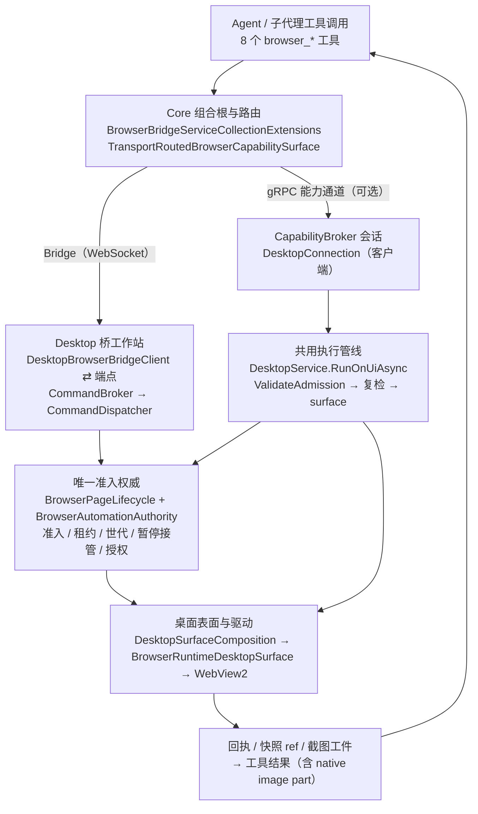

# 浏览器工具与浏览器控制能力——架构与施工进度

> **本文是快照，不是承诺。** 代码与测试数字取自 **2026-10-18**、HEAD `cfaaea2` 的工作树实读与实测；
> 真机 G1–G11、250ms 校准、启动/重启/崩溃恢复/退出回收**仍未验证**（见 §10、§11）。
> 依据文件：修订方案 [浏览器交付修订施工方案](../12_features/浏览器交付修订施工方案-2026-10-12.md)
> 与复核报告 [浏览器交付代码复核与拒收依据](../14_reports/浏览器交付代码复核与拒收依据-2026-10-12.md)。

## 1. 一页摘要

- **工具面**：8 个 Agent 浏览器工具（`browser_context` / `browser_tabs` / `browser_navigate` /
  `browser_snapshot` / `browser_locate` / `browser_interact` / `browser_wait_for` / `browser_screenshot`），
  由 `Source/PuddingBrowser.AgentTools/` 提供，**只在 Desktop 子进程且启用浏览器自动化时**注册
  （`BrowserBridgeServiceCollectionExtensions.AddDesktopBrowserAutomation`）。
- **控制面**：浏览器副作用必须经过 Desktop 侧**唯一的准入权威**（`BrowserAutomationAuthority`，由
  `BrowserPageLifecycle` 持有）：身份 → 目标与信任 → 页面授权（Read/Write/Manage）→ 租约 →
  执行前复检 → 回执/工件。两条传输（WebSocket Bridge 与 gRPC 能力通道）**共用同一份权威与生命周期**；
  路由二选一、**不做跨传输回退**。
- **幂等**：Bridge 命令在 Desktop 侧有原子账本
  （键 = 桌面进程实例 + 连接世代 + operationId；指纹 = 调用者 + 完整语义载荷），
  重放复用终态、未知结果永不复用也不当安全重试、deadline 在**每次接收**时检查。
- **视觉**：截图经 `IBrowserScreenshotPublisher` 落成内容寻址工件，再以 `LlmImagePart`
  进入模型原生图像通道；无法进入视觉时**显式** `visionUnavailable`，不谎报。
- **子代理委派**：父身份由可信执行上下文投影；子授权以**真实子 runId** 申请、范围取父集合的子集、
  期限取 `min(请求, 父剩余)`；成功/失败/取消/超时/启动失败**统一撤销**，Host 端口 fail-closed。
- **施工进度**：R1–R5 已完成并留证；R6 内部侧（反例迁移、正向/对照、链级清单）已完成；
  **唯一未完成**是外部真机阶段（G1–G11、250ms、生命周期四步）。
- **2026-10-18 实测**（HEAD `cfaaea2`）：
  - 外部复核 11 条反例注入路径 **11/11 通过**；
  - 链级 **12 套件 / 2124 通过 / 0 失败**，清单 `round-20261018` 绑定 `commit=cfaaea2`、
    `stage=ready-for-external-deploy`、`dirty=false`、`artifacts=114`、`checks=12`
    （[清单](../14_reports/浏览器交付-链级清单-2026-10-18.json)）；
  - 按套件过滤的浏览器相关用例全部通过：Service **109**、Connection **12**、Desktop **110**、
    Host **128**、Platform 委派/守卫 **14**、Automation **411**、AgentTools **96**。

## 2. 术语与范围

| 术语 | 含义 |
|---|---|
| 浏览器工具 | Agent 可调用的 8 个 `browser_*` 工具（见 §4） |
| 浏览器控制能力 | Desktop 侧对 WebView2 的控制权体系：授权、租约、幂等、任务绑定、暂停/接管、生命周期 |
| 能力（capability） | 能力通道/控制面使用的 `DesktopCapability` 描述符（如 `browser.snapshot`、`webview.navigate`） |
| 双传输 | ① **Bridge**：WebSocket（Host⇄Desktop，默认路径）② **gRPC 能力通道**（CapabilityBroker⇄DesktopConnection，可选启用） |
| 回执（receipt） | 一次交互/操作的事实记录（execution 状态、副作用、是否可安全重试、观察修订） |
| 观察（observation） | 快照/截图产生的、带修订号的页面事实；ref 与 observationId 都绑定页面版本 |
| R1–R6 | 修订方案的六个施工切片（见 §11 进度表） |
| G1–G11 | 设计方案门禁；可执行的观察项在 `BrowserSmokePlan`（S-01…S-13，见 §10.3） |

## 3. 分层架构



### 3.1 层与关键文件

| 层 | 位置 | 关键类型（职责） |
|---|---|---|
| **工具层**（Core） | `Source/PuddingBrowser.AgentTools/` | `BrowserAgentToolBase`（身份投影/统一错误）、8 个工具、`BrowserAgentToolIds`（canonical 工具/能力 ID）、`BrowserToolContracts`（响应与错误形状）、`BrowserDelegationTasks`（委派信封工厂）、`IBrowserScreenshotPublisher`（截图工件窄端口） |
| **Core 组合根/路由** | `Source/PuddingHost/BrowserBridge/` | `BrowserBridgeServiceCollectionExtensions`（条件注册：DesktopChild + 浏览器自动化启用）、`TransportRoutedBrowserCapabilitySurface`（按传输决策二选一）、`BridgeBrowserCapabilitySurface`（能力形状→`IBrowserRuntime`）、`RemoteBrowserRuntime/Context/Page`（Bridge 远程代理）、`DesktopTransportUsageTracker`（迁移计数）、`IBrowserBindingGate` + `CapabilityChannelBindingGate`/`DesktopBrowserBindingGate`（发命令前确保授权）、`HostBrowserDelegationLifecycle`（R4 委派端口实现） |
| **契约层** | `Source/Pudding.Contracts/Desktop/` | 能力目录与描述符、`CapabilityUnions`（请求/响应联合）、`BrowserControlContracts`（控制快照/自动化请求/操作枚举）、`BrowserGrantContracts`（调用者身份/页面授权/拒绝原因）、`BrowserTaskBinding`、`BrowserControlPlaneRequests`（binding revoke 请求）、`BrowserOperationMapping`（能力/动作→自动化操作、request-aware）、`BrowserRetryContracts`（重试裁定线格式）、快照/定位/交互/等待/标签/截图契约、`DesktopCallContext` |
| **Desktop 执行面** | `Source/Pudding.DesktopService/` | `DesktopService`（能力执行器实现：`ValidateAdmission` + `RunOnUiAsync` + `ExecuteOnUiAsync`、`Authority`/`Targets`/`Interaction`）、`BrowserPageLifecycle`（**唯一** lifecycle：持有唯一 authority + 页面注册表；`HasSufficientPageGrant`、`NotifyBridgeConnected/Disconnected`、`LedgerNamespace`）、`BrowserAdmissionAdapter`（Admit/Revalidate/Release 三件套）、`BrowserGrantIssuer`（签发规则）、`BrowserTaskBindingService`（控制面受理/撤销）、`BrowserOperationLedger`（原子幂等账本）、`DesktopDomScripts`/`DesktopInteractionState`（DOM 脚本与输入状态）、`BrowserReadingBaselineStore/DiffResolver`（阅读基线/差异）、`DesktopCapabilityChannelComposition` 及其 Host/Factory/Preflight/Settings/Budgets（gRPC 通道组合根）、`BrowserSmokePlan`（外部 smoke 清单）、`DeliveryManifest*`（R6 交付清单） |
| **桌面表面/驱动** | `Source/Pudding.DesktopSurface.Browser/`、`Source/PuddingBrowser.WebView2/` | `DesktopSurfaceComposition`（把 14 项 UI 表面拆给浏览器映射/Shell 两部分）、`BrowserRuntimeDesktopSurface`（9 项浏览器能力→`IBrowserRuntime`）、`WebView2BrowserRuntime/Context/Page`、`WebView2DomClient`、`WebView2PresentationGate`（真实 WebView2） |
| **WinUI 壳与桥客户端** | `Source/PuddingDesktop/`、`Source/PuddingDesktop.WpfArchive/Browser/` | `MainWindow.xaml.cs`（创建 WebView2 运行时/控制器/闸门，`SetHandler`）、`DesktopApplicationCoordinator.Capability.cs`（能力通道组合根调用与执行器接缝）、`DesktopBrowserBridgeClient`（握手/心跳/世代/重连）、`BrowserBridgeCommandDispatcher`（账本/幂等/期限/闸门/活动证据）、`BrowserWorkspaceController`（`IBrowserCommandHandler` 实现，真实页面操作；桥侧截图复用通道执行器） |
| **自动化领域组件**（无 WebView2 依赖） | `Source/PuddingBrowser.Automation/` | `BrowserAutomationAuthority`（准入/复检/授权/世代/暂停接管）、`BrowserRefRegistry`/`BrowserRefIdentity`（快照 ref）、`BrowserInteractionReceipt`/`BrowserReceiptJudge`（含 `BrowserRetryPolicy`）、`NativeInputSequence`、`BrowserScreenshotPlanner/Transfer/Coordinates`、`PageEventLog/Policy`、`BrowserReadingFormat`/`Article*`、`SubAgentDelegation`/`SubAgentDelegationLeases`、receipt 重放账本 `BrowserOperationLedger`（见 §11 差异项） |

## 4. 工具面：8 个浏览器工具

注册方式：`[Tool(id: BrowserAgentToolIds.X, …)]` 标记 + `services.AddPuddingToolsFromAssembly(typeof(BrowserContextTool).Assembly)`；
身份从**可信工具执行上下文**投影（`BrowserCallerIdentityScope`/`BrowserCallerIdentitySource`），
模型参数不能指定 caller/runId。

| 工具 ID | 名称 | 作用 | 授权类别（最小准入） | 关键行为/契约 |
|---|---|---|---|---|
| `browser_context` | Browser context | 创建/列出/查看/关闭浏览器上下文 | 列表：可信任务身份（有界元数据）；创建/关闭：**Manage**（当前任务的显式管理授权） | 创建页成功后按创建者许可**原子登记**页面与授权（避免"无现成页 ⇒ 永远不可用"） |
| `browser_tabs` | Browser tabs | 新建/列出/激活/关闭标签页 | 新建/关闭：**Manage**；激活：目标页 **Write**（并走 UI 焦点副作用） | 工具动作 `new/list/activate/close`；协议侧 `DesktopTabAction` 仅 New/Activate/Close，`list` 走上下文能力读取 |
| `browser_navigate` | Browser navigate | goto/back/forward/reload/stop | 目标页 **Write** + 本次执行**租约** | 版本/目标校验；回执记录副作用与可重试性 |
| `browser_snapshot` | Browser snapshot | 读取有界 DOM/可访问性快照，交互节点带**带版本 ref** | 目标页 **Read** | 受预算约束；返回 `pageEvents`（有界、合并）与页面版本 |
| `browser_locate` | Browser locate | 解析 ref/CSS/XPath/文本/role/label/placeholder/alt/title/test-id | 目标页 **Read** | 十类定位器；定位结果绑定页面修订 |
| `browser_interact` | Browser interact | click/fill/type/press/hover/scroll/select/check | 目标页 **Write** + **租约** | 与 `browser_wait_for` 配合；提交后**不得重查旧 Locator**；未知副作用 ⇒ 不可安全重试 |
| `browser_wait_for` | Browser wait for | 等 CSS 选择器出现/隐藏或通配 URL | 目标页 **Read** | 有界等待；超时语义明确 |
| `browser_screenshot` | Browser screenshot | 有界截图并返回 `observationId`（后续坐标操作引用） | 目标页 **Read** + **必须钉页面版本**（`expectedPageVersion`） | 视口/区域/整页；`detail=low/high/original`；预算：单张 ≤8 MiB、`low` 长边 512px、基准 40 KiB；输出 native image part 或显式 `visionUnavailable` |

**工具清单的两处 nuance（当前实现事实，见 §11 差异/开放项）**

1. `BrowserAgentToolIds.All` 与 `BrowserAgentCapabilityIds.All` 是 **7 项核心集合**（不含 screenshot）；
   `browser_screenshot` 有独立 ID 常量与 `[Tool]` 注册，并且在**可写委派**中由 `BrowserDelegationTasks`
   **显式追加**（`WriteTaskRequiredTools` 含 screenshot）。只读委派的注入列表 = `All`（7 项）。
2. `browser_screenshot` 在 Bridge 路径上依赖**能力通道的执行器**：控制器通过
   `Func<IDesktopCapabilityExecutor?>` 延迟取通道的 `DesktopService`；通道未启用时该能力在 Bridge 路径上
   **明确不支持**（`BrowserOperationNotSupported`），不会用别的路径偷偷替代。

## 5. 授权与执行控制面

### 5.1 身份（caller）

- 类型：`BrowserCallerIdentity(kind, callerId, taskId, parentTaskId)`；`kind` ∈ `User`（UI 直接操作，不受自动化闸门约束）、
  `Agent`（Core 侧可信任务）、`SubAgent`（**必须**带 parentTaskId）。
- 产生：工具层从**可信执行上下文**投影；能力通道/Bridge 的入站由解码器统一解出
  （`Mapping.cs` 的 `TryDecodeBrowserCaller`；Bridge 侧 `BridgeCallerContext.Create`）。
  未知 kind、缺必需身份、子代理缺 parent ⇒ `InvalidRequest`，**不让构造异常逃出解码器**。
- 关系校验归控制面：自身绑定要求任务身份一致；父任务可按受限委派契约为子申请；普通 A 不得替 B 签发/撤销。

### 5.2 目标与信任

- 目标：`DesktopPageTarget(contextId, pageId)`，可选 `frameId`；页面注册表在 lifecycle
  （`BrowserTargetRegistry` / `DesktopTargetRegistry`），记录 context 信任、页面版本、就绪度、用户选中的 Agent 目标。
- 信任：`DesktopContextTrust`：`Untrusted`（普通第三方页；禁脚本注入/Shell 交互）、
  `AgentAuthorized`（已授权 Agent 页面，可脚本与导航）、`Workbench`（可信工作台；可用 Shell 交互但禁注入脚本）。
- 策略：`DesktopCapabilityPolicy`（`RequiresPageTarget`/`RequiresAgentTarget`/`IsAllowedForTrust`/
  `DeniesWorkbenchScriptInjection`）；能力级与 request-aware 的**操作映射**见 `BrowserOperationMapping`。

### 5.3 授权（grant / scope / epoch）

- 范围：`BrowserPageGrantScope`：`None=0`、`Read=1`（元数据/快照/定位/等待/截图）、
  `Write=2`（导航/交互/坐标输入/脚本）、`Manage=4`（建/关 context 与 tab）。
  管理授权（`BrowserManagementGrant`）与页面读写授权**不互相替代**。
- 签发：`BrowserGrantIssuer.TryIssue`（有效期上限、目标已登记、连接世代存活、子集校验在唯一 authority 里判）。
- 世代：`BrowserControlEpoch` / `BrowserPageGrantEpoch`；**接管/恢复/断连都推进世代** ⇒ 旧许可与旧租约在
  复检时被判陈旧（拒绝文案：*“the admitted control or grant epoch is stale …”*）。
- 撤销：页面级/上下文级/执行域级/全量；另有**隐式失效**（epoch 推进）——三者共同覆盖
  “任务结束、切目标、关闭上下文/页面、撤销、接管、断连”。

**页面授权的现行判据是**三级**（2026-10-13 `ace0100` 之后的实现，`BrowserPageLifecycle.HasSufficientPageGrant`）**：

1. **用户显式选中**的 Agent 目标页（唯一显式授权动作）；
2. **V1 基线**：桥处于**已确认世代**（`ConnectionGeneration.IsLive`）即视为 Agent 自己的浏览器在线，可驱动；
   暂停/接管等**运行控制**在同一入口之前已拦下；
3. 既有的**页级 grant**（能力通道路径签发）继续兼容。

> 第 2 条是 69 规格 §1.1 的有意简化：逐页 grant 在该场景下的可验证安全收益≈0，而可用性成本确定
> （实测：同一意图产生三种拒绝码）。**计划在会话收敛（step 4）后移除**。
> 该简化意味着：**桥在线时，“逐页授权”不再是一票否决条件**；安全边界依赖暂停/接管、审计与生命周期。
> 任何收紧都需要同时改本方法与 Bridge 的 `SetAgentTarget` 下发链，不能只改一侧。

### 5.4 一次执行的时间线（Desktop 执行面）

1. **入队前**：`DesktopService.ValidateAdmission` 纯验证 + `Authority.Admit`（**写操作在此拿到唯一租约**；
   管理/只读按分类判定），失败即返回；`lease` 立即进入 `try`。
2. **所有退出路径**由 `finally` 释放原租约（取消、版本拒绝、dispatcher 拒绝、超时、surface 异常……）。
3. **UI 队列内**：`ExecuteOnUiAsync` 对同一许可做**复检**（`Revalidate`/`HasSufficientPageGrant`；
   不再第二次 `Admit`），陈旧世代/接管/撤权在此被拦下。
4. **触碰表面**：`IDesktopUiSurface`（`DesktopSurfaceComposition`）→ 浏览器映射到 `BrowserRuntimeDesktopSurface`
   → `IBrowserRuntime`（WebView2）。驱动包含多个有副作用步骤时逐步通过 permit guard 检查取消/世代。
5. **回执**：`BrowserActionReceipt`（执行状态、副作用、可重试性、观察修订）；未知结果 ⇒
   `mayHaveSideEffects=true`/unknown，**禁止自动重试**。
6. `BrowserAdmissionAdapter` 把上述三步（Admit/Revalidate/Release）收敛成两传输共用的适配器。

### 5.5 控制快照与控制面

- `BrowserControlSnapshot` = 唯一状态投影：`ControlEpoch`、`GrantEpoch`、`IsPaused`、`IsUserTakeover`、
  `IsClosed`、`ActiveLease`、`Reason`；UI 状态显示只投影这一份。
- 控制面写入点：暂停/接管（`SetPaused`/`SetUserTakeover`）、Agent 目标（`SetAgentTarget`）。
  WinUI 侧用 `BrowserAutomationGateSync` 扇出到所有闸门（Bridge dispatcher 必挂，能力通道启用后再挂自己的闸门）；
  `IBrowserAutomationGate.SetAgentTarget` 默认空实现，**Bridge dispatcher 与 lifecycle 是实际落点**。
- 暂停/接管期间：**已授权的只读观察继续；无授权观察仍拒绝；管理与写操作停止**。

### 5.6 控制面：任务绑定（谁把页面交给任务）

`BrowserTaskBindingService.Accept(BrowserTaskBinding)`（Desktop 侧受理）：

1. 绑定目标必须**当下**就是用户选定给 Agent 的页（**绑定不能替代用户选择**）；
2. 同一选中页**不得匿名共享**给无关任务（共享需独立显式选择许可；外部复核 P0 的落点）；
3. 子代理：必须有 parentTaskId，且**父授权在目标页真实存在**；子范围取父集合的**子集**，
   期限夹到 `min(请求, 父剩余)`（留 1 秒安全边界避免微秒级越界）；
4. 签发交给 `BrowserGrantIssuer`（有效期上限/登记/世代）；
5. 同一 (任务,目标) 重复受理：先撤旧授权再签，避免两份并存。

`browser.binding.apply` / `browser.binding.revoke` 是控制面能力；`Source` 字符串只用于审计、**不是授权凭证**。
Bridge 侧由 `DesktopBrowserBindingGate`/`CapabilityChannelBindingGate` 在发命令前确保授权
（无会话时门 = no-op；**最终判据始终在 Desktop 侧**）。

### 5.7 幂等：完整指纹 + 原子账本 + 重试裁定

- **账本键**（`Source/Pudding.DesktopService/BrowserOperationLedger.cs`）：
  `(DesktopProcessInstance, ConnectionGeneration, OperationId)`；世代进键 ⇒ 重连后同 ID 落新命名空间。
  Bridge 派发器通过 `BrowserPageLifecycle.LedgerNamespace`（进程实例 + 当前世代，**只用标量**）取值；
  2026-10-12 修复前这两项曾是常量 `"bridge"`/`0`（会跨世代复用），现已修并有用例。
- **指纹**（完整语义）：调用者身份 + 能力/动作 + 目标（context/page/frame/pageVersion）+ 完整 typed payload；
  `deadline`/`correlationId`/`OperationId` **不进 hash**（OperationId 是键），但**每次接收**都检查请求是否过期
  （检查在账本裁决**之前**，覆盖重放路径）。
- **四态**：`Execute`（唯一获胜者）/ `AwaitPending`（等同一完成源）/ `ReplayCompleted`（复用已知终态）/
  `Conflict`（同键异指纹 ⇒ `operation_id_conflict`，**不透露原结果**）。
- **边界**：在途记录永不被容量/保留期驱逐；未知结果（`Abandon`）不参与驱逐、**永不复用也不当安全重试**；
  只有已知终态才在保留期内复用（容量 1024 / 保留 10 分钟，实现内常量）。
- **结果载荷缓存**（`BrowserBridgeCommandDispatcher` 的 `BrowserOperationResultCache`）：**只在账本裁决为
  `ReplayCompleted` 之后**查询，因此不构成“第二套去重权威”，也**不可能跨调用者/跨世代复用**；
  条目过期或被驱逐后重放 ⇒ 返回显式错误 `operation_result_unavailable`（不编造结果）。
- **重试裁定**：`BrowserActionReceipt.SafeToRetry` + `BrowserRetryPolicy.Decide(receipt)` +
  `BrowserRetryContracts`（含 `receipt_expired` 等线名）；契约层只承载数据，判定在 Automation 组件内。

## 6. 两条传输与统一入口

### 6.1 Bridge（WebSocket，默认路径）

```
工具 → TransportRoutedBrowserCapabilitySurface / BridgeBrowserCapabilitySurface
     → RemoteBrowserRuntime/Context/Page（Host 代理）
     → DesktopBrowserBridgeClient（WinUI：握手+心跳+看门狗+连接世代+重连）
     → DesktopBrowserBridgeWebSocketEndpoint（token 只走请求头；握手/心跳）
     → DesktopBrowserCommandBroker → BrowserBridgeCommandDispatcher
     → IBrowserCommandHandler = BrowserWorkspaceController → IBrowserRuntime（WebView2）
```

- **Dispatcher 职责**：账本命名空间/指纹/`deadline` 前置检查/暂停与接管门/页面授权检查
  （`_lifecycle.HasSufficientPageGrant`，Shell 安全访问器）/活动与操作状态事件/结果缓存；
  通过 `Lifecycle` 读快照、`SetAgentTarget` 下沉目标。
- **桥侧截图例外**：`page.screenshot` 由控制器通过 `Func<IDesktopCapabilityExecutor?>` **复用能力通道的
  `DesktopService`**（“同一条执行路径、准入/闸门/预算一致”）；通道未启用 ⇒ 明确不支持
  （`screenshot is not available over the bridge transport in this host configuration`）。
- **连接即活性**：`HelloAck accepted` ⇒ `Lifecycle.NotifyBridgeConnected(gen)`；断开/主动断开 ⇒
  `NotifyBridgeDisconnected()`。这解决了历史上 `NotifyConnectionGeneration` **生产零调用者**导致
  “Core 已连接、桌面权威恒不活、所有浏览器命令停在 *the desktop connection is not established*”的 P0
  （2026-10-13 `ace0100`，见 §11.3）。

### 6.2 gRPC 能力通道（可选启用）

```
工具 → TransportRoutedBrowserCapabilitySurface（通道就绪优先）
     → CapabilityBroker 会话 ⇄ DesktopConnection（客户端；流式传输/操作注册/字节预算/映射）
     → IDesktopCapabilityExecutor = DesktopService（WinUI 侧实现）
     → RunOnUiAsync（准入/复检/队列） → DesktopSurfaceComposition → BrowserRuntimeDesktopSurface → WebView2
```

- 组合根：`DesktopCapabilityChannelComposition.StartAsync`（平台无关、可脱 UI 测试）。三条不可动摇语义：
  **① 关闭 = 什么都不做**（继续 Bridge，返回 `Success(null)`）；**② 启用了却起不来 = 明确失败**（不静默留在旧 Bridge）；
  **③ 不做跨传输回退**（解析不了端点就不启动，宁可暂时不启用，也不把同一次操作执行两次）。
- 它只接受**生命周期端口**（同时持有唯一 authority 与页面注册表）——分开传两个参数就允许“配错对”，
  等于又出现两份控制权状态；`BrowserTaskBindingService` 由组合根构造**同一个**实例交给 bridge 与通道。
- `connectionGeneration: () => authority.ConnectionGeneration` ⇒ 生产路径的 `Admit` 闸门**必需**；
  `DesktopServiceOptions` 的允许集合 = **代码事实**声明的能力集合（不从配置放宽）。

### 6.3 路由与迁移观测

- `DesktopTransportRouting.Decide`（CapabilityBroker）给出传输决策；
  `TransportRoutedBrowserCapabilitySurface` 按决策二选一：通道就绪优先，否则 Bridge；**都不行就如实失败**。
- `DesktopTransportUsageTracker` 记录用量与回退（退役判据“窗口内零回退”）；`MissingEvidenceCalls`
  记录“副作用能力缺权限证据”的观测（迁移期只观测，不拒绝）。

### 6.4 “同一执行边界”的当前形态（重要）

- **判据来源唯一**：Bridge dispatcher 与能力通道的 `DesktopService` **共享同一个 `BrowserPageLifecycle`**
  （⇒ 同一个 `BrowserAutomationAuthority`、同一页面注册表、同一世代/暂停/接管状态）。
  R1 的页面授权检查、R2 的账本命名空间、deadline 检查都落在这份唯一状态上。
- **入口有两处**（与修订方案 §5.2 的“页面命令统一调用 `DesktopService.ExecuteAsync`”**不完全一致**）：
  Bridge 页面命令（goto/snapshot/locate/interact/wait…）由 `BrowserWorkspaceController` 的直接 handler 执行，
  只有**截图**复用通道的 `DesktopService`；能力通道路径则全部走 `DesktopService.RunOnUiAsync`。
  方案的 `BrowserBindingCoordinator` 未以该名字落地，由 `BrowserTaskBindingService` +
  `CapabilityChannelBindingGate`/`DesktopBrowserBindingGate` + `HostBrowserDelegationLifecycle` 组合承担。
  两处入口共享权威，因此**授权/状态不分裂**，但“单一执行管线”在代码上仍是**两个入口 + 一份判据**。

### 6.5 组合根矩阵（必交付证据）

- 两列：**Bridge-only** 与 **gRPC-enabled**；必须经真实 DI/工厂与生产协议适配器（可用假 driver）。
- 已落地证据：Host 扩展测试断言“同一服务重复解析为同一实例”
  （[BrowserBridgeServiceCollectionExtensionsTests](../../Tests/PuddingHost.Tests/BrowserBridge/BrowserBridgeServiceCollectionExtensionsTests.cs)）；
  `TransportRoutedBrowserCapabilitySurfaceTests` 覆盖路由；Desktop 侧
  [DesktopCapabilityCompositionTests](../../Source/Pudding.DesktopServiceTests/DesktopCapabilityCompositionTests.cs)
  钉住“关闭态不构造、生命周期端口必需、共享权威同一实例”。

## 7. 页面语义：快照 / 定位 / 交互 / 等待 / 阅读

- **Snapshot ref**：`BrowserRefToken(Value, Scope, DocumentGeneration, ViewportRevision, HostNodeKey, RoleHint?, NameHint?)`；
  `BrowserRefRegistry.Validate` 依次校验**页面**（`PageMismatch`）、**框架**（`FrameMismatch`）、
  **文档世代**（`DocumentChanged`）、**节点附着**（`NodeDetached`）；viewport 修订陈旧只**标记** `viewportStale`，不拒绝。
  ⇒ 交互提交后**不得重查旧 Locator**；导航后旧 ref 失效，且不会点到同名替代节点。
- **交互与回执**：`BrowserInteractionReceipt` + `BrowserMutationPostcondition` + `BrowserReceiptJudge`
  （纯 SPA 菜单点击不得被判失败；未知副作用禁止自动重试）；原生输入用 `NativeInputSequence`
  （按下/移动/释放逐步 guard，清理按键属于释放资源而非继续业务输入）。
- **定位**：10 类定位器（`LocateContracts`/`LocateCursor`）；结果绑定页面修订，跨页/跨帧拒绝。
- **等待**：`WaitForContracts`（选择器出现/隐藏、通配 URL）。
- **阅读/抽取**：`BrowserReadingFormat`、`ArticlePaging/Cursor/Markdown/CompactJson`、
  `BrowserReadingBaselineStore`/`BrowserReadingDiffResolver`（阅读基线与差异，受预算约束）。
- **页面事件**：`PageEventLog`/`PageEventPolicy`（有界、按条数截断、连续重复合并为 `(xN)`、总次数另计；
  仅事实说明，**不用于继续交互**）。
- **截图坐标**：`BrowserScreenshotPlanner/Transfer/Coordinates`、`ScreenshotLayoutFacts`、
  `ScreenshotObservationRegistry`：observationId 关联坐标变换与 PageVersion；旧 observation 不因工件可长期查看而永久可用于点击。
- **文件上传/文件选择器**：`FileUploadPlan`（真实 `DOM.setFileInputFiles`）；WebView2 无文件选择器 API ⇒
  页面自弹选择框**记录为不支持**，不假装接管。

## 8. 截图 → 模型视觉通道（R5）

链路：

```
BrowserScreenshotTool（分块校验/尺寸/mime/预算）
  → IBrowserScreenshotPublisher（AgentTools 内窄端口）
  → BrowserScreenshotArtifactPublisher（Host；注入 VisionArtifactStorageService）
  → 内容寻址工件：vision-<sha256>（每 workspace 串行、幂等、临时文件+magic bytes+原子改名、路径穿越防护）
  → ToolExecutionResult.OkWithParts(metadataJson, [LlmImagePart(artifactId, detail)])
```

- 无 publisher / 传输不支持 native parts / 模型不支持视觉 ⇒ **显式** `visionUnavailable` 及原因；
  文本模型仍可 capture 由用户查看，但**不得谎报视觉读取成功**；也不自动换模型。
- 工件在调用 workspace 的工件域内，跨 workspace 无权解析；不泄漏文件路径或会话凭据。
- 组合根注册是**条件式**的：仅当容器已有 `VisionArtifactStorageService` 时注册 publisher
  （测试容器只装配 Bridge 扩展时强注册会抛 `Unable to resolve service`，2026-10-12 实测 3 条回归）。

## 9. 子代理浏览器委派（R4 / G10）

- **信封与范围**：`BrowserDelegationEnvelope`（目标、范围、pageGrantId、期望结果、预算、工具清单、截止）；
  `BrowserDelegationScope(CanRead, CanWrite, CanManage)` 只能**收窄**；结果预算默认/上限 2 KiB。
- **可信父身份投影**：`SubAgentSpawnRequest` 与两条 `BuildSpawnRequest` 路径传递三个**标量**
  （`BrowserDelegationContextId`/`PageId`/`ScopeName`），不接受模型填 caller/runId。
- **窄端口**：`PuddingCore.Abstractions.IBrowserDelegationLifecycle`（**只用标量** ⇒ Core 不依赖 Contracts；
  这是 Platform 唯一可见的公共落点）；实现方必须满足：父身份可信、子绑定真实子 runId、范围子集、
  期限 `min(请求, 父剩余)`、成功/失败/取消/超时/父终止都撤销、断连后新世代不自动恢复、拒绝必须带可区分原因。
- **Platform 侧**：`SubAgentManager` 在真实子 runId 产生后申请；**fail-closed**（拒绝 ⇒ 撤销 + 该子运行失败）；
  撤销收尾覆盖：成功/异常/取消/超时/启动投影失败（`RevokeBrowserDelegationAsync`），
  并有**源码不变量守卫** `SubAgentManagerRevokeCoverageGuardTests`（含反向对照）。
- **Host 侧实现**：`HostBrowserDelegationLifecycle`：会话解析 → `BrowserCallerIdentity(SubAgent, callerId,
  childRunId, parentTaskId)` → `DesktopBrowserBindingProducer.IssueAsync` → 失败即带理由拒绝；
  签发时登记 `childRunId → binding`，撤销时精确移除（天然幂等），经 `browser.binding.revoke` 能力发撤销；
  未知范围线名/目标只给一半/无可信父 runId ⇒ 拒绝；无会话 ⇒ 拒绝（与“门”的 no-op 语义刻意不同）。
  注册在 Host 组合根（与门共用会话解析器/描述符来源；浏览器自动化关闭时不注册）；
  验收用例 `HostBrowserDelegationLifecycleTests`（8 条）+ 注册验证 2 条。

## 10. 交付证据与外部验收边界（R6）

### 10.1 内部侧证据

| 判据 | 证据 |
|---|---|
| 外部复核 **11 条反例** | 原文件保留在 [TestScripts/BrowserDeliveryReview/README.md](../../TestScripts/BrowserDeliveryReview/README.md)（ServiceReview/ConnectionReview/BridgeReview/Review.targets）；已迁入常规套件；2026-10-18 注入路径 **11/11** |
| 正向配对（防“一律拒绝”） | `BrowserBridgeAuthorizationFixtureTests` 1/1；R4 正向用例（真实子 runId/可信父身份/完成后撤销） |
| 对照组 | Connection `BrowserBindingDecodeTests` 6/6；Service 三控制类 4/4 |
| 链级 | 2026-10-18：12 套件 / 2124 通过 / 0 失败，清单 [round-20261018](../14_reports/浏览器交付-链级清单-2026-10-18.json)（`ready-for-external-deploy` · `dirty=false` · `commit=cfaaea2`） |
| 历史链级 | 2026-10-12：12 套件 / 2118 通过 / 0 失败，清单 [最终（e2d88df）](../14_reports/浏览器交付-链级清单-最终.json) |

清单校验要点（`Source/Pudding.DesktopService/DeliveryManifest.cs`）：`buildId`/`commit` 必需、
不可复现构建不得声明 `ready-for-external-deploy`、至少一条检查且**全零计数即拒**、
不得含失败检查、`knownUnverified` 必须显式声明、`requiredExternalSteps` 必需（= `startup|restart|crash-recovery|exit-reclamation`）。
链脚本 `TestScripts/delivery-manifest.ps1`：**Shell 构建守卫（step 0）→ 发布产物守卫 → 套件 TRX → CLI 事实 → 校验**；
**Shell 构建守卫无条件执行**（WinUI 产品工程曾因引用边界破坏而链全绿却构建不了）；
**发布目录缺失才发布**；**脏树会按规则拒绝产出清单**（2026-10-12 实测 `dirty=true` ⇒ `manifest NOT emitted`）。

### 10.2 复现命令（内部侧）

```powershell
# 11 条反例（评审者注入路径；必须用独立 artifacts-path，否则 0 用例）
$reviewTargets = (Resolve-Path TestScripts/BrowserDeliveryReview/Review.targets).Path
$reviewArtifacts = Join-Path (Get-Location) 'temp/build/browser-review'
$reviewResults = Join-Path (Get-Location) 'temp/test-out/browser-review'
foreach ($p in @(
  'Source/Pudding.DesktopServiceTests/Pudding.DesktopServiceTests.csproj',
  'Source/Pudding.DesktopConnectionTests/Pudding.DesktopConnectionTests.csproj',
  'Tests/PuddingDesktop.Tests/PuddingDesktop.Tests.csproj')) {
  dotnet test $p --artifacts-path $reviewArtifacts --nologo `
    "-p:CustomAfterMicrosoftCommonTargets=$reviewTargets" `
    --filter 'FullyQualifiedName~BrowserDeliveryReview' `
    --logger "trx;LogFileName=$([IO.Path]::GetFileNameWithoutExtension($p)).trx" `
    --results-directory $reviewResults
}

# 整链（需先停 PuddingDesktop/PuddingAgent，或在干净 git worktree 内跑；先验 buildId 新鲜度）
TestScripts/delivery-manifest.ps1 -BuildId <new-id>
```

### 10.3 外部阶段（唯一未完成）

可执行观察项清单在 `BrowserSmokePlan`（**S-01…S-13，覆盖 G1–G11**；每项要么真机、要么注明自动化覆盖）：

| 门禁 | 观察项（摘要） |
|---|---|
| G1 | 接管后写入：驱动调用 0；只读可用；恢复后旧写租约不复活 |
| G2 | 非目标页/跨帧/跨身份/撤权后/子代理扩权：全部拒绝；建关页无残留 |
| G3 | 纯 SPA 菜单点击不被判失败；页面事件接管（对话框/权限/新窗口/下载）有界上报 |
| G4 | 同一节点连续只读 + fill + 滚动：无需重复定位；读不推进 PageVersion；导航后旧 ref 被拒 |
| G5/G6 | 阅读预算（UTF-8 ≤1536 字节、前 10 条、无额外 locate）与正文/分页/cursor 语义 |
| G7 | 十种 locator 矩阵、受控输入、密码不回显、0×0/禁用/遮挡拒绝；文件选择器按“不支持”记录 |
| G8 | 滚动位移/边界 no-op/停止原因/无限滚动 contentChanged |
| G9 | 截图与目标一致、导航中不返回旧页、detail/预算/元数据、缩放后旧坐标拒绝、**窗口隐藏不返回黑图**、模型收到类型化图片 |
| G10 | 父子写租约不并存；子代理**真的**发现并调用 browser_*；取消/接管/超时回收许可 |
| G11 | 启停通道/迟到 CoreReady/断连/隐藏恢复/跨标签/重启/崩溃/退出：订阅不增长、旧会话不复活、断连不双执行、外部证据 |

运行步骤与反作弊要求见 [浏览器交付外部验收手册](../13_runbooks/浏览器交付外部验收手册.md)：
重启到**明确新构建** → 进程内新会话功能 smoke（真实模型/八项工具/TestSite/Bridge Activity/免重启）→
G1–G11 → **250ms 校准**（记录机器/版本/语料/节点数/DOM 复杂度、p50/p95/p99 与超时截断语义，**不得只报最好值**）→
外部控制器判定**启动/重启/崩溃恢复/退出回收**。

## 11. 施工进度与差异

### 11.1 切片进度（截至 2026-10-18）

| 切片 | 计划的边界 | 状态 | 关键落点与证据 |
|---|---|---|---|
| **R1** 不变执行许可 / 原租约复检 / 全路径释放 | Contracts / Automation / DesktopService | ✅ 完成 | `ValidateAdmission`（Admit 一次）+ `RunOnUiAsync` try/finally 覆盖全部退出路径 + `Revalidate`/`HasSufficientPageGrant`；`BrowserAdmissionAdapter` 三件套；`BrowserExecutionPermitTests` 4/4（接管恢复不复活、入队前取消不泄漏、版本拒绝不泄漏、选中页不共享） |
| **R2** 完整语义指纹与原子账本（跨身份/并发去重） | Contracts / Broker / DesktopConnection / Bridge | ✅ 完成 | 指纹=调用者+完整载荷；账本四态、未知不驱逐不复用；Bridge 键=真实进程实例+世代（修复常量缺陷）；deadline 前置检查；`BrowserOperationLedgerTests`、`BrowserLedgerNamespaceTests`、`BrowserOperationIdentityTests`（Connection 4/4）、Bridge 并发“恰好一次” |
| **R3** 可信任务绑定与统一传输入口（组合根矩阵） | Host / DesktopService / WinUI 组合根 | ✅ 完成（含计划—代码差异） | `BrowserTaskBindingService` 五条受理规则；`browser.binding.apply/revoke` 控制面；request-aware tab 映射（TabNew/TabActivate/TabClose 分别准入）；两传输共享 lifecycle/authority；组合根矩阵用例。**差异**：`BrowserBindingCoordinator` 未落地（见 §11.2） |
| **R4** 身份统一解码与 B6 Runtime 委派装配 | DesktopConnection / Runtime / Platform | ✅ 完成 | `TryDecodeBrowserCaller` 统一解码；Core 标量端口 + Platform fail-closed 申请/撤销 + Host 端口实现/注册；源码不变量守卫 + 反向对照；两条 spawn 入口同形正向用例 |
| **R5** 截图字节进入模型视觉通道 | AgentTools / Host / Vision 存储 | ✅ 完成 | `IBrowserScreenshotPublisher` + `BrowserScreenshotArtifactPublisher` + `OkWithParts`/`LlmImagePart`；`visionUnavailable` 回退；AgentTools 96 用例（含单一图像部件断言）、Host 截图链路用例 |
| **R6** 证据绑定与外部验收 | 常规测试 / 交付清单 / 外部验收 | 🟡 **内部侧完成 / 外部待验收** | 11 条反例迁移 + 正向哨兵 + 对照；链脚本与清单校验；两轮链级证据（2118/0 @ `e2d88df`；2124/0 @ `cfaaea2`）；**G1–G11、250ms、生命周期未验证** |

### 11.2 计划—代码差异（需决策，不是已修缺陷）

| # | 修订方案的要求 | 当前代码事实 | 影响/建议 |
|---|---|---|---|
| 1 | `BrowserExecutionPermit` + `RevalidatePermit` 类型（§3.1） | **未以该类型落地**；用 `DesktopService.ValidateAdmission` + `Authority.Revalidate` + try/finally 达意 | 语义已覆盖并有 4 条不变量用例；若要严格对齐类型，属重构（低收益） |
| 2 | `BrowserBindingCoordinator`（§5.2） | **未落地**；由 `BrowserTaskBindingService` + 两个 Gate + `HostBrowserDelegationLifecycle` 组合承担 | 功能覆盖，但“单一协调器”的可审计性弱于方案；建议在下一轮收敛 |
| 3 | 共享 `BrowserOperationIdentity` 生成器（§4.1） | **未落地为共享类型**；指纹在 `WireMapping.CoreCommandEncoder.Fingerprint`、`Mapping.Fingerprint`、`BrowserBridgeCommandDispatcher.Fingerprint` 分别实现 | 字段若漂移可能产生“同请求不同指纹”；建议抽公共构造并加穷举一致性测试 |
| 4 | 页面命令统一调用 `DesktopService.ExecuteAsync`（§5.2） | Bridge 页面命令走 `BrowserWorkspaceController` 直接 handler；只有**截图**复用通道的 `DesktopService`；两条路径**共享同一 lifecycle/authority** 判据 | 授权/状态不分裂，但存在两个执行入口；若要统一，需把 handler 改为协议→`DesktopCapabilityRequest` 适配器 |
| 5 | `browser_screenshot` 在 canonical 工具/能力清单中 | `BrowserAgentToolIds.All`/`BrowserAgentCapabilityIds.All` 为 **7 项**（不含 screenshot）；screenshot 有独立 ID/`[Tool]` 注册，可写委派显式追加 | 只读委派注入列表不含 screenshot，可能与“截图属 Read 观察”的设计意图不一致；建议明确决策（补入 All 或文档化） |
| 6 | receipt 重放账本 | `PuddingBrowser.Automation.BrowserOperationLedger`（5 分钟/1024 项、回执重放语义）在检索范围内**只被测试直接构造**，未发现生产持有者 | 视为**未接线组件**；若计划使用，需接入驱动路径并加用例；否则考虑删除避免误读 |

### 11.3 已修复的真实缺陷（2026-10-12 验收修复 + 2026-10-13 后续接线）

1. **R4 委派撤销泄漏**（2026-10-12 修复）：`ExecuteSyncAsync` 两条收尾路径 `TryRemove(..., out _)` 丢弃 runId ⇒
   运行结束不撤销委派授权。已修 + 源码不变量守卫（反向对照证明守卫会失败）。
2. **R2 账本键常量**（2026-10-12 修复）：键中进程实例/连接世代为 `"bridge"`/`0` ⇒ 重连后同 ID 命中旧世代记录。
   已改为真实值（`BrowserAutomationAuthority.ProcessInstanceId` + lifecycle `LedgerNamespace`）+ 用例。
3. **Bridge 并发用例空验证**（2026-10-12 修复）：无授权夹具下 `Count <= 1` 恒真 ⇒ 按复核 README L44
   强化为“授权 A + 两次都成功 + 恰好一次”。
4. **浏览器整体不可用的生产接线缺口**（2026-10-13 `ace0100`，非本次文档轮所做）：
   `NotifyConnectionGeneration` 生产零调用者 ⇒ 权威恒 `None`；用户选页不下发 ⇒ 闸门读不到目标。
   修复：桥握手/断开驱动权威活性；`SetAgentTarget` 下发链（UI → gate sync → dispatcher → lifecycle）；
   `HasSufficientPageGrant` 三级判据（§5.3）。**该修复也是把“逐页 grant”改为 V1 基线的语义变更，需在外部验收中按新语义审查。**

## 12. 未完成与下一步

### 12.1 外部（唯一阻塞）

- **G1–G11**（§10.3 的 S-01…S-13）· **250ms 校准** · **启动/重启/崩溃恢复/退出回收**。
- 执行入口：[浏览器交付外部验收手册](../13_runbooks/浏览器交付外部验收手册.md)；历史清单见
  [真机与外部验收清单-2026-10-08](../16_qa/真机与外部验收清单-2026-10-08.md) 与
  [2026-10-09 浏览器自动化交付验收索引](../14_reports/2026-10-09-浏览器自动化交付验收索引.md)。
- **审查口径更新**：2026-10-13 的 V1 基线改动（桥在线即可驱动 Agent 自己的浏览器）**改变了逐页授权语义**，
  外部验收应按当前实现审查“暂停/接管仍能阻止写入、只读仍可用、撤权/断连仍失效”，
  而不是假定“每页必须有 grant”。

### 12.2 内部可选项（不阻塞外部验收）

1. 对 §11.2 的 6 项差异逐一决策（尤其 #3 指纹共享构造、#4 单执行入口、#5 screenshot 清单、#6 未接线账本）。
2. 抽公共指纹构造器并加跨传输一致性测试（防止字段漂移）。
3. 把 `Known-flaky` 用例（`SessionEventStreamServiceTests.A_Replaced_Waiter_…`，非浏览器范围）按仓库规则处置：
   已定名、未加白名单；再次出现时按失败消息自报的条件判定是产品竞态还是测试假设。
4. 仓库级文档链接门禁仍有约 37 处他方既有红灯（与本次文档无关），需要各作者修复。

## 13. 文件地图（按层定位）

| 想找什么 | 去哪里 |
|---|---|
| 工具 ID/名称/描述、工具基类、身份投影、委派信封工厂、截图发布端口 | `Source/PuddingBrowser.AgentTools/`（`BrowserAgentToolIds.cs`、`BrowserAgentToolBase.cs`、`BrowserCallerIdentityScope.cs`、`BrowserDelegationTasks.cs`、`IBrowserScreenshotPublisher.cs`、8 个 `Browser*Tool.cs`） |
| Host 组合根、传输路由、Bridge 代理、门与委派端口、截图工件发布 | `Source/PuddingHost/BrowserBridge/`（`BrowserBridgeServiceCollectionExtensions.cs`、`TransportRoutedBrowserCapabilitySurface.cs`、`RemoteBrowserRuntime.cs`、`CapabilityChannelBindingGate.cs`、`DesktopBrowserBindingGate.cs`、`HostBrowserDelegationLifecycle.cs`、`BrowserScreenshotArtifactPublisher.cs`、`DesktopBrowserBridgeWebSocketEndpoint.cs`） |
| 能力目录/请求响应联合/授权与回执契约/操作映射/重试线格式 | `Source/Pudding.Contracts/Desktop/`（`Capabilities.cs`、`CapabilityUnions.cs`、`BrowserControlContracts.cs`、`BrowserGrantContracts.cs`、`BrowserTaskBinding.cs`、`BrowserOperationMapping.cs`、`BrowserRetryContracts.cs`） |
| 唯一准入权威、lifecycle、租约、任务绑定、幂等账本、gRPC 通道组合根、交付清单 | `Source/Pudding.DesktopService/`（`BrowserAutomationAuthority.cs` 在 Automation；`BrowserPageLifecycle.cs`、`BrowserAdmissionAdapter.cs`、`BrowserTaskBindingService.cs`、`BrowserGrantIssuer.cs`、`BrowserOperationLedger.cs`、`DesktopService.cs`、`DesktopCapabilityChannelComposition.cs`、`DeliveryManifest*.cs`、`BrowserSmokePlan.cs`） |
| 领域纯逻辑（ref/回执/截图计划/输入序列/阅读/委派校验） | `Source/PuddingBrowser.Automation/`（`BrowserRefRegistry.cs`、`BrowserRefIdentity.cs`、`BrowserInteractionReceipt.cs`、`BrowserReceiptJudge.cs`、`NativeInputSequence.cs`、`BrowserScreenshotPlanner.cs`、`BrowserScreenshotTransfer.cs`、`BrowserReadingFormat.cs`、`SubAgentDelegation.cs`） |
| Bridge 客户端/派发器/控制器/闸门同步 | `Source/PuddingDesktop.WpfArchive/Browser/`（`DesktopBrowserBridgeClient.cs`、`BrowserBridgeCommandDispatcher.cs`、`BrowserWorkspaceController.cs`、`BrowserOperationResultCache.cs`、`BrowserAutomationGateSync.cs`） |
| WinUI 壳装配与能力通道启动 | `Source/PuddingDesktop/MainWindow.xaml.cs`、`Source/PuddingDesktop/Hosting/DesktopApplicationCoordinator.Capability.cs` |
| 桌面表面与 WebView2 驱动 | `Source/Pudding.DesktopSurface.Browser/`（`DesktopSurfaceComposition.cs`、`BrowserRuntimeDesktopSurface.cs`）、`Source/PuddingBrowser.WebView2/`（`WebView2BrowserRuntime/Context/Page`、`WebView2DomClient.cs`、`WebView2PresentationGate.cs`） |
| 子代理委派装配（Platform/Runtime/Core） | `Source/PuddingPlatform/Services/SubAgentManager.cs`、`Source/PuddingCore/Abstractions/IBrowserDelegationLifecycle.cs`、`Source/PuddingRuntime/Services/SubAgentInvocationService.cs` |
| 交付与验收证据 | `TestScripts/delivery-manifest.ps1`、`TestScripts/BrowserDeliveryReview/`、`Docs/16_qa/浏览器交付验收索引-2026-10-12.md`、`Docs/14_reports/浏览器交付-链级清单-2026-10-18.json`、`Docs/13_runbooks/浏览器交付外部验收手册.md` |

## 14. 证据复现（2026-10-18 实测）

| 组 | 命令 | 结果 |
|---|---|---|
| 11 条反例 | 见 §10.2 第一段 | **11/11** |
| 浏览器相关（按套件过滤 `FullyQualifiedName~Browser`） | `dotnet test <套件> --filter "FullyQualifiedName~Browser"` | Service **109** · Connection **12** · Desktop **110** · Host **128** · Automation **411**（命名空间含 Browser ⇒ 等于整套）· AgentTools **96**（同前） |
| 委派决策 + 撤销守卫 | `dotnet test Source/PuddingPlatformTests --filter "FullyQualifiedName~Browser|FullyQualifiedName~SubAgentManagerRevokeCoverageGuard"` | **14/14** |
| 整链 | `TestScripts/delivery-manifest.ps1 -BuildId round-20261018`（干净 worktree 内） | **12 套件 / 2124 / 0**，清单 `ready-for-external-deploy`、`dirty=false`、`commit=cfaaea2` |

> **可复现性说明**：上述整链在隔离 `git worktree` 内执行；工作树需补齐 git 子模块内容
> （`external/github.hyfree.GM`，否则 Shell 编译面缺类型）与前端产物 `Source/PuddingPlatformAdmin/dist`
> （否则 `EnsureAdminDistExists` 在 Publish 失败），并先 `dotnet restore`。主工作树因为含有他方未提交改动，
> 直接在主树跑链会因 `dirty=true` **按规则拒绝产出清单**——这是正确行为，不是故障。
