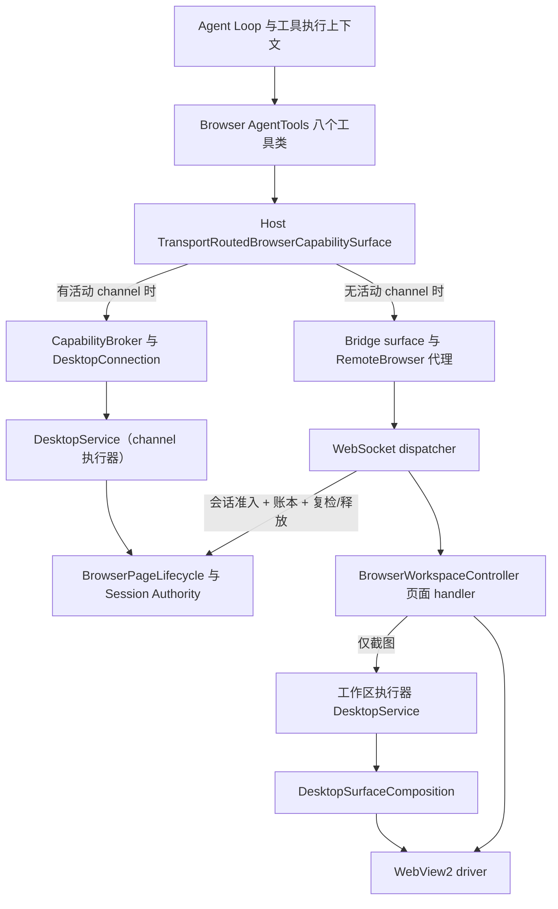

# 浏览器工具与浏览器控制能力——现有架构与一期实施入口

**一期目标是 Agent 在 PuddingDesktop 的真实浏览器中完成用户任务。** 下文描述现有代码结构，不把组件存在等同于产品可用。目标架构以 [ADR-097](111ADR-097Agent浏览器控制一期闭环与单一执行链ADR.md) 为准，施工依赖与验收见[一期方案](../12_features/Agent浏览器控制一期整体实施方案-2026-10-18.md)。

原快照的测试数字、R1–R6 状态、历史修复与复现命令移至[审阅报告](../14_reports/Agent浏览器控制架构与实现审阅-2026-10-18.md)，保留来源并限定证据范围。本页保留原文件名以维持既有引用；**2026-10-18 晚施工进度**见 §7。

## 1. 产品边界

- Core 子进程拥有 Agent Loop、工具、模型调用及工件存储；WinUI Shell 拥有窗口、浏览器表面和进程监督。
- `PuddingDesktop.WpfArchive/Browser` 的无 UI 源码由 WinUI 项目链接编译，因此它们仍属于生产调用链；WPF UI 不进入产品进程。
- 工具仅在 `DesktopChild && BrowserAutomationEnabled` 时注册。浏览器一期**固定默认 Bridge**；gRPC 能力通道可选开启，但不再是浏览器执行器的生命周期前提。
- 用户的普通浏览器、Workbench 与 Agent WebView2 profile 分离；页面数据不是指令或授权来源。

## 2. 现有生产链路

当前事实（2026-10-18 晚）：

- **默认 Bridge 已有与传输无关的执行器**：`DesktopBrowserExecutorComposition` 在浏览器工作区就绪时构造（`CapabilityExecutor` 不再依赖 channel），截图经该执行器执行；页面登记与真实版本也由工作区初始化喂入。
- **Bridge 命令准入已收敛到会话权威**：dispatcher 从宿主注入的 `Origin` 取可信 Core 会话 owner，首条可信命令确认交页归属，触碰页面前 `Revalidate` 同一票据，finally 精确释放；旧页级 grant 闸门已删除。
- **执行仍未完全统一（I2 剩余）**：导航/快照/交互等页面命令仍由 `BrowserWorkspaceController` 直接执行（准入与账本已统一，执行路径尚未迁移进执行器）。能力通道路径仍使用旧 `BrowserAutomationAuthority` 的 grant/lease，属迁移期分工。
- “不回退”的准确现状是：每次调用选择活动 channel 或 Bridge，**已尝试的操作不跨传输重试**；不是“只要配置启用 channel，Bridge 就不会被选择”。

## 3. 按层文件地图

| 层 | 当前入口 | 职责/限制 |
|---|---|---|
| 工具 | [AgentTools 地图](../../Source/PuddingBrowser.AgentTools/code_map.md) | 八个工具类、输入输出契约、调用身份作用域；canonical `All` 已含 `browser_screenshot`（八项同形） |
| Core 组合根 | [BrowserBridgeServiceCollectionExtensions](../../Source/PuddingHost/BrowserBridge/BrowserBridgeServiceCollectionExtensions.cs) | 条件注册、路由、调用上下文、binding gate 与委派端口 |
| Host 代理 | [BridgeBrowserCapabilitySurface](../../Source/PuddingHost/BrowserBridge/BridgeBrowserCapabilitySurface.cs)、[RemoteBrowserPage](../../Source/PuddingHost/BrowserBridge/RemoteBrowserPage.cs) | typed capability 到旧 runtime/Bridge 命令映射；滚动目标/事实已完整透传，`inputMode=native` 在触碰页面前拒绝 |
| Bridge | [DesktopBrowserBridgeClient](../../Source/PuddingDesktop.WpfArchive/Browser/DesktopBrowserBridgeClient.cs)、[dispatcher](../../Source/PuddingDesktop.WpfArchive/Browser/BrowserBridgeCommandDispatcher.cs) | 握手/断连、期限、账本、会话准入/复检/释放、会话状态推送 |
| 页面 handler | [BrowserWorkspaceController](../../Source/PuddingDesktop.WpfArchive/Browser/BrowserWorkspaceController.cs) | UI 协调；Agent 页面命令执行尚未迁出（I2 剩余）；截图复用工作区执行器 |
| 执行/生命周期 | [DesktopService 地图](../../Source/Pudding.DesktopService/code_map.md) | 工作区执行器、channel 执行器、页面登记、会话权威门面、旧权威/租约（channel 迁移期）与命令账本 |
| 会话规则 | [Authorization 地图](../../Source/PuddingBrowser.Authorization/code_map.md) | 独立组件，**已由 DesktopService 生产持有**：交页待确认 → 可信 owner 确认 → 写世代/唯一票据 |
| 驱动映射 | [BrowserRuntimeDesktopSurface](../../Source/Pudding.DesktopSurface.Browser/BrowserRuntimeDesktopSurface.cs) | 传 typed request 到 driver；截图/滚动事实在表面层映射 |
| WinUI/driver | [WinUI 地图](../../Source/PuddingBrowser.WinUI/code_map.md)、[WebView2 地图](../../Source/PuddingBrowser.WebView2/code_map.md) | 共用驱动源码；策略经 Abstractions 注入，不能依据旧条件编译注释判断当前支持 |
| Shell 装配 | [MainWindow](../../Source/PuddingDesktop/MainWindow.xaml.cs)、[Capability 组合根](../../Source/PuddingDesktop/Hosting/DesktopApplicationCoordinator.Capability.cs) | 建浏览器、挂 handler、构造工作区执行器与目标登记、推送会话状态、启动可选通道 |

## 4. 工具面与真实支持范围

| 工具 | 用途 | 当前需要留意的限制 |
|---|---|---|
| `browser_context` | context 发现与管理 | 发现的“状态/交出范围/实际能力”尚未进入回执；create/close 属引导/管理路径 |
| `browser_tabs` | new/list/activate/close | list 经上下文读取；其余是管理/焦点副作用；管理命令必须绑定已交出上下文 |
| `browser_navigate` | goto/back/forward/reload/stop | 写操作；默认 Bridge 经 controller 执行（执行统一属 I2 剩余） |
| `browser_snapshot` | 有界快照、正文、ref | 暂停/接管期间仍允许（运行控制只阻断副作用） |
| `browser_locate` | ref 与语义/选择器定位 | 结果绑定目标/文档版本；动作后不重查旧 Locator |
| `browser_interact` | 点击、输入、滚动等 | 滚动目标/事实已透传；`input_mode=native` 明确拒绝；`expect_value` 在默认 Bridge 报 `unverified`（动作前观察不是后置证据） |
| `browser_wait_for` | 有界条件等待 | 超时作为观察结果；支持条件以实际路径为准 |
| `browser_screenshot` | 截图、observationId、工件/图片部件 | 默认 Bridge 经工作区执行器；工件/`LlmImagePart` 机制存在，模型实际收到图片仍待 I3/I4 |

上表是当前代码限制，不是一期允许永久保留的行为。下一版对用户承诺哪些动作，以[一期动作矩阵](../12_features/Agent浏览器控制一期整体实施方案-2026-10-18.md#4-一期工具与动作支持矩阵)为准。请求不支持的输入模式应明确拒绝，不能静默执行另一个后端。

## 5. 授权、控制与幂等的现状

**会话权威（单一准入）**：`BrowserPageLifecycle` 内部持有 `AgentTargetSessionAuthority`，并把桥握手/断连、用户交页、暂停/接管、关页/关上下文全部驱动到它；桥/Shell 只经 `BrowserSessionAdmission` 的**标量门面**访问（不引用 Authorization 组件）。

- **交页 ≠ 授权**：用户选页只产生“待交页”；首条带可信 `Origin` owner 的命令确认归属后才建立会话；UI 状态区分“等待会话确认 / 已交出 / 失效”。
- **页面可驱动性**只来自：用户选中的 Agent 目标页，或页级 grant。**桥在线不再放行任意页面**（F3 修复）。
- **运行控制**：暂停/接管只阻断副作用并取消在途写，只读观察继续；恢复不复活旧写（独立写世代）。
- **票据**：唯一 `permitId`、写串行化、触碰前复检、所有退出路径精确释放；释放后不可复用，迟到/重复完成不释放他人占用。
- **过渡**：`DesktopService` 的截图准入对只读操作使用同一页级基线（只读且不签发租约）；能力通道路径仍用旧 authority 的 grant/lease，待 I2 执行统一后退役。

幂等：`BrowserOperationLedger` 仍是 Bridge 唯一去重来源（键=进程实例+连接世代+operationId；四态；未知结果不驱逐）。Automation 中同名 receipt 账本仍无生产持有者，不宣称已接入。

## 6. 页面观察、截图与子代理

ref 必须携带 PageVersion，并在页面/框架/文档世代/节点附着变化时拒绝失效引用。交互提交后通过 Wait 或新快照观察，不查询旧定位符来证明成功；Bridge 交互返回的元素已如实标记为**动作前快照**，工具不得当后置证据（`expect_value` 报 unverified）。

截图工具已有分块完整性校验和 `IBrowserScreenshotPublisher`；Host 在视觉存储服务已注册时注入 publisher，产生 workspace 工件及 `LlmImagePart`。生产组合根测试已验证“能力通道关闭 + 交页准入 + 假 driver”下截图经执行器到达驱动恰好一次；真实 WebView2 图片与模型接收仍需 I3/I4 证据。

子代理已有 Core 标量端口、Platform 申请/撤销与 Host 实现；Host 实现依赖 channel session，无 session 会拒绝。主 Agent 路径与子代理路径须独立验收，不能用委派单测替代默认产品可用性。

## 7. 施工进度（2026-10-18 晚）

| 工作包 | 状态 | 证据 |
|---|---|---|
| I0 反例基线 | ✅ 关键反例落成并先红后绿 | F7 3 失败→绿；F2 2 失败→绿；F3 2 失败→绿；F4 6 失败→绿；I2 会话准入旧闸门 6 失败→绿 |
| I1 Authorization 组件 | ✅ | `4874f1f`：所有者/写世代/唯一票据/交页确认；组件测试 **48/48** |
| I2-a 执行器解耦 + 工作区管线 | ✅ | `118920e`/`3152ba7`：共享权威关闭权、工作区执行器、页面登记/版本、页级只读准入；DesktopService **418/418**，Shell build 0 |
| I2-b Bridge 单一准入 | ✅ | `590e18a`：会话权威接入、owner/交页确认、复检/释放、稳定码；Desktop **342/342**，负对照 6 失败 |
| I2-c 执行统一 | ✅ 生产路由全覆盖，清理未做 | 前置：`8f5a0bf`（执行器见 `SessionPermitMarker` 不重复旧 authority 裁决）、`f2b7d1a`（Marker 上线排除守卫）。映射/反投影/接线：`a9d3c1e`…`b1e7c94`（命令映射全量、结果反投影、派发器路由缝、真实执行器路由）；**Bridge 全部命令**（context.list/getInfo/create/close + page.create/list/getInfo/activate/close/goto/back/forward/reload/stop/snapshot/locate/interact/waitFor/screenshot）在生产路径经**同一工作区执行器**；错误码对表测试、Shell build 0、Desktop **381/381**。**未做**：controller 旧 handler 代码删除/职责收缩、能力通道旧 authority/lease 退役；已知字段缺口（context UserDataDirectory、tabs active/agentTarget 标志）待真机确认 |
| I3 工具→模型闭环（内部部分） | 🟡 进行中 | F4 `ba41dd6`（native 拒绝/滚动透传/**53+136**）、F6 `616952b`（八工具目录/98）、F2 前半 `1db8647`（只读继续/21）、F1 组合根 `e4aaaad`（3/3，Desktop 350）、交页 UI `4ba8fe2`（2/2，347）、F5 部分 `ad85bd8`（动作前观察 unverified/99+136） |
| I3 真机 + 视觉 + 真实模型 | ⏳ 外部阶段 | 需真实 WinUI/WebView2、测试 Agent/DataRoot、视觉模型；未在本机执行 |
| I4 外部生命周期 | ⏳ 外部阶段 | 启动/重启/崩溃恢复/退出回收由外部控制器判定 |
| 防回退守卫 | ✅ | `c9cfd1e`：旧 grant 闸门 token/四步接线/owner 来源的源码守卫 3/3，负对照实测变红 |

## 8. 一期实施与验收入口

1. [ADR-097](111ADR-097Agent浏览器控制一期闭环与单一执行链ADR.md)：单一路由、传输无关执行器、控制会话、结果事实与第一期完成定义。
2. [一期实施方案](../12_features/Agent浏览器控制一期整体实施方案-2026-10-18.md)：I0–I4 工作包、组件先测后接、八工具矩阵、真实 Agent 和外部生命周期。
3. [审阅报告](../14_reports/Agent浏览器控制架构与实现审阅-2026-10-18.md)：代码证据、开源固定来源、六项旧差异裁定入口、历史测试与进度摘录。
4. [历史验收索引](../16_qa/浏览器交付验收索引-2026-10-12.md)与[外部验收手册](../13_runbooks/浏览器交付外部验收手册.md)：既有可靠性门禁与两段式流程；不能单凭历史清单宣称一期完成。
5. [I2-c 执行统一设计决议](../12_features/浏览器I2-c执行统一设计决议-2026-10-18.md)：下一阶段实施口径（提案），含适配器边界、单一准入、账本归属、完成判据与回滚方式。
