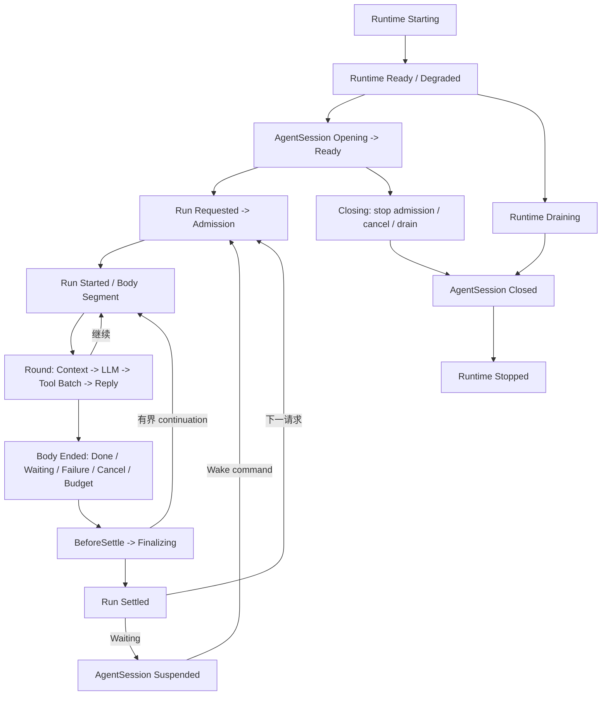

# Agent 全生命周期 Hook、事件与动作注册点目录

## 1. 本轮优先冻结的内容

**先规划全生命周期注册点，再实现具体管道。** 本目录是主入口：定义哪个阶段可以观察、拦截、变换、包裹或发起动作，谁负责执行和资源回收。所有名称是拟定合同，尚未创建生产注册表；架构和代码设计是本目录的实现说明。

范围包括 Core 业务运行时、AgentSession、Run、Round、上下文/LLM、工具、回复、等待/恢复、子代理、后台任务、插件、系统动作、时间触发及诊断。Desktop 产品进程的启动/退出仍由外部主管决定，进程内 runtime 事件不证明进程已经退出。

### 1.1 分类与记号

| 记号 | 注册项 | 能力 | 不能做 |
|---|---|---|---|
| O | Observer，只读事件订阅 | 接收不可变事实；统计或向任务端口提交新命令 | 返回 allow/deny；写当前调用的上下文 |
| G | Guard，决策 Hook | await 后返回允许/拒绝/审批/延期 | 执行被拦截动作；任意终止其他 Run |
| T | Transform，变换 Hook | 返回指定数据的新快照 | 改身份、授权事实、原始结果、全局状态 |
| W | Around Middleware，包裹 Hook | 在 next 前后处理；受约束租约与计时 | next 重复调用；未授权直接执行终端 |
| A | Action Handler，命令动作 | 有权限的命令通过注册路由进入所属 coordinator/业务处理器 | 用事件名当命令；绕过调用管道和状态机 |

Hook 不是一个含上百个可写方法的统一接口，而是 G/T/W 的具名类型合同；O 单独注册到事实流。下表出现的“前/后”是可观察事实的时间位置；前置事件本身不承担 G 的控制结果。

如果需求是“必须在工具执行前完成这段代码”，就注册 G/T/W 并 await；异步 O 即使订阅前置事实，也可能在工具执行后才消费，不能借事件名称承诺同步时序。执行后事件同样不保证所有消费者已经处理完成。

## 2. 生命周期主图

主循环结束、Run 收口、Session 关闭、产品进程退出是不同事实。注册点必须指向一个确定 scope，不能统称 OnCompleted。

## 3. 完整注册点目录

控制列“无”表示该事实阶段不开放改变运行决策的 Hook；可以有多个 O。每个 Action 仍受命令准入、当前状态和授权约束；不是注册一个名称就获得权限。下面的 action 名称为 canonical command type，Agent 使用的 tool 名称和 UI 路由由应用适配器映射。

### 3.1 Core 业务运行时与装配

| ID / 阶段 | 控制与包裹注册点 | 只读事实事件 | 动作注册点 / owner |
|---|---|---|---|
| RT01 配置/服务装配校验 | G：IRuntimePreflightCheck；不允许业务插件改变 DataRoot/Secret | runtime.starting、runtime.preflight.completed/failed | runtime.preflight；组合根 |
| RT02 必需组件启动 | W：IRuntimeStartupMiddleware，仅可信系统项 | runtime.component.started/failed | runtime.component.start；组件主管 |
| RT03 就绪/降级 | 无；required 失败不得 Ready | runtime.ready、runtime.degraded | runtime.health.query；诊断端口 |
| RT04 关闭准入与 drain | W：IRuntimeDrainParticipant，独立清理 token；不能拒绝产品退出 | runtime.draining、runtime.drain.failed | runtime.drain.request；运行时主管 |
| RT05 资源清理完成 | 无，最后基础设施组件自身停止前发出 | runtime.stopped | 产品 restart/exit 由外部主管负责 |

RT01/02 不能由尚未加载的外部 DLL 提供系统必需启动能力。注册定义必须来自已验证的系统配置；第三方包元数据扫描另见 PL01。

### 3.2 AgentSession 生命周期

| ID / 阶段 | 控制与包裹注册点 | 只读事实事件 | 动作注册点 / owner |
|---|---|---|---|
| AS01 创建身份、模板/策略快照 | G：IAgentSessionOpenFilter；W：IAgentSessionResourceParticipant | agent_session.open.requested、opened/open.failed | agent_session.open；SessionCoordinator |
| AS02 Ready 与可用状态 | 无；availability 是投影 | agent_session.availability.changed | agent_session.inspect；查询端口 |
| AS03 暂停/挂起 | G：ISessionSuspendFilter，只能校验，不直接写状态 | agent_session.suspended、suspend.rejected | agent_session.suspend；SessionCoordinator |
| AS04 唤醒/恢复 | G：ISessionResumeFilter，重读权限/模板/挂载世代 | agent_session.resumed、resume.rejected | agent_session.resume；SessionCoordinator |
| AS05 关闭 | W：IAgentSessionCloseParticipant；系统先禁止新准入 | agent_session.closing、closed、close.failed | agent_session.close；SessionCoordinator |
| AS06 故障与显式恢复 | G：ISessionRecoveryFilter，只批准恢复方案 | agent_session.faulted、recovered、recovery.failed | agent_session.recover；恢复主管 |

Ready/Busy 为可用状态，不能替代上述生命周期。一个 AgentSession 可承载多次 Run；close 超时不能仅删除字典项并宣称 closed。

### 3.3 Run / body / Round

| ID / 阶段 | 控制与包裹注册点 | 只读事实事件 | 动作注册点 / owner |
|---|---|---|---|
| RU01 请求与准入 | G：IRunAdmissionFilter；固定执行互斥租约 | run.requested、run.admission.rejected/deferred | run.submit；RunCoordinator |
| RU02 执行范围进入 | W：IAgentRunMiddleware，Tracing/总耗时 | run.started | 自动动作；RunCoordinator |
| RU03 每个 body segment 进入/停止 | 无任意跳转；与 RU08 有界 continuation 配合 | run.body.started、run.body.ended | run.continue 仅由协调器批准 |
| RU04 Round 开始/结束 | G：IRoundAdmissionFilter，预算/前置检查 | round.started、round.finished | 不开放 round.execute 绕过 Run |
| RU05 取消/预算耗尽 | 固定控制命令；可观察，不允许插件否决用户取消 | run.cancel.requested、run.budget.exhausted | run.cancel；取消控制端口 |
| RU06 追加输入/用户审批等待 | G：IUserInputAcceptanceFilter；固定当前 Run 围栏 | run.input.accepted/rejected、run.waiting | run.input.submit、approval.decide |
| RU07 异常分类 | T：IRunFailureMapper，仅安全分类，不改变已发生效应 | run.failure.observed | diagnostics.query；不直接重启当前 body |
| RU08 最终收口前 | G：IRunSettlementFilter：Settle / Continue / Suspend / Fail | run.finalizing；continuation.requested/accepted/rejected | 由 RunCoordinator 调度，受原预算上限 |
| RU09 必要持久化/释放 | W：IRunSettlementParticipant，必需项受信任 | run.settlement.failed | recovery.reconcile；恢复主管 |
| RU10 收口完成 | 无控制 Hook；只读 | run.settled | 后续新任务走 run.submit |

RU07 不暴露原始 Exception 给外部；失败 DTO 携带安全错误码和证据引用。RU08 不是 observer；RU10 不能要求“再做一次模型调用”修改已经收口的 Run。

### 3.4 上下文、压缩与 LLM

| ID / 阶段 | 控制与变换注册点 | 只读事实事件 | 动作注册点 / owner |
|---|---|---|---|
| CX01 上下文来源收集 | T：IContextContributor，输出带来源/优先级/预算的 segment | context.build.requested | context.preview 为只读动作；ContextBuilder |
| CX02 合并/裁剪/围栏 | T：IContextTransform；固定 canonical turn/身份/预算校验不可移除 | context.built、context.validation.failed | 不开放任意改写 CURRENT USER TURN |
| CX03 压缩候选与准入 | G：ICompactionAdmissionFilter；T：ICompactionCandidateTransform | compaction.proposed、skipped、started | context.compact.request；ContextMaintenance |
| CX04 压缩提交 | 固定候选指纹/净收益/事务验证，不作为外部 Hook | compaction.committed/failed | 候选失效重新计划，禁止写 DB 的回调 |
| LM01 请求准备 | T：ILlmRequestTransform，受允许字段白名单限制 | llm.request.prepared | 由 ILlmInvocationPort 调用 |
| LM02 请求准入/调用包裹 | G：ILlmRequestAdmissionFilter；W：ILlmInvocationMiddleware | llm.request.started、llm.request.finished | 不开放直接 provider.send 工具 |
| LM03 流增量 | 无控制，O 经低成本独立流消费 | llm.delta.observed（默认不持久逐 token） | 上层编码为 SSE；不在 observer 内 await UI |
| LM04 Provider 故障与重试 | LLM 模块内部策略注册；只公开安全反馈合同 | llm.attempt.failed、llm.retry.scheduled | attempt 由 LLM 端口管理预算/幂等 |

LM01 禁止改变已选择的身份、秘密、允许工具集合和当前用户输入围栏；若改变模型/协议等需重新走模型选择命令和完整准入，不能在一个 Transform 中偷换。预算/压缩反馈通过 DTO 交给所属策略，不由上层操作 provider 内部状态。

### 3.5 工具发现、调用与返回

| ID / 阶段 | 控制与过滤器注册点 | 只读事实事件 | 动作注册点 / owner |
|---|---|---|---|
| TL01 元数据发现/可见集合 | T：IToolExposureContributor；固定权限求交 | tool.catalog.changed、tool.exposure.changed | tool.search、tool.describe；Catalog |
| TL02 请求/解析绑定 | W：IToolCallMiddleware；固定可信 identity | tool.call.requested | tool.invoke；唯一调用端口 |
| TL03 参数绑定/规范化 | T：IToolInputFilter；固定 schema/大小校验 | tool.input.prepared/invalid | 无单独“跳过验证执行”动作 |
| TL04 权限与前置检查 | G：IToolAuthorizationFilter，多个订阅式注册的策略逐个 await | tool.authorization.allowed/denied/approval_required/deferred | approval.request / decide；审批协调器 |
| TL05 并发/额度/执行资源 | W：IToolResourceFilter；固定执行前权限世代复核 | tool.execution.queued、tool.resource.acquired/rejected | 由管道协调资源 |
| TL06 执行 | W：IToolInvocationFilter；终端 IToolExecutorPort | tool.execution.started、tool.execution.finished | 只能通过 tool.invoke 间接到达 |
| TL07 异常与效果裁定 | T：IToolExceptionMapper，执行异常专用 | tool.failure.observed | effect.query / compensation.request 需工具明确支持 |
| TL08 返回投影 | T：IToolResultFilter；原始结果封存后 waterfall | tool.result.projected/projection.failed | 原文通过受授权 artifact 查询 |
| TL09 调用收口 | 固定终态提交与租约释放；外层 W finally | tool.call.finished | diagnostics.query；含拒绝/取消/未知效应 |

TL04 的“注册”与只读事件的“订阅”使用不同 API。防火墙注册到 TL04；延迟统计注册 TL02 W，或订阅 TL02/TL09 O。TL08 负责处理模型可见内容，不允许覆盖 TL06 的原始成功/失败、错误和副作用事实。

### 3.6 回复、投递与用户交互

| ID / 阶段 | 控制与变换注册点 | 只读事实事件 | 动作注册点 / owner |
|---|---|---|---|
| RP01 回复草稿/协议解析 | T：IAgentReplyTransform，保留结构化状态/引用 | reply.prepared、reply.validation.failed | 当前 Run 内由 ReplyPipeline 调用 |
| RP02 最终回复审核 | G：IReplyPublicationFilter；固定隐私/渠道限制 | reply.publication.denied | reply.review.request；审批协调器 |
| RP03 canonical 回复提交 | 固定提交；不可由外部结果 Hook 替代 | reply.committed | reply.publish.request 必须引用有效草稿和 Run |
| RP04 渠道投递/重试 | W：IMessageDeliveryMiddleware，业务投递端口 owns retry | message.delivery.started/succeeded/failed | message.deliver / retry；渠道模块 |
| RP05 UI/用户反馈 | O；输入转为新命令 | user.feedback.received、approval.decided | user.input.submit、user.feedback.submit |

reply.committed、run.settled 和 message.delivery.succeeded 是三件事。渠道发送失败不改变已完成工具的效应；投递重试使用同一 deliveryId 幂等，不能重跑 Agent body。

### 3.7 子代理、后台任务、记忆与长期目标

| ID / 阶段 | 控制与包裹注册点 | 只读事实事件 | 动作注册点 / owner |
|---|---|---|---|
| SA01 委派准入 | G：IDelegationAdmissionFilter；预算/权限取交集 | subagent.delegation.requested/accepted/rejected | subagent.delegate；DelegationCoordinator |
| SA02 子 Run / 汇聚 | W：ISubAgentJoinMiddleware；与父 Run 必要工作账本关联 | subagent.started、subagent.settled、subagent.join.finished | subagent.cancel / inspect；所属 coordinator |
| BG01 Job 提交/准入 | G：IBackgroundJobAdmissionFilter；workspace/owner 固定 | job.queued/rejected | job.submit；任务调度端口 |
| BG02 Job 执行/终态 | W：IBackgroundJobMiddleware | job.started、job.finished、job.retry.scheduled | job.cancel / retry；JobCoordinator |
| MM01 记忆读取/写入 | 记忆组件自己的 G/T/W，窄字段合同 | memory.query.finished、memory.write.committed/failed | memory.query / write；MemoryService |
| GL01 Goal 迭代/结算 | 目标组件自己的 G，不能覆盖 Run 生命周期 | goal.iteration.started/settled、goal.settled | goal.continue / cancel；GoalCoordinator |

子代理仍执行相同 Run/LLM/Tool 管道；SA02 只是委派关系，不能再开一个绕过门禁的工具调用入口。记忆与 Goal 扩展点先登记归属，详细领域合同在其组件中独立设计，不把所有领域机制塞进 AgentKernel。

### 3.8 插件包、加载、挂载与卸载

| ID / 阶段 | 控制与包裹注册点 | 只读事实事件 | 动作注册点 / owner |
|---|---|---|---|
| PL01 启动/运行时元数据扫描 | G：IPluginManifestValidator，纯元数据校验 | plugin.discovered、plugin.metadata.invalid | plugin.scan / inspect；Catalog，不加载 DLL |
| PL02 激活准入 | G：IPluginActivationFilter；固定信任/权限/资产验证 | plugin.activation.requested/denied | plugin.activate；PluginSupervisor |
| PL03 Worker 启动/入口初始化 | W：IPluginActivationParticipant，系统可信 | plugin.activation.started/succeeded/failed | 主管监督，外部 DLL 不进入 Core 地址空间 |
| PL04 Agent 挂载/曝光 | G：IPluginBindingFilter；固定许可取交集 | plugin.binding.attached/detached | plugin.attach / detach；BindingCoordinator |
| PL05 健康/运行时故障 | O；动作走主管命令 | plugin.worker.failed、plugin.quarantined | plugin.diagnose / quarantine |
| PL06 卸载与资源 drain | W：IPluginDrainParticipant；不能否决系统回收 | plugin.unload.requested、unloaded、unload.failed | plugin.unload；PluginSupervisor |

发现包、激活 Worker、挂载 Agent、暴露工具是四个独立事实。卸载 owner 同时撤销其 Action/Hook/Observer 注册；在途调用保留快照租约并按 drain 策略结束。具体包/IPC/管理工具合同沿用工具插件化方案。

### 3.9 Agent 动作、Pudding 系统动作与时间

| ID / 阶段 | 执行前注册点 | 执行后 / 终态事件 | 动作注册点 / owner |
|---|---|---|---|
| AC01 Agent 提议动作 | G：IAgentActionAcceptanceFilter；验证模型结构化提议，不直接执行自然语言 | agent.action.proposed、accepted/rejected | agent.action.submit；动作路由协调器 |
| AC02 Agent 动作分派 | W：IAgentActionMiddleware；再进入对应工具/回复/委派/等待管道 | agent.action.started、agent.action.finished | kind 为 ToolCall / Reply / Delegate / Wait / Complete；固定 kind 路由 |
| AC03 Pudding 应用动作 | G：IApplicationActionFilter；W：IApplicationActionMiddleware | app.action.requested、started、finished | 按 namespace 注册唯一处理器，应用 ActionDispatcher |
| AC04 配置/Agent/渠道管理 | G/T：所属模块的校验/变换；expectedVersion 必需 | config.changed、agent.definition.changed、connector.state.changed | config.update、agent.definition.update、connector.start/stop；所属组件 |
| AC05 维护/运行管理 | G：授权的系统控制策略；不能阻断最终安全退出 | maintenance.started/finished、runtime.control.accepted/rejected | storage.maintenance、runtime.stop/restart.request；后者转外部主管协议 |
| TM01 Schedule 定义与修改 | G：IScheduleRegistrationFilter，权限/时区/触发频率检查 | schedule.registered/updated/removed | schedule.create/update/remove；TimeTriggerCoordinator |
| TM02 时间到达与派发 | G：IScheduledActionAdmissionFilter；W：IScheduledDispatchMiddleware | schedule.due、trigger.dispatched/skipped/missed | 不直接执行 Hook；提交预注册 action envelope |
| TM03 deadline / timeout / interval | 固定取消机制；阈值通知 O | deadline.reached、timeout.observed、timer.threshold.reached | timeout 是控制原因；通知不能代替取消源 |
| TM04 时钟变动/恢复补发 | G：IScheduleRecoveryFilter，按持久策略重建，不修改已过 deadline | clock.adjustment.observed、schedule.recovered | schedule.reconcile；时间模块 |

Agent 的动作提议与执行事实分开：一个提议可以被拒绝或推迟。AC02 的 tool kind 必须进入 TL02–09，delegate 进入 SA01/02，reply 进入 RP01–03；这是组合关系，不是额外执行通道。Pudding 的应用动作有自己所属模块，不由 AgentKernel 实现渠道启动、配置读写或存储清理。

时间定义包含三种口径：UTC/指定时区的日历时间决定 schedule，TimeProvider 单调时间计算耗时/deadline，持久序号决定事实先后。不能仅按 occurredUtc 排序。调度定义含 scheduleId、owner、targetAction、timeZone、cron/interval/once、misfirePolicy、并发策略、enabled；secret 不放 schedule payload。一次触发生成 triggerId 与幂等 commandId，遵守动作授权；时间到达不自动赋予新权限。

Misfire 策略显式为 Skip / CoalesceLatest / CatchUpBounded，CatchUp 有次数和时间预算；同 schedule 默认禁止重叠。日历时区/DST、机器休眠、重启、时钟回拨需要真实调度测试。高频 tick 不默认广播为持久事件；只登记业务触发、遗漏及健康摘要。系统 timer 和 Run deadline 由各自 owner 管理，插件卸载取消其 schedule、入队触发及在途租约。

## 4. 动作注册合同与调用规则

Action 是可请求执行的命令，例如 run.submit、plugin.unload；Event 是既成事实，例如 run.settled、plugin.unloaded。注册点分成三类：

| 类型 | 谁可注册 | 路由与权限 |
|---|---|---|
| 内核生命周期命令 | 内置系统 owner，启动装配 | 固定 coordinator，唯一 handler，不可第三方覆盖；所有命令经过身份、状态、版本围栏 |
| 领域动作 | 可信领域组件，显式 capability | 有 namespace + schema + effect/idempotency 描述；通过 ActionDispatchPipeline |
| 外部插件动作 | 受约束 Worker owner | 受插件 manifest、许可和绑定约束；向 Agent 暴露时映射成工具，同样进入工具调用管道 |

ActionDescriptor 至少包含 actionId、版本、输入输出 schema、scope、required capability、effectKind、支持的幂等模式、owner、timeout。一个 `(actionId, version, targetScope)` 只有一个有效 handler；冲突拒绝装配，不能用“最后注册者获胜”。同一命令可有多个 G/W/O，但 handler 不做广播执行。

ActionEnvelope 包含 commandId、actor、targetScope、expectedVersion、idempotencyKey、causationId 和 immutable payload。传入 actor 只能由入口认证后建立，不能信任 payload 自称管理员。系统状态命令有校验后的控制面执行通道；领域有副作用动作执行前获得许可和资源租约，不能靠调 ActionDispatcher 绕开工具授权。

Observer 想触发动作时，必须显式订阅绑定：`事件条件 -> 提交 action envelope`。由调度端口进行去重、权限校验、递归深度/因果环限制；不是发布任意 event 就自动执行同名 action。默认关闭通配事件到高权限动作的自动绑定。

## 5. 名称、负载与事件守恒

事件名使用 `domain.subject.fact`，action 使用 `domain.subject.verb`；JSON schemaVersion 独立于名称。合同版本重大变更显式升版，不创建散落字符串；代码生成/静态常量来自单一 Catalog 定义。

| 事件组 | 基数与顺序 | 必须携带 |
|---|---|---|
| Runtime | 一次 runtimeGeneration：starting 一次，ready/degraded 按健康变化，draining 一次，stopped 最多一次 | generation、组件健康；外部进程退出证据另存 |
| AgentSession | 一次生命周期 opened 最多一次、closing 一次、closed 最多一次；暂停/恢复可多次 | sessionId、sessionVersion、原因 |
| Run | 每个 commandId 一次 requested；started 0..1；body 可多个 segment；settled 最多一次 | executionId、segmentId、最终 outcome、预算与清理结果 |
| Round | 每个 roundId：started/finished 各最多一次，finished 含失败/取消 | executionId、roundIndex、调用与用量摘要 |
| LLM | requestId 下多个 attemptId；attempt 终态与 logical request 终态分开 | 模型标识、协议类型、usage、错误码；无 secret |
| ToolCall | callId：requested 一次，execution.started 0..1（多 attempt 需独立标识），finished 最多一次 | argumentsHash、descriptor/binding/policy generation、原始 outcome、投影状态、effectState |
| Action | commandId：accepted/rejected 二选一；执行终态最多一次 | handler/owner、scope、许可证据引用 |
| Plugin/Job | 每次 activationId/jobId 独立终态；重试有 attemptId | owner、generation、资源状态、原因 |

可恢复的持久 scope 使用账本补偿未完成事实；进程突然退出可能只有 requested 而没有 finished，恢复时产生 Interrupted/UnknownEffect 终态并保留恢复来源，不能伪造成功。普通 Observer 最佳努力流可能丢消息；“最多一次终态提交”不意味着事件总线 exactly-once 送达。

所有事件由所属状态权威发布。业务 observer 不发布另一个 run.settled 冒充内核。表中 completed/failed 是相互排斥的阶段事实；字段 payload 不靠字符串拼接判断状态。

## 6. 注册、注销、故障和观测规则

每项注册包含 RegistrationId、受信任 OwnerId、kind、pointId、scope、order、lifetime、trust、timeout、failurePolicy、required。pointId 与接口类型必须匹配；错误类型/重复 ID/非法作用域在注册事务中拒绝。

- G/T/W 的执行顺序由固定 stage 决定，同阶段使用明确 order 与稳定 ID；O 可多个独立消费者，不承诺它们的完成顺序。
- 当前调用使用不可变 registry generation；注销只影响后续快照，owner drain 等待当前调用实际退出。
- G 中安全前置项 fail-closed；O 失败隔离；T 分必需安全变换和可选装饰；W 受阶段语义约束，不能事后改写已发生效应。
- 订阅有 handle、队列和工作 owner；可重放消费者有 checkpoint。清理用独立 deadline，不使用已取消的请求 token。
- 防火墙按注册合同控制执行，既不直接操作 Agent 主循环，也不依赖 O 的副作用取消。计时 W 用单调时钟，事件关联统计要显示缺失率。

### 6.1 单一注册入口与顺序

拟定 `Source/PuddingHost/Composition/AgentExtensionsComposition.cs` 为生产组合入口，以 `AddPuddingAgentExtensions(...)` 和组件提供的 `Use...` C# 扩展方法集中声明。扩展方法只声明自身服务、注册项、动作和 schedule，不访问内核私有字段，也不在构造器/程序集静态初始化中偷偷订阅。Web、Console 与 DesktopChild 共用此组合入口；测试可以创建独立 builder。

单一 `AgentExtensionRegistry` 保存 Hook、Observer、Action、Schedule 的描述与世代；单一 `AgentExtensionPointCatalog` 保存本目录的 pointId、合同类型、默认错误语义和允许作用域。Action 路由、事件订阅和时间模块使用该注册快照的不同索引，执行设施仍各自独立，不把所有逻辑塞入一个 God class。

排序固定为：**Stage → Order → ScopeRank → RegistrationSequence → RegistrationId ordinal**。阶段由合同绑定，不接受任意设置；ScopeRank 为 Global、AgentSession、Run、ToolBinding。默认 Order=0，因此同阶段同作用域按照中央代码的注册顺序进入，包裹式过滤器逆序退出。显式 Order 只改变同阶段排序，不能越过授权/校验等固定边界。注册 Sequence 由单一事务分配，不允许组件自造；动态变化在诊断中记录实际序号与世代。

同一中央链中先声明 UseFirewall 后声明 UseResourcePolicy，仅在二者同阶段且同 Order/Scope 时决定先后；跨阶段仍按阶段规则。Observer 默认各有独立队列，若业务要求依赖顺序，应改成一个串行控制管道或有 checkpoint 的投影流水线，不能借用订阅注册顺序保证异步处理完成顺序。

组合入口首先验证候选全集，再原子发布世代；冲突/缺失 required 项不影响旧世代。插件管理命令也通过该 registry 的受控事务，不修改中央源码，不创建另一份暗藏的列表。中央入口是声明中心和排查入口，动态注册实际状态以 registry 查询为准。

管理查询按 pointId 展示“支持的扩展类型 / 当前注册项 / required / scope / 执行顺序 / snapshot generation / 健康”。先提供查询与 dry-run，再提供有权限的注册管理；不能把 event 名列表误展示成全部都可拦截。

## 7. 首批实现边界与代码入口

全目录覆盖目标生命周期，不要求第一版一次实现所有领域 Hook。建议先冻结合同和状态权威，然后依次交付：

| 批次 | 必须实现的点 | 退出条件 |
|---|---|---|
| C0 合同目录 | 记号分类、事件/动作信封、ID、权限、owner、状态/终态合同 | 点位无歧义；架构与接口对照一致 |
| C1 执行骨架 | RT01/03/04、AS01/05、RU01/02/05/08/09/10、TL02–09 | 正常、拒绝、审批、异常、取消、超时、卸载均有正确结果与资源归属 |
| C2 数据准备与输出 | CX01/02、LM01/02、RP01–04、TL01 | 流式/非流式一致；领域事件与 HTTP 编码分离 |
| C3 动态插件与后台 | PL01–06、BG01/02、SA01/02 | Agent 动态加载/使用/卸载，故障可诊断，子代理无权限旁路 |
| C4 领域扩展 | Compaction、Memory、Goal 及细粒度恢复 | 各组件独立冻结合同并验证，注册进同一目录 |

AS03/04、RU06 等现有产品必需行为在接入时必须保留，可先使用适配器；上表是新组件施工批次，不代表允许删除未迁移行为。详细项目/接口/类/文件与验证安排见[代码设计](Agent生命周期与Hook管道代码设计-2026-10-09.md)，职责与管道规则见[架构设计](Agent生命周期与Hook管道架构设计-2026-10-09.md)。
