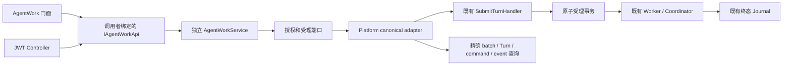

# Agent 单轮执行 API P2：契约与接入说明

这份契约实现总规划中的**已有 Agent 单轮文本执行切片**。上层提交文本与稳定操作 ID，取得因果回执，随后查询这一轮执行的状态和原始回复；不需要知道 JSON 文件、数据库、上下文、工具和 LLM 资源池如何装配。

## 1 能力与边界

- Agent 必须已存在、已启用、未冻结，且有归属于该 Agent 和调用者的可用主会话。没有主会话返回 `agent.not_ready`，不暗中创建 Agent 或会话。
- 只提交一个 canonical Turn；复用既有 worker、执行租约、工具授权和终态提交，不引入第二套执行循环或 Work 状态表。
- `Completed` 仅证明本轮执行已提交完成事件。`Verification` 固定为 `not_requested`；不代表用户目标已验收，也不承诺外部工具副作用 exactly-once。
- 当前 HTTP 只向已认证的管理用户开放；进程内使用绑定调用者的 `IAgentWorkApi`。插件 RPC、委托权限与额度尚未接入，禁止把管理身份工厂直接交给插件。
- 创建实例、子代理、流式订阅、显式取消、Goal 自动续轮与验收 Hook、MCP/上下文/模型池公共租约不属于本切片。不能据此宣称整个组件化完成。

## 2 调用方用法

```csharp
// authenticatedHttp 由调用方创建、认证并释放，BaseAddress 为实际 Core 地址。
var api = new HttpAgentWorkApi(authenticatedHttp);
var work = new AgentWorkClient(api).For(new AgentRef("default", "agent-id"));

// 在业务记录里先持久保存 operationId 和完整文本；响应丢失时不得换 ID。
var request = new AgentWorkRequest("business-job-42", "请检查当前工作区，并报告发现。");
var receipt = await work.SubmitAsync(request, cancellationToken);
var snapshot = await work.GetAsync(request.OperationId, cancellationToken);
// snapshot.IsTerminal / Status / Terminal / DiagnosticCode 决定如何展示。
// Terminal.Reply 可以为空，不能据此把 Completed 改成失败或捏造回复。
```

如果已有配置 SDK 的 `Agent` 句柄，可用 `agent.Work(api)` 得到同一执行门面。配置核心契约保持冻结，本次通过新增 SDK 文件扩展能力。句柄没有隐藏后台线程、不拥有宿主、不创建 LLM 客户端；查询取消只结束调用方等待，不取消已受理工作。

## 3 操作身份与恢复

`OperationId` 是调用方的业务去重键；作用域为可信 actor + workspace + agent。允许 ASCII 字母、数字、点、下划线和横线，长度 1–128，拒绝 `.` / `..`。工作区最长 64、Agent 最长 128。文本非空白，最长 32768 字符，原文不裁剪。

服务从作用域和 OperationId 派生稳定 WorkId，作为既有 acceptance batch 的 ClientRequestId。输入消息 metadata 保存调用者、OperationId、完整文本请求哈希，与输入、batch、Turn、command 和 `turn.accepted` **同事务提交**。不新增数据库表或第二个幂等存储。

| 情况 | 结果 |
|---|---|
| 相同身份、操作 ID、文本再次提交 | 返回原回执，不再排队 |
| 相同操作 ID、不同文本（含空格差别） | `operation.conflict`；本次未受理 |
| 原工作已受理，Agent 后来冻结或主会话重绑定 | 仍可回读/重放原回执；新操作按当前可用性检查 |
| 事务已提交，通知或响应失败 | 从新数据库 scope 回查；能证明提交则返回原回执，否则 `unknown` |
| HTTP 超时、断线、取消发生在提交之后 | `submission.unknown`；SDK 不自动重试 |
| 查询暂时没有受理记录 | HTTP 204 / SDK null；并发中的提交仍可能稍后提交，不能当成取消或保证未执行 |

遇到 `unknown`，先用原 OperationId 查询；必要时**重发完全相同的请求**。不能另造 ID。去重保证依赖 canonical 输入/batch 的保留期；本切片不删除这些记录，也不承诺清库之后仍记得旧操作。

Core 的数据目录租约保证单进程写入；singleton adapter 的提交 gate 串行化本入口的受理/去重。所有读取按同一数据库事务快照完成，避免运行中多次读产生假矛盾。运行时配置仍按既有 Coordinator 执行时冻结，回执不声称已经冻结本轮 LLM 或工具配置。

## 4 状态判据

| 状态 | 可复核证据 |
|---|---|
| Accepted | 输入、batch、唯一 command、Turn 和 accepted event 身份一致；command 为 pending/leased |
| Running | canonical command 为 running/cancel_requested，尚无终态；cancel_requested 不等于取消完成 |
| Waiting | canonical command 为 waiting_child/waiting_for_tool |
| Completed / Failed / Cancelled | command 状态、Turn 状态/终态序号/种类、事件类型/payload.kind 全部一致，且 workspace、conversation、command、turn、run、assistant message 身份一致 |
| Unknown | 未识别状态、缺失终态、终态 JSON 损坏或身份矛盾；提供 diagnostic code，不返回可误认成功的回复 |

回执包括 WorkId、OperationId、Agent、ConversationId、InputMessageId、TurnId、CommandId、AcceptedSequence、AcceptedAt。终态另外包括 EventId、RunId、Sequence、原始 Reply、ErrorCode、ErrorMessage。**不查询会话最新回复、不用文字包含某个 ID 当因果证据、不解析“已完成”文字当状态。** 身份层受理证据损坏返回 `receipt.invalid`，不回传不可信回执。

## 5 HTTP 与分层

- `POST /api/workspaces/{workspaceId}/agents/{agentId}/work`：JSON `{ operationId, text }`；成功 200 为受理回执，非执行完成。未知字段被拒绝，包括 actor、GoalContinuation 或控制字段。
- `GET /api/workspaces/{workspaceId}/agents/{agentId}/work/{operationId}`：200 为快照，204 为当前无记录。
- 401/403 为认证/授权失败；400 参数错误；409 为操作冲突或 Agent 未就绪/不可用；503 为无法确认受理或证据损坏。标准错误包含 `code/message/effectOutcome`，内部异常细节不透传。



`Pudding.Api.Contracts` 只依赖 BCL；`PuddingAgentWork.Contracts` 只依赖公共契约；`PuddingAgentWork` 只依赖端口与公共值。csproj 白名单在编译期拒绝反向引用 Host。Platform 承担存储和运行时适配，Host 只做 DI 装配。SDK 使用接口或认证 HTTP，不引用 Platform/Runtime。

## 6 验证入口与下一步

组件测试在 `Source/PuddingAgentWorkTests/`；SDK 回执/断线/取消测试在 `Source/Pudding.Api.SdkTests/WorkSdkTests.cs`；SQLite/JWT/真实终态 Journal 测试在 `Tests/PuddingAgentWork.IntegrationTests/`；Host 装配测试在 `Tests/PuddingHost.Tests/Hosting/AgentWorkCompositionTests.cs`。具体运行结果记录在修改日志，不写入架构判据。

下一项核心工作应先补齐**取消与终态竞态、插件委托授权和资源额度**，再开放 worker RPC；不能通过给插件管理 token 快速接通。Goal 验收插件需要单独的回合交付事件、只读上下文视图和受预算限制的子代理 API，本切片仅提供它们的执行入口基础。
