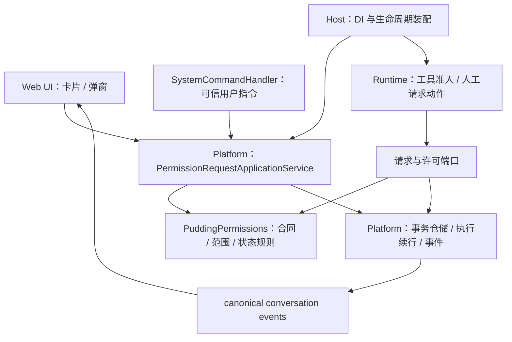
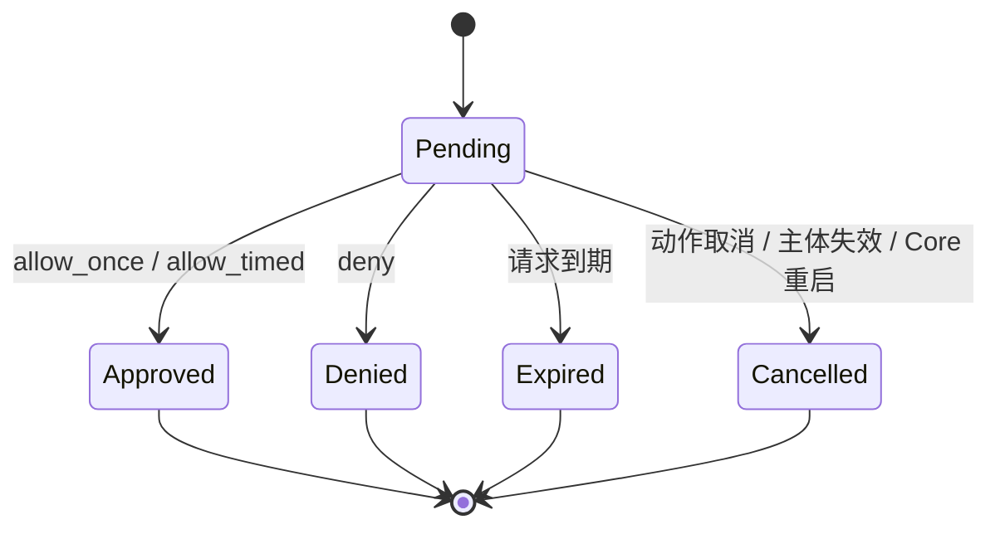

# Agent 权限请求与单次、短时授权设计方案

> **交付性质：设计提案。** 本文定义产品行为、组件边界、合同和验收条件，不表示功能已实现或已部署。
>
> **目标：Agent 遇到高风险操作或特殊权限需求时，能向用户发起具体、可审阅的请求；用户通过弹窗或授权指令决定允许一次、短时间允许或拒绝；运行时按该决定继续或停止相应动作。**

## 1. 产品决策

采用 **一个权限请求状态机、两种决策入口、三个展示位置**：

- 状态机：请求 → 用户决定 → 授予许可 → 执行前核验与消费 → 失效或撤销。
- 决策入口：可信 Web UI 按钮、经过身份验证的用户消息指令；二者调用同一个应用服务。
- 展示位置：会话消息中的请求卡片、当前会话的授权弹窗、工作台的待授权入口。

一期提供：

| 能力 | 约定 |
|---|---|
| 单次授权 | 默认选项；绑定一个具体动作，只允许一次执行尝试 |
| 短时授权 | 1、5、10 分钟；默认建议 5 分钟，最长 10 分钟，按服务端时间计时 |
| 授权对象 | 具体工具调用，或后端已登记且有执行校验器的权限 |
| 拒绝 | 拒绝这张请求，阻止该待执行动作；不等同于永久黑名单 |
| 撤销 | 提前撤回尚未消费的许可或短时许可 |
| 等待与继续 | 等待期间不循环请求模型；决定提交后恢复对应动作或反馈拒绝原因 |
| 恢复界面 | 刷新、切换会话、SSE 重连后仍能读取待处理请求与当前许可 |

一期不提供永久授权、整台机器授权、通配所有工具、一键授权所有子代理。现有完全访问模式保持独立产品含义，不作为本弹窗的快捷选项。

**用户许可与安全分类是两种事实。** 现有自动审批继续处理普通调用，本功能不把所有高危工具都改成人工必审；只有策略声明需要用户同意、Agent 明确申请用户许可，或已产生可人工处理的结果时才建立请求。

## 2. 现有基础与缺口

以下结论来自源码静态阅读，未以本次运行验证代替集成验收。

| 现有位置 | 已有能力 | 本方案需要补齐 |
|---|---|---|
| [ToolAuthorization.cs](../../Source/PuddingCore/Tools/ToolAuthorization.cs) | `/authorize`、`/deny`、`/revoke`；Once、Timed、Session、Permanent；参数哈希工具 | 指向具体请求的命令、明确资源范围、授权人与执行主体分离 |
| [InMemoryToolAuthorizationService.cs](../../Source/PuddingRuntime/Tools/Approval/InMemoryToolAuthorizationService.cs) | 工具级授权、时效查询、持久化永久许可 | Timed 目前不绑定 Session；Once 不匹配参数哈希；消费点忽略 `TryRemove` 结果，存在并发重复放行窗口 |
| [RequestToolApprovalTool.cs](../../Source/PuddingRuntime/Tools/Approval/RequestToolApprovalTool.cs) | 结构化自动审批及分类门户 | 明确的人工请求动作、请求 ID、可展示的范围与选择项；Agent 不能自行决定授权 |
| [AgentFirewall.cs](../../Source/PuddingRuntime/Services/AgentFirewall.cs) | 统一闸门；授权、自动审批、能力、工作区与资源约束 | 单次许可最终消费点；新的人工许可不能成为跳过其他闸门的早返回 |
| [ApprovalController.cs](../../Source/PuddingPlatform/Controllers/Api/ApprovalController.cs) | `/api/sessions/{sessionId}/decide`；写入 `approval.resolved` | 当前控制器未调用运行时授权服务；需所有权校验、原子决策及 grant/恢复调度联动 |
| [SystemCommandHandler.cs](../../Source/PuddingPlatform/Services/Conversation/SystemCommandHandler.cs) | 用户指令接入授权服务；外部渠道有特权判定 | 与按钮完全共用请求决策路径；不再通过工具名产生无请求绑定的临时许可 |
| [ApprovalCard.tsx](../../Source/PuddingPlatformAdmin/src/pages/chat/components/ApprovalCard.tsx) | 消息内卡片；允许一次、始终允许、拒绝 | 短时选项、范围展示、实时到期状态、弹窗、撤销入口 |
| [MessageList.tsx](../../Source/PuddingPlatformAdmin/src/pages/chat/components/MessageList.tsx)、[事件投影](../../Source/PuddingPlatformAdmin/src/pages/chat/hooks/useSessionEventProjection.ts) | 已渲染卡片、处理 requested/resolved 事件 | 当前每条助手消息只有一个 `approvalCard`；需按请求 ID 管理集合，避免并发请求覆盖 |
| [ToolAuthorizationCommandWiringTests.cs](../../Source/PuddingPlatformTests/Services/ToolAuthorizationCommandWiringTests.cs) | 已测试人工指令授予与待审票据关系 | 当前人工 grant 生效后原自动票据仍 Pending；应显式关联人工处理结果，避免两个界面说法不一致 |

在所检查的 Runtime/Platform 路径中，已有事件定义、存储接纳和前端消费，尚未找到工具人工请求稳定写入 `approval.requested` 的完整生产链。实施时必须用真实调用验证生产者、投影、决定与执行四段，不能只验证手工构造的卡片。

因此，本次建设重点是**收口已有基础并补齐闭环**。无需再建一套互不相干的审批中心。

## 3. 用户交互

### 3.1 会话卡片

卡片固定出现在触发请求的动作旁，不依赖 Agent 自己写一段“请授权”的自然语言。标题、对象和授权范围由服务端事实生成，申请理由可来自 Agent，但明确显示为申请说明。

```text
┌─ 需要你的授权 ──────────────────────────────────────┐
│ Agent：工程助手                 风险：写入本地文件    │
│ 操作：修改项目配置                                   │
│ 对象：<当前工作区>/config/app.json                    │
│ 工具：file_patch                                     │
│ 原因：启用你要求的日志级别                           │
│ 范围：仅本会话、此 Agent、此文件                     │
│                                                     │
│ [查看变更与执行详情]                                 │
│ 请求剩余 08:42                                      │
│                                                     │
│ [允许这一次] [短时允许 ▾] [拒绝]                     │
│ 短时选项：1 分钟 / 5 分钟 / 10 分钟                  │
│ 指令：/authorize req:<请求编号> once       [复制]     │
└─────────────────────────────────────────────────────┘
```

“查看详情”按工具展示命令、工作目录、文件差异、域名、接收对象或其他结构化目标。长内容渐进展开；密钥、令牌、密码不进入卡片。影响授权范围的关键参数不能因脱敏而被隐藏；例如隐藏凭据值，但保留凭据别名及所连接服务的身份。

短时选项展开时必须明确写出“在这段时间内，允许此 Agent 在本会话中重复执行哪些操作”。**时间范围与操作范围是两个独立维度**，不能把“允许 5 分钟”实现为当前 Agent 的所有工具放行。

### 3.2 弹窗与待授权入口

- 当前打开会话有新请求时，显示一个应用内弹窗；内容与卡片同源，最多同时一个，剩余请求显示数量。
- 其他会话的请求只增加工作台待授权徽标，不抢走当前输入焦点。用户点击后进入请求所在会话。
- 每个请求每次页面访问至多自动弹出一次；关闭弹窗、点击遮罩或按 Escape 只是“稍后处理”，不等于拒绝，更不等于同意。卡片和待授权入口继续保留。
- 弹窗没有默认授权快捷键，Enter 不直接批准。提供键盘焦点约束、清晰按钮名称及读屏标签；颜色不是区分风险与状态的唯一方式。
- 请求文案按纯文本/受限 Markdown 渲染。工具返回的 HTML、网页、截图与 Agent 生成页面不能伪装成可信授权控件。
- 同一请求在卡片、弹窗和另一个浏览器窗口提交时，由后端裁定唯一决定；界面不以本地按钮状态作为授权事实。

### 3.3 结果和有效许可

卡片区分三个事实：

1. **用户决定**：已允许一次／已允许 5 分钟／已拒绝／已过期／已取消。
2. **许可状态**：待使用／有效至某时刻／已使用／已撤销／已失效。
3. **执行状态**：等待继续／执行中／完成／失败／执行结果待核实。

不能把“用户已同意”显示成“操作已成功”。短时许可在会话授权面板显示剩余时间与“立即撤销”；倒计时参考服务端 `serverTime`，服务端始终是有效期权威。

## 4. 授权范围

### 4.1 主体与身份

每份请求和许可至少绑定：

```text
WorkspaceId + SessionId + AgentInstanceId + ExecutionPrincipalId
SubjectKind + ToolId/PermissionId + ResourceScope
CoreEpoch + PolicyVersion
```

- `ExecutionPrincipalId` 是被授权的执行身份；`RequestedByAgentId` 是申请者；`DecidedByUserId` 是实际决定人。允许管理员代批时，也不得把执行身份改成管理员。
- 身份从会话、执行快照、登录态及渠道绑定解析；不采信模型参数或浏览器 body 中自报的用户、Agent、工作区。
- 父代理代子代理发起时显示完整委派来源，许可仍精确绑定子代理。默认不继承、不传播、不合并。
- 请求编号用于定位，不是访问凭据。知道编号不代表能查看或批准。

### 4.2 单次授权

绑定 `InvocationId + ToolDefinitionHash + CanonicalArgumentsHash + ResourceFingerprint + WorkingDirectory`。

- `InvocationId` 由可信执行层签发，不能使用模型随意提交的字符串代替。
- JSON 属性顺序规范化，数组顺序与实际值保持不变；拒绝重复键或无法确定的 JSON，不对命令做语义猜测。
- 参数、目标、工作目录、工具定义、资源版本变化时旧许可不适用，需要重新申请。
- “一次”指**一次实际执行尝试**。参数预检失败或其他闸门拒绝时不消费；进入工具执行前原子消费。
- 工具已开始后失败、超时或回执丢失，不返还一次许可，不自动重复有副作用动作。
- 并发下同一许可只能由一个 invocation 认领；单次许可不允许“先读剩余次数，再无条件返回成功”。

### 4.3 短时授权

所有短时许可也绑定当前会话；从用户成功决定的服务端时间起算，不从请求创建时起算。

操作范围优先按工具提供的类型化匹配器约束：

| 对象 | 可授权范围 | 一期约束 |
|---|---|---|
| 具体工具调用 | 同一工具、相同参数与目标的重复调用 | 没有可靠范围匹配器时只能使用此模式 |
| 文件写入权限 | 指定文件，或当前工作区内明确目录及写入动作集合 | 由文件工具校验最终路径；目录写入不包含删除 |
| 结构化网络工具 | 指定 origin、账号/连接、动作或接口集合 | 校验重定向后的最终目标；不靠 URL 字符串前缀 |
| 浏览器动作 | 指定工作区、页面身份、origin、动作集合 | 既有控制权、PageVersion 与执行租约仍需通过 |
| 通用 shell | 相同执行程序、命令/参数摘要及工作目录 | 不提供“该目录下一切 shell 操作”通配，shell 的副作用不能仅凭 cwd 确定 |

服务端 `PermissionDefinition` 必须声明匹配器版本、可用时长、风险级别和可授权动作。没有实际工具消费该权限的请求返回 `permission_unsupported`，不能生成一个只会亮绿灯的授权项。

删除、不可逆变更、发送敏感数据等由权限定义标为 `OnceOnly` 的动作，只显示单次选项。短时许可不覆盖后续风险升级、目标扩大或新工具定义。

文件范围需处理 Windows 路径大小写、分隔符、相对路径、目录边界和重解析点；适配器在执行前解析最终目标，不能用简单 `StartsWith`。无法确认链接目标或目标身份时拒绝范围匹配。授权匹配不能替代操作系统沙箱。

### 4.4 失效与撤销

- 到期：`now >= ExpiresAt` 即失效；定时任务只负责及时更新展示，不承担安全判断。
- 撤销：立即阻止尚未开始的调用；与执行认领并发时按同一事务中的先后顺序判定。
- 已开始的操作：尽力取消，清晰提示“撤销阻止后续操作，已产生的效果不会自动回滚”。
- 会话结束、权限定义更新、主体权限收回、工作区/目标变化：停止继续使用对应许可。
- Core 重启：一期所有未消费单次许可与短时许可按 `CoreEpoch` 失效；待决请求取消，已开始但无结果的动作标为结果待核实。历史决定保留，不能重载文件后自动恢复授权。
- 系统时钟回拨：同进程内同时检查单调计时的 TTL；重启以新 epoch 失效，不能因回拨延长许可。

## 5. 与现有自动审批的关系

权威关系参照[安全分类器与工具调用准入方案 v2](安全分类器与工具调用准入方案-v2.md) §11、§14：分类器裁决、用户同意、能力与资源边界分别建模。

| 情况 | 本方案行为 |
|---|---|
| 自动审批允许，且无需单独同意 | 直接执行，保持无人值守路径 |
| 自动审批允许，但策略要求用户同意 | 创建权限请求，等待明确决定 |
| Agent 主动提出人工请求 | 先规范化目标与范围，再建立请求；不得自己调用批准入口 |
| 既有审批结果 `NeedHuman` | 建立或复用关联的人工请求，保留原始原因与自动票据 ID |
| 分类器 `DeferredDependency` | 展示依赖等待，保持可重试语义，不自动改写为用户待办 |
| 分类器最终拒绝 | 不因用户点击而伪造成分类器允许；可展示拒绝原因与重新评估入口，重新评估须有新事实或显式管理动作 |
| 能力、沙箱、工作区、资源硬边界不满足 | 本次许可不能越过；展示无法授权的原因 |
| 人工明确拒绝当前动作 | 该动作停止；不得换一个请求 ID、走旧 grant 或自动白名单后静默继续 |

**有用户同意，不等于存在自动安全放行；有自动安全放行，也不等于用户已同意某个特别声明需要同意的动作。** 这保留分类器对安全结论的权威，同时补齐用户对具体动作的决定权。

这里的“硬边界”指模式、身份、能力、沙箱、工作区和资源不变量，不把旧命令黑名单候选升级成分类器不可覆盖的终局规则。

现有 `/authorize <tool> ...` 和完全访问路径可能先于自动审批放行。新请求接入后，必须统一检查“此 invocation 是否存在需要用户决定或已被拒绝的记录”，再走其他放行路径；旧 grant、YOLO 或完全访问不能满足新请求的用户同意条件。不得让同一调用同时存在两个互相绕过的人工授权权威。

## 6. 组件与依赖

新增独立叶子组件 **`PuddingPermissions`**，只依赖 BCL，不引用 Runtime、Platform、Host、WinUI、数据库或 LLM SDK。以下名称与路径为拟新增项，不表示文件已经存在。



| 层 | 职责 |
|---|---|
| `Source/PuddingPermissions/`（拟新增） | 请求、决定、许可、范围合同；纯状态转移与匹配规则；命令语法；时间与存储端口 |
| `Tests/PuddingPermissions.Tests/`（拟新增） | 独立规则测试、假时钟与并发仓储合同；禁止宿主依赖的构建门禁 |
| `PuddingCore` | 保留既有工具与执行合同；承接最小的 typed result、等待原因、可信调用身份适配 |
| `PuddingRuntime` | 从实际工具调用生成规范化请求；执行前匹配/认领；等待后恢复；不直接操作 EF |
| `PuddingPlatform` | 登录与所有权、请求决策应用服务、数据库事务、事件、用户指令、恢复调度 |
| `PuddingPlatformAdmin` | 卡片、弹窗、待授权面板、状态投影；不计算是否有权执行 |
| `PuddingHost` | 完成独立门禁后的服务注册与后台到期/恢复驱动 |
| `PuddingDesktop` | 继续承载 Web UI；业务审批不迁入 Shell；桌面通知只是后续可选提示 |

组件输入使用自己的小型 DTO。工具描述符、EF 实体、分类器结果的转换留在引用方，避免为复用而反向引用调用方。

## 7. 数据合同与状态机

### 7.1 三个核心对象

| 对象 | 关键字段与含义 |
|---|---|
| `PermissionRequest` | `RequestId`、`Version`、主体身份、`TurnId/RunId/InvocationId`、`Subject`、规范化范围、参数摘要、工具定义摘要、`AllowedChoices`、理由、自动审批关联、创建/到期时间、`CoreEpoch` |
| `PermissionDecision` | `DecisionId`、`RequestId`、`ExpectedVersion`、`IdempotencyKey`、`allow_once/allow_timed/deny`、时长、可信决定人/渠道、决定时间、审阅对象摘要 |
| `PermissionGrant` | `GrantId`、`RequestId`、主体与范围、`Once/Timed`、生效/到期、版本、撤销状态、签发 epoch、策略版本；单次 grant 绑定 invocation |

另设 `PermissionContinuation` 保存恢复锚点、工具调用 checkpoint 引用和执行认领状态。执行参数的受保护引用与展示 DTO 分离；对外响应只提供必要的脱敏内容，不把可用于内部执行的凭据暴露给模型或 UI。

请求默认 10 分钟未决定即过期；单次许可决定后默认 2 分钟内须开始，且不得超过动作自身 deadline。短时许可支持 1/5/10 分钟；服务端拒绝非法或超限时长，不静默扩大或缩小时长。

### 7.2 状态分别记录



请求决定后不退回 Pending。许可另有 `Active → Consumed / Expired / Revoked / Invalidated`；执行续行另有 `Waiting → Ready → Started → Completed / Failed / UnknownOutcome / Cancelled`。

批准决定是历史事实：许可到期后不能把“用户曾允许”改写成“用户从未允许”。`Approved` 请求也可能关联 `Revoked` 许可和 `Cancelled` 执行。

### 7.3 幂等与原子性

- 创建：同一 `Workspace/Session/Invocation/SubjectFingerprint/PolicyVersion` 只产生一张有效请求。重发相同调用返回原请求；改变参数生成新动作，旧待决请求取消。
- 决定：检查身份、Pending 状态、版本、有效期、允许的选项，再以条件更新写入决定；**决定、grant、恢复意图、审计事件同事务提交**。
- 同一幂等键和相同载荷返回原结果；同键不同载荷返回 `idempotency_conflict`。另一决定竞争失败返回已有状态，不追加第二份许可。
- 执行：其他准入全部完成后，以 `InvocationId` 原子认领许可并写入执行开始意图；单次 grant 只有一个消费者。状态查询不消费。
- 撤销与执行开始共享同一持久化并发边界。撤销先提交则不能开始；开始先提交则标记进行中并尝试取消。
- 采用“至多一次启动 + 未知结果显式处理”，不宣称对任意外部副作用能做到 exactly-once。工具有自己的幂等键时复用其结果核验能力。

## 8. 执行链与等待恢复

### 8.1 正常链路

1. Runtime 冻结可信身份、工具定义、实际参数、目标范围与工作目录，完成不消费许可的预检。
2. 准入策略返回 `Allowed`、`Denied`、`DependencyWait` 或 `UserConsentRequired`。最后一种通过请求服务准备创建/复用请求。
3. 受影响执行进入 `waiting_permission`，保存 checkpoint；请求、等待组、恢复锚点及 requested 事件在同一个事务里提交后才对外可见。随后释放执行租约和模型请求，不持有数据库事务等待人点击。
4. UI 或用户指令提交决定。Platform 在一个事务里更新请求、签发许可、写审计及续行意图；提交成功后通知 SSE 和调度器。
5. 调度器按恢复锚点至多唤醒一次；重新验证会话、主体、参数、工具定义、资源身份、时间及所有闸门。
6. 许可原子认领成功后执行被冻结的动作，记录结果，再继续原任务。禁止由模型自由改写一次已获批准的命令。

**UI 不直接调用工具执行 API，决定接口不直接执行 shell。** 它们只改变持久化事实，执行仍经过 Runtime 的唯一入口。

现有自动票据的 `CheckAsync` 也可能消费一次票据。接入时必须将“非消费式评估”和“执行开始前认领”分开，避免等待用户期间就耗尽自动许可。需要同时消费自动票据与人工 grant 时，相关消费记录必须进入同一执行准入事务，或先完成可证明等价的预留/提交协议；不得假定文件票据与数据库 grant 天然原子。无法完成这一门禁的适配器不能启用自动续行。

恢复调度采用持久意图而非一次性内存通知。决定与 worker 停放交错、通知丢失或后台重复扫描时，均通过请求状态、等待锚点和 fence 对账；不能出现用户已批准而执行永远睡眠，或旧 worker 与恢复 worker 同时启动的状态。

### 8.2 等待状态如何接入现有执行系统

现有 [SqliteExecutionJournal.cs](../../Source/PuddingPlatform/Services/Execution/SqliteExecutionJournal.cs) 有 `waiting_child` 停放机制，但不能假定其已支持权限等待。新增独立等待原因与对应 CAS 转移，复用租约/围栏的思想，不把权限请求伪装成子代理完成事件。

- 原 `TurnId/CommandId/InvocationId` 保持稳定；恢复产生新的运行尝试与 fence，旧 worker 失去提交权。
- checkpoint 必须覆盖当前模型工具批次、已完成结果、待授权调用、预算和恢复位置；Streaming 与 Buffered 两条执行路径使用相同合同。
- 一期在工具批次边界停放当前执行链。已开始的并行调用先收口并记录结果；尚未开始的调用不越过停放点。恢复不重跑已完成项。
- 多请求属于同一等待组：可逐个决定，全部有结果或统一到期后继续；任何依赖被拒绝的后续动作不得启动。
- 人工等待不消耗模型轮次或工具尝试次数，不触发心跳重试风暴；保留原任务总 deadline，批准不能隐式延长任务预算。
- 停止、取消、会话结束与 Goal 取消均要原子作废待决请求/未使用的单次许可；Goal 调度识别等待原因，不能另起一轮绕过等待。
- UI 断线不取消请求；Core 重启按 §4.4 处理。默认不跨重启自动重放待批准或已批准动作。

只有等待恢复门禁通过后，产品文案才能承诺“允许后自动继续”。不能把“把按钮接到 grant，再要求用户发继续”当作完整交付。

### 8.3 Agent 主动申请

扩展现有 `request_tool_approval` 门户，拟增加 `request_human`、`human_request_status`、`human_request_cancel` 动作，避免新增一个平行审批工具。

- `request_human` 接收 `tool_id + exact_arguments + purpose + requested_scope`，或 `permission_id + bounded_scope`。
- Runtime 根据目录和适配器确认范围与风险，签发 planned invocation；模型提供的“已有用户同意”“低风险”不构成证据。
- 主动申请返回请求 ID 和待处理状态；实际调用可携带请求 ID 作为选择器，由 Runtime 解析到已登记的 planned invocation 并验证参数与主体。请求 ID 本身不授予权限，无可信关联的调用不能消费该单次许可。
- 只有工具实际调用进入等待才需要保存该工具调用的执行 checkpoint；主动申请阶段等待的是 Agent 续行。批准后 Agent 可继续提交已绑定计划，参数变化则重新申请。
- Agent 可以查询自己可见的请求或取消自己的待决请求；不存在模型可调用的 `approve`、`grant` 或“替用户确认”动作。

## 9. 指令与 API

### 9.1 用户消息指令

```text
/authorize req:<request-id> once
/authorize req:<request-id> 1m
/authorize req:<request-id> 5m
/authorize req:<request-id> 10m
/deny req:<request-id>
/revoke grant:<grant-id>
/permissions
```

- `/permissions` 显示当前会话待决请求和有效许可，并提供可复制的精确指令；指令编号可以补全，不靠用户记忆。
- 中文固定命令可作为同一解析器的别名，例如 `/授权 req:<id> 单次`、`/授权 req:<id> 5分钟`、`/拒绝 req:<id>`、`/撤销 grant:<id>`。
- 一期不把“好的”“可以”“同意”自动解释为授权。没有唯一请求和范围时，这些文本继续作为普通聊天内容。
- 只处理消息入口验真的人类正文；模型输出、工具返回、转发引用、文档、网页、图片、子代理消息不能授予权限。用户仍可从卡片复制完整命令并亲自提交。
- UI 发送路径在进入普通 Turn/steering 队列之前识别授权命令；等待中的 Turn 不能阻塞用户决定的提交。
- 指令处理只记录用户决定与服务回执，不新建一次模型对话；允许后台调度恢复已存在的执行链。
- 无效授权语法返回确定性的命令错误，不能回退给模型猜测并执行。

**现有语法收口：** `/authorize <tool> once|10m` 只在当前用户、会话、Agent 下有且仅有一张可匹配待决请求时解析到该请求；零张提示先发起具体请求，多张列出编号。`session/permanent` 在该交互入口返回不支持说明。此为直接收窄当前合同，实施时同步帮助、预设提示词和测试，不新增第二套宽授权兼容实现，也不将旧永久许可自动转换为新许可。

### 9.2 HTTP 合同

复用已有决定路由，替换仅写事件的内部实现；`approvalId` 对应本模块 `RequestId`，与自动审批 `TicketId` 分开。

| 接口 | 用途 |
|---|---|
| `GET /api/sessions/{sessionId}/permission-requests?status=pending&cursor=...` | 分页读取请求；默认 20、最多 100 |
| `GET /api/sessions/{sessionId}/permission-requests/{requestId}` | 详情、当前版本和可用选项 |
| `POST /api/sessions/{sessionId}/decide` | 既有路由升级；一次或短时允许、拒绝 |
| `GET /api/sessions/{sessionId}/permission-grants` | 当前有效许可及有界分页历史 |
| `POST /api/sessions/{sessionId}/permission-grants/{grantId}/revoke` | 撤销指定许可 |

```json
{
  "approvalId": "pr_opaque_id",
  "expectedVersion": 1,
  "idempotencyKey": "client_generated_uuid",
  "decision": "allow_timed",
  "durationSeconds": 300
}
```

`allow_once/deny` 不接受时长；`always_allow` 不再出现在新合同。返回请求版本、用户决定、许可状态/范围、`expiresAt`、`serverTime`、恢复状态；禁止只返回一个 `approved: true` 让调用方猜测执行是否开始。

鉴权顺序：登录与渠道绑定 → Workspace/Session 所有权及审批角色 → 请求身份和主体 → 版本/状态/范围。外部渠道沿用现有特权校验，并额外验证目标会话绑定；跨会话决定不因管理员身份以外的普通登录而开放。不存在用户身份时失败关闭，禁止回退 `"single-user"` 或 `"admin"`。

错误码至少包括 `permission_request_not_found`、`permission_forbidden`、`permission_request_expired`、`permission_already_decided`、`permission_version_conflict`、`permission_scope_not_allowed`、`permission_unsupported`、`permission_invocation_changed`、`permission_grant_expired`、`permission_grant_revoked`、`permission_wait_cancelled`、`idempotency_conflict`、`permission_store_unavailable`。常规请求采用 400/403/404/409/503，并返回稳定码；成功重放幂等请求返回原 200 结果。

## 10. 持久化、事件与安全边界

### 10.1 存储与事件

Platform 新增权限请求、许可、续行记录的 EF 映射及仓储，使用现有 SQLite 事务设施：

- 请求：按 ID 点查；索引 `(workspace, session, status, created_at, request_id)`；invocation/request 指纹唯一键。
- 决定：请求唯一决定、幂等键及载荷摘要；不使用“扫描最近 200 条事件判断是否已决定”。
- 许可：按主体、工具/权限、状态、到期查询，候选数量受限；范围匹配失败不扩展搜索为全表遍历。
- 续行：按 `RequestId/WaitGroupId/InvocationId` 唯一恢复键；与请求状态和执行 fence 条件更新配对。
- 审计、canonical 事件与状态变更同事务提交。现有事件存储若无法参与同一事务，则使用该事务内 outbox，提交后投递，消费者按稳定 EventId 幂等；禁止先发 SSE 再补写授权状态。

沿用 `approval.requested`、`approval.resolved`，补充许可授予、消费、撤销、到期/失效及执行续行事件。载荷包含请求/许可 ID、版本、主体、范围摘要、决定人和原因；request 和 grant 的变化版本分别递增。扩展现有事件类型注册、校验与首屏投影。

前端使用 `requestsById` 和 `grantsById`，请求按 `TurnId/InvocationId` 挂到消息，不再覆盖单个 `approvalCard`。打开会话先读有界快照与游标，再重放增量；乱序/重复事件只按版本归约，缺口时重取快照。

### 10.2 配置与审计

产品配置进入 `<DataRoot>/config/system.json`，拟新增 `Permissions` 节：启用状态、可用时长、最大时长、请求 TTL、单次开始 TTL、每会话待决上限、请求速率和审计保留期。默认每会话最多 10 张待决请求、每 Agent 每分钟最多 10 张新请求；相同动作复用原请求，不占新请求额度。超限返回明确状态，不丢失已有请求。

权限定义来自可信程序注册和受控配置；模型只选择已公布权限，不创建新的权限类型。记录申请、决定、签发、匹配失败、消费、撤销、失效、续行和未知结果；不记录密码、ControlToken、完整认证头或密钥正文。

对可被 Agent 读写的数据目录，**不能仅靠把 grant 放入 SQLite 就宣称防篡改**。一期许可使用进程内签发密钥对规范化授权字段和 epoch 做完整性校验，密钥不落模型可读文件、不进环境变量；核心验签失败、存储失败均不放行。服务重启所有旧 epoch 许可失效，持久化状态只提供历史与对账。

运行时仍需阻止工具修改授权数据库、执行 checkpoint 和信任配置；通用 shell 若具有同一 OS 账户的任意代码执行权限，则不是本模块能单独防护的隔离边界。不得把“防 Agent 自行点击/伪造许可”宣传为能够抵御同账户任意恶意进程。

### 10.3 特殊权限的接入门槛

要新增一个可授权权限，必须同时提交：

1. `PermissionDefinition`：名称、风险、支持模式、时长和范围 schema。
2. `ScopeResolver`：从实际调用提取可信目标和规范化范围。
3. `ScopeMatcher`：将实际调用与 grant 精确匹配。
4. `ExecutionEnforcer`：在实际副作用边界核验许可。
5. UI 摘要映射、审计脱敏规则以及正反例测试。

例如 `file.write` 许可必须由文件工具消费，不能让 `shell` 因同样写文件就隐式继承；浏览器仍使用已有页面授权与协议，不创建平行页面控制权。Windows UAC、系统摄像头/麦克风等 OS 权限需各自系统授权，产品弹窗只表达 Pudding 内部许可。

## 11. 施工顺序与验收

遵守[组件化交付规程](../10_conventions/组件化交付规程.md)，先独立测试，再接入宿主。

| 阶段 | 产物 | 门禁 |
|---|---|---|
| S1 | 叶子组件合同、状态转移、范围规则及假时钟 | 无宿主引用；状态/有效期/范围测试通过 |
| S2 | 仓储原子操作端口、内存参考实现与并发合同测试 | 决策唯一、单次唯一消费者、撤销竞争、幂等冲突通过 |
| S3 | 独立请求、决定、等待组、消费场景夹具 | 完整串联及失败注入；无网络、无真实危险操作 |
| S4 | 独立评审组件 API、边界和测试证据 | 组件 build/test 通过，依赖检查通过；不改宿主、DI 或 slnx |
| S5-A | Platform 事务仓储/应用服务/API/指令、Runtime 适配与恢复、Host 装配 | SQLite 集成与工具哨兵测试；所有执行入口准入一致 |
| S5-B | 卡片、弹窗、待办与许可列表、首屏/SSE 投影 | 前端交互测试、真实浏览器端到端 smoke |
| S5-C | 隔离环境集成、前端部署及外部验收 | 版本徽标可确认；进程内功能与进程外生命周期分别验收 |

一期最终验收必须覆盖：

| 类别 | 必测情形 |
|---|---|
| 真实闭环 | 工具触发请求 → 弹窗/指令决定 → 原工具实际进入一次 → 会话继续；拒绝则副作用计数为零 |
| 精确授权 | 工具相同但参数、cwd、资源、Agent、Session、定义摘要任一不同，均不得消费 |
| 短时 | 1/5/10 分钟；到期前/恰好到期/到期后；时钟回拨；只影响指定范围 |
| 并发 | 两窗口决定、按钮与指令竞争、100 个并发单次消费、撤销与启动竞争 |
| 权威 | 非 owner、越渠道、伪造 role、Agent 输出“同意”、伪造网页按钮均不能签发 |
| 策略 | 普通自动允许不弹窗；分类器拒绝不被 grant 覆盖；依赖等待不被改成人工授权；硬边界仍生效 |
| 生命周期 | 等待期间零模型轮询；停止/Goal 取消；预算到期；Core 重启后不恢复旧许可 |
| 恢复 | Streaming/Buffered、并行工具批次、同 Turn 多请求、重复唤醒、旧 worker/fence 拒绝 |
| 不确定结果 | 开始意图提交后崩溃、工具超时/回执丢失：不自动重跑，显示待核实 |
| 数据一致 | 状态、grant、审计/outbox 事务中途失败全部回滚；重复事件不重复决定或执行 |
| UI | 多请求不覆盖；弹窗关闭保留待办；倒计时、可访问性、错误提示、断线和刷新恢复 |
| 特殊权限 | 注册权限有真实执行校验；未注册权限拒绝；Windows 路径及浏览器版本变化反例 |
| 存量收口 | 旧工具名命令唯一匹配；session/permanent 明确拒绝；旧 grant 不能绕过新请求的拒绝 |

性能验收采用本地记录：请求/决定不等待 LLM、数据库查询有界；100 张历史请求与多窗口订阅不触发全会话事件扫描。具体 p95 阈值在 S1 基线测量后确定，不把未测数值写成已达成指标。

实施前端时按新增功能递增次版本号，统一使用 pnpm；完成构建后部署到实际 Core 的 `wwwroot/admin` 并核对徽标。Desktop build/test/publish 串行，采用隔离输出；真实动作测试使用隔离 DataRoot 与可计数的测试工具，禁止直接拿开发数据做破坏性验证。

## 12. 文件落点与交付边界

| 文件/区域 | 计划 |
|---|---|
| `Source/PuddingPermissions/`、`Tests/PuddingPermissions.Tests/` | 新增独立组件与测试；S4 以前不登记宿主 |
| `Source/PuddingCore/Tools/ToolAuthorization.cs` | 用户命令收口、身份合同适配；具体范围规则归叶子组件 |
| `Source/PuddingRuntime/Tools/Approval/RequestToolApprovalTool.cs` | 人工请求/查询/取消动作；不提供批准动作 |
| `Source/PuddingRuntime/Services/AgentFirewall.cs` | 新许可判定与其他闸门的组合，检查与最终消费分开 |
| `Source/PuddingRuntime/Services/AgentExecution/` | Streaming/Buffered 等待与 checkpoint 恢复；实际调用入口覆盖 Native/平台工具旁路 |
| `Source/PuddingPlatform/Services/Permissions/`（拟新增） | 事务仓储、应用服务、到期/恢复协调与审计 |
| `Source/PuddingPlatform/Controllers/Api/ApprovalController.cs` | 复用决定路由，委派统一应用服务，补身份与请求版本校验 |
| `Source/PuddingPlatform/Services/Conversation/SystemCommandHandler.cs` | 授权指令进入相同决策路径 |
| `Source/PuddingPlatform/Services/Execution/SqliteExecutionJournal.cs` | 权限等待原因、围栏与唯一续行 |
| `Source/PuddingPlatformAdmin/src/pages/chat/components/ApprovalCard.tsx` | 复用卡片，替换永久选项，显示作用域及结果 |
| `Source/PuddingPlatformAdmin/src/pages/chat/permissions/`（拟新增） | 请求集合投影、弹窗宿主、待办/许可面板、API 与交互测试 |

本提案只交付设计。源码实现、测试执行、前端构建部署和产品 smoke 属于后续施工；不把已有组件文件或测试文件的存在当作功能完成证据。
