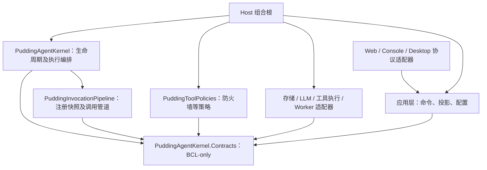
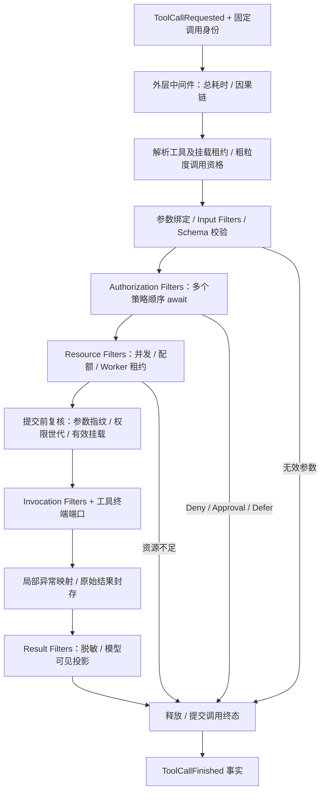

# Agent 生命周期与 Hook 管道架构设计

## 1. 目标和设计依据

目标是让 Agent 内核只负责编排、状态转换和调用端口；权限、工具前置检查、结果投影、延迟统计等通过有类型的扩展点实现。任一业务组件只能使用所属阶段的合同，不能持有 AgentExecutionService、DbContext、可写运行时全局状态或宿主 IServiceProvider。

先冻结[全生命周期注册点目录](Agent全生命周期Hook事件与动作注册点目录-2026-10-09.md)，包括 Agent 动作、Pudding 应用动作与时间，再施工。配套文档：[现状审计](../14_reports/2026-10-09-Agent生命周期与Hook边界审计.md)、[明确的代码设计与迁移清单](Agent生命周期与Hook管道代码设计-2026-10-09.md)、[工具插件化方案](工具插件化架构与实施方案-2026-10-09.md)。本文定义目标状态，所有新增工程和接口均为拟定，不宣称已经实现。

参考 [ASP.NET Core Filters](https://learn.microsoft.com/zh-cn/aspnet/core/mvc/controllers/filters?view=aspnetcore-10.0) 的分阶段过滤器、作用域和包裹调用概念，以及 [Middleware](https://learn.microsoft.com/zh-cn/aspnet/core/fundamentals/middleware/?view=aspnetcore-10.0) 的 next 与短路模型。Pudding 的具体阶段、副作用规则和事件协议是本项目设计，不照搬 MVC 的执行顺序。

## 2. 注册概念及权限边界

| 概念 | 合同 | 是否等待 | 是否改变执行 | 示例 |
|---|---|---|---|---|
| 只读事件观察者 Observer | 接收已发生事实的不可变 DTO | 普通观察者不在关键路径等待；持久消费者按自身队列处理 | 不返回决定，不修改调用上下文 | 工具前后统计、界面投影、通知 |
| 决策拦截器 Guard / Authorization Filter | 返回 Allow / Deny / RequireApproval / Defer | 必须 await，受截止时间约束 | 可短路，不能执行工具或改写状态 | 防火墙、资源准入、前置检查 |
| 变换过滤器 Transform Filter | 从输入快照产生新值，带变换来源 | 必须 await | 只修改指定字段；随后重新校验 | 参数规范化、工具结果脱敏 |
| 包裹式中间件 Middleware | 调用 next，进入/退出成对 | 必须 await | 在规定阶段包裹；next 至多一次 | 耗时、Tracing、受约束资源租约 |
| 调用管道 Pipeline | 固定阶段 + 不可变注册快照 + 终端端口 | 负责完整调用 | 控制阶段顺序、短路、故障映射 | 工具调用管道、Run 管道 |
| 动作 Action | 输入/输出 schema + 唯一 handler + 许可/幂等合同 | 经过命令准入后 await 或进入持久队列 | 由所属 coordinator 执行 | Agent 委派、Pudding 配置更新、schedule 触发 |
| Hook | 上述扩展点的统称 | 由具体合同决定 | 禁止一个通用 Hook 同时包办全部能力 | RunBeforeSettle 是控制点，RunSettled 是事实 |

**Event 是事实，Interceptor 是控制调用。** `tool.call.requested` 可以在执行前发生，但已经发布这个事件不意味着获准执行。权限模块注册到授权合同，而不是订阅一个 fire-and-forget 事件再悄悄取消 Agent。

只读包含字段不可变、集合不可变和不暴露可写业务对象。观察者需要发起新的后台任务时，通过受授权的任务端口提交独立命令，产生新的 identity；不能回写当前事件来控制已经发生的调用。

## 3. 编译期组件边界

箭头表示直接引用；Surface/Host 不进入 Contracts、Pipeline、Kernel 的引用闭包。Desktop 保留独立产品进程，业务仍在 Core 子进程内。新组件不引用现有 Runtime/Platform/Host，不把原有大程序集改名当作完成拆分。

| 新组件 | 负责 | 不负责 |
|---|---|---|
| PuddingAgentKernel.Contracts | 状态与事件 DTO、调用端口、过滤器和 owner 合同 | EF 实体、ASP.NET、DI 容器、日志文件格式、具体工具 |
| PuddingInvocationPipeline | 注册表、快照租约、排序、阶段执行、观察者隔离与超时 | 数据库实现、Agent 主循环、审批 UI |
| PuddingAgentKernel | AgentSession/Run/round 状态机、终态收口、执行 body 编排 | HTTP、流序列化、Provider 协议、领域工具实现 |
| PuddingToolPolicies | 授权/沙箱/资源等策略过滤器，仅依赖窄端口 | 主循环、直接调用工具、修改 Run 状态 |
| 现有消费方侧适配器 | 将旧能力映射到新端口，逐步迁移 | 让新组件反向引用旧实现 |

Pipeline 内核直接使用 BCL；DI 注册辅助首先放在消费方装配文件。只有多个消费方确需复用时，再抽取一个受限 DI 适配项目，避免为初版增加无用项目。

## 4. 五级生命周期与权威

| 作用域 | 状态与终止语义 | 资源 owner |
|---|---|---|
| ProductRuntime | Starting → Ready / Degraded → Draining → Stopped；启动失败 Faulted | Core 子进程主管；Desktop 判断产品进程回收 |
| AgentSession | Created → Opening → Ready ↔ Suspended → Closing → Closed；Faulted 可显式 Recover | 会话持久身份、会话级注册、工具挂载 |
| Run | Created → Admitted → Running → Finalizing → Settled；拒绝/故障也经 Finalizing | executionId、执行租约、预算、取消源、必要收口工作 |
| Round | Created → ContextPrepared → ModelCalling → ModelReturned → ToolsProcessing → Finished | 上下文快照、模型请求、Round 工具批次 |
| ToolCall | Requested → Prepared → Authorized → Executing → Finalizing → Finished | callId、调用快照、批准指纹、Worker 调用租约 |

ToolCall 的拒绝、参数错误、取消等可以从任一执行前阶段直接进入 Finalizing，不经过 Executing。状态表示进度，终态结果另用 outcome，避免几十个组合状态。所有转换由所属 coordinator 执行；扩展只能返回值或提交受控命令。

### 4.1 Ended 与 Settled

- `run.body.ended`：主循环停止本次 body，原因可为 Done、Waiting、Failed、Cancelled、BudgetExhausted。
- `run.before_settle`：受信任的决策过滤器评估必要收口；可请求有预算的 continuation，不能直接重入主循环。continue 创建新的 body segment，同一 Run 内受统一轮次/耗时预算限制。
- `run.settled`：必要工作完成、终态已提交、执行资源已释放、该 Run 不再自动追加工作。观察通知的异步执行不改变 settled。
- Waiting 作为 Run outcome，AgentSession 进入 Suspended；唤醒产生新 Run。后台索引、统计、潜意识等非必要工作属于新的 job，不能无限阻止 settled。
- 关闭 Session 先禁止新 Run/挂载，再取消在途调用、drain、释放注册和挂载，最后 Closed。StopRequested 与 Stopped 明确区分；超时残留记录为故障，不能谎报清理成功。

状态权威与既有 canonical Execution 终态仓储融合：使用同一 executionId 和 first-writer-wins 提交，不创建第二套互相竞争的终态表。当前 RuntimeControlService、SessionStateManager 是控制/投影适配器，迁移后不各自独立决定 Run outcome。

## 5. Agent 执行外层管道

HTTP 流式与 Buffered 都消费相同执行语义，不复制工具调用和生命周期规则。模型增量通过领域事件输出；上层 SSE/WebSocket 编码器选择传输格式。Context 构建、模型请求准备、压缩检查使用各自窄接口；不提供可随意拿到 LLM client 或整个内核的万能事件。

单个 middleware 实例是否共享由注册 lifetime 指定；run/call 状态保存在调用局部或所属 scope。预算、取消和授权的必需不变量属于固定 stage，不能靠装配 Order 值使其排到执行之后。

## 6. 工具内层过滤器管道

### 6.1 固定阶段规则

1. 身份来自可信调用入口，不能由插件 arguments 声称 workspace/Agent/权限。未知工具、过期挂载也产生有 callId 的终态。
2. Input Filter 可以规范化参数，随后重新做 schema 校验，再计算最终 argumentsHash。授权基于最终参数和工具版本；授权之后不允许修改输入。粗粒度身份/资源保护在参数处理前执行，防止未授权大输入消耗资源。
3. 多个授权过滤器按固定顺序 await；Allow 只意味着当前过滤器没有阻断，不覆盖前面的 Deny。RequireApproval 和 Defer 保留现有待审批/等待类型，不映射成工具崩溃，也不直接停止整个 Agent。
4. Resource Filter 在已授权后获取执行资源，finally 释放；权限撤销、挂载世代变化或批准过期在执行提交前复核。对执行中的敏感操作，Core 能力服务也逐请求验证许可。
5. Invocation Filter 只能包裹已授权的不可变输入。next 至多一次；通用 middleware 不实现重复执行。重试由明确的 attempt 管理设施授权，副作用未知时禁止自动重试。
6. 工具异常转换成结构化原始 outcome；Exception Mapper 仅处理其声明的工具执行异常，不吞授权、收口或 observer 异常。外层基础设施边界负责兜底。
7. Result Filter 按顺序变换模型可见结果，保留原始 outcome、效应状态、错误、审批证据和内容哈希。执行失败不能被结果过滤器改写成成功。无效投影返回 ProjectionFailed/安全占位，不能重新执行已完成工具。
8. 短路不会进入尚未进入的内部过滤器，已进入的包裹层仍退出。固定终态事实覆盖所有路径，不依赖某个“成功结果过滤器”记录延迟。

工具完成与副作用分离：`EffectState = NotStarted / None / Confirmed / Unknown`。Worker 超时或连接断开可能是 Unknown；取消信号也不是“外部动作未发生”的证据。记录执行事实后允许 Agent 诊断或请求补偿，不隐式回滚。

### 6.2 用户提出的两个典型扩展

**防火墙**：注册 IToolAuthorizationFilter，将当前 AgentFirewall 八道门禁返回值适配为决定；消费方只依赖 IToolInvocationPipeline。防火墙实现只拿身份、最终参数、工具 descriptor 和许可查询端口，无权取得执行服务或写 Session 状态。初次迁移不改变任何门禁行为。

**延迟统计**：注册外层 IToolCallMiddleware，在 next 前读取单调时钟，finally 记录耗时；记录总调用、准入排队、执行 attempt 和结果投影的不同 span。也支持按 `(executionId, callId)` 关联 requested/finished 事件做离线分析；有界队列丢失需要显示 completeness，不把缺失事件当 0ms。

## 7. 多注册项、作用域及快照

注册记录具有 RegistrationId、OwnerId、接口对应的 Stage、Order、Scope、Lifetime、Trust、Timeout、FailurePolicy 和配置版本。注册/注销接口只对受授权组件开放；管理界面是其调用方，没有权力直接修改内核字典。

阶段固定；同阶段排序为 `(Order, ScopeRank, RegistrationSequence, RegistrationId ordinal)`，ScopeRank 为 Global、AgentSession、Run、ToolBinding。默认按中央 C# 扩展方法链的注册顺序；中间件进入正序、退出逆序；串行变换正序传递结果。不得依赖程序集扫描偶然顺序或 GetType().Name。高级依赖排序 Before/After 留到有需求后再做，初版不引入隐含拓扑规则。

所有注册通过 Host 的一个 `AgentExtensionsComposition.cs` 声明入口和一个受控 Registry；详见注册点目录 §6.1。事件、动作、时间消费不同索引，但不维护彼此不一致的注册列表。TimeTriggerCoordinator 只负责产生有幂等身份的动作命令，不直接侵入 Agent 循环。

每次调用捕获一个 RegistryGeneration 不可变快照并取得租约。在途调用一直用同一个快照；新注册、注销或热更新只影响后续调用。OwnerId 注销先停止捕获，等待活跃租约和观察者工作 drain，再释放资源。OwnerId 是受信任 owner 管理服务分配的身份，不是插件任意填写的越权标签。

必需授权过滤器由系统装配设置 required；在构建快照时缺失/故障必须 fail-closed。Agent 管理工具无法移除系统 required 策略。外部 DLL 可以贡献工具和受约束观察/投影能力；提升为系统授权策略需要独立可信安装权限，不能把“能创建工具”理解为“能绕过自己的防火墙”。

## 8. 事件基础设施与资源归属

事件信封包含 eventId、eventType、schemaVersion、occurredUtc、单调序号、runtimeGeneration、AgentSessionId、executionId、roundId/callId、causationId、注册快照版本、红acted payload reference。事件不携带 secret、活 DbContext、Exception 实例或可修改服务对象。

| 类别 | 发布和消费保证 | 合适用途 |
|---|---|---|
| 最佳努力观察流 | 有界队列；同订阅分区顺序；明确 dropped/lag 计数；不阻塞主流程 | 延迟、统计、低成本 UI 提示 |
| 持久事实消费 | canonical 提交与 outbox 原子关联；至少一次、checkpoint、幂等、可重放 | 必需审计、关键投影、任务触发 |
| 控制 Hook | await 明确 typed 结果；不走观察流 | 授权、执行前检查、BeforeSettle |

不宣称跨进程 exactly-once 分发。必需审计写入失败属于提交故障，不能以“只读订阅容错”为理由放行敏感调用；普通延迟观察者异常则隔离并报警。诊断错误通过专用 sink 记录，避免 hook.failed 观察者抛错导致递归事件风暴。

每个订阅者具有 owner、handle、限流、并发度、超时和队列预算；默认按 executionId 保序，不保证不同订阅者处理完成顺序。Unsubscribe 停止新入队，DisposeAsync 执行配置好的 drain/drop 策略。后台索引/Embedding 交给 job scheduler，明确工作 owner 和 workspace，而不是裸 Task.Run。

## 9. 故障、取消与外部隔离

| 出错对象 | 默认行为 |
|---|---|
| 授权/前置安全过滤器 | Deny/PolicyUnavailable，fail-closed；必要时明确待审批 |
| 必需 Input/Result 安全变换 | 输入拒绝；结果隐藏并报 ProjectionFailed，保留原始执行事实 |
| 可选结果装饰 | 保留上一安全投影并记录错误 |
| 普通观察者/延迟统计 | 隔离故障，标记降级，主执行继续 |
| 工具实现 | 返回 Failed/Cancelled/TimedOut 等 outcome；标注 effectState |
| 收口或持久事实提交 | 单独 InfrastructureFailure；保留因果与可恢复证据，不伪造 settled |

区分用户取消、deadline、owner 卸载和依赖故障。不能 catch 所有 Exception 然后统一“继续”。CT 已取消时，清理使用独立且有界的 cleanup token。

进程内超时只限制等待，不保证插件停止；忽略 CT 的代码仍可能运行。进程内 Hook 只允许受信任、无任意阻塞的实现，超时后保留活跃租约直至真实完成并将 owner 隔离。低信任外部 Hook/工具在独立 Worker 中执行，超时由主管停止 Worker；不可终止的进程标记残留资源故障，不提前释放其所有权。此边界与工具插件化方案一致。

## 10. 可诊断与管理面

提供 IExtensionDiagnosticsQuery 查询注册、阶段顺序、匹配作用域、快照世代、required 状态、近期失败、queue lag/drop、活跃租约、worker、卸载原因。诊断工具只调用该端口，文件/数据库读取属于诊断存储适配器。

关键诊断码：`HOOK_REGISTRATION_INVALID`、`HOOK_REQUIRED_MISSING`、`HOOK_POLICY_DENIED`、`HOOK_TIMEOUT`、`HOOK_OBSERVER_FAILED`、`HOOK_QUEUE_DROPPED`、`HOOK_NEXT_REUSED`、`HOOK_OWNER_DRAIN_TIMEOUT`、`HOOK_RESULT_INVALID`、`RUN_SETTLEMENT_FAILED`。每条包含阶段、RegistrationId、OwnerId、callId/executionId、因果码和安全错误摘要；不回显参数秘密。

Web 管理界面增加“执行扩展”页：按阶段展示顺序、作用域、owner、是否必需、版本和健康；提供 dry-run 解释、授权的 enable/disable、注销/卸载、错误详情。修改走应用命令端口并返回受影响世代；运行中调用仍显示原世代。Desktop 只承载既有 Web UI。

## 11. 文档、施工顺序与验收

新类/接口必须写名称、description、职责和不变量、related_files、related_docs、categories；使用 C# XML summary/remarks，具体模板在代码设计。字段要有真实语义与可解析链接，不能机械复制与本类无关的列表。

| 阶段 | 交付 | 门禁 |
|---|---|---|
| H0 | Contracts + 状态、事件、过滤器合同冻结 | 独立示例编译；不引用 Core/Runtime/Web/EF |
| H1 | Pipeline 注册快照、排序、next 约束、控制/观察分离 | 独立测试故障矩阵及边界变异取红 |
| H2 | Kernel 生命周期与 first-writer-wins 收口端口 | 所有出口、Waiting/唤醒、停止/drain、预算与 continuation 验证 |
| H3 | 独立 Policies 与假端口；统计/事件消费者样例 | 八门禁语义向量、多个过滤器、队列与 owner 生命周期 |
| H4 | S5 接入：工具公共入口、旧 Hook 适配、流式/非流式统一语义 | 宿主装配、旧权限/审批用例、四种调用路径一致 |
| H5 | 移除旧双路径，数据/传输/诊断适配器迁出 | 编译闭包、架构测试、真实产品 smoke |
| H6 | Worker Hook bridge、插件工具挂载与管理 UI | 动态加载/卸载、故障诊断、外部控制器生命周期验收 |

每个组件分别遵守[组件化交付 S1–S5](../10_conventions/组件化交付规程.md)，H0–H3 不改宿主/解决方案/现有 DI。Contracts 先独立验证，再作为下游组件的已交付依赖。工具插件 P0 应先对齐这里的调用 identity、outcome、owner 和事件字段；Worker 进程/DLL 测试可以并行推进，不必等整个旧 Runtime 清理完成。

验收必须覆盖：必需策略缺失拒绝、多个 allow 后 deny、异常/超时拒绝、参数变更重新校验、权限撤销、next 二次调用防重复副作用、结果失败不重试、旧注册快照稳定、卸载 drain、观察者失败不影响工具、所有终态事件守恒、Streaming/Buffered 语义一致。详细测试清单与目标文件见代码设计。
