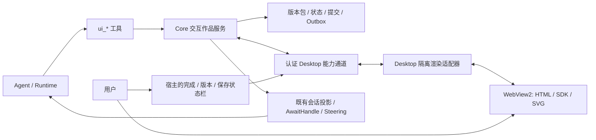

# Agent 生成式交互界面与浏览器应用运行时设计方案

## 1. 产品定位与当前边界

Pudding 增加一种可持续编辑的“交互作品”：Agent 在对话中生成 HTML/CSS/JS 或结构化界面，Desktop 的浏览器组件加载它，用户通过选择、表单、图表和绘画表达意图，Agent 读取结构化结果并继续更新。作品与聊天保持关联，也可独立在右侧工具区展开，不受聊天文本宽度限制。

本方案是[浏览器可靠性与渐进阅读方案](浏览器自动化可靠性与渐进阅读设计方案-2026-10-08.md)的配套设计；普通网站自动化和交互作品使用相关的显示/观察能力，但作品多出版本、持久状态、SDK 和提交协议。本次交付设计，不创建新产品组件或把未实施能力标成可用。

源码基线显示 `ToolAvailabilityCatalog` 将 Artifact/Panel 标为 Deferred；`MainWindow.DeferredNotice` 明确成果接口和交互提交通道尚未建立。已有浏览器控制与图片 Artifact 能力可复用，不能据此认定已有 HTML 应用运行时。浏览器可靠性已有后续组件施工，本文不重复冻结其历史缺陷状态，依赖以相应切片验收为准。

最终架构保持 WinUI Shell + Web UI + 独立 Core：Core 负责作品、状态、版本、用户回应、Agent 与存储；Desktop 负责隔离的 WebView2 显示、消息转发和窗口生命周期。生成应用不得启动独立开发服务器、安装 npm 包或获得进程内 PuddingHost。

## 2. 典型场景与最小成品

| 场景 | 用户看到/操作什么 | Agent 读取什么 |
|---|---|---|
| 方案对比/图文设计文档 | A/B/C 卡片、草稿图、并排/叠加对照、差异高亮、评分与批注 | 选中方案、评分维度、关键批注和最终确认版本 |
| 偏好/意图收集 | 表格、单选/多选、排序、滑杆、条件字段和校验提示 | 有 schema 的字段值、未回答项、用户提交的不可变快照 |
| SVG 草稿/设计图纸 | 缩放、平移、图层、标注、尺寸/参数调整与节点选择 | 对象 ID、参数、标注与选区；SVG 源或局部截图 |
| 软件架构/类图/流程图 | 图形折叠、节点详情、链路追踪、不同设计的切换 | 选中节点/关系、展开状态、问题与确认选择 |
| 涂鸦/需求勾画 | 笔刷、橡皮、形状、文字、圈选、撤销/重做；Agent 图层可与用户图层对照 | 结构化 strokes/形状、局部截图、用户圈选与文字说明 |
| 后续可扩展 | 参数模拟、计划/时间线、排序投票、数据探索、交互式教学与故障诊断 | 可复现输入参数、筛选条件和用户决定 |

首个可验收闭环选择“方案对比 + 偏好表单”：Agent 创建 → 用户修改 → Agent 更新说明而不覆盖已填数据 → 用户点完成 → Agent 收到结构化结果。图表和 SVG 后续增量接入；涂鸦需要单独的矢量状态、撤销和截图门禁。

## 3. 总体结构与信任边界



Core 是持久事实源，SDK 和页面是输入/渲染客户端。页面调用宿主必须经过类型化消息白名单、作用域和版本校验；不是给生成 JS 暴露 .NET 对象、文件系统或通用 Core 管理 API。

交互作品放在独立渲染表面中，底层复用 WebView2 技术与驱动观察/截图能力，逻辑身份为 `interactive_app`，不冒充 Workbench，也不把整个 context 都授权为 Agent 可操纵的普通网页。由 Core 的 app 操作授权签发该作品的显式页面 grant，适配前序 authority/租约；用户输入和 Agent 写操作的冲突规则由作品协议补充。

组件拟定：`PuddingInteractive.Core` 仅引用 BCL-only `Pudding.Contracts`，负责 manifest/schema、版本/状态冲突、提交与存储端口；`PuddingInteractive.Renderer` 仅引用 Contracts，负责文档/消息世代、加载回执和更新协调，不依赖 UI/数据库/Agent。Core 存储与 outbox 适配位于 Platform/Host，WebView2 适配位于 Desktop 平台组件；JS/CSS SDK 为版本化静态资源，不能把业务存储搬进 Shell。

Contracts 增加相应窄端口和 DTO，保持零 ProjectReference；新组件不得引用调用方。两个组件先按 S1–S4 独立测试，再由 S5 接入 Desktop/Core，不能为了调用方便反向引用 Runtime/Host。具体适配项目的允许引用名单需逐项更新并保留编译期取红测试。

## 4. 作品包、身份与版本

每个作品由不可变发布包、可变状态和渲染实例组成。Agent 不必创建一个新仓库/网站；最小包是 manifest.json、index.html 和可选 app.js/styles.css/assets。也支持 schema 驱动的表单/对比模板，由内置 renderer 直接渲染。

| 字段 | 含义 |
|---|---|
| appId / workspaceId | Core 签发、隔离作用域，不允许页面自行声明其他 workspace |
| ownerAgentId / conversationId / taskId | 作品创建者与交流绑定；切换聊天不改投递目标 |
| appRevision / bundleHash | 不可变源码/资源发布版本，编辑创建新版本，不覆盖历史包 |
| schemaVersion / sdkVersion | 数据合同与锁定运行时资源版本；不得静默升级 SDK |
| stateRevision | Core 已提交状态版本，用于 CAS 与冲突检测 |
| viewId / renderGeneration | 某个打开视图及其文档加载世代，区分多视图与旧页面回调 |
| interactionId / submissionId | 一轮提问与一次正式回应；不得只按“当前聊天”猜归属 |

manifest 包含入口、kind、模板、状态 schema、初值、字段所有权、具名函数 schema、允许的资源引用及交互绑定。Agent 提供的 manifest 仅是申请；实际授权来自可信工具上下文，页面不能通过 manifest 自行增加网络、文件、工具或跨 workspace 权限。

包验证包括相对路径/大小/MIME、入口可解析、资源引用、SDK 版本、schema 和工具参数；拒绝目录穿越、符号链接越界、绝对文件引用。版本包发布前完成校验，渲染也有 deadline/error 回执；“包已保存”和“页面已显示”是两个独立事实。

默认一个作品一个活动主视图；再次 open 聚焦已有视图，不重复创建。需要 A/B 两视图时显式创建额外 view，共享 canonical state 但布局/选区可视图独立。关闭视图不删除作品或已保存草稿，重新打开使用最新明确版本。

## 5. 加载、隔离与资源基础设施

每个 appId 对应稳定且独立的虚拟 HTTPS origin，例如 `https://app-<opaque-id>.pudding-ui.invalid/`；appRevision 在路径中，不能每次改版换 origin 导致 localStorage 丢失。实际域名由宿主生成，示例不是真实部署地址。

Core 保存不可变包，认证通道把校验后的指定包传给 Desktop，Desktop 缓存到 DesktopHome 下独占的渲染缓存目录。WebView2 映射范围只包含该作品资源与已批准静态 SDK，不映射 D:\data、工作区根或程序目录；Core 路径不直接暴露给页面。浏览器 Profile 与可信 Workbench/外部网页分离，不共享登录态。虚拟映射可支持有 origin 的本地内容和存储，参见[WebView2 本地内容文档](https://learn.microsoft.com/en-us/microsoft-edge/webview2/concepts/working-with-local-content)。

内置 SDK/样式/图形组件按锁定版本/hash 复制或由受控资源路由提供，生成包不能覆盖 `/_runtime/`。默认无需联网、不依赖 CDN；指定外部图片/数据由 Core 的有界资源导入接口取得后形成 app-scoped asset。网络扩展作为显式能力建设，禁止借 generated HTML 的 fetch/导航访问本机管理端点、登录令牌或任意文件。

对生成内容设置应用级 CSP、导航/弹窗/下载与资源请求策略，拦截未授权的 top-level/frame 导航并立即撤销该文档 bridge。白名单不能只检查最初 URL：redirect、子 frame、worker/websocket 等通道需各自验证或保持关闭。MVP 不开放外部 frame、service worker 与通用 host objects。

WebMessageReceived 验证实际 sender origin、对应 WebView/viewId、renderGeneration、请求大小、方法与 app grant；消息内自报 appId/source 不作凭据。SDK 不持有 ControlToken、Admin JWT 或永久访问密钥。导航/关闭/重连撤销旧文档句柄与订阅；这是[WebView2 安全指南](https://learn.microsoft.com/en-us/microsoft-edge/webview2/concepts/security)要求的来源校验在本产品里的具体应用。

## 6. Agent 工具与页面 SDK

### 6.1 工具入口（目标定义）

| 工具 | 主要动作与返回 |
|---|---|
| ui_create | 从模板/schema 或 HTML 包创建；返回 appId、发布版本、校验结果；可请求 open |
| ui_update | 更新文件、模板/data model 或 schema；必须 baseAppRevision/baseStateRevision，返回候选/激活结果与冲突 |
| ui_open | open/focus/close 指定作品视图；返回 viewId/pageId、renderGeneration、实际显示版本和加载回执 |
| ui_read | source=state/draft/submission/events/exports/localstorage；支持 JSON 路径、字段、游标与字节预算 |
| ui_invoke | 调用 manifest 声明的具名函数，带参数 schema、版本、deadline；返回类型化结果和副作用状态 |
| ui_wait | 注册或读取指定 interactionId 的 durable 等待句柄；等待 submitted/cancelled/expired，不轮询整页 |
| ui_export | 导出指定版本与状态为 HTML/SVG/PNG/JSON/CSV；返回 workspace Artifact，不隐含发布到外网 |

这些工具不替代 browser_snapshot/locate/interact/screenshot：作品正常数据交互优先 ui_read/SDK，DOM/截图用于观察、测试、布局和局部视觉输入。普通网站不会因为名字相同就获得 UI SDK 权限。工具发现只暴露当前已实现并协商可用的入口。

`ui_read` 默认摘要/指定字段、最多 4 KiB，返回 actual revisions、freshness、source/provenance 和 nextCursor。不得每次把 HTML、整张表或全部 strokes 塞进模型；完整源与大量数据使用 Artifact。页面未打开时仍可读取 Core 的持久状态，不能错误声称读到当前 JS 内存。

### 6.2 SDK 最小接口

| 接口族 | 提供的基础设施 |
|---|---|
| Pudding.ready / context | 初始化、已绑定身份的只读摘要、SDK/作品版本、主题/尺寸、重连状态 |
| Pudding.state | get/select/subscribe、带 baseRevision 的 patch、flush、保存状态；由宿主按路径所有权校验 |
| Pudding.forms | schema 渲染、字段联动、默认值、校验、dirty/错误/完成状态、结构化收集 |
| Pudding.functions | 具名 query/action 注册；JSON 参数/结果 schema、可描述的调用列表 |
| Pudding.events | 有界 UI 事件、自定义 interaction signal；不直接唤醒任意 Agent |
| Pudding.submit | 整理/校验本轮 response 并请求宿主提交入口；不能伪造 human-confirmed |
| Pudding.assets / export | 受权限约束的图片/数据引用，快照/导出请求与 Artifact 链接 |
| Pudding.view | 主题、resize、加载/错误反馈、focus/selection 与可访问性辅助 |

示例仅是拟定 API，不是当前可执行代码：

```javascript
const context = await Pudding.ready();
Pudding.forms.mount('#preferences', {
  statePath: '/inputs/preferences', schema: preferenceSchema
});
let selectedNode = null;
Pudding.functions.registerQuery('getSelection', {
  resultSchema: selectionSchema,
  handler: () => ({ selectedNode })
});
await Pudding.state.flush();
await Pudding.submit.prepare({ interactionId: context.interactionId });
```

Agent 随后用 ui_read 读已保存偏好，或 ui_invoke(name=getSelection) 得到闭包变量 selectedNode。这满足“调用 JS 函数读取局部变量”，但不能承诺任意不导出的词法变量可被外部读取；生成模板默认给关键状态与选区提供 exports，Agent 不用编写 eval 扫描。

具名 query 也不是数学意义的纯函数：任意 JS handler 可以改 DOM/闭包变量。MVP 将所有自定义函数调用视为 renderer-local 且可能有副作用，禁止自动重试和跨页面作用，query 执行期间阻止 SDK 的持久写接口；只有宿主实现的 canonical state.select 能声明真正只读。action 允许授权范围内状态变更，但不能调用任意工具或获取系统授权。

调用前固定 app/view/render generation/版本，调用后带实际 stateRevision；reload 后旧回包拒绝。函数超时不能证明没执行，返回 unknown、mayHaveSideEffects=true，并撤销旧 bridge/回调句柄。可序列化的计算可以放 worker；闭包 getter 和 DOM handler 在页面上下文执行，不能假称自动被 worker 隔离。失控页面的恢复策略是销毁/重建 view；是否能终止忙循环以及影响其他 view 的范围必须通过真实 Runtime 探针确认，不以 Promise timeout 伪装终止。

## 7. 状态存储、localStorage 与字段所有权

### 7.1 三类状态与真源

| 类别 | 位置/寿命 | 读取与保证 |
|---|---|---|
| 瞬态视图状态 | JS 内存：hover、临时动画、未导出局部变量 | ui_invoke 仅在对应 view 在线时可读，标 renderer-local |
| 用户草稿与应用数据 | Core canonical state，经 SDK patch/CAS 持久化 | 刷新/关闭/Core 重启后可恢复；显示保存中/已保存/冲突/离线 |
| 正式提交 | Core 不可变 submission，绑定作品/状态/schema 版本 | Agent 读到具体提交快照，不读“当前可能已改的表格” |

浏览器 localStorage/IndexedDB 用于本作品的有界缓存和离线暂存，SDK state 是正式共享状态的默认入口。SDK 提供 storage adapter：明确允许的 key 可同步到 Core，或通过 ui_read(source=localstorage, keys=[...]) 按需读在线 view 的同源缓存；不扫描全部 origin，不把缓存当成已经保存到 Core。

同一 app 的 origin 稳定，revision 路径不改存储 namespace。多 view 修改 localStorage 不作为同步真源，最终同步使用 stateRevision；缓存损坏可从 Core 重新水合。纯自定义 localStorage 需声明 keys/schema/预算，刷新后可保留但跨 Profile/机器/Core 备份不保证，因此 SDK 模板默认不用裸 localStorage 保存唯一份用户答案。

初始状态分区为 model（Agent 提供的方案/文案/图模型）、inputs（用户答案草稿）、view（当前选区/筛选/布局）、drawings（具名用户/Agent 图层）、computed（应用派生结果）。字段所有权由 Core 执行；页面自报“这是用户输入”不授予新的写权限。

Agent 可以设置尚未作答字段的默认值、更新 model、添加自己的绘画图层；不能覆盖 dirty inputs 或用户图层。Agent 要改用户已填内容时提出 suggestion/差异，交给用户采纳。自动应用仅限声明安全的非冲突 model 变更和新增字段；缺少 baseRevision 一律拒绝，不 last-write-wins 覆盖用户。

### 7.2 持久化与离线

Core 保存不可变包文件与 manifest，状态/提交/事件/outbox 使用事务性存储；数据库只存 operational state 与包索引，不把 LLM 配置等混入。拟定 `<DataRoot>/interactive-apps/<workspace-id>/<app-id>/revisions/<revision>/` 存源包，具体路径由 PuddingDataPaths 推导，目录使用服务端 ID，浏览器从不直接访问此根目录。状态存储由独立接口隔离，Platform 适配既有 SQLite 能力；不新增旧格式兼容层。

草稿 patch 初始去抖 200ms，并在 blur、笔画结束和完成前 flush；flush ack 之后才显示“已保存”。断连时显示“离线草稿”，有界本地队列保留 mutationId/baseRevision；重连按 CAS 合并不同字段，同字段冲突保留两份并提示，不能重放为新变更。

保存快照 + mutation 去重 + outbox 在一个 Core 事务完成。提交时将已确认草稿 revision 固定成 immutable snapshot；提交完成回执必须在耐久写完成后返回。清理遵循 Core 存储治理：关闭不删除，归档/删除明确区分；正在等待用户的作品、提交和被引用资源不按普通缓存 TTL 清除。

## 8. 实时编辑与不丢输入的更新协议

appRevision、stateRevision 和 renderGeneration 分离。最常见更新只 patch model/参数，不重新加载文档；使用 stable element/field IDs，保留输入焦点、selection、滚动与草稿。Agent 更新 diagram node 的标签不能改变 nodeId，否则关联批注丢失。

源码更新按“上传不可变候选包 → 校验与隔离候选渲染 → 与当前 revision 比较 → 激活 → ready ack”执行。只有样式/受支持组件数据的安全更新可原位替换；任意 JS/结构变化进行受控 reload。不能一边修改同一 index.html 文件、一边由浏览器读取半份内容。

reload 前 flush 并保存当前 field/selection/view 状态；用户正在输入且无法无损替换时暂存候选，显示“有更新”，让用户在结束编辑后切换。schema 的字段删除/重命名保留旧答案 orphan 区与原 revision，不静默清空；候选状态迁移先校验、失败保留旧版。所有尚未提交的 interaction 记录其 schema 版本，更新不能把旧问题答案当成新问题答案。

候选预览使用相同 canonical state 的只读副本且禁止 submit/持久 patch；其 origin/view generation 独立，不能通过加载候选脚本改正式草稿。候选加载失败不损坏已显示作品，ui_update 返回“已保存候选、未激活”和实际错误。

允许固定查看旧版本/A-B 并排，Agent 默认更新当前主版本，不能抢走用户正在看的对比 Tab。rollback 只是选择旧源码版本，不能回滚/覆盖更晚的用户输入；若数据 schema 不兼容则只读显示旧提交或显式状态转换。

## 9. 用户完成、Agent 唤醒与来源

表单输入/选区变化先保存，不每个 keypress、拖拽点都触发 LLM。默认只在用户点击“完成/提交”或明确配置的 interaction checkpoint 发一条结构化回应；连续模拟可以提供低频更新订阅，但仍有合并/预算，不让高频 UI 事件成为无限模型调用。

generated JS 只能 prepare 提交。宿主控制的状态/完成栏位于作品内容之外，保留作品标题、归属、显示版本和保存状态；用户只需在这处点一次“完成”，不弹第二轮确认。宿主绑定当前已保存 revision/interactionId，Core 原子生成 submission + outbox，按钮在拿到 ack 前显示提交中。

submission 包含 appId、interactionId、submissionId、app/schema/stateRevision、数据/资源引用、绑定 conversation/task、trusted sender context 与记录时间。重复点击、重传、断线 ack 丢失通过同一 submissionId 幂等；Agent/页面脚本不能给消息自行标成 human_confirmed。浏览器工具不授权点击这处宿主完成栏；脚本触发的 app event、预填/自动测试结果标成 renderer/agent，不能冒充正式用户回应。

MVP 的 renderer draft 来源统一记 renderer（含自定义 JS），不把任意网页事件冒充可信人类行为；正式提交说明用户接受了那个具体快照。作品收集的“同意”仅是方案/偏好数据，不授予工具、网络、文件或外部操作权限。外部动作仍走已有可信授权链路。

Core 按 interaction 创建时固定的目标投递，不能因为用户切换聊天把结果发给另一 Agent。复用现有 AwaitHandle/会话消息/Steering：等待态唤醒对应 handle；执行中排入绑定任务的结构化 steering；无活动执行时产生同一会话可见的 ui.result 回应，不启动第二套 scheduler 或并发 Turn。outbox 去重且可 replay，过期/取消仍留记录并给出明确状态，不自动投递给新问题。

ui_wait 是耐久挂起合同，返回 handle 后释放 Agent 执行占用，不让工具阻塞等待人的输入几十分钟。Agent 可先继续独立工作；只有明确的提交/取消/过期事件恢复依赖该答案的工作。

## 10. 基础组件与信息密度

SDK 内置的模板是可复制/可组合的界面骨架，Agent 填内容与事件即可，不强迫所有作品使用同一种布局。默认支持明暗主题、中文排版、响应式、键盘/屏幕阅读器、loading/error/empty、resize、状态提示与一致的提交位置。

MVP 的表单 schema 支持 string、number、boolean、enum、多选数组、object 和稳定行 ID 的表格，定义 required、范围/长度、单位、默认值与显示条件。声明任意 JSON Schema 方言之前必须有对应验证器；条件显示不能删掉隐藏字段的已保存值。SDK 提供拖拽/滑杆之外的键盘替代操作，并以 Core 的同一 schema 判定正式提交，不能只依赖页面校验。

首批组件：图文卡片/图片放大与对比、方案矩阵、可编辑表格与 schema 表单、滑杆/分段选择/排序、tabs/accordion/详情面板、markdown、SVG viewport。后续增加图表、diagram node/edge、timeline 和 doodle canvas。图形渲染库锁定版本本地打包；Agent 生成的作品无需自行下载/安装依赖或启动 pnpm。SDK 开发构建若涉及前端项目，仍使用 pnpm，并遵守相应前端版本规则。

表格适合收集结构化偏好而不是粘贴巨大 dataset：虚拟化、排序/筛选和字段投影进入组件合同；schema 与可见列分开，隐藏列不能丢失数据。图文方案提供参数切换/叠图/局部放大，用一块画布同时展示多个维度；聊天保留解释与结论，选择和细节在作品里完成。

图纸/SVG 节点都有 stable objectId，批注绑定对象/坐标/版本；架构图可通过节点点击展示职责、接口和相关文字，流程图可逐步高亮路径。不要求所有图必须可交互；静态 SVG 同样可以被导出与局部阅读。SVG 源导出与 PNG 视觉预览分开，当前图片读取管线不直接把 SVG MIME 当栅格图支持。

涂鸦保存矢量 strokes/shape/text/layer 和操作 ID；绘画本地按帧流畅显示，Core 合并后持久化笔画级事件，不把每个 pointermove 发给 LLM。撤销/重做以本操作者的操作为单位，Agent 在独立图层提出改稿，不能擦掉用户图层。Agent 读选择区域内矢量数据，配合截图 artifact 进行视觉理解；可同时返回圈选框和文字提示。

## 11. 导出、诊断与预算

导出绑定明确 appRevision + submission/stateRevision，生成可复现 HTML/SVG/JSON/CSV 或 PNG，记录 SDK/hash/来源。HTML 静态导出移除宿主 bridge 和写接口，附带数据快照；依赖宿主的控件明确说明离线仅浏览，不假称仍可提交。PNG 等栅格进入既有 Vision Artifact，HTML/SVG/JSON 进入通用作品资源存储，不能扩充 VisionArtifactStorageService 的图片 MIME 白名单冒充通用附件仓库。

初始限额提案：单次作品包 5 MiB/100 文件；message 64 KiB；单个 state 文档 1 MiB；单次 ui_read/function result 默认 4 KiB、上限 64 KiB；大表/图层分页或 Artifact；每作品在线增量队列 256 条/1 MiB。所有上限返回可解释的 budget_exceeded/truncated，不截断半份 JSON。限额在 fixtures 与真实绘画样本验证后配置化，不能成为默默丢点/丢答案的理由。

客户端重试 mutationId/operationId 不变；事件有 cursor、schema/version 和明确 gap。完整状态可重水合，提交不可由客户端自行覆盖。UI 内高频刷新本地完成，Core 事件用于保存和重要互动，Agent 只收到有界摘要。网络/存储失败、render timeout、SDK不匹配、函数缺失、版本冲突、离线未保存和事件过期都有类型化结果。

诊断收集包 hash、渲染世代、操作 ID、加载/保存/提交延迟、错误类型与有界 console 证据；默认日志不记用户表单全文、绘画内容、任意脚本或密钥。用户可在宿主查看加载失败并重新打开，不能因一个 generated app 出错让 Core/Desktop 崩溃。

## 12. 施工顺序与可验收闭环

| 切片 | 交付内容 | 门禁 |
|---|---|---|
| U0 | 契约、作品/状态/提交模型与两个独立组件 | S1–S4：schema/CAS/版本/提交幂等/消息世代/编译边界；不得接宿主 |
| U1 | Core 持久化 + Desktop 隔离加载 + ui_create/open/read | S5 后两种来源隔离、真实 HTML 渲染、关闭重开状态恢复、render ack准确 |
| U2 | SDK state/forms + 宿主完成栏 + outbox/AwaitHandle | 方案偏好表单闭环：保存/提交/唤醒；断连/重复点击/切聊天不误投不丢数据 |
| U3 | ui_update、候选预览与具名 JS 调用 | 用户输入与 Agent 更新不互覆；函数读闭包值；旧文档回包拒绝；失控 JS 可恢复 |
| U4 | 图文对比、SVG/图表/架构图、导出与截图 | 所选 objectId/参数可回读，局部视觉正确，离线导出身份/版本可复现 |
| U5 | 涂鸦、图层、撤销/重做、批注与大状态分页 | 人类/Agent图层分离、矢量与截图一致、事件丢失可恢复、无需高频模型调用 |

依赖浏览器 B0/B1 的授权、控制权和结果语义，以及 B4 的截图/视觉通道；未通过时可独立开发 U0 的纯逻辑和 SDK fixtures，不能以公开任意 JS 桩作为捷径。无需等待所有外围上传/CDP功能完成才实现 schema 表单；作品持久状态也不应依赖通用浏览器 eval。

MVP 验收固定覆盖：10字段偏好表单保存后重开全恢复；断线输入不标已保存、重连冲突可解释；一次正式提交只投递一次且回到原会话；Agent 更新文案时用户答案/焦点保留；candidate 脚本不能改正式草稿；同 origin 本作品 localStorage 可按声明读取，跨作品读拒绝；JS具名 getter 返回真实当前闭包值并注明在线世代；两独立作品不能互读状态或碰工作台权限。

可用性目标拟定：已加载模板的参数/视图更新 P95≤200ms，本机 Core state save ack P95≤500ms（注明设备/样本），提交 durable ack 后交互事件可查询且不丢失；不承诺 LLM 推理在相同延迟内完成。连续绘画不触发逐点 Agent 调用。资源/版本/权限越界用调用计数=0的门禁证明；只测替身不算真实 WebView2 隔离验收。

Core/Renderer 独立测试先于接入；Desktop build/test/publish 串行、产物放 temp/build/recovery 与 temp/test-out，覆盖率路径显式指定。真实模型功能在明确新构建的新会话里验收，进程重启/崩溃/退出由外部控制器判断。新增关键文件后再更新子项目/根代码地图；本方案阶段只登记设计入口，不提前登记拟新增程序集为已交付。

## 13. 后续扩展与完成定义

可扩展方向包括参数化预算/时间模拟、地图与空间布局、交互教程、用户逐步评审、对比前后版本的可视化 diff。连接真实业务数据/多人协作/插件控件属于后续能力：复用既有 Connector 和授权，不能让生成 JS 直接持有外部账户凭据；多人共同修改需要明确协同策略，MVP 的单用户 CAS 不伪装成完整 CRDT。

本设计任务完成条件是本方案、索引入口和修改日志通过文档自检并独立提交。产品完成至少要交付 U1–U3 的创建/更新/读取/持久提交闭环与真实 Desktop 验收；图片、SVG、涂鸦等能力按切片声明，不能把工具首页占位入口视为完成。

## 14. 落地进度（2026-10-20，只读核对结果）

**已落地（仅 Web 前端）**：

| 能力 | 位置 | 状态 |
|---|---|---|
| spec v1 + 校验 | `panel/spec.ts` | survey/variants/draft；禁外链、坐标 0..1、体积上限均有限制 |
| 三种渲染器 | `SurveyPanel` / `VariantsPanel` / `DraftPanel` | HTML 走 `sandbox=""` + CSP，SVG 走 DOMPurify |
| 对话入口 | `richblocks/PanelBlock.tsx`（panel 围栏） | JSON → validatePanelSpec → PanelView；坏 spec 列前 3 条问题，不渲染半成品 |
| 提交闭环 | `UiSubmissionContext` + `buildUiSubmission` | 提交结果回填输入框；**无通道时禁用提交并说明原因** |

**未落地（仍属设计）**：U1 及以后——Core 持久化、Desktop 隔离加载、workspace 生成本、`ui_create/open/read`。目前没有 Poster/Artifact 持久化与关闭后重开恢复，也没有 Agent 侧 SDK 调用。

**已知边界**：① 面板**原位更新**（同 id 替掉上一版）在对话内不成立——每条消息的围栏是独立块，只有右侧 tab 支持同 id 替换；② 图表引用 artifact 时仍需后端 GET 接口（当前 `VisionArtifactApiController` 只有 POST）。

**口径**：上表只覆盖 Web 前端可见行为，Core / Desktop 侧本次未改动；不得拿它当作 U1 已交付的证据。
