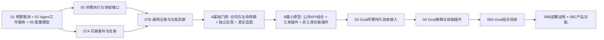

# Agent 组件化任务书 1～8：总则与依赖

本组任务书把[公共 API 规划](核心组件与插件公共API规划-2026-11-04.md)拆成八个可验收工作包。**任务书是施工设计，不是实现完成声明，也不直接授权 DeepSeek 修改核心。** 本组编号 PA-01～PA-08 不替代原 P0～P6、DS-W01、DS-PG01；原施工单的白名单继续有效。

## 1 任务目录与交付物

| 编号 | 任务书 | 最小交付物 | 核心责任 |
|---|---|---|---|
| PA-01 | [跨轮预算、取消与租约](Agent组件化任务书-01-跨轮预算取消与租约-2026-11-05.md) | 持久根账户、统一派发前预留、取消与崩溃核账 | 主代理 |
| PA-02 | [Agent 与 SubAgent 工厂](Agent组件化任务书-02-Agent与SubAgent工厂-2026-11-05.md) | 受权实例目录、显式创建、工作控制、原子子代理租用 | 主代理 |
| PA-03 | [持久验收任务](Agent组件化任务书-03-持久验收任务-2026-11-05.md) | 绑定证据版本的 Review Job、只读评审、可追踪回执 | 主代理 |
| PA-04 | [Goal 续跑控制](Agent组件化任务书-04-Goal续跑控制-2026-11-05.md) | 在既有状态机与 outbox 上接入评审，自动补交付 | 主代理 |
| PA-05 | [核心能力组件化](Agent组件化任务书-05-核心能力组件化-2026-11-05.md) | 授权、工具、MCP、上下文、循环、工作区的独立端口与实现 | 主代理逐组件交付 |
| PA-06 | [配置与模型能力](Agent组件化任务书-06-配置与模型能力-2026-11-05.md) | 版本化有效配置、显式小模型路由、可信报价 | 主代理 |
| PA-07 | [可靠插件扩展](Agent组件化任务书-07-可靠插件扩展-2026-11-05.md) | 持久事件订阅、任务协议、扩展点注册、卸载排空 | 主代理 |
| PA-08 | [可见性与产品验收](Agent组件化任务书-08-可见性与产品验收-2026-11-05.md) | 真实预算/验收/续跑 UI、进程外部署证据、产品闭环 | 主代理集成与验收 |

## 2 先承认现有边界

| 已有能力 | 不得据此宣称的能力 |
|---|---|
| `IAgentWorkApi.SubmitAsync/GetAsync` 受理单轮工作、查询精确回执 | 已有通用 Agent 工厂、取消 API 或跨轮 Goal 完成语义 |
| 内存 `ExecutionResourceScope`、`ModelResourcePool` 和宿主绑定的模型评审 | 重启后预算仍连续、主循环所有模型调用已预留、评审已驱动 Goal |
| `GoalRunStore`、`GoalContinuationWorker`、`GoalSettlementWorker`、重启调和器 | 可以再造一套 Goal 数据库、续跑计时器或终态写入者 |
| `Context.ModelEvaluations()` 和分类/证据评审 DTO | 已有持久 Review Job、后台插件任务或验证事实的权威来源 |
| 插件 Worker 与 advisory Hook | Worker 是恶意代码安全沙箱，或 Hook 异常可以控制主循环 |

主循环当前一次 dispatch 结束会释放资源作用域。因此，**不能在 turn-completed 后拿旧 scope 调验收器**；PA-01/03 必须把账户与任务所有权提升到持久 Work/Goal 根，下一轮和验收分别取得新租约。既有 `WorkId` 属于单轮回执，跨轮账户采用明确映射，不悄悄改变其含义。

## 3 实施顺序：基础设施与通用插件先成立，再接 Goal

近期目标按[两阶段合同](基础设施服务生命周期与最小原型两阶段目标-2026-11-07.md)划分：先完成 A 的服务/API、组件与抽象实例生命周期、事件订阅和 Hook 的定义、独立实现与真实适配证据，再组合 B 的最小原型。原任务编号和叶任务白名单不变。



**基础设施组件化与通用软件功能插件化是 Goal 的前置目标。** 插件覆盖工具、业务功能、策略和事件处理；07B 不能仅注册 DI 或仅支持工具结果建议就视为交付。Goal 参考用户指定的 deepseek-harness，但必须消费 Pudding 的公共服务与真实插件生命周期，不另建专用旁路。

A 基础门禁要求：组件清单、合同卡及生命周期转换有真实实现和取红测试；所需执行/资源/授权端口有真实适配消费者；Work/Agent 服务无需泄露内部配置；07A/07B 经真实 PluginManager 与 Worker 验证。B 再组合普通 Work、工具调用、产物事实与零工具功能插件，证明效果、重投幂等和卸载恢复。缺任一前置，03/04 的纯领域测试可以继续，完整 Goal 接入不得宣称完成。

07A/07B 可在所需公共端口稳定后独立开发，不等待所有可选组件或 UI/渠道插件类型完成。03 只拥有评审领域状态，不另造通用消息总线；第一条模型评审切片使用明确配置的模型和只读 `IModelEvaluationApi`。02A/02B 按 Goal 实际需要提供父子身份、取消、目录/工厂及租约，而非用内部请求拼装替代服务。

01 先使用当前已能解析的平价模型快照，冻结报价端口；06 在此端口上增加用途选择、时段价格和显式免费模型，不形成 01 等待 06 的循环。03 从受权 Context/Workspace 端口取证；其所需端口必须先具备真实实现，但无需等待这些领域的所有可选能力。

05 各组件独立遵守 S1～S5，不用“组件化”作为一次搬空 Runtime 的理由。外观接通和真正抽取分开验收：旧服务只有薄适配器、核心算法移出且编译依赖受限，才能叫 `ComponentExtracted`。

## 4 所有任务共同的所有权和语义

- **事实来源**：canonical Work/Turn/Command、既有 Goal 聚合与检查报告是权威；插件和模型返回建议。文本“完成”、HTTP 202、IPC 返回成功都不是目标完成。
- **身份**：Actor、Workspace、父任务、预算根、插件 generation、权限由宿主绑定；请求中的字符串不能扩大这些范围。禁止向插件提供 `IServiceProvider`、`DbContext`、原始密钥或可变宿主对象。
- **取消**：调用方停止等待、持久任务取消、宿主关机调和是三种动作。已派发的模型不因取消回包就归还并发槽；资源在真实完成或已证实终止后释放。
- **可靠性**：持久操作以 OperationId/业务唯一键去重；同键不同内容必须冲突。网络上的 exactly-once 不作承诺，采用至少一次投递与幂等受理/结算。未知效果不自动重试。
- **审批**：系统拒绝优先；插件 Guard 只能收紧；模型和验收器不能批准自己。等待人工时不持有 Worker、模型或工具执行槽。
- **普通聊天**：默认不触发验收或下一轮。进入 Goal 需要已有明确授权或用户预先启用的自动 Goal 策略；模型可以建议进入，不能自行加额度。
- **存储**：领域仅引用自己的 BCL 端口。Platform 提供现有文件/数据库适配器；不增加第二个同职责状态库。新增租约、评审、订阅表可以存在，但不能复制整个 Work/Goal 状态机。

## 5 主代理与 DeepSeek 的交接门

**核心由主代理负责**：公共 DTO/异常语义、父子生命周期、状态机、预算账本、原子提交、权限、协议、Worker/Host 装配和编译边界。DeepSeek 只能消费冻结接口，完成本组各任务的一个明确叶任务。分任务中列出的“主代理改动面”是设计范围，**不是 DeepSeek 的可写清单**。

每次派发必须附一个由主代理生成的 `ContractRelease` 交接文件，存放 `.work/<task>/<run>/contract-release.json`，至少包含：

```json
{
  "taskId": "DS-PA03-A",
  "baseCommit": "<实际 HEAD>",
  "workingTreeSnapshot": "<相关既有 WIP 文件哈希>",
  "writableFiles": ["<逐个完整仓库相对路径，不接受目录通配符>"],
  "readOnlyContractHashes": [{"path": "<实际存在的文件>", "sha256": "<实际哈希>"}],
  "requiredCommands": ["<已由主代理跑通的命令>"],
  "dependencyEvidence": ["<独立组件测试证据>"],
  "status": "released"
}
```

占位 JSON 不是有效放行。**未收到实际交接包，或编译契约不存在，状态一律 `blocked-on-contract`**。不能让 DeepSeek 按文档创建接口、填空实现或修改上游以便示例能编译。白名单文件已经存在则停止，交给主代理审查，不能覆盖其他施工者成果。一个施工者同一时间只接一张叶任务单。

开工和交付都运行以下既有冻结检查，日志写入本任务 `.work`。未来核心有意改动时，由主代理审阅差异、更新相应冻结基线并重新签发交接；DeepSeek **不能**更新基线使其通过。

```powershell
pwsh -NoProfile -File TestScripts/test-agent-configuration-contract-freeze.ps1
pwsh -NoProfile -File TestScripts/test-agent-work-contract-freeze.ps1
pwsh -NoProfile -File TestScripts/test-plugin-agent-api-contract-freeze.ps1
```

还须核对本任务 `readOnlyContractHashes`，三个旧检查不覆盖全部新接口。禁止修改既有测试、解决方案、根索引、Host/DI、全局构建配置及其他任务文件；主代理负责接入。禁止读取 `D:\Keys`、`D:\data`、调用真实模型/Agent、部署重启、commit/push/reset/clean/stash。禁止用 catch-all、默认成功、跳过测试、更新快照掩盖失败。

## 6 构建、测试与能取红的验收

遵守[组件化交付规程](../10_conventions/组件化交付规程.md)：S1 独立项目和端口 → S2 假端口实现与测试 → S3 失败/竞态/边界验证 → S4 独立构建通过 → S5 主代理登记解决方案与 DI。接入前不改 Host。

每张施工单指定测试工程；新增 .NET 测试使用仓库现行 `MSTest.Sdk/4.0.1`，TFM 继承根设置、`UseVSTest=false`，不升级全局包。以下是命令模板，交接时必须换成该任务真实路径并由主代理验证：

```powershell
$taskRun = '.work/<task>/<run>'
New-Item -ItemType Directory -Force $taskRun | Out-Null
git status --short > "$taskRun/before-status.txt"
dotnet build <测试工程.csproj> --artifacts-path "$taskRun/artifacts" -p:UseVSTest=false -p:CollectCoverage=false --nologo > "$taskRun/build.log" 2>&1
if ($LASTEXITCODE -ne 0) { throw 'Build failed; do not run an old DLL.' }
dotnet "$taskRun/artifacts/bin/<测试程序集>/debug/<测试程序集>.dll" --no-ansi --no-progress --results-directory "$taskRun/results" > "$taskRun/test.log" 2>&1
if ($LASTEXITCODE -ne 0) { throw 'Tests failed.' }
```

对并发/取消采用 barrier、可控 provider、假时钟，不用固定 sleep 碰运气。编译边界须有隔离副本负例：加入反向 ProjectReference 后 build 必须失败。关键测试至少有一种故障注入证明能取红；修改只发生在 `.work` 的隔离副本，不能破坏工作树再“恢复”。每个阶段记录命令、退出码、测试数、故障注入命中测试、未跑项。

## 7 交付与停止条件

DeepSeek 交付格式固定：Task ID、`ready-for-review`、实际文件清单、前后状态差异、冻结检查/新契约哈希、构建测试日志、负例证据、未完成项。发现白名单外依赖、无法表达的接口、基线失败、权限缺口、数据迁移歧义，立即停止对应任务并给出证据；不得借“完成验收”自行扩大范围。

主代理按 `ContractReady → FacadeConnected → ComponentExtracted → ProductVerified` 标记每项，不能混用。运行中产品另分 `ready-for-external-deploy` 与 `in-product-functional-complete`；未部署的新 DLL 不算当前 Core 已生效。代码、子项目索引与日志由主代理完成对应集成；本组文档自身不改变现行运行时行为。
