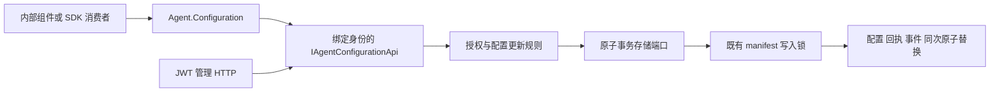

# Agent 配置 API P0/P1：DeepSeek 施工任务书

这份任务书只授权下列三项独立施工单。**收到 DS-01 就只做 DS-01，不能顺手完成 DS-02/03，也不能开始总规划的其他阶段。** 每项都不阻塞已经接入的配置主流程，独立交付后由主代理审阅集成。完成状态统一写 `ready-for-review`，不能宣称整套插件系统或 Agent 组件化已完成。

## 1 核心与施工任务的边界

主代理拥有以下内容，DeepSeek 一律只读：

| 位置 | 权威职责 |
|---|---|
| `Source/Pudding.Api.Contracts/` | 公共 DTO、字段补丁、回执、稳定错误、IAgentConfigurationApi |
| `Source/PuddingAgentConfiguration.Contracts/` | 可信调用者、授权端口、不可变状态、原子存储事务端口 |
| `Source/PuddingAgentConfiguration/` | 授权、校验、CAS、幂等、变更记录、查询主流程 |
| `Source/Pudding.Api.Sdk/PuddingClient.cs` | 工作区、Agent、配置门面及生命周期 |
| `Source/Pudding.Api.Sdk/HttpAgentConfigurationApi.cs` | HTTP 路由、响应校验、失败和 unknown 语义 |
| `Source/PuddingPlatform/Services/WorkspaceAgentFileService.Configuration.cs` | 现有 manifest 单写入者的配置适配器 |
| `Source/PuddingPlatform/Services/AgentConfigurationApiFactory.cs` | 管理端身份转换与资源范围绑定 |
| `Source/PuddingPlatform/Controllers/Api/AgentConfigurationApiController.cs` | JWT 管理端点与错误映射 |
| `Source/PuddingHost/`、`Source/PuddingCore/` | 宿主装配、现存配置模型；不可修改 |

三项任务不得改这些文件，也不得改现有测试以掩盖失败。根 `code_map.md`、解决方案、全局构建属性、前端、运行配置和依赖锁文件均由主代理维护。

核心调用链固定如下：



当前只开放元数据配置。**Agent 创建/执行、子代理、Goal、Hook 控制策略、MCP、模型资源池、插件 RPC 的 Agent 授权均不在本任务书范围内。** 不允许增加假实现、返回默认成功、复制一套 Agent 状态或开放原始内部服务来补齐这些能力。SQLite 后端、配置日志回收也暂不派发；涉及事务/恢复/幂等策略，留给主代理另行设计。

## 2 开工前必须执行

1. 阅读仓库 `Agents.md`、根 `code_map.md`、本任务所属目录的 `code_map.md`。
2. 明确本次收到的 Task ID；没指定时先报告缺少 Task ID，不自行选择任务。
3. 执行 `TestScripts/test-agent-configuration-contract-freeze.ps1`。它核对本任务书配套的[核心文件指纹](Agent配置API-P0P1-核心文件指纹.json)。任一不一致立即停止，禁止更新指纹文件使其通过。
4. 记录 `git status --short` 到 `.work/<task-id>/<run>/before-status.txt`；仓库有其他未提交工作，禁止 reset、stash、clean、批量格式化、自动修复整个仓库。
5. 确认允许创建的文件尚不存在。若已存在，先报告主代理，禁止覆盖可能属于其他施工者的实现。
6. 临时输出只进 `.work/<task-id>/<run>/`。所有构建必须带 `--artifacts-path`；禁止调用 npm/yarn、禁止升级依赖、禁止启动或重启 Core/Desktop/Guardian。

不读 `D:\data`、`D:\Keys`、LLM 配置或真实凭据，不发 Slack/飞书消息，不调用真实模型，不修改目标仓库之外的业务数据。不得 commit、push、部署。

指纹采用 UTF-8 文本、统一 LF 换行后计算 SHA-256，避免 Git 的 CRLF 转换产生误报；其余内容不归一化。检查脚本和指纹清单同样只读，施工者不得调整校验算法。

## 3 已冻结的接口与行为

以真实源码为签名权威，以下是必须理解的语义，不是允许重新设计接口的建议。

```csharp
Task<AgentConfigurationSnapshot> GetAsync(AgentRef agent, CancellationToken ct = default);
Task<ConfigurationChangeReceipt> UpdateAsync(AgentRef agent,
    AgentConfigurationPatch patch, ConfigurationUpdateOptions options,
    CancellationToken ct = default);
Task<ConfigurationChangePage> ReadChangesAsync(AgentRef agent,
    long afterSequence = 0, int limit = 100, CancellationToken ct = default);
```

| 概念 | 固定规则 |
|---|---|
| AgentRef | WorkspaceId + AgentId；不能通过更换 ID 扩大权限 |
| Patch | 仅 DisplayName/Description；遗漏保留、Set(null) 清空；不支持 Status/模型/权限/任意属性字典 |
| 名称 | 非 null 时不得空白，最长 256；服务会 Trim；清空后沿用现有名称显示规则 |
| 描述 | 最长 16000，可空串或 null；换行与空白原样保存 |
| ExpectedRevision | 不透明字符串；不得解析、加一或自行生成；旧版本必须冲突 |
| OperationId | 每个新命令使用新值；同一命令重试必须保留 ID、补丁和 ExpectedRevision；不同载荷复用 ID 返回 operation.conflict |
| 身份 | 服务端绑定；请求体不包含 ActorId/权限/令牌/工作区授予信息 |
| 应用回执 | AppliedTarget=configuration-source 只确认配置源；不代表 UI 已刷新或当前 Run 已切换 |
| Changes | 仅此版本化 API 的变更；旧 PUT 的所有动作不属于此流；无变化的命令有回执但不产生事件 |
| 游标 | 单个 Agent 的非负 Sequence；页上限 1..200；Complete 表示在该次读取时已追平 |
| 失败 | 不改成空值/成功；未知副作用是 unknown；不能自动换 OperationId 重试 |
| journal | 最多 1024 条命令，满时 resource.limit；不允许施工者删除或裁剪它 |

HTTP 入口：

- `GET /api/workspaces/{workspaceId}/agents/{agentId}/configuration`
- `PATCH` 同一路径；请求 `{ "patch": ..., "options": ... }`
- `GET .../configuration/changes?afterSequence=0&limit=100`

当前 HTTP 只接受管理端 JWT。第三方 external token 和插件凭据不可冒用该入口。新增插件授权由主代理负责。

写入 wire 示例（不是普通字符串补丁）：

```json
{
  "patch": { "displayName": { "isSpecified": true, "value": "鲸鲸" } },
  "options": { "expectedRevision": "从 Get 取得", "operationId": "本命令稳定标识" }
}
```

SDK 使用示例：

```csharp
var client = new PuddingClient(api); // api 由可信装配方提供
var agent = await client.Workspace(workspaceId).Agents.GetAsync(agentId, ct);
var before = await agent.Configuration.GetAsync(ct);
var receipt = await agent.Configuration.UpdateAsync(
    new AgentConfigurationPatch { DisplayName = "鲸鲸" },
    new ConfigurationUpdateOptions(before.Revision, operationId), ct);
```

## 4 DS-01：只读 SDK 命令行示例

**目标**：普通 .NET 程序只引用 SDK，即可读取 Agent 元数据，不了解 manifest/JSON/数据库。这个示例只读，不增加更新命令。

### 文件白名单

只允许新建：

```text
Samples/AgentConfigurationClient/AgentConfigurationClient.csproj
Samples/AgentConfigurationClient/Program.cs
Samples/AgentConfigurationClient/ConfigurationInspector.cs
Samples/AgentConfigurationClient/README.md
Samples/AgentConfigurationClient/code_map.md
Tests/AgentConfigurationClient.Tests/AgentConfigurationClient.Tests.csproj
Tests/AgentConfigurationClient.Tests/ConfigurationInspectorTests.cs
Tests/AgentConfigurationClient.Tests/code_map.md
```

只允许在 `.work/ds-01/<run>/` 写临时输出。不改任何现存文件；索引与解决方案由主代理接入。

### 固定接口

命名空间 `Pudding.Samples.AgentConfigurationClient`：

```csharp
public static class ConfigurationInspector
{
    public static Task<int> RunAsync(IAgentConfigurationApi api,
        string workspaceId, string agentId, TextWriter output,
        TextWriter error, CancellationToken ct = default);
}
```

`RunAsync` 通过 `PuddingClient` 获取 Agent 并读取配置。stdout 输出一行 JSON，仅含 workspaceId、agentId、revision、displayName、description、templateId。成功 exit 0；ConfigurationApiException 只向 stderr 写 `Code`，exit 1；取消 exit 130。不得调用 Update/ReadChanges，不读取磁盘配置，不创建 Agent，不 Dispose 注入的 api、writer 或 HttpClient。

`Program.cs` 仅负责参数解析、HttpClient 和凭据载入：必须提供 `--base-url --credential-file --workspace --agent`；未知/重复/缺少参数 exit 2。凭据文件格式 `{ "accessToken": "..." }`，缺失或空值 exit 2，不回显其内容。Base URL 禁止 userinfo/query/fragment，HTTP 只允许 loopback，其他地址必须 HTTPS；不得关闭 TLS 验证。HTTP 超时 15 秒，使用 Bearer 请求头，Ctrl+C 取消。不能提供默认生产地址或在仓库写示例 token。

### 固定步骤

1. 新建 net10.0 Console，唯一 ProjectReference 是 `../../Source/Pudding.Api.Sdk/Pudding.Api.Sdk.csproj`，不加包。
2. 先实现 ConfigurationInspector，再实现参数/HTTP 外壳；不能把 SDK 逻辑复制进示例。
3. 测试项目使用 `MSTest.Sdk/4.0.1`，唯一 ProjectReference 指向示例工程。使用假的 IAgentConfigurationApi，禁止真实联网。
4. 至少验证：合法配置精确输出；中文/换行正确 JSON 转义；permission.denied 不输出配置；取消；Get 不存在；Update/ReadChanges 调用次数均为零；注入资源未释放。
5. README 写构建、参数、凭据占位文件格式、退出码及只读边界；不承诺创建/执行 Agent。

### 验收命令

```powershell
$run = '.work/ds-01/<本次标识>'
New-Item -ItemType Directory -Force $run | Out-Null
dotnet build Tests/AgentConfigurationClient.Tests/AgentConfigurationClient.Tests.csproj --artifacts-path "$run/artifacts" -p:UseVSTest=false -p:CollectCoverage=false --nologo > "$run/build.log" 2>&1
# build 非零时停止，不运行旧 DLL。
dotnet "$run/artifacts/bin/AgentConfigurationClient.Tests/debug/AgentConfigurationClient.Tests.dll" --no-ansi --no-progress --results-directory "$run/results" > "$run/tests.log" 2>&1
```

## 5 DS-02：配置变更分页读取扩展

**目标**：调用方不手写分页循环；只遍历当前可取得的事件，不增加后台订阅、轮询或持久 checkpoint。

### 文件白名单

只允许新建：

```text
Source/Pudding.Api.Sdk/ConfigurationChangeReader.cs
Source/Pudding.Api.SdkTests/ConfigurationChangeReaderTests.cs
```

允许在这两个目录各自的 `code_map.md` 增加一条对应文件索引，不改其他行。其他文件只读。

### 固定接口和算法

命名空间 `Pudding.Api.Sdk`：

```csharp
public static class ConfigurationChangeReader
{
    public static IAsyncEnumerable<AgentConfigurationChanged> ReadAvailableChangesAsync(
        this AgentConfiguration configuration,
        long afterSequence = 0, int pageSize = 100, int maxPages = 20,
        CancellationToken ct = default);
}
```

1. 校验 configuration 非 null、afterSequence >= 0、pageSize=1..200、maxPages=1..1000；非法参数抛对应 ArgumentException，不发请求。
2. 以调用方游标调用已有 `ReadChangesAsync`，传递 ct；不得修改 HTTP adapter 或添加新端点。
3. 每页先完整校验，再 yield：Items 不能 default；Sequence 必须严格递增且大于上一游标；有条目时 NextCursor 必须等于最后条目的 Sequence；空页 NextCursor 必须等于请求游标。
4. Complete=false 时必须至少有一条事件且 NextCursor 前进；否则抛 `ConfigurationApiException("transport.invalid_response", ...)`，不得无限循环。
5. 依次 yield 已验证条目。Complete=true 即结束；不要再次请求确认，不 Sleep、不长期等待未来事件。
6. 未 Complete 时用 NextCursor 继续；达到 maxPages 仍未 Complete，抛 `ConfigurationApiException("resource.limit", ...)`。已经 yield 的内容是部分结果，不能悄悄当完整结果返回。
7. 不重试异常，不吞取消，不修改配置，不存游标。取消时原样传递 CancellationToken。

注意：异步迭代器需 `[EnumeratorCancellation]` 正确接收枚举取消；参数验证可以在返回内部迭代器之前执行。不能为简化实现忽略调用者 `WithCancellation` 的 token。

### 必须测试

正常两页顺序和每页入参；Complete=true 空页只调用一次；最后一页后不多请求；服务端异常原样传播；不前进的 partial 页；空 partial 页；倒序/重复 Sequence；NextCursor 与末项不符；页数耗尽抛错；调用前取消和枚举中取消；消费者提前停止后不发下一页请求。使用假的 IAgentConfigurationApi 构造 SDK 门面，禁止网络。

### 验收命令

```powershell
$run = '.work/ds-02/<本次标识>'
New-Item -ItemType Directory -Force $run | Out-Null
dotnet build Source/Pudding.Api.SdkTests/Pudding.Api.SdkTests.csproj --artifacts-path "$run/artifacts" -p:UseVSTest=false -p:CollectCoverage=false --nologo > "$run/build.log" 2>&1
dotnet "$run/artifacts/bin/Pudding.Api.SdkTests/debug/Pudding.Api.SdkTests.dll" --no-ansi --no-progress --results-directory "$run/results" > "$run/tests.log" 2>&1
```

## 6 DS-03：公共配置 wire 的序列化边界测试

**目标**：补齐真实 JSON 边界的测试，保护未提供/设值/清空和严格字段集合；不改生产代码。

### 文件白名单

仅新建 `Source/PuddingAgentConfigurationTests/ConfigurationSerializationTests.cs`，并仅在同目录 `code_map.md` 增加该文件索引。不得修改 `ConfigurationTests.cs` 或 csproj。

### 施工步骤与预期

使用 `System.Text.Json` 和 `new JsonSerializerOptions(JsonSerializerDefaults.Web)`；需要验证必填构造参数时明确设置 `RespectRequiredConstructorParameters=true`，不得把客户端选项误认为所有 JSON 默认行为。

新增数据驱动用例，至少覆盖：

| 输入/场景 | 预期 |
|---|---|
| patch 缺少 description | IsSpecified=false；不等同显式清空 |
| description 的 isSpecified=true、value=null | IsSpecified=true 且 Value=null |
| description="" | 保持空串，不转 null |
| 中文、emoji、CRLF、引号、反斜线 | 序列化后反序列化逐字符相等 |
| displayName 与 description 同时出现 | 两个 presence marker 都保留 |
| Patch 加入 status/modelId/permissions 三种字段 | 每种均 JsonException |
| 字段包装中加入额外 member | JsonException |
| Options 加入 actorId/authorization | JsonException |
| 请求顶层加入 actorId | JsonException |
| isSpecified 使用字符串而非 bool | JsonException |
| 启用必填检查后，UpdateRequest 缺少 options 或 patch | JsonException |
| 合法回执 round-trip | AgentRef、OperationId、所有 revision、AppliedTarget、Changed、可空 ChangeSequence 和时间相等 |

测试反序列化不负责代替业务校验：空补丁、超长描述、空白名称等由配置服务拒绝，不能为了让 wire 测试通过把校验移到 DTO 构造函数。

验收：按 DS-02 相同 build/run 模式，工程替换为 `Source/PuddingAgentConfigurationTests/PuddingAgentConfigurationTests.csproj`、DLL 替换为 `PuddingAgentConfigurationTests`，输出目录改为 `.work/ds-03/<本次标识>/`。必须运行原有测试和新增测试，不能只过滤新文件。

## 7 所有任务共用的停止条件

遇到以下任一项，保持已写文件，停止扩大修改，提交诊断：

- 需要改只读核心文件、签名、错误码、权限、回执语义或宿主注册才能继续。
- 冻结指纹不匹配；发现目标文件已有其他实现；同目录存在无法确认归属的并行修改。
- 现有测试失败。报告测试名、命令、原始错误和日志路径；不得改断言、加 Skip、缩小测试集合或更新“正确答案”。
- 需要读取真实凭据、启动产品、访问生产目录或发送实际消息才能验证。
- 想增加“通用框架”、重试策略、后台服务、缓存、日志清理、配置迁移或新包依赖。

不能通过复制代码、反射内部对象、去掉检查、catch 后返回成功绕开上述条件。可以报告更好的想法，但不把它混进当前施工差异。

## 8 固定交付格式与主代理验收

每项交付必须含：

1. Task ID；状态 `ready-for-review` 或 `blocked-with-evidence`。
2. 精确新增/修改文件清单；说明是否全部在白名单内。
3. 每个必测场景 → 测试方法名 → 结果；总通过/失败/跳过数。
4. 实际构建和测试命令、退出码、`.work` 日志路径；没有运行就写未验证。
5. `git diff --check` 结果；未跟踪新文件也要检查空白与内容，不只看 git diff 的旧文件部分。
6. 开工和完工两次冻结指纹检查结果；不得提交 token、日志正文或整个工作树打包。
7. 未完成事项；不得把猜测写成已验证结论。

主代理按以下次序接收：指纹/文件范围 → 阅读 diff → 独立复跑该任务完整测试 → 更新索引 → 决定是否登记工程或接入产品。施工者不修改解决方案、不执行 S5、不部署，也不批准自己的交付。

三项可以并行做；DS-02 与 DS-03 各自只增加独立文件和一条索引。主代理负责合并索引冲突。更多组件的迁移请参考[总规划](核心组件与插件公共API规划-2026-11-04.md)，它不是本施工单的写入授权。
