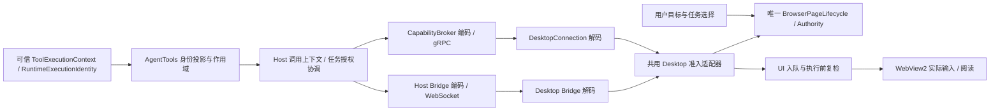

# B1 身份准入接线与浏览器交付下一阶段实施方案

## 1. 决策与执行范围

选择 **A：Core 从可信执行上下文投影调用者身份，经认证的 Desktop 通道传递，Desktop 使用本进程唯一 authority 校验并准入**。不采用会话身份代替任务身份的 B，也不采用无限复跑维持现状的 C。本裁定解除“必须再选 A/B/C”的设计前置条件，目标是交付 B1/B6 的活路径闭环。

跨层改动是这个切片的必要范围：Contracts、两套 wire/映射、AgentTools 的身份作用域、Host 装配、CapabilityBroker、DesktopConnection、DesktopService、Runtime 委派、Shell 可信目标绑定及对应测试。文件位于其他子系统本身不构成再次询问设计方向的理由；并行未提交改动必须核对、协调并保留，不能通过覆盖或混合提交代替协调。

本文交付决策与施工方案，未声称产品接线已经完成，未改变其他会话的 Goal 状态或发送继续施工消息。旧任务卡的 A/B/C 选择由本方案取代，功能状态仍待施工。

| 原阻塞项 | 裁定 | 是否阻塞 B1 源码施工 |
|---|---|---|
| 身份来源与跨层修改 | 选 A；身份、授权和实际执行闸门一起形成闭环 | 设计选择已解除；实现仍需通过门禁 |
| 扫描 250ms | 保留为待真实驱动校准的候选值，不认定已经生效或验收 | 不阻塞身份接线；阻塞扫描时间门限的产品完成声明 |
| 三条时序 flake | 允许在必要的 Host/Desktop 路径修复根因与测试同步，独立切片 | 受影响发布套件的未解决失败阻塞其通过声明 |
| 根索引指纹 | 使用现有规范算法重算并人工更新；单独维护任务 | 不阻塞身份接线；仓库索引门禁保持如实失败 |
| 真机与生命周期 | 分成外部部署、产品内功能、外部生命周期三项交接 | 不阻塞独立测试；阻塞产品完成与默认启用 |

## 2. 基线事实与需要补齐的闭环

当前源码中 `Admit` / `Revalidate` 的 authority 接口和实现存在，但缺少生产调用；`DesktopCallContext` 没有 caller，gRPC 解码按 operation/deadline 等字段重建上下文。Bridge 的 Origin 只用于审计，缺少父运行与执行 kind，不能用它替代授权身份。

另外，`IssueGrant` / `IssueManagementGrant` 同样没有生产签发调用。因此“加 caller + 调 Admit”不足以完成 B1：必须建设用户授权绑定、任务授权签发/同步、准入、执行前复检、撤销与清理，否则只会把原先可操作变成全部拒绝。

更正调用位置：`Pudding.CapabilityBroker/DesktopSession` 是 **Core 侧**会话与命令发送端。最终页面 authority 位于 Desktop 的 `BrowserPageLifecycle.Authority`；Broker 负责验证 Core 的调用上下文、编码、去重与传输，不能复制 Desktop authority 或签发 Desktop 执行租约。

## 3. 身份与协议设计

### 3.1 身份来源

在 `BrowserAgentToolBase.BeginExecutionScope` 内用现有 `BrowserCallerIdentitySource.TryProject` 投影 `request.Context.ExecutionIdentity` 和实际 Agent 实例标识；保存到独立的调用级作用域，所有正常返回、异常、取消均恢复前值。不得把身份保存到 DI 单例工具字段，也不得从浏览器 Arguments、Origin、网页、模型自报字段推导。

新增或扩展一个窄身份 accessor，身份作用域与审计 Origin 分开。Host 的 context factory 从 accessor 获取调用者；Bridge 与能力通道都使用同一投影结果。缺身份返回具体的拒绝结果，不生成默认 Agent/任务。并发任务、嵌套工具与异常退出均要验证作用域无串用。

现有投影将 RunId 放入 `BrowserCallerIdentity.TaskId`，ParentRunId 放入 ParentTaskId。本切片明确这两个字段表示**执行运行身份**，不能混用任务看板 TaskId、聊天 SessionId 或长期 AgentId。跨 Turn 的长期任务授权由可信 Core binding 显式重新绑定新运行；不能仅凭相同 callerId 自动借用旧运行授权。

### 3.2 两传输同步变化

`DesktopCallContext` 增加类型化 caller。它是通用 Desktop 上下文，非浏览器 Shell 请求可以没有 browser caller；所有浏览器自动化操作必须要求可信 Agent/SubAgent 和完整运行字段。浏览器工具不能构造 User kind 绕过闸门，用户原生操作走独立可信入口。

gRPC 的 `CapabilityCommand` 增加独立 caller message；字段含 kind/callerId/taskId/parentTaskId，未知枚举、空必填、过长或不合法标识都拒绝，不按 proto 默认值补身份。Bridge 命令 envelope 同步携带类型化身份和明确连接绑定，禁止把授权塞进任意 Arguments JSON。审计 Origin 与 PermissionEvidenceSummary 保持诊断用途，后者不能仅凭字符串 `allowed` 获得授权。

DesktopId、DesktopProcessInstanceId、连接 generation、控制 epoch 和 grant epoch 由当前已认证连接与 Desktop authority 提供/验证，不接受模型或 caller 自报这些字段。验收覆盖连接认证和 Core 实例更换；信任的是获准 Core 的上下文声明，不是所有能向本机端口发 JSON 的进程。此次不凭空增加每调用签名系统。

当前两协议均为 v1；本切片将能力通道 `Current/Minimum` 与 Bridge version 同步提升为 v2，更新握手、测试与探针。旧/新配对明确拒绝；不兼容时不回退另一通道重做操作。proto 保留已有字段编号，新增字段使用未占用编号；生成类型、编码/解码和消费方在同一实现切片完成。

### 3.3 幂等与身份不能分离

Core `CoreCommandEncoder.Fingerprint` 当前仅含能力和业务 payload。新指纹必须同时包含完整规范化 caller（含 kind、运行与父运行）、连接作用域、显式目标和 payload；用明确长度/字段编码避免字符串分隔碰撞。deadline/trace 可按原语义排除，不能排除身份。

同 operationId 换 caller、父运行、目标或 payload 必须拒绝，不能借重复请求路径绕过授权，不能返回另一行动者的缓存结果。Desktop 与 Bridge 的 operation ledger 同步校验身份；已执行请求重传只回放已记录事实，不再次入队/签租约/输入。连接换代后的旧记录不能授权新执行；结果不明仍按 unknown 处理。

## 4. 授权签发与唯一准入位置

### 4.1 用户目标绑定到实际任务

目标勾选与任务身份绑定是两个事实。Shell 的“Agent 目标”需要从可信 Core 元数据取得具体 Agent/会话/运行 binding，并向用户显示归属；没有明确 binding 时显示等待绑定，不把当前活动 Tab、最后一条消息或任意 caller 当作获准任务。

Core 根据既有用户授权记录提出受范围约束的 grant 申请；Desktop 同时检查本地用户目标事实、实例/连接世代和任务 binding，调用唯一 authority 的 `IssueGrant`。用户授权可以复用，不要求每次 browser 调用再确认，但一条普通调用不能自动把自己授权为目标页 owner。

page grant 明确 read/write/manage、context/page/frame、行动者、有效期与授权来源；管理 grant 明确任务可建/关 context、建 tab 的范围。metadata 清单按 BrowserOperationPolicy 的 None 分类处理并限定可见信息，不借列表读取暴露其他任务页面正文。

新建页面只在有效管理授权范围内登记并按明确策略签发该任务的页面授权，登记/授权失败回收新建对象。目标切换、任务结束/取消、父任务撤销、页面关闭、Core/连接世代更换均执行确定性撤销。控制面申请、签发 ack 和撤销也须有两传输映射、顺序与幂等用例；不得靠公开模型工具 `grant_all` 实现。

### 4.2 两次校验与资源释放

在 DesktopService 建立一个共用准入适配器，两传输映射成同一 `BrowserAutomationRequest`，引用同一 `BrowserPageLifecycle`，不存在第二个 authority。Bridge 的执行 dispatcher 和能力通道的 DesktopService 都进入这个逻辑位置；Core authorizer 的预检不能替代 Desktop 校验。

调用顺序固定为：

1. 校验协议/连接、调用身份、参数与 operationId 账本。重传命中时校验原行动者，回放结果而非重复执行。
2. 根据 `BrowserOperationPolicy` 生成显式 request；新操作在 UI 入队前调用 `Admit`，写操作保存返回租约。
3. UI 回调在触碰页面前检查取消/deadline、目标存在/版本/可操作性，写操作调用 `Revalidate`；只读操作也重新核对连接与 grant，避免排队期间撤权后继续读。
4. 多步键鼠序列每个下一步输入前复检。接管确认与输入步骤的执行边界必须序列化，不能在“检查通过→下一步实际输入”之间留下可穿透接管的竞态。
5. 记录实际 dispatch/验证/副作用事实；finally 释放本操作租约和队列占用。异常、取消、断连、UI 入队失败、页面关闭均覆盖。

拒绝的驱动调用数必须为 0；接管后授权只读仍可用；恢复不复活旧租约。管理操作和每个已实现的浏览器入口也要覆盖，不能只接七个工具之一或只挡 click。无法映射的浏览器副作用入口 fail-closed；Shell 通知等非浏览器能力不被错误要求 browser grant。

## 5. B6 的 Runtime 接线

在 B1 活路径通过后，复用现有子代理机制，不新增执行器：Runtime 创建真实 child run/parent run，签发父授权的有效子集，期限不超过父授权；工具发现/注入包含任务所需能力，未完成能力不可注入为可用。

父代理同页写许可先停止并等待在途操作结算，子代理取得独立授权/租约后才输入；不同页是否允许并发服从当前 authority 的实际粒度，不能靠描述声明已支持。子任务完成、超时、取消、父授权撤销和进程重连均释放许可。父结果默认 ≤2 KiB，长证据通过 Artifact。

先做 Runtime 注入与生命周期的替身集成，再做用户指定测试 Agent/DataRoot 的真实模型委派。没有真实模型结果不能宣布 G10 完成，不读取模型 Secret 绕过项目准入。

## 6. 扫描校准、时序问题与索引维护

### 6.1 250ms 的处理

10,000 节点/深度 64 与输出字节预算继续作为确定性合同；250ms 是待校准候选，不能用纯函数测试或固定 delay 宣布通过。真实驱动校准前不引入一个宣称正式有效的 250ms 硬切断；调用 deadline 仍有界，达到任何已有上限必须区分 incomplete_scan 与 output_budget。

在实际 WinUI/WebView2 Runtime 上，使用固定中文/英文 SERP、正文、深 DOM、嵌套 frame/shadow fixture；记录 Runtime/硬件/缩放、扫描节点/覆盖率、热身、重复样本、P50/P95/P99及页面繁忙情形，单独记录驱动扫描而非 LLM/网络时间。采用预算内完整 fixture覆盖率与交互响应目标共同选值，不为了 250ms 降深度或砍内容。

校准结果进入独立报告与配置，追加确定性截断合同测试，再启用正式时间门限。deadline/Payload 超限只证明有界，不能证明页面内容完整。

### 6.2 三条时序 flake 的修复边界

| 已登记用例 | 优先检查与修复方向 |
|---|---|
| `SecondConnection_CannotReplaceAwaitingHelloConnection` | 握手占用与第二连接拒绝的明确事件/屏障；检查 receive 取消/超时、释放时序与资源泄漏 |
| `LlmConfigurationLoad_DoesNotDeadlockOnDesktopSynchronizationContext` | 配置加载同步上下文与同步阻塞，使用受控调度/完成信号测试；若生产存在阻塞则修生产 await 路径 |
| `HiddenSurface_ParksLateSdkFramesAndStopsObservingAfterDisposal` | dispose 世代栅栏、解除订阅、迟到 SDK frame 投影与 fixture 的明确排空/完成信号 |

这些是调查方向，不预判三条都是测试问题。独立修复提交，禁止以统一加 sleep、扩大 timeout 或允许无限 retry 作为验收。适当调整明确的探针 watchdog 需记录理由，但不能改变应有状态机断言。

拟定稳定性门禁：受控调度覆盖故障时序；修复后单项与对应串行整链各首跑重复 20 次、0失败，保留全量 TRX/首次失败信息。20次通过是回归证据，不是永不失败保证。修复前登记表用于分类，不计作默认绿色；新身份切片受影响套件首次失败就报告失败。

链外 WebApi 的 goal/compaction 三失败另建归因任务，明确是否会阻断当前 API/委派路径。受影响则必须修后验收；无关则保留失败报告，不能将浏览器套件绿色外推为全解决方案绿色。

### 6.3 指纹维护

`code_map_check.py --fingerprint` 当前仍实现逐 glob 枚举与规范聚合，`--fp-probe` 用多种口径诊断。`matches=NONE` 只表示声明不匹配候选，不能推出“工具不支持、无法计算”。

在固定源码快照上按[code-map规范](../10_conventions/code-map-规范-v2.md)和工具当前算法计算四项，再人工更新声明、条目数与受影响行；记录工具 hash、输入排除集和改动依据。处理根索引已有行/字段超限时把详细规则链接到权威子索引，仅保留跨项目用途，不能自动截断语义。禁止凭探针中的任意候选值碰运气，也不新增豁免。

此维护独立提交，不混入身份接线。产品发布身份使用实际产物/源码构建指纹；索引 freshness 不能代替构建来源，也不能因为索引未维护就假称浏览器功能已验证。

## 7. 施工切片、文件落点与验收

| 顺序 | 切片与主要落点 | 完成门禁 |
|---|---|---|
| I1 | 身份作用域 + DTO/wire v2：AgentTools base/accessor、Host context factory/Bridge 编码、Contracts、proto、Broker WireMapping/DesktopSession、DesktopConnection Mapping、Bridge Messages/握手 | 两传输往返；缺/错身份拒绝；并发无串用；不同 caller 同 operationId 拒绝；v1/v2拒绝；消费者同切片构建 |
| I2 | 任务绑定与 grant 生命周期 + Desktop 共用准入：Host 授权协调、Shell可信绑定、DesktopService/BrowserPageLifecycle、Bridge dispatcher/handler | 用正常入口签发的授权完成“允许任务真实走替身驱动一次”；未签发/跨任务/跨页拒绝=0调用；入队后接管/撤权复检拒绝；异常路径租约归零 |
| I3 | B6：Runtime 委派、实际工具注入、子授权与回收 | 真实 child身份到达Desktop；子集越权0调用；父子不并发同页写；取消/父撤权级联；有界父结果 |
| I4 | 三项时序修复；根索引维护各自独立提交 | 首跑稳定性证据；索引门禁通过或如实列出未修规则；不通过重试掩盖失败 |
| E1 | 外部控制器部署明确 Desktop/Core配套构建，真机 P0 + native/scroll/screenshot探针 + 250ms校准 | 实际进程/产物/前端徽标与新构建一致，G1–G4实测；能力按支持动作/表面声明 |
| E2 | 产品内新会话真实模型 smoke，外部生命周期判定 | G1–G11逐项完成/未完成矩阵，startup/restart/crash-recovery/exit-reclamation有外部事实 |

I1/I2/I3 的纯策略和契约增量先独立测试（S1–S4），通过后再 S5 装配；已有组件不重复宣布完成。每个切片同步全部消费方，不提交暂时编译不通的半套协议；配套版本完成前不默认启用新通道。每个已验证原子任务精确暂存并提交，更新对应子项目地图/日志。

至少覆盖这些接缝测试：

- Contracts + Broker + DesktopConnection：kind/parent/运行身份完整往返、空值/未知枚举/错世代拒绝、指纹身份绑定。
- AgentTools + Host：正常 ToolExecutionRequest 产生真实caller，AsyncLocal并发/嵌套/异常恢复，不通过测试专用 setter 绕过生产入口。
- DesktopService + Bridge：同一个 lifecycle实例、生产grant签发入口、准入/复检、close/reconnect/revoke、读/写/管理矩阵与0调用计数。
- Runtime：父子真实身份与作用域、工具发现、取消/完成回收，单例上下文不泄漏。
- 所有受影响消费者编译；Desktop build/test/publish串行，输出放 temp/build/recovery、temp/test-out，先restore/build后同目录--no-restore。不部署覆盖正在运行实例的文件来假称已加载。

外部验证优先固定 TestSite，滚动观察 document.scrollingElement/实际容器/overflow/位移与输入backend；native逐动作探针，明确unsupported；截图核对当前文档、ContentLoading、目标、可见/隐藏/最小化表面，黑图不能当截图成功，受支持表面可先有限声明。复用[外部smoke手册](../13_runbooks/浏览器自动化外部smoke-runbook.md)，不足的身份/grant与校准步骤施工时补齐，原有记录不被新总数字覆盖。

## 8. 交接、停止条件与交互作品的关系

I1–I3输出源码提交、相关首次TRX、两传输允许/拒绝计数、构建清单和明确未验证项。内部达到 ready-for-external-deploy后交给外部控制器；新构建内功能会话才能输出 in-product-functional-complete，外部控制器独立给出四步生命周期结论。当前执行环境没有真实Shell时，这是一项具体外部交接，不再用相同复跑替代部署。

下一次有效推进应以 I1/I2 的生产接缝为中心；缺少真实机器只阻塞 E1/E2，不阻塞可测源码施工。只有具体依赖缺失或并行修改无法协调时登记一次阻塞，给出缺少的输入/验收者和可执行交接；停止生成同义轮次、重复数字和新的“等待再选择 A/B/C”任务卡。

交互作品方案继续使用独立状态/提交/SDK，不把任意JS当作身份修复途径。可先独立完成其 U0 契约和模板fixtures；共享浏览器执行/观察能力的产品接入在本方案P0通过后进行。首个用户价值仍是“方案对比 + 偏好表单”，保存、更新、读取与正式提交闭环不被外围浏览器功能拖成无限大项目。
