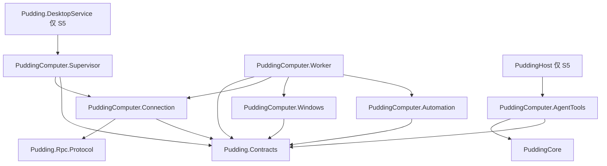

# PuddingAgent Computer Use 代码设计与分阶段施工方案

PuddingAgent 通过 Windows UI Automation 读取和操作标准控件，通过屏幕截图与原生键鼠覆盖自绘界面。Agent、工具授权、任务和业务记录保留在 Core；Windows 执行器运行在独立 Worker，由 Desktop 的系统能力层监督。实现目标是完成“观察 → 定位 → 操作 → 验证”，并让用户接管、目标失效和结果未知具有确定语义。

本方案为施工规格。下文标为“新增”的工程、文件和接口均是拟建对象；代码块用于冻结接口形状与算法，不代表已编译的实现。产品边界遵守 [Shell Web Core ADR](ADR-Desktop-Shell-WebUI-Separate-Core-2026-09-29.md)，组件交付遵守 [S1 至 S5 规程](../10_conventions/组件化交付规程.md)。

## 1 产品范围与技术决策

首版支持 Windows 已解锁的当前交互桌面、同用户普通权限应用、多显示器、混合 DPI、标准控件与截图坐标操作。八项工具全部有明确行为；应用启动、关闭窗口、拖拽、剪贴板和跨虚拟桌面操作作为扩展切片，未实现动作必须返回 `unsupported_action`。

首版只操作用户已经打开并授权的窗口。启动应用需要另行解决进程归属、应用目录和参数约束，不通过任意 shell 命令代替。文件、Office 或浏览器存在专用接口时，Agent 优先使用该接口；Computer Use 负责需要桌面交互的部分。

| 决策 | 代码约束 |
|---|---|
| UIA 与原生输入并存 | `backend=uia/input` 必填；不提供动作执行后的自动后端回退 |
| 原生驱动独立进程 | UIA、截图和键鼠实现只由 Worker 装配；Shell/Core 不加载 FlaUI |
| 复用既有能力通道 | Computer 只走能力通道，不扩展旧 Browser WebSocket Bridge |
| 复用契约叶 | 新 DTO 放 `Pudding.Contracts/Computer/`，保持 ProjectReference/PackageReference 均为 0 |
| 本地控制状态单一所有者 | Worker 的 `ComputerAuthority` 持有租约、观察和动作账本；Core 持有业务授权记录 |
| 当前桌面单写者 | 所有 Computer 变更操作在 Windows 会话与桌面范围串行；跨 DataRoot 共享互斥 |
| 模型无凭据控制面 | 工具参数不含 caller、grant、权限结论、Worker 世代或真实 HWND |
| 可终止不等于可回滚 | 取消、超时或杀 Worker 之后，已派发 UIA/输入动作可能仍有副作用 |

独立 `PuddingComputer.Contracts` 不再作为工程候选：既有 `DesktopCapabilityRequest/Response` 需要包含 Computer DTO，另建合同程序集会迫使 `Pudding.Contracts` 增加引用，违反其 BCL-only 编译门禁。采用同一叶程序集内的 `Pudding.Contracts.Computer` 命名空间，避免反向依赖。

## 2 当前实现与复用接缝

| 当前文件 | 已有事实 | 接入方式 |
|---|---|---|
| [ScreenCaptureTool.cs](../../Source/PuddingHost/Tools/ScreenCaptureTool.cs) | `screen_capture` 枚举显示器/窗口并发布图片部件 | 保留其工具用途；新工具通过窄发布端口复用 Vision Artifact |
| [WindowsScreenCaptureBackend.cs](../../Source/PuddingHost/ScreenCapture/WindowsScreenCaptureBackend.cs) | GDI、PrintWindow、多屏物理坐标与线程 DPI 上下文 | S5 后抽取共用采集实现；不让新组件引用 Host |
| [ScreenCaptureModel.cs](../../Source/PuddingHost/ScreenCapture/ScreenCaptureModel.cs) | 图像模型仅含尺寸、BGRA 和 stride | 新观察另外记录真实采集模式、窗口世代、裁剪与转换信息 |
| [BrowserScreenshotTool.cs](../../Source/PuddingBrowser.AgentTools/BrowserScreenshotTool.cs) | 截图分块校验与 `OkWithParts` 原生图像输出 | 沿用输出方式，Computer 不依赖 Browser 工具程序集 |
| [DesktopCallContext.cs](../../Source/Pudding.Contracts/DesktopCallContext.cs) | operation、deadline、Desktop 身份；现有 caller 为 Browser 类型 | 增加独立 `ComputerCaller`，不把桌面动作伪装成 Browser 调用 |
| [ToolPermissionPolicyService.cs](../../Source/PuddingRuntime/Tools/Platform/ToolPermissionPolicyService.cs) | 静态工具风险分类；High 要求运行时授权 | 新工具采用保守静态等级，资源范围另由 Computer grant 检查 |
| [TrustedCallerDesktopCapabilityAuthorizer.cs](../../Source/Pudding.CapabilityBroker/TrustedCallerDesktopCapabilityAuthorizer.cs) | 可信身份门，不是完整工具审批链 | 新增 Computer 宿主授权适配器，在发送前验证真实工具许可 |
| [WindowAutomation.cs](../../Source/HarnessAgent.Core/Computer/WindowAutomation.cs) | user32 原型、窗口查找、旧键鼠调用 | 只参考，不把 HarnessAgent.Core 纳入产品依赖 |

截图代码存在需要明确处理的接缝：注释提到采集方式，但现有 `CapturedScreenImage` 没有该字段；PrintWindow 回退也不能仅靠注释推断。Computer 驱动必须由实际分支填写 `capture_mode`，并区分“窗口渲染内容”和“屏幕可见像素”。

## 3 工程依赖与文件布局

### 3.1 工程依赖

箭头表示编译引用；进程之间的请求流见第 8 节。



| 工程 | 框架与引用 | 职责与边界 |
|---|---|---|
| 既有 `Pudding.Contracts` | net10.0；仅 BCL | 新增 Computer 值对象、端口和判别联合；无驱动、计时器、文件或数据库实现 |
| 新增 `PuddingComputer.Automation` | net10.0；Contracts | 状态归约、准入、几何转换、观察失效、去重与回执纯规则 |
| 新增 `PuddingComputer.Windows` | net10.0-windows；Contracts；FlaUI.UIA3/SkiaSharp | UIA、窗口、截图、输入、桌面探测；只有 Worker 引用 |
| 新增 `PuddingComputer.Connection` | net10.0；Contracts、Rpc.Protocol | 有界 Named Pipe 帧、DTO 映射、请求关联与取消；对端身份验证经端口 |
| 新增 `PuddingComputer.Supervisor` | net10.0；Contracts、Connection | Desktop 侧进程生命周期、Job Object、握手和停止；Windows API 以运行时平台守卫保护 |
| 新增 `PuddingComputer.Worker` | net10.0-windows 可执行；Contracts、Automation、Windows、Connection | IPC 服务、命令调度、控制事件循环与驱动装配 |
| 新增 `PuddingComputer.AgentTools` | net10.0；PuddingCore、Contracts | 八个工具、调用上下文投影、结果投影、图片发布端口 |

Supervisor 与 Windows 驱动分开是为了让 Desktop 不加载 UIA/图像驱动依赖。Supervisor 不引用 Worker 工程，Worker 不引用 Supervisor；产品打包复制 Worker 成品，进程启动使用清单中已验证的路径。

各新工程添加 `EnforceComputerBoundary` 构建 Target，逐项验证允许的 ProjectReference 和 PackageReference。测试除检查直接引用外，也检查依赖闭包；注入一个禁止引用必须使 `dotnet build` 失败。不能以全仓字符串零命中代替引用检查，因为门禁代码自身需要写出禁止的程序集名称。

### 3.2 新增文件清单

以下路径为施工目标，不是当前代码地图条目。

```text
Source/Pudding.Contracts/Computer/
  ComputerIdentity.cs                 窗口、观察、租约与 Worker 身份
  ComputerCaller.cs                   可信 Agent 与运行身份
  ComputerGrants.cs                   授权范围和 apply/revoke 合同
  ComputerCommands.cs                 八类请求及明确的动作联合
  ComputerObservations.cs             UIA 节点、截图和坐标元数据
  ComputerActionReceipt.cs            执行与验证的独立状态
  ComputerErrors.cs                   稳定错误码及重试语义
  ComputerCapabilitySurface.cs        工具调用窄端口
  ComputerDriverPorts.cs              UIA/捕获/输入/窗口端口
  ComputerWorkerPorts.cs              IPC、进程和本地停止端口
  ComputerCapabilityCatalog.cs        八项工具与十项能力的声明数据

Source/PuddingComputer.Automation/
  ComputerAuthority.cs                唯一控制状态与状态迁移
  ComputerAdmission.cs                授权、目标与操作准入
  ComputerObservationRegistry.cs      有界观察登记与失效
  ComputerOperationLedger.cs          原子去重与未知结果
  ComputerRequestFingerprint.cs       语义参数规范化与指纹
  ComputerCoordinateMapper.cs         图像与 Windows 坐标换算
  ComputerReceiptEvaluator.cs         回执与验证判定

Source/PuddingComputer.Windows/
  WindowsDesktopProbe.cs              会话、前台、输入桌面和显示布局
  WindowsWindowRegistry.cs            HWND/PID/启动时间与不透明 ID
  UiaDispatcher.cs                    专用 MTA 线程及 COM 生命周期
  UiaSnapshotReader.cs                有界子树读取与分页
  UiaElementLocator.cs                精确定位与唯一命中校验
  UiaActionDriver.cs                  Invoke/Value/Selection/Toggle/Scroll
  WindowsCaptureDriver.cs             GDI/PrintWindow 及真实 capture_mode
  WindowsInputDriver.cs               SendInput、Unicode、按键清理
  WindowsInputObserver.cs             外部输入与本方注入标记
  WindowsDesktopWriteLease.cs         跨进程互斥与专用持有线程

Source/PuddingComputer.Connection/
  ComputerWireMapper.cs               Computer DTO 与 proto 双向映射
  ComputerPipeClient.cs               Desktop 端请求关联
  ComputerPipeServer.cs               Worker 端接收与写回
  ComputerFrameCodec.cs               长度、大小、世代与帧类型检查

Source/PuddingComputer.Supervisor/
  ComputerWorkerSupervisor.cs         启停、健康与超时回收
  WindowsWorkerProcess.cs             受控启动、匿名引导通道、Job Object
  ComputerPeerVerifier.cs             对端进程及用户身份检查
  ComputerEmergencyStop.cs            本地快速停止与释放兜底

Source/PuddingComputer.Worker/
  Program.cs                         瘦组合根
  ComputerCommandDispatcher.cs        校验、排队、执行与回执
  ComputerControlLoop.cs              不依赖 UIA 线程的撤销/接管/心跳
  ComputerObservationService.cs       读取结果与登记原子性
  ComputerVerificationService.cs      动作后的新观察与条件验证

Source/PuddingComputer.AgentTools/
  ComputerEnvironmentTool.cs
  ComputerSessionTool.cs
  ComputerWindowTool.cs
  ComputerSnapshotTool.cs
  ComputerLocateTool.cs
  ComputerScreenshotTool.cs
  ComputerInteractTool.cs
  ComputerWaitForTool.cs
  ComputerAgentToolBase.cs            sealed 入口及可信身份守卫
  ComputerToolArguments.cs            顶层 snake_case 与嵌套 camelCase
  ComputerToolResultProjection.cs     有界模型输出与稳定错误
  IComputerImagePublisher.cs          Core 工件发布窄端口
```

契约中保留八工具的 canonical ID；新工具程序集从合同投影工具列表。不得在提示词、注册器、前端和测试中分别维护八份字符串列表。

## 4 C# 契约

### 4.1 身份与调用上下文

```csharp
namespace Pudding.Contracts.Computer;

public readonly record struct ComputerWindowId(string Value);
public readonly record struct ComputerObservationId(string Value);
public readonly record struct ComputerSessionId(string Value);

public sealed record ComputerPrincipal(
    string WorkspaceId,
    string ChatSessionId,
    string AgentInstanceId,
    string RunId,
    string? ParentRunId,
    bool IsSubAgent);

public sealed record ComputerCaller(
    ComputerPrincipal Principal,
    string ToolCallId);

public sealed record ComputerControlCaller(
    string UserId,
    string WorkspaceId,
    string RequestId);

public sealed record ComputerCallContext(
    string OperationId,
    ComputerCaller Caller,
    DateTimeOffset DeadlineUtc);

public sealed record ComputerExecutionEpoch(
    string DesktopProcessInstanceId,
    ulong ConnectionGeneration,
    string WorkerInstanceId,
    long ControlEpoch);

public sealed record ComputerWindowIdentity(
    ComputerWindowId WindowId,
    int ProcessId,
    long ProcessStartTimeUtcTicks,
    long WindowGeneration);
```

上述 record 的验证由工厂执行：标识不得为空，UTC offset 必须为 0，必需运行字段齐全，子代理必须有父运行。反序列化后必须走同一验证器；`default(struct)` 不构成有效身份。

`ComputerCaller` 仅由 `ToolExecutionContext` 的冻结字段投影。子代理身份取 `ExecutionIdentity` 的执行种类，不靠 `ParentRunId` 是否存在推断。`OperationId` 在 Core 发送适配器首次接受 ToolCall 时生成并缓存，重试不生成新 ID；跨 Core 实例不复用 ID。

`ComputerControlCaller` 只供已认证用户的目标选择、授权和暂停/恢复控制面使用，由 Core HTTP 认证上下文构造；不进入 Agent 工具 schema。线缆身份采用 tool/control 判别联合，两者恰好一个。工具调用必须为 tool 分支，grant.apply/revoke 必须为 control 分支；用户界面的 environment 枚举允许 control 分支，但只能经专用 Controller 入口。不能让用户控制面伪造 Agent Run 来迎合既有 Browser 身份门。

Worker 的执行世代由已认证连接与本地状态产生，模型不填写。HWND 只存在 `WindowsWindowRegistry` 的内部表；`ProcessId + ProcessStartTime + HWND + WindowGeneration` 联合防止句柄复用。枚举显示名称不参与授权身份判定。

### 4.2 观察与目标

```csharp
public readonly record struct PhysicalRect(int X, int Y, int Width, int Height);
public readonly record struct ImagePoint(double X, double Y);

public enum ComputerCaptureMode
{
    ScreenPixels,
    WindowRender
}

public sealed record ComputerObservation(
    ComputerObservationId ObservationId,
    ComputerExecutionEpoch Epoch,
    ComputerWindowIdentity? Window,
    long DisplayLayoutRevision,
    long WindowGeometryRevision,
    long ContentRevision,
    DateTimeOffset CapturedAtUtc,
    DateTimeOffset ExpiresAtUtc);

public sealed record ComputerImageGeometry(
    PhysicalRect SourceRect,
    int ImageWidth,
    int ImageHeight,
    ComputerCaptureMode CaptureMode,
    bool CoordinateInputAllowed);

public abstract record ComputerActionTarget;
public sealed record ComputerElementTarget(
    ComputerWindowId WindowId,
    ComputerObservationId SnapshotId,
    string ElementRef) : ComputerActionTarget;
public sealed record ComputerPixelTarget(
    ComputerWindowId WindowId,
    ComputerObservationId ObservationId,
    ImagePoint Point) : ComputerActionTarget;
public sealed record ComputerFocusedTarget(
    ComputerWindowId WindowId,
    ComputerObservationId ObservationId) : ComputerActionTarget;
```

输入模型采用判别联合，`ref` 与坐标不能同时出现。按键和 Unicode 输入也必须绑定观察和窗口，不能隐式发给“当时的任意前台窗口”。

UIA 元素输出至少包括 `ref/controlType/name/automationId/enabled/offscreen/bounds/patterns`；`value` 需显式请求并经过敏感字段过滤。COM 对象与 RuntimeId 不向模型暴露；RuntimeId 只在本 Worker 世代内辅助重新验证目标。

`ContentRevision` 是本执行器依据动作、UIA 事件和局部检查维护的观察修订，不宣称检测全部外部 UI 变化。读取前后几何不一致时不发布可点击观察。即使 revision 相同，也必须执行动作前复检。

### 4.3 工具到驱动的端口

```csharp
public interface IComputerCapabilitySurface
{
    Task<ComputerResult<ComputerEnvironment>> EnvironmentAsync(
        ComputerEnvironmentRequest request, ComputerCallContext call, CancellationToken ct);
    Task<ComputerResult<ComputerSessionState>> SessionAsync(
        ComputerSessionRequest request, ComputerCallContext call, CancellationToken ct);
    Task<ComputerResult<ComputerActionReceipt>> WindowAsync(
        ComputerWindowRequest request, ComputerCallContext call, CancellationToken ct);
    Task<ComputerResult<ComputerSnapshot>> SnapshotAsync(
        ComputerSnapshotRequest request, ComputerCallContext call, CancellationToken ct);
    Task<ComputerResult<ComputerLocateResult>> LocateAsync(
        ComputerLocateRequest request, ComputerCallContext call, CancellationToken ct);
    Task<ComputerResult<ComputerScreenshot>> ScreenshotAsync(
        ComputerScreenshotRequest request, ComputerCallContext call, CancellationToken ct);
    Task<ComputerResult<ComputerActionReceipt>> InteractAsync(
        ComputerInteractRequest request, ComputerCallContext call, CancellationToken ct);
    Task<ComputerResult<ComputerWaitResult>> WaitForAsync(
        ComputerWaitRequest request, ComputerCallContext call, CancellationToken ct);
}

public interface IComputerAutomationDriver
{
    Task<ComputerSnapshotData> ReadAsync(ComputerSnapshotRequest request, CancellationToken ct);
    Task<ComputerLocateData> LocateAsync(ComputerLocateRequest request, CancellationToken ct);
    Task<ComputerPreflightFacts> InspectTargetAsync(ComputerActionPlan plan, CancellationToken ct);
    Task<ComputerDispatchResult> ExecuteAsync(ComputerActionPlan plan, CancellationToken ct);
}

public interface IComputerCaptureDriver
{
    Task<ComputerCapturedImage> CaptureAsync(ComputerCapturePlan plan, CancellationToken ct);
}
```

`ComputerResult<T>` 采用私有构造器与 `Success/Failure` 工厂。失败可以携带 `PartialValue`，以保留动作回执；成功不能同时带 Error。上述端口中的请求/输出 DTO 在 `ComputerCommands.cs`、`ComputerObservations.cs` 定义，完整字段由第 5 节参数表和第 7 节结果表冻结。

驱动不负责授权签发和模型输出；Automation 不执行真实 UIA/系统调用；工具不直接解析 HWND、创建进程或访问图片存储。Windows 端口可以在确定性测试中替换为 Fake。

## 5 八项工具与调用示例

### 5.1 参数与能力映射

所有工具均支持运行时传入的 CancellationToken，不接受模型自定义的无限超时。顶层工具参数使用 snake_case，嵌套对象使用 camelCase，与现有工具反序列化规则一致。

| 工具与能力 | 首版参数 | 结果与限制 |
|---|---|---|
| `computer_environment` → `computer.environment` | `include_windows`、`max_windows`、`cursor` | 当前会话状态、显示布局、前台与已授权窗口；枚举授权缺失则返回受限状态，不泄露其他窗口标题 |
| `computer_session` → `computer.session` | `action=acquire/status/release/operation_status`；`window_ids`、`requested_mode=read/write`、`session_id`、`operation_id` 按动作适用 | 用户已有 grant 与请求范围的交集；越界拒绝而非静默扩大；查询 operation 仅限本人运行 |
| `computer_window` → `computer.window` | `session_id`、`window_id`、`action=activate/restore` | 执行回执和新窗口状态；不隐式切换虚拟桌面 |
| `computer_snapshot` → `computer.snapshot` | `session_id`、`window_id`、`mode=outline/interactive/full`、`scope_ref`、`snapshot_id`、`max_nodes`、`max_depth`、`max_bytes`、`cursor`、`include_values` | 带 `snapshot_id` 的有界控件树；scope_ref 必须同时带来源 snapshot_id |
| `computer_locate` → `computer.locate` | `session_id`、`window_id`、`locator`、`limit`、`cursor` | `matches/next_cursor/truncated`；每个 ref 带本次 snapshot_id；多匹配绝不代选 |
| `computer_screenshot` → `computer.screenshot` | `session_id`、`window_id` 或 `display_id` 二选一；`region`、`mode=screen/window_render`、`detail`、`format`、`max_edge` | 原生图片、observation_id、实际 geometry/capture_mode；整屏需单独授权 |
| `computer_interact` → `computer.interact` | `session_id`、`backend`、`action`、`target`、`text/keys/delta/value`、`expect` | 确定性回执；参数按动作验证，拒绝多余冲突参数 |
| `computer_wait_for` → `computer.wait_for` | `session_id`、`window_id`、`condition`、`timeout_ms`、`poll_interval_ms` | `matched/timed_out/observation`；查询异常与正常超时分开 |

`locator` 首版字段为 `automationId/name/controlType/ancestorRef/exact`；祖先引用必须绑定 `snapshotId`。允许字段的 AND 组合，不支持任意 UIA XPath 或代码表达式。查询零匹配为正常结果，动作目标零匹配为拒绝。

工具 DTO 与领域 DTO 由显式映射器转换。例如 JSON 中 pixel target 的 `x/y` 映射为 `ComputerPixelTarget.Point`，不依赖反序列化器猜测扁平字段；所有判别联合都有 schema 和映射快照测试。

游标绑定窗口身份、世代、查询指纹与观察快照。分页读取已捕获的有界节点集合；不能把新的 UI 树拼到旧游标后面。已截断的采集返回 `incomplete_scan`，输出预算截断返回 `output_budget`。

### 5.2 动作矩阵

| action | UIA 后端 | input 后端 | 验证方式 |
|---|---|---|---|
| `invoke` | InvokePattern | 不支持 | 新窗口/文本/状态条件 |
| `set_value` | ValuePattern，可空字符串 | 不支持 | 新观察回读 value；敏感值只回 matched 和长度 |
| `select` | SelectionItemPattern | 不支持 | IsSelected |
| `toggle` | TogglePattern，要求目标状态 | 不支持 | ToggleState；已满足时 no-op |
| `scroll` | ScrollPattern，可报告边界 | wheel，先验证命中区域 | 滚动值或新观察；像素变化不等于业务成功 |
| `click/double_click/right_click/move` | 不支持，使用 invoke 表达控件语义 | SendInput，绑定图片观察 | 可选后置条件 |
| `type_text` | 不支持，使用 set_value | Unicode SendInput；保留当前编辑语义 | 可选输入值/文本条件 |
| `press` | 不支持 | 键名白名单与组合键 | 焦点/窗口/文本条件 |
| `drag` | 扩展切片 | 扩展切片 | 首版明确 unsupported |

`type_text` 是插入文本；`set_value` 是替换值。空文本在二者中的行为分别是 no-op 与清空，禁止混为一谈。首版文本单次 UTF-8 上限 4 KiB，不自动切成多次不受检查的连续输入；组合键数量和持续时间有硬上限，不暴露跨调用的裸 `key_down`。

### 5.3 示例

前提：用户已在 Web 控制面给当前任务授予指定窗口的读取和写入范围；下面的 ID 均由前序工具返回，示例值只是占位。

```json
{
  "tool": "computer_interact",
  "arguments": {
    "session_id": "cs-example",
    "backend": "uia",
    "action": "set_value",
    "target": {
      "kind": "element",
      "windowId": "cw-example",
      "snapshotId": "obs-example",
      "ref": "e12"
    },
    "text": "Pudding 中文输入测试",
    "expect": {
      "kind": "value_equals",
      "locator": { "automationId": "editor", "controlType": "Edit", "exact": true },
      "value": "Pudding 中文输入测试"
    }
  }
}
```

```json
{
  "tool": "computer_interact",
  "arguments": {
    "session_id": "cs-example",
    "backend": "input",
    "action": "click",
    "target": {
      "kind": "pixel",
      "windowId": "cw-example",
      "observationId": "obs-image-example",
      "x": 420,
      "y": 180
    },
    "expect": { "kind": "window_title_contains", "value": "另存为" }
  }
}
```

工具参数中没有 `approved=true`、`grant_id`、`worker_instance_id` 或 `hwnd`。这些值只能由可信控制面和本地登记表提供。

## 6 控制会话与资源授权

### 6.1 授权与租约

Core 的 `ComputerGrantService` 保存“哪个任务允许操作哪些资源”的业务事实，Desktop/Worker 接收经认证的授权更新。Worker 的 `ComputerAuthority` 校验授权投影、持有实际租约，并执行本地暂停、用户接管与撤销；两者管理不同事实，不各自决定第二份桌面 owner。

Core 用户许可接入 [单次与短时授权方案](Agent权限请求与单次短时授权设计方案-2026-10-20.md) 的统一请求/决定服务，Computer 提供类型化窗口范围匹配器。`ComputerGrantService` 是该许可的资源适配与下发端，不另建审批状态机；Worker 的 ComputerGrant 是有界执行投影，不是第二份用户决定。统一许可服务尚未交付时，CU5 必须先完成所需的可信决定、原子消费、撤销与执行接线，不能假定现有 ApprovalController 已能闭环。普通读写任务可用有界短时范围；被策略标为 OnceOnly 的动作仍绑定一次具体 invocation。

新增 `computer.grant.apply/revoke` 只供控制面使用，不能出现在模型工具目录。申请 `computer_session` 只是消耗已有授权，不能签发或恢复被用户撤销的授权。

授权记录至少含：

```csharp
[Flags]
public enum ComputerScope
{
    None = 0,
    Enumerate = 1,
    ReadTree = 2,
    CaptureWindow = 4,
    CaptureDisplay = 8,
    UiaWrite = 16,
    NativeInput = 32,
    WindowManage = 64
}

public sealed record ComputerGrant(
    string GrantId,
    ComputerPrincipal Grantee,
    IReadOnlyList<ComputerWindowId> Windows,
    IReadOnlyList<string> Displays,
    ComputerScope Scope,
    bool IncludeOwnedDialogs,
    DateTimeOffset ExpiresAtUtc,
    long GrantRevision,
    string? ParentGrantId);
```

身份比较使用 workspace、会话、Agent、run 的稳定组合，不将每次变化的 ToolCallId 当作 grant owner。子代理默认不继承权限，显式授予时仍必须是父授权的子集，并绑定该子代理执行主体；撤销父授权须级联撤销。窗口启动身份变化不能继承原授权。

用户选择窗口时可同时勾选“包含该窗口打开的对话框”，映射为 `IncludeOwnedDialogs`。只有 OS owner 链能关联至授权根窗口、进程启动身份匹配、当前桌面一致的受管对话框才动态登记为该 grant 的派生目标；关闭根窗口或撤销 grant 时级联回收。不能按标题“另存为”或同名进程推断授权；跨进程 broker 对话框无法证明 owner 时要求用户另选。新弹窗由环境查询返回其新 window_id，后置条件只在这个有效范围内查找。

模型没有初始枚举权时，由可信用户界面枚举并选择窗口；不能为了选目标先开放全部窗口标题。截图显示器与读取窗口是两个范围，窗口授权不隐含整屏授权。

`PermissionEvidence` 现有实现仍有观察期语义，因此新增 `ComputerToolPermitAccessor` 作为 Core 进程内的执行许可接缝：由 ToolInvocationService 在权限与审批完成后写入，绑定 caller、ToolCallId、工具 ID、参数指纹与 deadline；Host 发送前核验，缺失即拒绝。许可不上线缆、不进模型结果。Yolo 可按现有规则跳过审批，但不能跳过资源范围、目标、租约和世代校验。

Broker 接线采用 `CompositeDesktopCapabilityAuthorizer`：Computer 分支交给新 `ComputerCapabilityAuthorizer`，其工具路径验证 permit，用户控制路径验证认证用户和控制操作范围；其他能力继续用既有授权器。不能直接复用只要求 Agent ExecutionId 的身份门，否则用户授权操作无法合法进入，也不能用 AllowAll 绕过。

首版八工具静态权限均为 `High`；纯读工具额外标 `ReadOnly`，不能标成 `Low` 绕过当前分类器。`computer_session` 含控制动作，`computer_window/interact` 均不声明 ReadOnly/ConcurrencySafe。已有任务授权可被许可层复用，避免每次普通点击重复弹出同一范围的确认。

### 6.2 状态迁移

```text
Unavailable --执行器就绪--> Idle
Idle --有效 grant + acquire + 系统互斥成功--> Owned
Owned --用户输入/暂停--> Paused
Owned/Paused --release/撤销/到期/任务结束--> Idle
任意状态 --锁屏/输入桌面切换/断连--> Unavailable
任意状态 --驱动挂起或失联--> Recovering
Recovering --确认旧 Worker 退出 + 新握手--> Idle
```

`Paused → Owned` 需要可信用户恢复事件和仍有效的 grant，模型重复 acquire 不构成恢复。控制事件先增加 `ControlEpoch`，撤销在队列中尚未开始的动作，再等待在途动作终态；不能因撤销而把已派发动作写成 `not_started`。

全局互斥键取用户 SID、Windows SessionId、WindowStation 和 Desktop 名称的摘要，不包含 DataRoot/Agent ID。使用命名 Mutex 时由专用线程持有与释放，不能跨 await 随机在线程池释放；abandoned mutex 触发恢复检查，不能视为正常空闲。

观察可并发，但首版变更操作全部串行，UIA 也不能与同桌面的原生输入并行写。其他 Pudding 实例只能得到 `desktop_busy`。该互斥协调 Pudding 自身，不宣称能阻止其他软件操作系统。

### 6.3 Browser 与用户接管

首版将本 Pudding 产品进程及其工作台/Agent Browser 窗口排除出 Computer 目标；内部浏览器继续用 `browser_*`。由进程身份排除，不能仅匹配窗口标题。这样不用在本期同时改造 Browser 的页面级控制权。

外部浏览器窗口可作为普通授权应用操作；若以后引入外部浏览器 Connector 的并行控制，应通过共同资源端口登记其窗口 owner。允许 Computer 操作本产品窗口属于独立扩展任务，需要与 Browser 生命周期接缝一起验收。

本方注入输入带进程内随机标记；外部输入触发接管，不能把所有带“injected”标志的事件都忽略。输入监听只记录事件类别/时间/来源判定，不记录用户键入内容。用户接管后的读取是否继续由 read grant 决定；写入立即停止准入。

## 7 观察有效性与执行回执

### 7.1 坐标与新鲜度

Windows 虚拟屏幕使用真实物理坐标，主屏原点为 `(0,0)`，左侧/上方副屏可为负数。图像内部原点为 `(0,0)`，不能把两者都称作“虚拟桌面左上角”。

对没有额外旋转、且记录了实际采集矩形的图片：

```text
screenX = sourceRect.X + imageX × sourceRect.Width  / imageWidth
screenY = sourceRect.Y + imageY × sourceRect.Height / imageHeight
```

先检查 `0 ≤ imageX < imageWidth` 和 Y 边界；转换后按统一舍入规则落到目标像素。显示旋转由采集后端规范化，否则拒绝坐标输入。SendInput 归一化依据整个虚拟屏幕及其负原点，使用 `MOUSEEVENTF_ABSOLUTE | MOUSEEVENTF_VIRTUALDESK`，覆盖边缘像素测试。

`WindowRender` 图像用于理解被遮挡窗口，不签发可点击坐标；坐标输入要求 `ScreenPixels`。执行前检查同一窗口启动身份、窗口几何、显示布局、有效期、前台窗口、目标点命中测试和授权范围。前台不匹配返回 `foreground_mismatch`，由 Agent 显式激活后重新截图；禁止先偷切焦点再用原图点击。

只有窗口授权时，ScreenPixels 采集须在复制前后检查目标区域的遮挡归属，发现其他未授权窗口覆盖就拒绝发布；用户可改用 WindowRender，或明确授予相应显示器捕获范围。PrintWindow 失败不得自动退回包含其他应用像素的屏幕截图。窗口捕获权限不能经“裁剪矩形”扩张为整屏权限。

输入动作前的复检仍无法消除所有 TOCTOU 竞态。执行器应缩短检查到输入间隔、限制单次序列长度、监听接管，并用动作后的新观察验证结果；不得承诺“revision 相同就绝对不会误点”。

每次写动作使该窗口既有 refs 和坐标观察失效；保守失效也适用于部分派发/结果未知。后置验证通过重新读取与稳定定位器获得新证据，不能动作后重查旧 ref。截图读取本身不使前一次观察失效，直到它超时或关联事实变化。

### 7.2 回执结构

```csharp
public enum ComputerExecution { NotStarted, Dispatched, Completed, Unknown }
public enum ComputerVerification { NotRequested, Passed, Failed, Unverified }
public enum ComputerCompletion { Blocked, Dispatched, Verified, Failed, Unknown }

public sealed record ComputerActionReceipt(
    string OperationId,
    ComputerExecution Execution,
    ComputerVerification Verification,
    ComputerCompletion Completion,
    bool MayHaveSideEffects,
    bool SafeToRetry,
    string Backend,
    int? SubmittedInputCount,
    int? ExpectedInputCount,
    IReadOnlyList<string> EvidenceRefs,
    string? ErrorCode);
```

| 情况 | completion | 副作用与下一步 |
|---|---|---|
| 旧观察、无授权、接管、焦点错误，驱动未调用 | `blocked` | 无副作用；刷新/恢复后创建新的动作，不能盲重试旧参数 |
| 输入完整提交，没有 expect | `dispatched` | 可能有副作用；先观察 |
| 驱动执行完且必需 expect 全部通过 | `verified` | 有新证据；完成 |
| 输入部分提交或 expect 不满足 | `failed` | 可能有副作用；不能因失败重发整段 |
| 调用中断连、驱动挂起、Worker 崩溃 | `unknown` | 保守认为可能生效；查询/观察后决定 |
| 等待达到期限但条件未满足 | wait 结果 `timed_out=true` | 不是驱动错误；可重新观察 |

`operation_status` 只查询本运行的已知账本，不重新执行动作。相同 operation 与相同语义指纹：在途等待同一完成源，已完成返回原回执；不同指纹返回 `operation_conflict`。待定/unknown 记录不按普通 LRU 驱逐，账本满时拒绝新写入。

Core 在发送前记录 operation 与工具调用的关联及“待发/已发/已回执”状态；具体存储通过 Host 端口接入既有业务存储，不让 Worker 接数据库。断连后同一工具调用不自动跨世代重发；新 Worker 不知道旧操作的终态时返回 unknown。幂等仅覆盖仍有可信账本的操作，不承诺跨进程崩溃 exactly-once。

指纹包含动作、后端、目标、观察、输入值、expect、caller owner 与 session；日志只保存摘要。重复请求不能延长原始 deadline 或扩大授权；过期 grant 下也不能通过回放获取受限证据。

### 7.3 错误目录

| 错误码前缀均为 `computer_` | 语义 |
|---|---|
| `not_connected / unsupported_capability` | 通道不可用或能力未协商 |
| `unauthorized / grant_expired / grant_revoked` | 资源授权缺失或已失效 |
| `desktop_busy / paused / user_takeover` | 控制权冲突或暂停 |
| `desktop_unavailable / secure_desktop / integrity_mismatch` | 无可用交互桌面或权限边界 |
| `target_closed / target_reused / target_ambiguous` | 窗口身份无效或不能唯一确定 |
| `stale_observation / stale_element / cursor_expired` | 引用失效，要求重新观察 |
| `foreground_mismatch / point_obstructed` | 输入目标不满足条件 |
| `pattern_unsupported / unsupported_action` | 指定后端无该能力，不回退 |
| `partial_input / verification_failed / outcome_unknown` | 已开始执行，保留回执 |
| `worker_unresponsive / operation_conflict / budget_exceeded` | 执行器或资源状态异常 |

只有明确未派发且不会改变目标语义的短暂传输失败可以标安全重试；stale、权限、歧义和 unknown 都不是“相同参数重试”。错误消息脱敏、有界，不回显文本输入、截图正文或完整路径。

## 8 IPC 与能力通道

### 8.1 既有通道扩展

请求流为：

```text
ToolInvocationService
  → Computer*Tool
  → Host ComputerCapabilitySurface + 进程内 permit 校验
  → CapabilityBroker.DesktopSession
  → 既有认证能力通道
  → DesktopCapabilityExecutorRouter
  → ComputerWorkerSupervisor
  → ComputerPipeClient
  → Worker Dispatcher / Authority / Windows Driver
```

新建 `DesktopCapabilityExecutorRouter` 组合现有 DesktopService 执行器与 Computer 执行器；Computer 请求不进入 `IDesktopUiDispatcher`。只有 Shell 指示、窗口选择和紧急停止 UI 用 DispatcherQueue；UIA 不运行在 WinUI UI 线程。

当前 `DesktopCapability` 已占用 bit 0–20。新增以下十项，拟用 bit 21–30；实施前再核对实际分配，任何冲突先更新分配表，不复用已有值：

```text
computer.environment     21     Read
computer.session         22     Control（逐 action 细分）
computer.window          23     Mutating + HasSideEffects
computer.snapshot        24     Read
computer.locate          25     Read
computer.screenshot      26     Read
computer.interact        27     Mutating + HasSideEffects
computer.wait_for        28     Read
computer.grant.apply      29     Control，仅可信用户业务控制面
computer.grant.revoke     30     Control，仅可信用户业务控制面
```

新增 `DesktopCapabilityKind.Computer`；Computer 不使用 `RequiresPageTarget` 和 Browser page trust。能力目录表示实现/协商事实，操作 traits 与资源 scope 在 Computer 自己的单一目录中逐 action 判定；不能因 session.status 是读就把 acquire 也放行。

现有 proto 的命令和结果 oneof 已用到字段 30，拟给 Computer 十类 payload/outcome 分配 31–40；`CapabilityCommand.computer_caller` 拟用 8，与现有 Browser caller 的 7 分离。增量字段不重编号，双方映射与字段快照同一提交更新，能力版本为 1。缺 payload、能力与分支不符、两类 caller 同时出现均拒绝。

不把 `string operation + 任意 JSON` 塞进现有通道。每类 Computer 请求/结果都是类型化 proto，未知 action/enum 返回明确错误。`ComputerActionReceipt` 保留在 Computer 结果中，不能被外层通用 ErrorOutcome 丢掉；协议或连接级错误才使用现有通用错误。

新增 `DesktopEvent.computer_state` 可用于 UI 状态投影，带 state_revision/worker_epoch；中间状态可合并。授权 ack、停止 ack、动作终态走可靠结果通道，不能只靠可能被合并的事件确认。状态断档后查询 `session.status` 对账。

### 8.2 Worker 本地协议

在 `Pudding.Rpc.Protocol/Protos/computer_use.proto` 定义 Computer payload/outcome，`computer_worker.proto` 导入它并新增 Worker 帧；CU5 再由 `desktop_capability.proto` 导入同一消息源，禁止循环 import 或复制两套消息。wire 工程继续 ProjectReference=0。Named Pipe 使用长度前缀和 Protobuf：

```text
4 字节小端无符号长度 + ComputerWorkerFrame
frame = hello | hello_ack | command | result | cancel | control | heartbeat | event
```

外层必须含 protocol_version、worker_instance_id、connection_generation 和 sequence。帧长度先验证再分配内存；接收循环与命令串行队列分离，取消/撤销/心跳不被正在等待 UIA 的请求阻塞。读写两侧都拒绝旧世代结果。

Connection 只依赖 `IComputerPeerVerifier` 等合同端口，Supervisor 提供 Desktop 端验证器，Windows 提供 Worker 端验证器；Connection 不反向引用这两个实现工程。握手时还需校验 Desktop 实例、预期 Worker 构建标识与协议版本，并验证断连后旧端点不能重新取得控制权。

管道 ACL 限当前用户/SYSTEM，并核对预期对端 PID、启动身份与用户。仅有同用户 ACL 不足以认定是受信任 Core 或 Desktop。Supervisor 通过受限继承的匿名管道传一次性随机握手材料给 Worker；不放环境变量、命令行或日志。只继承指定引导句柄，不能泄露其他进程句柄。

Worker 无权把自己收到的任意 caller 标成可信；只接受握手匹配的 Supervisor。Core ↔ Desktop 继续使用既有 ControlToken 认证，图片不通过浏览器页面脚本上传给 Worker。

首版截图以有界字节结果返回，不增加共享临时文件路径。所谓分块若仍装在一个 protobuf message 内，**不代表突破 max_frame_bytes**。实际编码图像加 envelope 必须小于两段通道限制与 Vision Artifact 上限的最小值；超限先按请求允许的尺寸/质量生成派生图，仍超限则 `budget_exceeded`。返回实际尺寸和转换，不静默裁掉截图范围。

### 8.3 停止与恢复

Supervisor 创建挂起 Worker，加入专用 Job Object 后再恢复运行；Job 只覆盖 Worker 及其内部辅助进程。产品退出先发 stop、等在途清理，再在期限内回收 Job。Core 重启/断连先撤销写入，下一次连接须新世代并重新授权，不能恢复旧队列。

紧急停止经 Shell → Supervisor 本地路径，先关写入准入，再发控制帧；若 Worker 不响应则终止其 Job。本方按下键的清单应在输入提交前同步给本地释放兜底，结束后确认清除；只释放本方持有的键，避免破坏用户当前按键。崩溃或 OS 级阻塞下仍不能证明输入回滚，UI 必须保留 unknown 提示。

停止 Worker 后，UIA 已交给目标进程的请求可能晚到完成，不能立即断言目标恢复静止。新会话须重新观察，并阻止旧 operation 自动重放。首版不自动无限重启；连续故障达到预算后要求用户恢复。

## 9 Windows 驱动设计

### 9.1 UI Automation

`FlaUI.UIA3` 是首选候选，最终版本在技术探针通过后锁定。COM 对象只在 `UiaDispatcher` 的长寿命 MTA 线程创建、使用和释放，禁止跨线程传给工具/序列化器；回调只发送小型事实事件，不在回调中执行复杂查询。微软建议桌面 UIA 客户端在独立无窗口 MTA 线程执行，尤其需要读取自身 UI 时更应避免 UI 线程冲突。[线程规范](https://learn.microsoft.com/en-us/windows/win32/winauto/uiauto-threading)

`ReadAsync` 从指定授权窗口根开始，按 breadth-first 和节点/深度/字节/耗时上限读取；不从整个桌面无界 `FindAll`。利用 UIA 缓存批量获取必要属性，密码控件不得返回 value。虚拟列表只返回当前可观察节点；不因读取偷偷滚动或展开。

`LocateAsync` 输出候选与支持的 Pattern。`ExecuteAsync` 重新取得该 ref 对应元素并校验窗口归属、RuntimeId/关键属性和可用状态；0 或多个候选拒绝。模式支持可能动态变化，以执行前的实际 Pattern 为准。[UIA 模式](https://learn.microsoft.com/en-us/windows/win32/winauto/uiauto-controlpatternsoverview)

宿主超时只表示调用不再等待，不能通过 `Task.WhenAny` 宣称 COM 已取消。超时后关闭该 Worker 写入准入并进入回收流程；控制循环与 Supervisor 保持可用。

### 9.2 输入与焦点

`WindowsInputDriver` 使用 SendInput，检查返回的实际插入数量；组合键按顺序按下、反序释放。输入前检查物理修饰键状态，若用户已按住会影响语义的键则暂停，不通过释放用户按键“修复”环境。

文本用 `KEYEVENTF_UNICODE`，覆盖 UTF-16 代理对、中文和换行；不继续使用逐字符 `VkKeyScan` 截断结果。目标应用不支持 Unicode packet 时返回未验证/不支持，不能静默粘贴剪贴板。IME 特殊行为通过测试记录能力，不伪装所有应用都一致。

`computer_window.activate` 调用前台 API 后读取真实前台窗口，失败返回 `foreground_mismatch`。Windows 允许拒绝设置前台；不得以 API 调用结束代替激活成功。[前台限制](https://learn.microsoft.com/en-us/windows/win32/api/winuser/nf-winuser-setforegroundwindow)

Worker 默认普通权限。输入前探测目标完整性级别，已知更高权限则明确拒绝；SendInput 的失败码不能可靠区分 UIPI，无法确定时返回通用输入拒绝，不能编造权限原因。[SendInput 语义](https://learn.microsoft.com/en-us/windows/win32/api/winuser/nf-winuser-sendinput)

### 9.3 截图与坐标

首版复用 GDI 采集能力，在独立驱动中增加真实采集方式与错误返回。Win32 DPI 上下文的设置/抓图/恢复必须在同一线程同步完成，不能在中间 await。GPU 内容黑屏、捕获失败或受保护内容不可用时明确报状态，不把全黑图直接认定为正常画面。

Windows.Graphics.Capture 作为后续后端候选，通过同一 `IComputerCaptureDriver` 接入；启用前验证目标系统支持、窗口尺寸变化、设备丢失和边框/选择器体验。它提供窗口与显示器帧采集，但不会替代 Computer 的业务授权。[屏幕采集文档](https://learn.microsoft.com/en-us/windows/apps/develop/media-authoring-processing/screen-capture)

图片发布通过 `IComputerImagePublisher`：

```csharp
public interface IComputerImagePublisher
{
    Task<PublishedComputerImage> PublishAsync(
        string workspaceId,
        ComputerScreenshot image,
        CancellationToken ct);
}
```

Host 实现负责完整性、尺寸、MIME、工作区归属与内容寻址。工具返回 `ToolExecutionResult.OkWithParts(summary, [new LlmImagePart(artifactId, detail)])`，不把 base64 放进 JSON。工件身份与 observation 身份分离：相同图片可以复用工件，观察凭据仍绑定本次窗口和世代。

模型路由不支持视觉或发布失败时返回 `vision_unavailable`，不发放可用于图像坐标的模型观察；UIA 模式仍可按能力使用。局部裁剪/派生图片必须有自己的几何映射，不能沿用原图坐标。

## 10 执行管线与线程模型

Worker 使用独立控制循环、UIA MTA 线程、原生输入串行线程和有界捕获线程。准入和账本修改由控制循环串行化；驱动工作通过不可变计划提交，返回不可变事实。

```csharp
// 结构性伪代码；所有 Admit/Revalidate/Ledger 修改由控制循环执行。
var admitted = authority.Admit(call, request, currentFacts);
if (!admitted.Allowed)
    return Blocked(admitted.Error);

var entry = ledger.TryBegin(call.OperationId, Fingerprint(call, request));
if (entry.IsReplayOrPending)
    return await entry.ExistingResult;

try
{
    await writer.AcquireAsync(admitted.Owner, ct);
    var facts = await driver.InspectTargetAsync(admitted.Plan, ct);
    var permit = authority.Revalidate(admitted.Permit, facts);
    if (!permit.Allowed)
        return ledger.CompleteBlocked(entry, permit.Error);

    // 先登记进入不可回滚区；下游异常不能再记为 NotStarted。
    ledger.MarkDispatchStarted(entry);
    var dispatch = await driver.ExecuteAsync(permit.Plan, ct);
    authority.InvalidateObservations(permit.Target);
    var verification = await verifier.ObserveFreshAndVerifyAsync(
        permit.Plan.Postcondition, ct);
    return ledger.Complete(entry, receiptEvaluator.Evaluate(dispatch, verification));
}
catch (Exception ex)
{
    // 取消/超时按是否进入 dispatch 分类；不吞掉副作用事实。
    return ledger.CompleteFailure(entry, failureClassifier.Classify(ex, entry.Phase));
}
finally
{
    // 有界清理；清理失败进入 Recovering，不伪造释放成功。
    await inputCleanup.ReleaseOwnedInputsAsync();
    await writer.ReleaseAsync();
}
```

真实实现须保证 `finally` 只释放本次实际取得的租约；return 前完成账本终态，未知项不能因异常遗漏。若等待驱动无法返回，由 Supervisor 负责进程外回收，而不是依赖这段 finally 一定运行。超时/清理采用专用有界清理期限，不复用已经取消的调用 token。

入队、取队列、dispatch 前各检查 deadline/世代；撤销必须能发生在取队列与 dispatch 之间，并由最后一次复检阻断。排队取消的动作是 NotStarted；dispatch 后取消是 Dispatched/Unknown。验证服务不阻止控制事件处理。

## 11 配置与用户界面

### 11.1 配置归属

以下键是新增配置规格，实施时映射进现有配置模型，不新建配置数据库。

```json
{
  "Desktop": {
    "ComputerUse": {
      "Enabled": false,
      "WorkerRelativePath": "tools/computer/PuddingComputer.Worker.exe",
      "EmergencyStopHotkey": "Ctrl+Alt+F12"
    }
  }
}
```

上述字段属于 `DesktopHome/desktop.json`，用于执行器可用性和系统集成。Worker 路径须解析在产品目录内，不能由模型提供可执行文件路径。热键注册失败必须在启用前显示并允许改键，不能声称紧急停止已就绪。

`<DataRoot>/config/system.json` 保存任务范围、预算与工件保留策略，例如 `ComputerUse.MaxGrantSeconds/MaxObservationAgeMs/MaxSnapshotNodes/MaxScreenshotBytes/MaxActionMs/MaxQueuedCommands`。Desktop 的本地上限与 Core 的请求上限取更严格者，模型只能继续收紧。

建议起始值：grant 最长 300 秒，坐标观察最长 5 秒，snapshot 200 节点/深度 12/文本 16 KiB，队列 16 项，单次输入序列最长 2 秒，wait 最长 30 秒。它们是待探针调优的预算起点，不是性能承诺；IPC 最大帧不得超过既有通道实际协商值。

### 11.2 Web 与 Shell

Web 新增 Computer Use 控制区域：目标窗口选择、读/写范围、当前任务 owner、最近操作和证据、暂停/释放/恢复。核心授权端口拟为：

```text
GET    /api/computer-use/state
GET    /api/computer-use/windows          仅已登录用户界面，不能作为模型旁路
POST   /api/computer-use/grants           可信用户操作，绑定 Task/Run
DELETE /api/computer-use/grants/{id}
POST   /api/computer-use/control/pause
POST   /api/computer-use/control/resume   必须是用户动作
```

Controller 归 Core，复用身份验证、工作区归属和浏览器请求防伪规则；用户 ID 取认证上下文，不能相信 body 自报。普通聊天工具不能调用这些 API 绕过权限。前端事件以 Core 投影为准，显示 worker_epoch 与 revision 对账结果，避免把旧“正在控制”状态留在重启后。

Shell 只做控制指示、紧急停止、托盘入口和 Worker 生命周期；不迁移业务设置，不存任务数据库。目标应用在前台时停止入口仍要可用。UI 文案区分“已派发”“已验证”“结果未知”，不统一显示成功。

## 12 宿主接线清单

本节只在新组件 S1–S4 通过后执行。

| 位置 | 修改内容 |
|---|---|
| `Source/Pudding.Contracts/Capabilities.cs` | 新能力位、kind、traits 与声明目录 |
| `Source/Pudding.Contracts/Desktop/CapabilityUnions.cs` | 十类 Computer 请求/结果分支；构造期保证唯一分支 |
| `Source/Pudding.Contracts/DesktopCallContext.cs` | Computer tool/control 身份联合与合法组合校验；不改变 BrowserCaller 既有含义 |
| `Source/Pudding.Rpc.Protocol/Protos/desktop_capability.proto` | Computer payload/outcome、caller、状态事件与字段号快照 |
| `Source/Pudding.CapabilityBroker/DesktopSession.cs`、`WireMapping.cs` | 类型化发送/结果还原；完整保留 Computer 回执 |
| `Source/PuddingHost/ComputerUse/ComputerCapabilityAuthorizer.cs` 新增 | 工具 permit 与用户控制两条可信路径；组合现有 Broker 授权器，禁止 AllowAll |
| `Source/Pudding.DesktopConnection/Mapping.cs` | 对称映射、Computer 世代与 caller 验证 |
| `Source/Pudding.DesktopService/` | 新增 ExecutorRouter、Computer 执行器与生命周期组合；既有 Browser 执行器独立保留 |
| `Source/PuddingHost/ComputerUse/` 新增 | `ChannelComputerCapabilitySurface`、`ComputerImagePublisher`、`ComputerGrantService`、`ComputerResourceScopeMatcher`、`ComputerCallContextFactory`、`ComputerUseController`、DI 扩展 |
| `Source/PuddingRuntime/Tools/Platform/ToolInvocationService.cs` | 成功授权后压入 Computer 专用进程内 permit；任何直接反射工具调用不得获得默认 permit |
| `Source/PuddingHost/Extensions/PuddingServiceCollectionExtensions.Runtime.cs` | 仅按产品模式/功能配置注册 Computer 工具和依赖，验证 DI 图 |
| `Source/PuddingDesktop/Hosting/DesktopApplicationCoordinator.Capability.cs` | 通过 DesktopService 组合端口启动/停止执行器，不直接装配 UIA |
| `Source/PuddingDesktop/PuddingDesktop.csproj` | Worker 成品打包与存在性检查；Shell 不新增 Host/Runtime/FlaUI 引用 |
| `Source/PuddingPlatformAdmin/src/` | 受影响页面增加控制面和操作结果显示，接入现有状态机制 |
| `Source/PuddingPlatformAdmin/package.json` | 功能接入时递增次版本，构建部署后核对徽标 |
| `PuddingAgentNetwork.slnx` | S5 登记已验证组件；不能在 S1 顺手加入 |

`ComputerUse.Enabled=true` 但能力通道未启用时，启动预检明确返回配置冲突。通道未连接、Worker 未握手或能力未协商时，不暴露“可用”Computer 工具；首次冻结工具目录后断连，调用返回 NotConnected，不能回退 Host 中的直接 Win32 操作。

`screen_capture` 旧工具与新 Computer 截图的去重施工单独成提交：先独立验证抽出的采集后端，再把旧 Host 调用迁到共用实现，并验证全部使用方构建。新观察规则不能被旧截图返回的 artifactId 绕过。

## 13 测试与验收

### 13.1 独立确定性测试

每个新组件在 `Source/<Component>Tests/` 建测试工程，只直接引用被测组件及测试框架；跨组件组合另设 IntegrationTests。边界规则包括引用清单、依赖闭包与构建期反例。

| 测试组 | 必须覆盖的反例 |
|---|---|
| Contracts | default/空 ID、非 UTC、缺 caller、两目标同时出现、未知动作、union 分支冲突 |
| Authority | 两 owner 抢租约、子授权越界、父撤销、用户恢复与 Agent acquire 区分、到期与排队竞态 |
| Observation | HWND/PID 复用、Worker 换代、窗口移动、DPI/布局变化、旧 cursor、动作后旧 ref、读取中几何变化 |
| Geometry | 左上负坐标副屏、100/150/200% DPI、裁剪/缩图、边界像素、旋转与非法尺寸 |
| Ledger | 相同 operation 并发、不同参数冲突、回执丢失、账本满、unknown 不驱逐、重连不重发 |
| Receipt | 部分输入、验证失败、派发后取消、驱动超时、wait 正常超时与读取异常分离 |
| IPC | 超长/截断帧、假 peer、旧 generation、错误分支、图片超限、乱序结果、控制帧不被慢动作阻塞 |
| Supervisor | 子进程挂起、退出、杀进程、热键不可用、Job 回收、Core 断连、重复启动 |
| AgentTools | schema 与 canonical ID、可信身份来源、High 权限、图片 parts、失败保留回执、无视觉时拒绝坐标模式 |
| Host 组合 | 开关关闭/开启、缺依赖、通道关闭、permit 缺失、伪造 grant、取消转发、Browser 路由未被改变 |

测试必须证明反例被拦截，不能只断言某方法被调用。没有交互桌面的 CI 将实机测试标为 skipped/inconclusive，并单独报告，不能计入真实驱动通过数。

### 13.2 真实驱动夹具

新增 `Tests/PuddingComputer.TestApp/` 和 `TestScripts/test-computer-use.ps1`。测试应用提供标准 Edit/Button/List/Toggle、动态销毁重建控件、自绘画布、异步延迟、同标题双窗口和故意阻塞的 UIA 路径；具有独立事实输出，能核对实际收到的文本/点击次数。

| 场景 | 验收事实 |
|---|---|
| 中文与 emoji 文本、组合键 | 目标应用记录完全一致的输入，修饰键不残留 |
| 标准控件 UIA 操作 | 后置属性与夹具事实同时满足 |
| 自绘区域像素点击 | 坐标命中预期区域，点击计数恰为一次 |
| 焦点被抢、遮挡、用户输入 | 后续自动输入被拒绝；错误窗口输入计数为 0 |
| 副屏负坐标与混合 DPI | 每种布局下实际目标命中；不只校验数学公式 |
| 目标进程重启与旧句柄 | 旧 ID/授权/ref 全部失效 |
| 动作派发后断连 | 返回 unknown，恢复后不自动重复动作 |
| 锁屏/UAC/更高完整性目标 | 明确拒绝或不可用，不继续派发 |
| Worker UIA 卡住 | Shell 停止入口可用，Worker 被回收，旧操作不重放 |
| 产品退出 | Worker/内部辅助进程回收，用户目标应用保留 |

另用记事本和文件资源管理器执行业务 smoke：编辑并保存指定测试文件、打开测试目录并处理文件对话框。测试文件只放 `temp/test-out`，应用进程由外部测试控制器准备，不能把此准备当成首版 `computer_window.launch` 已实现。

### 13.3 产品两段式验收

1. 内部开发交付 `ready-for-external-deploy`，包含提交、构建身份、组件测试和明确未验项。
2. 外部控制器部署新构建，核对 Desktop/Core/Worker 的实际路径、启动身份和哈希。
3. 新进程内测试会话用明确选择且支持视觉的模型完成工具功能 smoke，交付 `in-product-functional-complete`。
4. 外部控制器判定启动、Worker 重启、Core 断连、崩溃恢复、紧急停止和退出回收；内部 Agent 不能独立证明这些结论。

模型测试使用用户选择的测试 Agent/DataRoot，不读取或复制现有 DataRoot 的 LLM Secret。视觉失败与执行器失败分别记录。

## 14 分阶段施工与提交边界

| 切片 | 交付 | 门禁与允许修改范围 |
|---|---|---|
| CU0 技术探针 | FlaUI/UIA3、Unicode、GDI、DPI、取消与 Worker 回收探针 | 只在 `temp/` 原型或独立测试夹具验证；不改宿主；选定并锁定依赖版本 |
| CU1 合同与规则 | Contracts/Computer、Automation 及各自独立测试 | S1–S4；既有契约叶只加新类型，不挂入 union/目录，不动宿主/slnx |
| CU2 观察与协议 | Windows 只读驱动、Connection、独立 proto 与映射测试 | S1–S4；使用新 `computer_use.proto`/`computer_worker.proto`，暂不修改既有桌面命令联合 |
| CU3 动作与监督 | 输入、UIA 写入、Supervisor、Worker、状态机故障测试 | S1–S4；实机夹具跑通接管/失效/未知结果；仍不接 Desktop/Core |
| CU4 工具适配 | 八工具、schema、可信上下文与发布端口 | 用 Fake surface/publisher 独立测试；不登记产品 DI |
| CU5 产品接线 | 第 12 节所有接入项、Web/Shell 控制面、工具 permit | S5；先合同/wire，再两端执行，再组合根；按独立原子任务提交，Desktop 构建串行 |
| CU6 交付验收 | 干净构建、新进程 smoke 与外部生命周期证据 | 两段式验收、前端徽标、工件与配置归属验证 |
| CU7 扩展能力 | 应用启动/关闭、拖拽、剪贴板、WGC 后端 | 各自独立规格与测试，未完成不加入已协商能力 |

CU1 对既有契约叶的增量不构成宿主接入；CU2 的新 proto 定义独立构建，CU5 才把 Computer 消息挂进原 `CapabilityCommand/OperationResult`。这样不会以“先加几个 enum”提前改变现网能力目录。

应用启动扩展必须由 Supervisor 的专用应用启动端口执行，使用用户授权的应用目录与类型化参数，并返回实际窗口身份。目标应用不能加入 Worker 的 Job Object，否则停止执行器会杀掉用户应用；无法满足进程归属时不开放 launch。关闭窗口必须处理未保存文档，不用 kill 代替 close。

每个切片先独立 restore/build/test，输出使用 `temp/build/recovery` 与 `temp/test-out/computer-use`；同一 Desktop 项目的 build/test/publish 串行执行。示例命令在对应工程存在后运行：

```powershell
dotnet restore Source/PuddingComputer.Automation/PuddingComputer.Automation.csproj --artifacts-path temp/build/recovery
dotnet build Source/PuddingComputer.Automation/PuddingComputer.Automation.csproj --artifacts-path temp/build/recovery --no-restore --nologo
dotnet test Source/PuddingComputer.AutomationTests/PuddingComputer.AutomationTests.csproj --artifacts-path temp/build/recovery --results-directory temp/test-out/computer-use --logger trx
```

测试工程自身先 restore，随后复跑才使用 `--no-restore`；不能拿组件 restore 代替测试工程 restore。涉及源文件搬迁/命名空间变更时补全解决方案或全项目构建。完成后只清理本切片拥有且已核对绝对路径的临时输出，避免删除其他任务产物。

新增关键文件后维护对应子项目 code_map；CU5 在根 §2 登记实际新增工程。过程、验证和未完成项写 `Docs/00_changelog`，证据写 `Docs/14_reports` 或 `Docs/16_qa`，不把执行记录追加到本设计正文。

## 15 进入实现前必须冻结的事项

| 事项 | 本方案给出的默认值或裁决方式 |
|---|---|
| 首版应用范围 | 用户已打开的外部普通权限窗口；本 Pudding 进程排除 |
| UIA 依赖 | FlaUI.UIA3 候选，CU0 验证 .NET 10 和目标应用后锁定版本 |
| 合同位置 | `Pudding.Contracts/Computer/`，不新增反向引用 |
| 本地执行权威 | Worker 唯一 ComputerAuthority；Supervisor 只监督/停止 |
| 暴露条件 | DesktopChild、ComputerUse 开启、能力通道和 Worker 就绪、可信任务范围匹配 |
| 原生输入模型条件 | 视觉路由可用、图片已发布、观察可用于坐标输入 |
| 初始授权体验 | 用户按任务选窗口和范围；同范围授权可复用，扩大范围需新用户授权 |
| 首版业务门禁 | 测试夹具、记事本、文件资源管理器；故障矩阵与生命周期外部验收 |

该范围内可先开始 CU0–CU1，不需要改动运行中的宿主；CU5 必须以所有独立组件门禁通过为前提。
