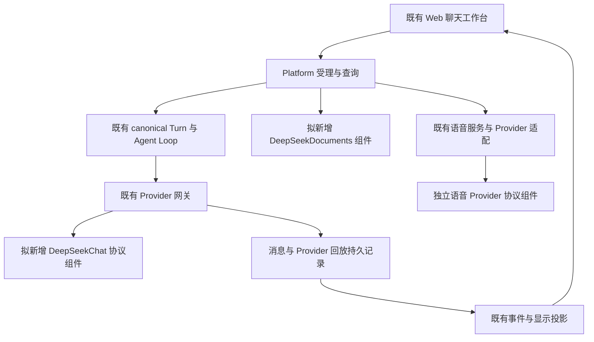

# DeepSeek 应用能力集成方案

## 1. 目标与范围

在既有聊天工作台内提供六项能力：联网搜索、深度思考搜索、文件输入、阅读链接、TTS/ASR、自动会话标题。保留 Pudding 的 Agent、工具、预算、消息真源和 Shell/Web/Core 边界。

本文件是可执行的施工提案；本次交付为分析与方案，没有实现或部署新功能。源码证据和 chat-demo 固定版本对照见 [研究报告](../19_references/deepseek-chat-demo-源码对照与改进优先级-2026-11-15.md)。

**整体先交付 [统一 ASR/TTS 与聊天语音体验](统一ASR-TTS能力与聊天语音体验优化方案-2026-11-15.md)**，首选接入指定的 Qwen ASR 并改善已有 Qwen TTS。下文 P0–P4 只用于 DeepSeek 聊天分线；DeepSeek 语音适配不能成为语音主线的前置条件。

## 2. 协议选择

**建议首期采用显式选择的 DeepSeek Responses 路由。** 理由是现有 Responses 网关已有大图 Files、引用缓存及 output items 回放，能复用较多已存在的文件链路。chat-demo 使用 Messages，借鉴其内容语义和投影函数，不照搬网络与状态管理。

当前 [`providerTemplates.ts`](../../Source/PuddingPlatformAdmin/src/pages/llm-resource-pool/providerTemplates.ts:220) 的 `deepseek-flash` 默认协议为 `openai`。首期新增能力只对已选择并验证的 Responses 路由开放；界面必须清楚提示当前协议支持情况，允许用户明确选择相应路由。不得静默改变既有 Agent 的协议。待首期闭环后，再按相同黄金样例补 Messages、Chat Completions；三种协议全部通过前，不宣称全面支持。

首期路由需要真实 API 验证后才能冻结；若发现 Responses 的必要扩展不可用，再依据证据调整选型。官方确认三种协议均覆盖应用能力，但事件形状并不相同，见 [Chatbot 总览](https://api-docs.deepseek.com/zh-cn/guides/build_a_chatbot/)。

## 3. 架构与依赖

DeepSeekChat、DeepSeekDocuments 是建议组件名称，尚未创建；语音 Provider 组件的边界按统一语音方案实施。可以按阶段分别建立，不需一次搭完。

| 边界 | 负责 | 不负责 |
|---|---|---|
| DeepSeekChat 叶子组件 | 原生工具声明、事件解码、有序输出块、协议特定的回放编码 | Agent 执行、配置读取、消息数据库、审批 |
| DeepSeekDocuments 叶子组件 | 上传 purpose、文档引用协议、错误与限制的有类型结果 | 任意路径读取、工作区授权、上传凭据持久化 |
| 语音 Provider 叶子组件 | 各服务商 TTS/ASR 协议、音频格式合同、取消与终态 | UI、麦克风权限、业务会话管理 |
| 调用方适配器 | 提供已授权字节、传输端口、凭据、身份、预算，映射现有公共模型 | 在叶子组件中反向调用 Runtime/Platform |
| Platform 与 Runtime | canonical 持久化、调用路由、上下文、幂等和事件投影 | 重新实现 DeepSeek 服务端搜索循环 |
| Web UI | 模式选择、附件进度、来源、播放与草稿 | 保存服务商密钥或决定执行授权 |

组件从 BCL 和自身合同起步，传输通过端口注入；测试工程只引用被测组件。**先完成 S1–S4，再在 S5 修改消费方工程、解决方案与 DI。** 以 [组件化交付规程](../10_conventions/组件化交付规程.md) 为门禁。新增的展示统计等建议行为走 Hook；协议解码、输入校验和持久化不能依赖会吞异常的建议 Hook 来保证正确性。

## 4. 先冻结四个合同

### 4.1 每次调用的能力选择

建议新增强类型的调用选项，区分模型能力与用户本轮选择：

- `SearchMode = Off | Web | Deep`；`ReadUserLinks`；`GenerateTitle`。
- 实际生效能力绑定 provider、模型、端点和协议；未知能力保持 Unknown，不按“OpenAI compatible”推定支持。
- `Web` 显式关闭思考；`Deep` 显式开启思考。Responses 映射为 `reasoning.effort=none` 与 `low/high/max`；Messages/Chat Completions 映射各自的 thinking/effort 字段。不能把 low 当作关闭，见 [思考模式](https://api-docs.deepseek.com/zh-cn/guides/thinking_mode/)。
- 模型切换到不支持的路由时，清楚提示并停止提交依赖该能力的请求；不得悄悄把文档当图片、把原生工具当 function。
- 保存会话偏好，同时记录每个 Turn 的实际选项。重试使用该 Turn 冻结的快照。

搜索和用户链接阅读不是完全独立的组合：官方规定开启 thinking 与 web_search 时使用深度搜索，不单独执行 read_link。UI 的“阅读链接”状态应展示实际生效模式；见 [联网工具](https://api-docs.deepseek.com/zh-cn/guides/web_tools/)。

### 4.2 输入内容

在现有 text/image 之外增加 document 部件，至少保存 `ArtifactId`、显示名、MIME、解析模式、内容指纹。canonical 数据只保存本地受权 Artifact 身份，远端 `file_id` 仍由 Provider 引用表管理。

需要同时打通：ContentParts 编解码、HTTP 受理、DB/JSONL、memory 镜像、冷水合、代理传输、预算估算及 UI。版本规则必须显式；不接受“未知类型被 Decode 成 null 后继续发送纯文本”的静默降级。无需为开发期引入旧格式兼容层，已有数据升级按仓库规则处理。

### 4.3 输出事实、回放与展示

保留两类相互关联的数据：有序原生输出块及完整签名，用于同路由回放；规范化的步骤、正文、引用、标题、用量，用于展示和查询。它们是同一输出事实的原文与派生投影，不是两个可独立修改的真源。

- 扩展 `StreamDelta` / 非流式结果的类型合同，支持步骤起止、引用增量、标题和服务端工具用量；附稳定调用与块身份。
- 服务端搜索步骤属于观察事件，不进入本地 `ToolCall` 执行队列；普通 function 调用保持既有执行链。
- 回放状态绑定 provider/endpoint/model/protocol，不能只有 `Protocol`；跨服务商切换不直接回传签名、文件引用或其他不透明载荷。
- 与消息完成事实一致持久化，恢复必须覆盖 Platform 消息、memory 镜像、冷水合和分支。签名不下发到普通 UI、日志或诊断包。
- 引用关联具体正文块，不能先把正文拼成一个字符串再猜引用位置；同 URL 的来源去重不等于合并全部正文块。
- 外部来源在规范化上下文中保持不可信数据身份；出站 Provider 的 assistant/server block 仅按协议编码，不能提升为 system 指令。保留当前用户围栏与审批边界。
- 压缩把需要配对和签名的块当作完整单元。若移除其网页上下文，显式记录失去该上下文；不得用模型摘要冒充可验证的原文。

### 4.4 结束、取消与费用

区分 Completed、Truncated、Refused、Cancelled、Failed、Interrupted；不要把 EOF、搜索结果为空或服务端工具失败解释成回答成功。

原生搜索在单个 HTTP 请求内部多步执行，本地工具次数上限不能作为它的硬预算上限。记录最终累计用量；搜索/抓取另行计费，不能只用聊天 Token 估算总费用，也不能把“结果块数量”当计费次数。无法确认的费用保留 Unknown。限制用户可选模式、并发、超时和取消行为，但不承诺取消能撤销已发生费用。

## 5. 六项能力的落地要求

### 5.1 搜索与深度搜索

输入框增加联网与深度模式选择。普通搜索展示搜索中、结果数量、失败原因；深度搜索展示 thinking 与 search/open_page/find_in_page 的有序步骤，允许折叠。正文用可点击引用关联来源卡片。

既有 `deepseek_search` / `deepseek_fetch` 继续承担显式工具调用。根据任务选择一种执行路径，避免同一需求同时自动开启原生搜索和主动派发一遍本地搜索。

不把“开启深度搜索”当作保证一定搜索；界面显示实际返回的行为。使用过联网工具的回复不开放 Provider 前缀续写，应按协议能力提供重新生成，重执行前仍走 Pudding 的工具副作用与幂等规则。

### 5.2 文件输入

先提供 PDF、DOCX、PPTX、TXT、MD、CSV、XLSX；服务器按实际内容验证格式。前端显示文字解析与图文解析选择、上传/解析状态、失败后的重试入口。只有附件 Ready 才能发送带该附件的消息。

[`SqliteProviderFileRefStore`](../../Source/PuddingPlatform/Services/Files/SqliteProviderFileRefStore.cs) 可复用存储及 CAS 思路；引用键必须评估并补入账号/端点身份、解析 purpose 与版本，不能只按 Artifact ID 复用不同解析结果。

官方合同：解析文档用 `text_recognition` / `rich_layout_recognition`，普通文本和表格用 `user_data`；purpose 必须先于 file。解析文档限制与现有图片策略不同，详见 [文件解析](https://api-docs.deepseek.com/zh-cn/guides/document_parsing/)。上传超时可能已经解析成功并产生费用，因此超时标成结果未知，不能无条件自动重传。

具体错误与恢复：

| 情况 | 处理 |
|---|---|
| 文件失效，但本地 Artifact 还在 | 同账号、同 purpose 串行重建引用，去重后重试；设置次数上限 |
| 原件丢失 | 附件明确标记不可用，让用户重新选择，不发送伪引用 |
| 图文解析缺图 | 不保证读取每张图；支持用户额外附图、明确标注来源 |
| 上下文超限 | 发送前估算，未知解析量保守处理；Provider 拒绝时明确显示，提供减少文件/选择页范围的后续能力，不静默截断 |
| 切换到其他 Provider | 保留本地原件与来源；只有受权后才上传到新服务商，原 file_id 不跨账号使用 |

### 5.3 TTS 和 ASR

语音的整体实施以 [统一语音方案](统一ASR-TTS能力与聊天语音体验优化方案-2026-11-15.md) 为准。以下仅限定后续 DeepSeek Provider 的协议差异；不要求把默认语音服务迁到 DeepSeek。

复用 `IVoiceProviderFactory`、`ITtsProvider`、`IAsrHttpRecognizer` 和现有语音设置，新增 DeepSeek 适配。当前工厂的 DashScope 限制需要在 S5 改为明确 Provider 分派，不能将 DeepSeek 响应送给 DashScope 解析器。

ASR 首期采用“录音结束 → 识别 → 可编辑草稿”，由用户正常发送；不把整段识别伪装为实时转写。DeepSeek 接受 PCM WAV/Ogg Opus，单次最多 120 秒、8 MiB；WebM 不能仅改文件扩展名后上传。服务端重新验证格式与长度，见 [ASR](https://api-docs.deepseek.com/zh-cn/guides/asr/)。

TTS 首期先接完整文本 HTTP 合成，经 Core 返回受控音频给现有播放入口；之后再做 WebSocket 边生成边播。现有 API 是完整音频返回，因此首期不能宣称低延迟流式播放已经完成。音色按 Provider 提供，避免沿用 `Cherry` 默认值；DeepSeek 音色为 stella/tide，HTTP 格式为 wav/pcm，文本有独立限额。见 [TTS](https://api-docs.deepseek.com/zh-cn/guides/tts/)。

WebView2 麦克风权限和播放能力须在产品内验收；麦克风字节只在本机采集，服务商凭据只在 Core 使用。后续低延迟播放应验证 PCM 半采样、背压、切会话取消和设备释放。

### 5.4 会话标题

首轮符合条件的请求开启 `title.enabled`。Responses 从结束事件的 `response.title` 读取；后续 Messages、Chat Completions 分别实现其标题位置。标题可能缺失、最多额外等待 5 秒；见 [会话标题](https://api-docs.deepseek.com/zh-cn/guides/conversation_title/)。

`SessionTitleService` 保持默认标题职责，增加专用的模型标题更新：仅当标题来源仍是 Default、会话 revision 匹配且该请求对应目标首轮时接受。用户重命名与模型结果竞争时，用户标题优先。一次会话只自动采纳一次；失败沿用默认标题或用户消息的短文本，不额外发起模型调用。标题只作展示，不参与身份、路由或文件名。

## 6. 分阶段施工与验收

每阶段按独立组件 S1–S4 → 调用方 S5 的顺序提交。表中的阶段是施工依赖，不是工期承诺。

| 阶段 | 交付内容 | 接入前与接入后的必要验收 |
|---|---|---|
| P0 | Responses 原生扩展协议、输出合同、持久回放与能力开关 | 组件独立测试；工具声明与 function 并存；签名/未知块往返；跨路由拒绝；写入/冷水合/压缩/分支恢复；旧工具调用回归 |
| P1 | 普通搜索、阅读链接、首次自动标题与 UI | 两轮读同一链接；来源绑定正确；服务端步骤不触发本地执行；用户改名竞争；缺标题、空结果、拒答和断流；重启后再追问 |
| P2a | 深度搜索过程与最终用量 | thinking/多调用先到、结果后到、乱邻接配对；并发引用；搜索与 read_link 模式互斥；取消与费用 Unknown；截断不能显示成功 |
| P2b | 文档上传解析、document 部件与引用恢复 | purpose 顺序、格式/限额；两种解析模式不串缓存；超时未知不重传；跨轮与重启后引用；过期重建、原件缺失；PDF 图表、DOCX、PPTX、XLSX 各有样例 |
| P3 | DeepSeek ASR、HTTP TTS、云端语音 UI | WAV/Ogg 与 WebM 拒绝；空音频、120 秒/8 MiB 边界；音色映射；草稿可编辑；取消释放设备；合成失败/提前断流和跨会话播放 |
| P4 | Messages、Chat Completions 对齐及可选低延迟语音 | 同一黄金样例的三协议语义等价；各自原始回放独立；语音 WS 结束码、取消与背压 |

### 6.1 必须覆盖的协议故障矩阵

- SSE：UTF-8 跨分片、CRLF、多行 data、保活、空 thinking、终态缺失、流内错误。
- 服务端工具：调用与结果不相邻、多条同时发起、无结果、带错误结果、普通 function 工具混用。
- 引用：多个 text block、一个块多来源、重复 URL、空标题、来源无法访问。
- 回放：热会话、冷水合、进程重启、压缩、分支、服务商/账号切换、签名缺失。
- 费用：最终累计用量覆盖初始用量；搜索/抓取费和 Token 分开；取消后未知费用不归零。
- 标题：正常、缺失、延迟、用户已改名、重复终态、旧请求晚到。

已有测试可作为组合回归入口：`PuddingCoreTests` 的三网关测试、视觉 wire tests、Files API tests；`PuddingRuntimeTests` 的 DeepSeek 工具与设置测试；`PuddingPlatformTests` 的语音服务和默认标题测试。新增组件另建独立测试，不把组件测试塞进宿主依赖闭包。

### 6.2 产品验收与发布

1. 在隔离目录完成构建与离线测试，日志进 `.work/deepseek-chatbot/<run>/`；本次分析阶段不触发产品构建。
2. 使用明确的测试 Agent、测试数据和已授权凭据做小规模真实 API smoke，分别验证六项能力；保存脱敏事件样例和费用，记录实际协议/模型。
3. 前端功能提交按修复/功能范围递增版本，使用 pnpm 构建，部署到 Core 实际读取的 `wwwroot/admin`，核对页角版本、哈希、时间。
4. 通过 Guardian 的 `bootstrap_reboot` 部署，按 requestId 等到 healthy；内部测试会话验收功能，外部控制器判定重启/退出等生命周期，不能用旧进程中的成功冒充新代码验收。
5. 分别记录 `ready-for-external-deploy` 与 `in-product-functional-complete`。可用能力按已验收协议开放；没有凭据或真实测试时，明确标记未验证。

## 7. 范围控制

本方案不要求重写聊天框架、切换前端技术栈或改变 Desktop 产品职责。模型安全与日期/语言等元信息是同批 API 的相邻能力，后续可独立评估；对外服务的安全配置需按实际产品部署要求处理。历史导入导出、消息树编辑、实时双向语音各自另立任务，避免把这六项能力拖入会话系统重构。
