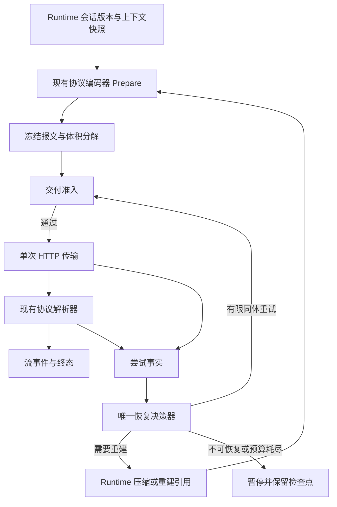

# LLM 请求交付可靠性架构与实施规划

本方案处于 Proposed。目标是让每次模型请求具备可测量的发送准入、有限且有效的恢复、完整的会话保护和可追溯的交付结论。外部链路仍可能失败，系统应能识别失败、避免放大并安全恢复，不能承诺永不出现连接重置。

本次只交付规划；事故事实、历史修补与未决原因集中在[诊断报告](../14_reports/2026-10-30-LLM连接重置架构诊断.md)。后续每阶段单独提交，按[组件化交付规程](../10_conventions/组件化交付规程.md)先独立验证再接入宿主。

## 1. 架构裁定

模型上下文容量、实际报文大小和网络传输能力是不同约束。缓存成本是优化目标，不能覆盖交付准入。已有前缀缓存、完整工具批次、当前用户围栏、分段摘要与持久 CAS 继续作为正确性基础。

必须建立以下不变量：

1. **计量、准入、发送使用同一份冻结的 UTF-8 报文。** 准入后不得再补工具、图片或续传项；任何变化都产生新的 variant 并重新准入。
2. **一个逻辑请求只有一个恢复决策者。** 网络、协议回退、file 引用重建、上下文重建全部申请统一发送预算；Streaming / Buffered 共用策略。
3. **重试需要说明改变了什么。** 同体重发只用于有限的瞬态恢复；连续相同故障之后进入重建、降载或暂停，不能把用户再次点击变成无限续命。
4. **传输失败不会直接改写历史。** 上下文修改仍经 Runtime 的候选验证、完整来源归档与持久 CAS；摘要失败保留原文。
5. **历史新鲜度由身份与代次决定。** 条数与文本长度不能裁定哪个上下文有效；不完整分页也不能覆盖完整暖历史。
6. **失败结论按证据强度表达。** 本地写成功不代表服务端已收完，未收到增量不代表服务端没有执行或计费。

## 2. 目标调用链与组件边界

拟新增一个 BCL-only 叶组件 `PuddingLlmDelivery`；名称为施工建议，当前尚不存在。职责限制为不可变报文合同、准入/恢复纯策略、单次 HTTP 传输和尝试事实，不放会话、模型业务、配置读取或数据库逻辑。

| 所属 | 职责 | 禁止承担 |
|---|---|---|
| 拟建 `PuddingLlmDelivery` | `PreparedRequest`、`DeliveryProfile`、`AttemptObservation`、`RecoveryDecision`；精确字节准入；单次可取消 HTTP；恢复预算算术 | 引用 Core/Runtime/Host/Platform/Memory；访问 DataRoot；自行压缩或调用工具；持久化密钥 |
| 现有 Core 协议网关 | 将消息、工具、视觉/续传合同编为冻结 body；将响应转为模型事件 | 各自决定重试次数；偷偷再发；把 token 估算当网络能力 |
| Runtime 交付协调器 | 调用纯策略、取得限流租约、统一驱动尝试；需要变更语义时协调已有压缩与 file 重建；发布诊断 | 第二套摘要算法；把 transport 组件反向绑定 Session 服务 |
| 现有 `PuddingContextPolicy` | 扩展纯版本协调判定及预算原因合同；保留容量/候选/CAS 适用性策略 | HTTP、锁、数据库、计时器 |
| 现有 Runtime 上下文服务 | 原文归档、摘要、checkpoint、持久 CAS、暖历史切换 | 用更短/更长直接裁定权威历史 |
| 现有 Diagnostics / Host | Diagnostics 接收 Runtime 映射后的事实；Host 装配配置与生命周期 | Shell 承担业务或网络恢复；再包装自动重试 handler |

编译依赖方向：Core/Runtime 可以消费 Delivery，Delivery 的 `ProjectReference=0`；Runtime 消费 ContextPolicy，两叶组件互不引用。Diagnostics 映射留在调用侧。S1–S4 不给任何宿主工程加引用，不登记 slnx/DI；S5 才装配。归属不清的 provider 特例留在现有网关，记录原因，不为“拆干净”引入反向依赖。

## 3. 请求合同：先冻结，再发送

`PreparedRequest` 至少承载：logicalRequestId、variantId、parentOperationId、routeKey、method/path、protocol/serializerVersion、contextGeneration、checkpointId、toolManifestHash、body 长度和 SHA-256、各组成部分字节、重放语义及生命周期所有权。

编码器生成一次、后续 attempt 重用同一 body；`ReadOnlyMemory<byte>` 仍需保证底层数组不被修改，不能把“只读视图”冒充不可变。池化缓冲区在最后一个尝试结束后归还。准入失败立即释放，受总大小和并发内存预算约束。授权头由发送边界绑定，不写入正文指纹、持久合同或诊断日志。

精确体积分解至少包含 system/developer、工具 schema、普通历史、tool output、reasoning/continuation、inline media、JSON 包装；每个字节只归属一类，分量和等于 bodyBytes。未知部件明确记 other，不能漏算。附件解析/Files 上传发生在冻结前，作为同一父操作的独立子请求记账；文件引用过期产生新 variant，不在旧 body 上就地修改。

保留三种不同计量：模型可见语义 token 估算（含模型视觉规则）、序列化 JSON 的 tokenizer 诊断值、成功响应的 provider usage。它们标明来源、词表/校准版本，分别使用。不能把 `bodyTokens` 当 provider 精确输入量，也不能用未校准的 raw 值推断当时没有触发压缩。

现有 `LlmRequestCapture` 的 body 长度/指纹进入常态必要事实；昂贵的全量 JSON token 诊断仍可抽样。默认不落正文、base64、完整 URL 查询串或凭据。只记录有界标量、版本、哈希与结果。

不默认启用未经 provider 合同确认的请求 gzip；HTTP 分块传输也不等于减少总报文。若未来明确支持压缩，需要分别记录原始编码字节与实际传输编码字节，各自服从对应限制，禁止混用。

## 4. 三类预算与策略优先级

| 预算 | 来源 | 决策 |
|---|---|---|
| 模型语义容量 | 已登记窗口、provider 明确输入限制、输出预留、安全量、WorkUnit 容量 | 超限必须在发送前恢复上下文；保持现有有效输入算术 |
| 请求交付预算 | 路由配置的实际 wire bytes、已核验的 provider 限制、当前网络 profile 的受控实测 | 精确报文超限零发送；独立于模型窗口，不再由 B/token 推导硬边界 |
| 操作资源预算 | 总墙钟期限、主请求发送次数、摘要子请求次数/token/成本、并发和内存上限 | 全恢复链共享；不能由进入下一层或下一 variant 重置 |

`DeliveryProfile` 以 provider、endpoint origin/path、protocol、非秘密的 credential epoch / network profile 标识组成作用域；记录来源 `configured / documented / measured / unknown`、版本、有效期和证据窗口。credential epoch 只作失效围栏，不记录密钥。不同 endpoint/协议/网络配置的经验不能混用。

传输预算采用独立的 soft target / hard cap。硬 cap 的最终数值由 P0 与 P5 对照确定；不把历史单次 512 KiB 成功或 1.45 MB 失败升级为永久阈值。没有可信实测时使用明确标注的产品配置，不自动从百万 token 窗口放大。被配置限制的请求应明确报告本地交付预算，而非伪造 provider 413。

正常请求以缓存友好的 token 阈值做维护；临近传输软目标也可提前准备。触及任一硬界限必须等待安全处理；缓存收益、维护冷却、最小回收阈值不能放行。固定系统前缀加必要工具已超过预算时，返回 `unshrinkable_request` 并给出分解，进入提示/工具供给治理，不能反复压缩没有收益的历史。

**优先级**：原文与协议正确性 → 发送可行性及资源上限 → 时延/成功率 → 缓存与 token 成本。6 B/token 可以保留为早期粗规划估算，不再充当最终传输准入真源。

## 5. 唯一恢复状态机

状态为 `Preparing → Admitted → Sending → Receiving → Completed`。失败进入 `Classifying → RetrySame / Reprepare / Paused / Failed`；任何分支先检查用户取消、重放语义、总期限和剩余次数。Streaming 与 Buffered 使用同一决策合同，仅输出消费方式不同。

| 事实 | 推荐恢复 | 必须守住的界限 |
|---|---|---|
| 本地校验失败、明确鉴权/权限错误 | 直接终止并返回可操作原因 | 无意义重试为零 |
| DNS/连接/TLS 问题 | 按具体类别有限恢复或暂停 | 不把它自动归因给会话大小；证书拒绝不关闭校验 |
| 首次上传 reset、没有业务事件、允许重放 | 预算允许时至多一次同体重发，指数退避加抖动 | 记载重复计算/计费的不确定性；重用相同 body/hash |
| 同体再次失败 | 返回 Reprepare 或 Paused | 不再第三次盲发原体；是否压缩取决于体积相关证据和可回收量 |
| 小请求同路由也失败 | 路由暂停/半开探测 | 不持续损失长会话上下文；探测单飞且有成本上限 |
| 明确 413 / provider 输入超限 | 分别调整字节/语义约束后重建 | 不把不同维度混成一个减半系数；新 variant 再准入 |
| 429 / 可重试 5xx | 尊重 Retry-After 与总期限，有限重试 | 不叠加网关/HTTP handler 的另一套重试 |
| file 引用明确过期 | 协调器授权一次重建 | 上传与主请求都计账；无网关暗中再发 |
| 已收到业务事件或可能执行服务端工具 | 终止/协议支持的查询恢复 | `hasYieldedDelta=false` 不足以证明可安全重放；不得重复执行本地工具 |
| 摘要失败、截断、无净收益 | 保留原历史，暂停主请求或返回原因 | 不提交半份摘要，不用失败摘要冒充修复 |

建议首轮可配置上限：一个逻辑主请求最多 3 次实际发送，同 body 最多 1 次额外发送，语义重建最多 1 次；file 重建和协议回退也占用这 3 个名额。这是待验收的产品策略，并非“允许每一层各重试三次”。缩小 variant 后若仍失败则结束，不继续递归缩小。

摘要是子操作：复用现有最多 64 次逻辑摘要调用的硬界限，同时新增共享的**物理发送计数**，建议初始总额也不超过 64；包含每段、递归归并及重试。实际允许量取剩余总期限、token/成本额度与调用额度的交集。进入摘要恢复时，主请求不能持有它将再次申请的 provider 并发槽，防止容量为 1 时自锁；每个实际 HTTP/响应生命周期自己持有租约并确保取消释放。

跨用户重试保留有界 failure ledger：按会话、路由、contextGeneration、失败 variant 指纹与时间窗记录；原样再次点击消耗同一恢复窗口，不重新获得无限配额。新消息构成新逻辑请求，但同一路由的半开配额与同 checkpoint 的体积失败证据仍可参考；不能仅凭近似文本或消息条数误封新任务。checkpoint/路由/策略变更和 TTL 失效有明确规则。重启后短期状态通过小型原子状态文件恢复，失败时标为 unknown 并限制探测，不能启动即全量放行。

会话级重复大报文抑制与路由级故障熔断分开：单个超大请求不应使所有会话断路。半开只允许一个有效探测，成功后逐步恢复。`DirectLlmClient` 与 Runtime fuse 的所有权需收敛：前者处理一次交付，后者处理会话执行健康，不能互相乘算 retry。

## 6. 上下文版本与失败后的安全降载

在现有 ContextPolicy 中增加纯 `ContextReconciliationDecision`；Runtime 传入双方 `generation / checkpointId / coverageHash / transcriptWatermark / snapshotCompleteness` 与当前轮身份，策略不读取正文或数据库。

| 情况 | 行为 |
|---|---|
| 同代、同 checkpoint，持久结果只是有限尾页 | 保留经验证的暖历史；按稳定 ID 追加新尾部 |
| 持久代次更新且 checkpoint/覆盖清单完整 | 在请求安全边界重建新工作视图，按覆盖排除旧原文，保留代次之后的新尾部及当前轮 |
| 内存包含未提交批次 | 等完整工具批次边界；当前 user / 未完成工具调用不得丢失 |
| 代次不一致且来源不完整/损坏 | 暂停并加载权威完整快照；禁止把较短的 100 行查询直接替代数百条历史 |
| 长度不同但身份一致性未证实 | 不作长度裁定；返回明确协调原因 |

压缩候选提交前重核身份、路由、工具、代次与冻结前缀，继续现有 CAS。发送前再次确认当前 variant 对应已采用的 checkpoint；候选已提交但进程崩溃后，冷启动依据持久代次重建，不能复活旧前缀。新消息在发送开始后的到达按既有 steering 语义处理；不得修改正在发送的冻结 body。

恢复降载优先级：采用已完成且适用的 checkpoint → 对完整旧跨度执行现有分段压缩 → 在既有视觉合同许可下用 file 引用替代大内联图。所有步骤使用实际报文复核收益，保留原文及附件回查。固定前缀治理和工具曝光在 turn 边界实施；不得为救当前请求静默删除必要工具、当前用户要求或原生 continuation 项。

请求小了仍不保证网络恢复；若体积证据不足，保留不确定性并暂停。不能仅凭一个 reset 自动永久调低模型容量。

## 7. 传输阶段与诊断合同

每次物理发送有独立 `attemptId`，一个逻辑请求有 `logicalRequestId`，每次改报文有 `variantId`。记录 attempt 耗时与 operation 总耗时，分别呈现，不再让单 attempt 的 dispatch_count 代表总调用次数。

必需事件：准入开始/结果、等待并发槽、SendAsync 进入、content 写入开始/完成、响应头、首个网络字节、首个合法 SSE 事件、首个业务增量、provider 终态、本地取消/期限、恢复决策。DNS/TCP/TLS/复用信息仅在底层可观测时填写，否则为 unknown。`response.created` 或服务端工具事件也是业务事实，不能只盯 UI 文本增量。

写入计数使用分块 HttpContent 包装器；“本地 WriteAsync 已完成字节数”是本地事实，写失败的当前分块可能已经部分发出，标注为下界/未知，不宣称精确远端收包进度。收到早期拒绝响应可能与上传重叠；状态机记录多个里程碑，不强迫事件符合单一线性顺序。实际连接复用与 TLS 阶段需传输诊断支持，不能只由 stack frame 推断。

每个物理派发重置 headers/phase 标志，修复“第一次收过错误头、第二次上传失败”可能继承旧标志的语义风险。分类同时保存 `observedPhase / inferredPhase / rule / confidence`，区分未收响应头和上传未完成。错误标题说事实，原因字段允许 unknown。

超时分为排队、连接、上传无进展/总上传、等待头、等待业务事件、流无进展和总操作期限；计时由统一协调器分配。SSE keep-alive 可证明链路活跃，不能无限延期业务进展和总期限。[DeepSeek 文档](https://api-docs.deepseek.com/quick_start/rate_limit/)明确有 keep-alive；[.NET 文档](https://learn.microsoft.com/en-us/dotnet/api/system.net.http.httpcompletionoption?view=net-10.0)说明 ResponseHeadersRead 的 HttpClient 超时不覆盖之后的正文读取，因此需要分阶段控制。

错误导出补入：运行 commit/程序集 SHA 或 MVID、策略版本、checkpoint/generation、完整 wire 分解、估算与 provider usage 各自来源、总实际发送数、累计已知/未知成本、为什么重试、为什么停止、是否做过重建及效果。无 token/正文/图片载荷。错误面板据状态提供“已暂停，原会话保留”“已完成整理，等待重试”等真实动作，不能只写“可重试”。

## 8. 先验证的假设与实验

P0 先固化假设矩阵，不预先选择责任方：

| 假设 | 支持/否定所需证据 | 决策影响 |
|---|---|---|
| 体积或上传时间与失败相关 | 同路由小/大 payload 交错、重复试验，按大小/阶段统计 | 独立传输预算与恢复目标 |
| 连接复用、HTTP 版本或代理路径相关 | 相同 body 一次只改一个条件，真实握手/阶段记录 | route profile；不默认每次销毁 HttpClient 或强制 HTTP/1.1 |
| 长会话重放/协议形状相关 | 等长但不同消息数、reasoning/tool/图片占比的合成对照 | 编码合同、逐项序列化和模型计量 |
| 压缩后旧内存仍被采用 | 持久/内存代次、coverage、watermark 与发送 variant 的完整链 | 版本协调；不先删“保留暖历史”保护 |
| provider 或链路普遍不可用 | 同时间窗小请求也失败，明确 HTTP 状态/远端请求 ID（若提供） | 路由暂停，停止对历史反复压缩 |

本地故障服务器必须走产品同一 .NET HttpClient 与编码路径；字节档位建议 64 KiB、512 KiB、1 MiB、事故的 1,838,327 / 2,272,063 bytes、4 MiB、6 MiB。测试包含固定字节不同语义结构、保留图片引用的受控夹具、上传中 RST、写完后断开、收到头后断开、首事件后断开、提前 EOF、429/5xx、慢上传、keep-alive 无业务进展、用户取消和并发争抢。

用可控 Stream 故障做精确单元断言，另用 loopback TCP/TLS 故障服务验证真实 HTTP 栈。TLS 仅信任测试证书，不关闭产品证书验证。服务端统计请求数、收包量和逻辑 ID，与客户端账本交叉核验。

真实 provider 实验只发送合成内容，使用明确选定的测试身份、DataRoot、协议和网络路径，事前限定次数/时间/费用；任何路径切换均只在隔离实验中进行，不修改用户系统代理。方案阶段不执行付费调用，也不复制生产密钥或生产会话正文。协议选择依据能力合同，不把“换协议成功一次”当通用修复。DeepSeek Responses 是无状态全量历史协议，不能假设服务端自动续接省去正文。[官方 Responses API](https://api-docs.deepseek.com/api/create-response/)

## 9. 施工顺序与每阶段完成定义

| 阶段 | 交付与代码归属 | 完成门禁 |
|---|---|---|
| P0 证据基线 | 只读采集方案、事故脱敏 fixture、假设矩阵；冻结运行构建/配置来源与验证口径 | 合成等形夹具重现三次同体尝试，不声称还原真实网络根因；不改宿主 |
| P1 Delivery S1–S4 | 拟建组件与只引用它的测试工程；冻结请求、准入、恢复算术、单次传输；现有 ContextPolicy 内独立验证版本协调规则 | 零上层引用；真实故障矩阵通过；变异可取红；宿主运行中可独立 build/test；尚不登记 slnx/DI |
| P2 S5 接入冻结报文 | Core 三协议编码器分离 Prepare/Parse，Runtime 接受冻结合同，Host 仅装配；基础迁移与行为变更分 commit | 原始协议语义、工具批次和图片回放守恒；准入字节与实际发送完全一致；三协议/双调用方式组合覆盖 |
| P3 统一恢复 | Runtime 协调器替换 DirectLlm 双路径重试；网关 file 重建改为返回恢复需求；共享预算、取消、限流、跨点击抑制 | 同体/总发送/摘要额度不越界；半开单飞；provider 并发=1 不死锁；不重复工具执行 |
| P4 版本协调与安全降载 | ContextWindowManager、WarmPrefixCompaction、持久 checkpoint 与发送前代次检查 | 暖/冷、同代分页、新代摘要、并发追加、提交后崩溃全部通过；原文可回查；失败零错误提交 |
| P5 产品闭环 | 脱敏诊断与前端状态；隔离真实 provider 对照；Guardian 部署与原长会话功能验收 | 交付清单、稳定观察、功能结果、成本/缓存/延迟对照齐全；结果必须区分通过/失败/未验证 |

P0 → P1 → P2 → P3 → P4 → P5 顺序交付。已有上下文正确性缺陷若在 P0 被证实，可单独作为原组件修复先交付，必须有复现与验证；不以此跳过新组件门禁。每一阶段失败停在该边界，不继续装配未验证组件。

P2/P3 保留对外调用合同但替换内部实现，不长期维护两套自动重试。组件抽取只搬迁必要职责，行为改动单独提交。如果涉及工程拆分、命名空间或文件搬迁，除定向套件还要全解决方案构建；输出进入 `temp/build` / `temp/test-out`。前端阶段才按规则递增版本，当前纯规划不动版本。

## 10. 必须能取红的验收

1. **精确准入**：超 hard cap 恰好 1 byte，所有主请求 SendAsync 次数为 0；变异为估算体积后，转义/图片/续传夹具必须失败。
2. **次数守恒**：主请求物理发送不超过配置总额；同体额外发送不超过 1；file 重建/协议回退也计入。删去统一扣减应让测试转红。
3. **失败恢复有效**：事故形状连续 reset 后不再第三次同体盲发；新 variant 必须有原因、不同指纹和达标的实际收益，否则暂停；小请求同样失败不触发无休止压缩。
4. **阶段可信**：上传中、上传后未收头、头后、业务事件后四类分别可区分；重复派发不继承旧 headers；无法观测字段明确 unknown。
5. **语义/原文安全**：当前 turn、并行工具批次与附件身份完整；新代 checkpoint 不复活旧跨度，同代不完整分页不丢暖历史；提交中断后冷启动可恢复；摘要截断/失败零提交。
6. **重放安全**：收到服务端工具/业务事件但尚无 UI 文本时，自动整次重放被拒；重复本地工具副作用次数为 0。LLM POST 的重复执行语义由合同决定，不直接套通用 HTTP retry。[微软 HTTP 恢复指南](https://learn.microsoft.com/en-us/dotnet/core/resilience/http-resilience)
7. **取消/并发**：排队、上传、摘要、流读取各阶段取消后都释放资源；单槽不死锁，半开探测不并发涌入；总期限耗尽立即停止派发。
8. **优化不抵消可靠性**：扩大模型窗口不能放大传输 hard cap；提高缓存目标不能绕过传输门禁；固定前缀过大不能造成无限压缩。
9. **版本可核对**：测试、候选产物、Guardian 接受产物、运行程序集指纹对应；`1.0.0.0` 或一次 health=200 不算功能验收。

发布验收分层：确定性故障矩阵要求全部通过；真实 provider 按档位记录独立逻辑请求数、首次成功率、恢复后成功率、失败阶段、上传/首业务事件 p50/p95、总 token/摘要成本与缓存命中。小样本不作 p99 或稳定性保证，成功一次不宣称长期修复。

真实样本数、观察时长、费用上限与时延/成本容忍线必须在 P0/P5 实验前固定，不能看到结果后移动门槛。若网络仍不可用，允许通过“正确暂停且不损坏数据”的故障处理门禁，但**不能**标记原会话恢复完成。原长会话需加载明确的新构建后完成一次真实续行及约定的后续观察，独立记录用户业务是否恢复。

## 11. 部署、回滚与范围控制

遵循[Guardian 运行手册](../13_runbooks/Desktop-Guardian.md)：先交付 ready-for-external-deploy，外部控制器用 bootstrap_reboot 部署并核对 requestId/healthy；新进程内会话完成 in-product-functional-complete；生命周期、崩溃恢复和退出回收由外部控制器判定。202/built/health=200 均不能替代完整验收。

P0–P4 不改生产网络、模型协议或用户数据。需要数据库重放时使用 `temp/test-out` 下在线备份；不让旧代码直接试跑生产库。初期以独立配置与可丢弃的恢复状态文件为主，不为本方案增加业务数据库兼容层。程序包按 Guardian 回滚，恢复状态与策略版本不匹配时重新评估；原始转录与已有 checkpoint 不回滚。

首个施工任务应是 **P0 的冻结证据/回放夹具和 P1 的独立交付组件**。它们先证明三个关键问题：究竟发了什么、哪一步失败、为什么下一次发送有机会改善。完成这些门禁后再接入自动降载与会话恢复，避免用新的阈值掩盖未解决的边界问题。
