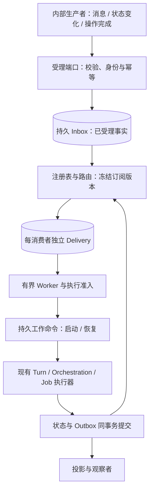

# Pudding 内部事件受理与调度基础设施设计

**PuddingAgent 必须能接受事件或消息，在受理后持久排队，按注册关系启动或恢复工作，并由状态变化继续驱动执行。Agent 心跳不参与这条链路的正确性保证。** 本文是待实施的内部基础设施方案，当前实现证据见[架构审阅](../14_reports/2026-10-18-Core严格分层与Hook架构审阅.md)。外部客户端、协议适配和第三方平台接入不在本轮范围内；验收使用内部生产者与测试替身。

本文保留总体设计入口；具体决策以 [ADR-098](../07_architecture/112ADR-098Core事件驱动与严格分层基础设施ADR.md) 为准，接口、表结构、代码归属和施工门禁见[施工与代码设计](Core事件驱动基础设施施工与代码设计-2026-10-18.md)。

## 1. 核心语义与范围

[README](../../README.md) 已定义 `Transition(State, Event, ContextSnapshot) -> NewState + Effects + DomainEvents`，并要求持久 Inbox、幂等、租约、fencing 与终态单调性。本方案补齐其进入执行之前的受理和调度合同。

| 对象 | 语义与责任 |
|---|---|
| 消息 Message | 有发送者、接收者和内容的通信；通知、请求、回复的处理模式不同，并非每条消息都启动 LLM |
| 输入事件 Event | 某个事实或信号已发生，可匹配订阅、唤醒等待中的工作；不要求转换成用户聊天文本 |
| 命令 Command | 匹配事件后形成的执行意图，例如开始 Turn、启动 Run、恢复等待节点 |
| Hook | 当前操作内部有界、类型化的 Guard/Transform/Around/Observer 接缝；通过注册参与当前操作 |
| 已提交领域事件 | 状态提交后的不可变事实，经 outbox 可靠发布，驱动后续工作和投影 |
| 唤醒信号 | 通知 Worker 有新持久工作；允许合并或丢失，数据库中的待办事实负责恢复 |

消息和事件共享可靠投递原则，但保留不同的业务合同。事件订阅注册与执行 Hook 注册都是正式扩展点：前者决定后续处理者，后者治理当前操作，不能互相替代。工具和模型执行仍使用窄的强类型端口，不绕行无类型事件总线。

“工作流”包括可持久恢复的单个 Turn、已有 Orchestration Run 和明确的后台作业。简单事件无需强制生成可视化 DAG；通用队列也不另造一套 Agent Loop 或图执行器。

## 2. 内部运行链路

常态流程由提交后的信号立即唤醒 Worker。Worker 先领取持久记录，再调用目标的受理端口；它不在数据库事务内等待模型或工具，也不占用全局出队循环直到 Agent 完成。

**关闭 Agent 心跳后，上述链路仍必须工作。** 定时触发器可以作为一个普通生产者；租约到期、重试到期及启动恢复可使用有界计时器或数据库增量扫描。这些扫描只处理已提交待办，不能变成让 Agent 定期调用 LLM 搜索待办的机制。

## 3. 严格分层与职责

下表是目标编译边界，尚未新建程序集。运行时数据流与编译引用方向要分别约束。

| 边界 | 唯一职责 | 不允许承担 |
|---|---|---|
| 事件合同与纯规则组件 | Envelope、Receipt、订阅描述、投递状态机、去重与路由规则；存储/时钟/唤醒/工作受理端口 | 引用 Host、Runtime、Platform、EF、HTTP 或具体增强组件 |
| 持久化适配器 | 原子受理、唯一约束、Delivery、租约与 fence、outbox/checkpoint、配额 | 调用 Agent、解析模型回复、嵌入业务路由策略 |
| 事件应用调度器 | 编排受理、路由与投递，执行预算、退避和生命周期管理 | 直接执行 LLM/tool，访问其他组件的 DbContext |
| 执行适配器 | 将明确命令交给既有 Turn、Orchestration 或 Job 受理端口，返回持久回执 | 绕过统一执行准入，直接调用 AgentExecutionService 的循环 |
| 注册的业务消费者 | 声明匹配规则、产生工作命令，或者处理所属业务的领域事实 | 改写其他消费者状态、反向调用事件调度实现、修改中央 Loop 才能生效 |
| Host 组合根 | 注册组件、验证注册冲突、启动和停止服务 | 保存去重/重试/路由算法或 Agent 业务分支 |

事件合同先以 BCL-only、项目引用为零的独立工程交付；规则与协调组件仅引用已交付的内层合同。持久化与执行适配器向内引用所需合同，内层永不引用适配器或其调用方。对允许引用、禁止依赖和公开 API 泄漏建立构建门禁，加入违规引用或外层类型必须使门禁失败。

已有 `IMessageInbox`、Message Fabric 和 Orchestration 存储作为复用对象，先核对各自事务及幂等保证，再用适配器接入。不能为了“统一”把消息表搬入通用 EventQueue，也不能保留两条都能启动同一工作的活动派发链。

## 4. 受理与可靠性合同

### 4.1 受理回执与消息身份

受理端口返回明确结果：`Accepted`、`Duplicate`、`Rejected` 或 `RetryLater`。前两者必须附带已持久化的 ReceiptId；只有成功提交后才能返回受理成功。`Task` 完成或内存总线发布成功不是受理凭据。

Envelope 至少携带 EventId、类型与 SchemaVersion、可信 Workspace/来源身份、OccurredAt、ReceivedAt、CorrelationId、CausationId，以及类型化 Payload 或持久载荷引用。内部生产者在重试时复用稳定事件标识，唯一键应包含工作区与来源作用域。

同一键同一内容返回原回执；同一键不同内容拒绝并记录冲突。普通重复投递不得使 completed/dead-letter 记录回到 pending。显式重放生成独立 ReplayId，引用原始事件并保留因果链。内容去抖或批量合并属于按事件类型显式声明的策略，不能替代按身份去重。

### 4.2 注册、路由与扇出

订阅描述包含 SubscriptionId、Owner、WorkspaceScope、事件类型/版本、受限过滤条件、目标能力及版本、执行模式、分区键、重试和预算策略。注册时检查能力存在、作用域、重复 ID 和策略冲突。

内置模块可以静态注册；用户创建的长期订阅必须持久化。进程内临时观察者应另有明确生命周期，不能冒充重启后有效的订阅。持久化描述和版本，不序列化委托或 IServiceProvider。

受理时绑定有效的注册版本，路由结果固定后再投递；后续注册变化不偷偷改变已排队事件的消费者。为每个匹配订阅创建独立 Delivery，唯一键至少包含 EventId 与 SubscriptionId/版本。一个消费者失败，仅重试其 Delivery，不重新执行已成功消费者。

无匹配事件应可查询为 Unmatched 或按明确策略 Ignored，并记录原因，不能以“业务已完成”掩盖未路由。删除或禁用订阅时，既有 Delivery 的 drain/cancel 策略也必须明确。

### 4.3 事务与崩溃恢复

| 边界 | 必须原子或可幂等恢复的内容 |
|---|---|
| 受理与路由 | 第一期采用有界同步路由；Inbox、去重键、冻结路由和全部 Delivery 同事务提交，校验注册 head 与配额；fan-out 超限在受理前拒绝 |
| 投递到执行 | 目标持久接受命令后才确认 Delivery；执行端按稳定 CommandId 去重 |
| 业务提交 | 状态更新与所属 outbox 事件同事务提交 |
| 后续消费 | 每消费者 checkpoint 或独立投递记录；处理结果与其重试状态可恢复 |

跨存储交接使用至少一次投递与两端幂等，不承诺跨数据库全局事务。目标已受理但回执丢失时，重试必须拿到同一个 Run/Turn 回执。Delivery 的“投递完成”与 Run 的“执行完成”、全链路“settled”分开记录。

Worker 领取返回 Owner、LeaseUntil 和递增 Fence；续租、完成、重试均校验所有权及 fence。旧 Worker 在租约转移后不能提交状态。外部副作用由执行器使用自身幂等键/回执处理，基础队列不能承诺所有工具只执行一次。

### 4.4 队列保护与执行准入

- 内存缓冲和持久积压都有数量/字节上限及工作区配额；达到上限返回可重试背压，禁止先确认再丢弃。
- 同一业务分区按声明顺序处理；需要串行的同一 Agent/会话复用既有执行租约。不同分区可有限并发，避免一次长 Turn 阻塞全系统事件。
- Busy 表示等待准入，不算业务失败，不耗尽失败重试预算；Agent 空闲事件应立即重新唤醒待办。
- 重试次数、退避、deadline、死信和人工重放可检查。优先级结合公平调度，避免低优先级永久饥饿。
- 成功/失败/取消等终态单调；组件停止时停止新领取，交接已领取工作或让持久租约恢复，不依赖无主的 fire-and-forget 任务。

## 5. 与 Hook、Agent Core 的关系

受理校验、路由策略和执行准入只在其所属操作的类型化 Hook 点开放增强。注册表声明 owner、作用域、确定顺序、超时、失败策略和是否允许变换。持久性、身份隔离、幂等和租约校验属于不可绕过的不变量，不因未注册 Hook 而失效。

Agent Kernel 接收已准入的工作，负责模型/工具循环和基础 Hook 接缝；它不管理全局事件订阅，不扫描待办，也不持有队列存储实现。业务消费者从领域事件创建后续命令，不能递归直接调用另一个 Agent 循环。事件自身不自动获得执行权，订阅目标和预算决定是否启动工作。

流式 token 和临时 UI 状态保留在 live stream 平面，不全量写入持久工作队列。`InternalEventBus` 可保留为提交后的低延迟通知，但不再作为必须完成工作的唯一事实载体。

## 6. 施工顺序与验收

遵守[组件化交付规程](../10_conventions/组件化交付规程.md)，每个独立组件先 S1–S4，再 S5 接入；本文不将取消注释旧 EventDispatcher 视为完成建设。

1. 冻结事件/消息/命令/投递/执行回执及注册合同，明确与现有 Message Fabric、Turn、Orchestration 的复用边界。
2. 独立实现纯规则与注册组件，用 fake store/clock/work acceptor 验证路由、状态机与行为；建立非法依赖的失败门禁。
3. 独立实现持久适配器，验证原子受理、唯一约束、per-consumer Delivery、崩溃恢复、租约与 fence、配额和死信。
4. 独立验证调度器及执行适配器合同；只交接持久命令，不运行真实模型。每个目标都证明命令重试不会另建重复工作。
5. 组件门禁通过后才接入真实 Host 组合根，注册正式消费者与执行适配器，消除旧派发旁路，运行内部端到端验收。

必需验收场景：

| 场景 | 应观察到的结果 |
|---|---|
| 关闭 HeartbeatOrchestrator 后注入内部事件/消息 | 有空闲执行槽时由提交信号启动工作，事件不会等待心跳 |
| Agent 正忙时连续注入，随后变空闲 | 排队并立即续派，等待不被计为失败；其他分区仍有进展 |
| 重复提交、受理回执丢失、终态后重投 | 同一事件/命令不产生第二次业务执行；显式 replay 单独标识 |
| 一个事件对应两个消费者，其中一个失败 | 成功者不重跑，失败者独立重试与死信 |
| 在受理后、路由中、目标受理后、业务提交后分别崩溃 | 重启继续正确阶段；不丢已确认工作，不改变冻结路由 |
| 唤醒信号丢失、进程重启、旧 Worker 迟到提交 | 有界恢复能发现持久待办；过期 fence 被拒绝 |
| 长期订阅重启、注册变更、跨工作区同名事件 | 订阅可恢复，排队事件保持原版本，作用域不串扰 |
| 突发入队超配额、长任务与短任务混合 | 背压可见、内存有界，无全局长任务堵塞 |
| 无消费者、取消、停机、重试耗尽 | 有可追踪终态或等待原因，未路由不伪报业务完成 |

本阶段以内部测试生产者完成上述链路，不要求实现任何外部客户端或平台适配。指标至少覆盖受理到工作接受的延迟、积压数量/年龄、重复与冲突、重试/死信、租约恢复和工作关联 ID；无新工作时不产生 LLM 调用。
