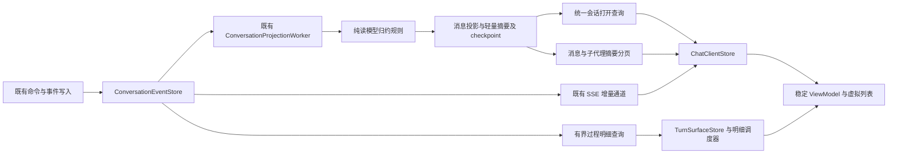

# 会话首屏与渐进加载架构优化方案

## 1 目标与主要决策

**聊天首屏只读取最近一页消息、必要运行状态和可靠同步游标；过程明细、较早消息、诊断面板按需加载。读取成本由窗口大小决定，不随历史事件总量线性增长。**

312 万条事件可以作为持久证据存在，182 万条会话事件也不应成为打开页面时需要重放、扫描或聚合的数据集。要消除的是在线查询对历史总量的依赖；删除记录不能代替这个修复。

采用以下方案：

1. **复用现有事件日志和投影器，补齐持久化的轻量读模型。** 终态、过程计数、活动回合摘要在消费事件时增量更新，页面读取时不重新推导全部历史。
2. **收敛一个会话打开流程。** Agent 身份解析后取得最近消息页、最小状态与同一快照的游标，替代首屏叠加调用 `/conversation`、`bootstrap` 和 `messages`。
3. **所有历史与明细接口同时限制条数和字节数。** 键集分页、稳定身份、明确截断和继续游标覆盖超长单消息、超长回合以及大量工具输出。
4. **复用现有 SSE、客户端 Store、明细调度器和虚拟列表。** 修正各自职责和游标协议，不再增加第二套状态管理或传输框架。
5. **回填只处理尚未完成的工作。** 持久断点、冻结扫描上界、批次让步；Ready 之后仍需控制负载，不能只增加一个启动延迟。

索引是上述查询合同的组成部分。只增加三个索引、隐藏骨架屏、增加缓存或把请求改为并行，均不能作为本方案的最终交付。

本次范围为方案设计。实现、数据库升级、部署和性能验收按第 11 节执行。下文数值为拟定门禁，不代表已经获得的优化结果。

## 2 问题边界与已有能力

诊断输入、源码定位和复测限制集中记录在[诊断基线](../14_reports/会话加载优化源码核对与诊断基线-2026-10-18.md)。需要区分以下事实：

| 当前行为 | 设计上的问题 | 目标行为 |
|---|---|---|
| `/conversation` 已限制最近 20 条消息，候选最多 60 条 | 消息少不代表事件扫描少；摘要仍从事件集合计算 | 从消息页和摘要行读取，禁止会话级历史聚合 |
| 活动过程只返回最近 64 条 | `outputEvents` 与 `processMetadata` 在限制返回前仍读取整个活动回合 | 活动正文预览、计数和最新位置直接取读模型 |
| 明细按可见 Turn 加载，最多两个并发槽 | 单条消息明细接口仍返回全量过程 | 保留调度器，把其工作单元改成一页 |
| 已有 `knownCursor`、本地缓存、选择版本号 | 初次选择不传缓存游标；选择与后台同步未统一请求所有权 | 同身份、同窗口合并请求，缓存和后台刷新分离 |
| 已有投影 checkpoint、事件 head、SSE 补流 | Agent 快照最后读取事件 head，不能由此证明已返回对应状态 | 明确区分已投影位置、事件 head、客户端已应用位置 |
| `bootstrap` 最多等待投影 500ms | 多入口反复获取状态；消息条数上限不限制其余 payload | 一个有界快照，无循环等待投影追平 |
| 子代理接口已有运行诊断列表 | 聊天状态接口另有全列表、全运行分组与 Token 聚合 | 聊天只取必要摘要；归档详情走已有诊断入口 |
| 回填已使用键集分页和批次间隔 | `lastId=0` 每次启动重置，仍重复扫描旧消息 | 持久断点与重试记录，重启接续 |

不得把既有能力描述成尚未建设，也不得另写一套同职责设施。既有[Chat 前端架构方案](Chat前端架构设计方案-2026-09-22.md)的稳定身份、权威合并和组件边界继续有效；本方案补充服务端读模型与加载合同。

## 3 目标架构与职责



### 3.1 编译期边界

新增一个小型纯组件 `PuddingConversationReadModel`，仅承载归约规则、页面预算与游标合同。组件只依赖 BCL，自有中立输入类型，不引用 EF、ASP.NET、Runtime、Platform 或 Desktop。Platform 将 canonical 事件映射为组件输入，并负责事务、查询和 DTO 适配。

组件的理由是可以脱离宿主独立验证重放、终态、分页和截断规则，不是把每个类包装成项目。按[组件化交付规程](../10_conventions/组件化交付规程.md)完成 S1–S4 后才能接入。若施工证明某项规则已有等价的独立叶子实现，复用并删除重复设计，不能维持两个归约器。

| 归属 | 单一职责 | 不承担 |
|---|---|---|
| 纯组件 | 事件归约、预算、稳定游标校验、摘要完整性状态 | SQL、网络、计时器、数据目录、身份认证 |
| Platform 写入适配 | 读模型与 checkpoint 原子提交、幂等 | 页面组装、外部向量调用 |
| Platform 查询服务 | 授权、会话解析、有界 SQL、响应 DTO | 在 GET 中回填、全量重放、修复运行状态 |
| 现有 Worker | 发现差额、分批驱动、取消与恢复 | HTTP 等待者队列、第二套事件总线 |
| `ChatClientStore` | 当前身份、打开/翻页/同步状态、请求所有权 | DOM、滚动坐标、SQL 查询策略 |
| `DetailHydrationScheduler` | 明细页优先级、并发、取消、有限重试 | 主消息真值、跨会话缓存覆盖 |
| Viewport / 组件 | 可见性、锚点、稳定渲染、用户展开意图 | 发起全会话刷新、推断权威终态 |

Desktop 保持现有 Shell/Web/Core 边界；不把读模型、缓存协调或业务分页搬入 WinUI Shell。

### 3.2 最小数据增量

复用 `ChatMessages`、`conversation_heads`、`conversation_projection_checkpoints` 和既有子代理投影。不新增数据库，不引入 Redis、消息中间件、通用 CQRS 框架或 MVCC 历史版本仓库。

建议新增两类小记录，字段名在 S1 合同中冻结：

| 记录 | 主键与内容 | 大小与职责限制 |
|---|---|---|
| `conversation_turn_summaries` | `(conversation_id, turn_id)`；rootRunId、关联 messageId、终态、计数、首尾 sequence、摘要版本、完整性 | 不保存全部事件；活动正文只保存有界尾部预览和定位信息 |
| `conversation_read_state` | `conversation_id`；当前根 Turn、压缩状态、必要子代理摘要、readModelVersion、初始化状态 | 只保存首屏必需状态，子代理数组同样限长，溢出用继续游标 |

已有 checkpoint 与上述记录在同一投影提交中推进。消息投影补充必要的来源序号、正文长度和有界预览/正文定位信息，避免先读入整段超大正文再截断。普通短消息仍直接返回正文，不把所有消息强制变成额外一次请求。

`processSummary` 明确区分 `complete`、`partial`、`unavailable`。未知计数返回缺失和原因，不填零；部分正文携带 `hasMoreContent`，不得让缓存或渲染层误认为全文已经完整。

### 3.3 代码设计约定

- 公共合同使用明确的不可变 DTO/record、枚举或判别联合；分页游标、身份和完整性都有独立语义，不复用含义模糊的 `status`/`cursor` 字段。
- Controller 只负责鉴权、参数验证与 HTTP 映射；SQL 留在查询适配，归约规则留在纯组件。只在真实外部边界定义端口，避免每个类都配一个没有替换需求的接口。
- 统一预算常量和配置验证，限制由服务端执行；不让多个 hook、Controller 和 SQL 分别维护同一个数字。字段和方法命名沿用所在项目风格。
- `CancellationToken`/`AbortSignal` 贯通调用链；同一 EF DbContext 不并行执行查询。每个循环都有退出和进度条件，禁止用无限重试掩盖未知状态。
- 失败返回可区分的原因，不 catch 后伪造空会话、零计数或成功游标。查询失败、数据不存在、证据被清理和读取未就绪必须分开。
- 保持最小改动范围，新增纯规则写独立测试，持久化与并发写边界测试；不为简单 DTO 赋值增加镜像测试，也不借此次优化重命名整个 Chat 目录。

## 4 读模型如何保持正确

### 4.1 增量归约与提交

1. Worker 按 `(conversation_id, sequence)` 读取一个有界批次；保留现有 200 条作为初始事件条数预算，同时增加字节预算。
2. 纯组件按 canonical 顺序更新涉及的 Turn 摘要、当前根运行和压缩状态。父子 run 分开；子代理事件不能抢占根 run，失败不能伪造助手正文。
3. 使用一个 `DbContext` 和一个短事务提交本批的 UI 投影、摘要以及 `projectedThrough`；相同批次再次执行不得重复累计。
4. 日志镜像、向量索引、话题检测等外部副作用在提交后执行，使用既有幂等入口及持久差额修复。它们不参与首屏读模型的事务成败，也不决定游标。

**现有 `ConversationProjector` 调用的 `ChatTranscriptWriter` 会自行建 scope、写消息并触发索引，checkpoint 又单独写入；仅在外层添加事务并不能使它们原子化。** 必须拆出接收同一事务上下文的持久化适配，查询只消费这一份权威投影。

用户消息现在由接入路径直接写入，不得为了统一而重复投影。接入路径需将消息身份与 canonical 接受事件序号绑定；快照只纳入其游标所覆盖的消息。终态消息由投影事务落库。施工须枚举 `ChatTranscriptWriter`、`AgentConversationLogService` 和其他 `ChatMessages` 写入者，明确每类消息的唯一 owner；未完成这项审计不得宣称快照一致。

不逐 delta 重写完整正文 JSON。流式字节由已有分块事件和 SSE 承载；读模型按批更新有界预览、计数和位置，完整终态正文复用消息转录。过程细节保留在原事件日志，按需读取。

### 4.2 三种游标不得混用

| 名称 | 含义 | 允许用途 |
|---|---|---|
| `eventHead` | 已提交的事件最新位置 H | 表示还有多少同步差额 |
| `snapshotCursor` | 响应中已覆盖的读模型位置 C | 初次 SSE 的 `afterSequence=C` |
| `lastAppliedSequence` | 当前客户端按顺序应用到的位置 A | 断线重连位置；必须与本地状态一起保存 |

约束为 `C <= H`。不能在读取消息后再取 H，把 H 当作这份消息的快照游标；也不能把只保存了游标、未保存状态的 IndexedDB 条目当作完整基线。

服务端用同一短 SQLite 读事务读取 checkpoint、消息页、必要运行状态与对应 head，固定一次一致视图。读事务在 DTO 取数完成后释放，不跨序列化或 SSE 存续。后台写入继续由 WAL 协调。

当前 `SessionProjectionStore` 会取旧 `session_projection_cursors` 与 canonical checkpoint 的最大值，并使用进程缓存。这不能自动成为新读模型的游标证明：新打开服务只能读取自己版本的已提交 checkpoint；迁移时盘点旧消费者并退役旧首屏游标路径，不能用两套进度的 `Max` 代替覆盖关系。

首屏覆盖的是最近消息窗口、当前运行和最小状态，并不声称包含所有旧过程；旧过程完整性由明细游标表示。被省略的旧消息通过历史分页获取，不从 SSE 从零重放。

### 4.3 SSE 与大差额恢复

复用 `SessionEventStreamService` 的 subscribe-first 和固定追赶上界机制。客户端先应用快照，再从 C 之后补流，按 `(conversationId, eventId)` 去重并维护顺序；会话切换增加 generation，旧连接与旧响应都失效。

当前每批 256 条只是批次上限，不是总追赶上限。增加每次恢复的事件数、总字节和耗时预算，初始建议为 **2,000 条、2 MiB、1 秒**，三者任一触顶即停止继续扫描。对保留缺口或过大差额返回既有 `snapshot_required` 语义并携带明确原因，不允许长时间自动追赶 182 万条事件。

快照暂未准备好时返回带 `retryAfter` 的 `syncing` 状态；客户端保留已显示的正文，有限退避检查，不以同一个旧快照无限重连。恢复成功才推进权威游标。终态已见、持久投影暂落后时保留终态，并在对应 Turn 投影版本追平后完成一次局部校正。

### 4.4 条件请求

将仅比较 `knownCursor` 的判断升级为表示层版本校验。ETag 至少覆盖会话身份、主会话绑定版本、readModelVersion、摘要修订及请求窗口；不能仅比较事件 head：投影可能在没有新事件时追平。

缓存 key 包含登录身份范围、workspace、agent、实际 conversation、读模型版本和窗口。退出登录、主会话 redirect、schema/投影版本变化都失效。304 只用于已有相同实体缓存的请求；无缓存收到 304 时只允许一次无条件补取，不进入空响应重试环。权限校验在条件响应之前完成。

前后端随同一产品版本切换合同；不保留长期 `knownCursor` 与 ETag 双分支。已有其他消费者的端点可保留名称，但必须委托相同查询服务，不能保留另一套重型投影实现。

## 5 首屏与分页合同

### 5.1 单一打开流程

沿用 Agent `/conversation` 作为解析主会话并打开页面的外部入口，内部调用统一快照查询。响应合同示意如下，字段不是已实现 API：

```text
ConversationOpenView
  identity: workspaceId, agentId, conversationId, bindingVersion
  readModelVersion, revision, snapshotCursor, eventHead
  history: items, nextBefore, hasMore, completeness
  activeTurn: bounded summary or null
  runtime: compaction state, bounded sub-agent summary
  sync: ready | syncing, retryAfter
```

最近页默认 **20 条可显示消息**，服务端最大 50 条；保留 user/assistant 的 canonical 关联，不强行把半个 Turn 误标为完整。跨页关联用稳定 turnId/messageId，边界缺失显示继续加载提示。

主会话进入时不再另外发 `messages?limit=20`、`bootstrap?messageLimit=1` 和全量 `sub-agents`。历史会话入口与 Agent 主会话入口复用同一打开服务，通过不同身份解析适配进入，不复制初始化流程。

身份解析也应有界：先按 redirect/Agent 已绑定的 MainSessionId 直接查会话，验证 workspace、owner 与绑定；未绑定时通过 canonical 条件查询最新主会话，不能每次先 `GetSessionsAsync(workspaceId)` 拉取整个工作区会话列表。条件请求复用同一次解析结果，避免先查游标再完整重复解析。

打开流程不等待后台诊断、索引状态、LLM 服务商列表、完整 Token 汇总或明细水合。权限/发送能力是必要控制信息，可独立小请求；其失败只限制相应操作，不阻挡历史阅读。

### 5.2 历史消息分页

使用已有消息稳定排序 `(createdAt, id)` 的键集游标，避免 `OFFSET`。游标绑定 conversation、排序版本和页边界；服务端校验归属和范围，不接受另一个会话的游标。

```sql
SELECT bounded_message_columns
FROM ChatMessages
WHERE session_id = @conversation
  AND (created_at, id) < (@beforeCreatedAt, @beforeId)
ORDER BY created_at DESC, id DESC
LIMIT @limitPlusOne;
```

这是查询形状示意，真实列名以 EF 映射为准。取 `limit+1` 判断 `hasMore`，不为总页数追加 `COUNT(*)`。新消息在尾部追加不会改变已经翻过的旧页边界；同毫秒记录以 ID 决定顺序。删除、重建、会话重定向使游标失效时返回明确重取原因。

去重优先依赖 canonical messageId 和持久化约束；不能为了补足 20 条可显示消息在请求内无限扩展候选。历史重复或无效记录需要额外探测时限制候选扫描预算，允许不足一页并返回可前进游标。SQLite 官方说明了大 OFFSET 的线性代价以及键集比较的用途，见[滚动窗口查询](https://sqlite.org/rowvalue.html#scrolling_window_queries)。

### 5.3 过程明细分页与正文完整性

在现有 `process-items` 端点增加 `beforeSequence`、`throughSequence` 和 `limit`。默认 100 项、最大 200 项、单页 256 KiB；响应提供首尾 sequence、继续游标、`hasMoreBefore`、截断/归档状态。

活动 Turn 首次只展示有界尾部，较早过程由展开或滚动触发。已完成 Turn 优先展示已持久化正文和轻量过程摘要，展开后读取过程页。**不能在第一批明细到达时把完整正文替换成仅含最后一页正文的执行流。** 若 UI 要恢复正文与思考、工具、委派的完整交错，需要覆盖相应区间后再切换该区间的渲染来源；未覆盖区间保留正文与“较早过程未载入”的明确边界，禁止两种来源重复显示同一正文。

分页按 canonical sequence，不按数组下标。父消息的子代理生命周期事件可带子 runId，不能用父 runId 一刀切过滤。工具开始/完成跨页时保留 toolCallId 的不完整节点，补页后合并；正文分块、思考与委派边界同理。

对事件类型稀疏的查询，必须约束**候选扫描范围**而不只是返回项数：先按对应实体与 sequence 取有界候选，再过滤展示类型，返回已扫描到的继续位置。空展示页也必须推进游标；自动预取最多两页，不能为了填满视口一直追历史。若后续证据表明这种扫描不够高效，再评估专用可展示事件索引，不能先建通用第二份事件库。

### 5.4 字节预算

| 对象 | 初始硬上限 | 超限行为 |
|---|---|---|
| 打开/历史页 JSON | 128 KiB | 缩短正文预览、返回继续定位；保留身份和状态 |
| 单条首屏正文预览 | 8 KiB UTF-8 | 显式“展开全文”；不得裁掉 typed image 身份 |
| 活动正文预览 | 16 KiB UTF-8 | 展示尾部并标记此前正文可加载 |
| 单页过程明细 | 256 KiB、最多 200 项 | 先到哪项预算就停止，继续游标前进 |
| 单个巨型事件/工具结果 | 预览最多 16 KiB | 返回详情引用；全文走分段读取或流式下载 |
| 首屏子代理摘要 | 最多 20 项、32 KiB，计入打开总预算 | 活动项优先，历史结果另页读取 |

上述预算包括 JSON 字段开销，不能简单等同字符串长度。大正文/大 payload 不得先 `ToListAsync` 完整载入再截断：消息读模型保存长度和预览；事件查询先获取有界片段或尺寸元信息，再决定是否取完整的小 payload。历史大字段缺少尺寸时，使用 SQL 有界片段读取并返回详情引用，不能对截断 JSON 当成完整 JSON 解析。

任何截断都不删除原始数据；如果原始证据已按保留策略归档/清理，返回 `unavailable/archived` 与原因，不能无限重试或谎称明细完整。

## 6 查询与索引设计

最终查询先定型，再建立最少索引。所有索引由 EF 模型与现有 schema ensure 的**同一份定义**生成或校验，新库与存量库不得分别维护两套名字。

| 查询 | 候选索引或键 | 说明 |
|---|---|---|
| 最近消息和向前翻页 | `ChatMessages(session_id, created_at, id)` | 先检查现有索引及 SQLite rowid 隐含排序能否覆盖，能覆盖则不新建 |
| 消息过程分页 | `conversation_events(conversation_id, message_id, sequence)` | 返回/候选皆有界；不含 payload |
| Turn 过程分页、后台重建一个 Turn | `conversation_events(conversation_id, turn_id, sequence)` | 避免整个 conversation 扫描 |
| SSE 连续追赶 | 既有 `(conversation_id, sequence)` 唯一索引 | 保留一份，不能删除唯一性保护 |
| 当前根运行、终态和过程计数 | 读状态主键与 Turn 摘要主键 | 正常首屏不再查事件 `Any`、`GroupBy` 或统计全回合 |
| 子代理分页 | parentSessionId 与稳定时间/ID 排序组合 | active/recent 查询独立，Token 明细不参与首屏 |

不默认再加 `(conversation_id, run_id)`：目标首屏从读模型获取根运行终态，不再需要这条事件查询。如果保留的独立诊断/修复路径仍高频按 run 查询，凭查询计划与写入成本再决定。这样避免三个旧查询退役后留下无消费方的索引。

索引不能保证带 `IN`、排序、类型过滤的查询天然有界。测试必须检查**真实 EF SQL**的 `EXPLAIN QUERY PLAN`：仅出现 `SEARCH ... (conversation_id=?)` 仍可能扫描整个会话，不能据此报绿。消息/Turn 分页应使用实体键与序号边界；允许对有界小集合排序，不允许先全会话过滤再排序。

存量重复索引清理复用 `StorageMaintenanceService` / `StorageMaintenanceQueries`。删除前核对列、顺序、唯一性、部分索引条件及替代索引存在性；不按名字盲删。百万行索引创建、统计更新和旧索引删除属于有成本的维护步骤，不能假装 `IF NOT EXISTS` 就是无成本启动检查。

新索引完成后在维护窗口更新统计；根据实际 SQLite 版本使用有界 `PRAGMA optimize`，完整 `ANALYZE` 留给明确维护/基准步骤，不每次 Ready 前执行。依据见 SQLite 官方[ANALYZE 推荐用法](https://sqlite.org/lang_analyze.html#recommended_usage_patterns)。

## 7 前端渐进加载与请求所有权

### 7.1 分开加载状态

`initialLoading`、`refreshing`、`loadingOlder`、`loadingDetail`、`syncing` 分别归属当前身份。骨架屏仅用于当前会话尚无可显示正文且首次必要查询正在进行；后台刷新、过程加载和投影追平不能覆盖已有正文。

切换 Agent 时立即清除旧身份的显示归属；可以显示新身份自己的缓存，不能短暂展示上一个 Agent 的消息。缓存命中先渲染，网络校验在后台进行；缓存存储异常不能阻断网络请求，保存缓存也不应阻挡 fresh 状态发布。

### 7.2 单一请求 owner

`ChatClientStore` 统一处理 `selectAgent`、重新打开、断线恢复与后台校正；React effect 只表达选择意图。同 scope、窗口和条件版本共用一个 Promise，重复选择当前 key 不增加 generation，也不重复拉取。

会话切换或所有消费者离开时取消旧请求，`AbortSignal` 贯通 API 与 EF cancellation；单个订阅者卸载不能取消仍被其他消费者使用的共用请求。响应进入 Store、进入缓存和更新游标前均复检身份、generation 与版本，防止迟到结果污染缓存。

复用已有 IndexedDB 缓存，增加版本、容量和生命周期约束。初始建议最多 5 个会话首屏、总计 5 MiB；明细缓存按字节淘汰，只保留可见窗口和相邻少量页。不得缓存整个 182 万事件会话，也不新引入请求缓存库。

目前 `useSessionEventProjection` 对 projection-owned 主会话只消费子代理事实，正文依赖 Agent 投影；因此不能直接关闭 1.2/5 秒轮询后声称 SSE 已接管。阶段 D 必须将主消息、Turn 和压缩事件明确路由到同一个 `ChatClientStore` 合并入口，同时撤销旧的重复正文投影。待 live、终态、重连测试通过，才移除健康状态下的整页轮询；异常校正保持有界。

### 7.3 明细调度与渲染

保留 `DetailHydrationScheduler` 的两个并发槽、可见性注册、失败分类与认证恢复。显式展开优先于预取；预取需让首屏正文完成渲染，600px 预取区不是“全部挂载行都要加载”的理由。

每个消息的分页状态按 messageId/Turn/窗口版本保存。向上翻页只 prepend 当前页，按身份去重并保持滚动锚点；SSE 到达不重建所有历史 Turn。消息/过程窗口之外的数据可以从内存淘汰，虚拟 DOM 并不等于内存已受控。

### 7.4 附属请求时机

| 请求类别 | 触发时机 |
|---|---|
| 身份、最近消息、必要运行状态 | 打开会话，唯一必需数据链 |
| 访问级别/发送资格 | 独立轻请求，未完成时限制相应操作 |
| 历史页 | 用户上滚/点击加载更早；最多一页预取 |
| 过程与子代理结果详情 | 展开或进入近视口；有界页 |
| context-health、cache-diagnostics、索引/潜意识诊断 | 对应面板打开才请求；面板隐藏停止 |
| LLM 服务商完整目录 | 模型选择器/设置打开；共享缓存 |
| 子代理状态校正 | 首屏摘要后主要依赖 SSE；断线和窗口重新可见时有界校正 |

子代理校正不能以“本地已有 active run”为前提，否则漏掉创建事件后永远无法恢复。保留低频对账，但对账必须是小摘要、单请求 owner、不可见暂停；建议健康连接不轮询全列表，失联时按 5/15/30 秒退避，恢复后停止。

## 8 后台负载与数据生命周期

### 8.1 SessionChunkBackfill

优先修复重复工作，再处理调度：

1. 在数据所属组件保存扫描 checkpoint，绑定数据集身份、索引配置/embedding 版本和记录水位；不能只存一个跨所有配置通用的 lastId。
2. 每次启动冻结高水位 H，只扫描 `(lastId, H]`，新记录由既有增量索引路径处理。扫描进度和失败重试分开，失败项有持久记录后才允许推进扫描位置。
3. 消息可能在相同 ID 下变化，单独 lastId 无法发现更新。通过现有写入路径发起幂等增量更新，校验内容 hash/索引版本；没有可靠更新通知时用持久 changedAt/changeSeq，不能假设 ID 增加覆盖修改。
4. 删除索引、切换 embedding、升级分块规则或恢复数据库后显式失效 checkpoint，重建为可观察、可取消的维护任务；普通启动不自动重做完整历史。
5. Ready 后给予首屏保护窗口，再以小批次执行；每批检查交互负载与取消。可从 50 条、50ms 工作预算、200ms 间隔开始校准，SQLite 忙时退避。单次不可中断操作不能靠循环预算假装已限时，需独立取消/超时。

复用现有 worker、配置类和持久存储，不为这个任务建设通用调度平台。Ready 发出只代表服务可用，不能作为后台任务可以占满 CPU/SQLite 的信号。

### 8.2 读模型初始化与历史证据

新数据自接入后增量维护摘要。旧数据升级分为“首屏可读”和“历史明细可补齐”，不要求先把 182 万条事件全量重放才能打开聊天：

- 现有持久消息立即提供最近页；旧摘要缺失显示 `partial/unavailable`，不在 GET 中补建。
- 后台优先建立当前/最近 Turn 的摘要，通过 Turn 索引分批读取。历史冷 Turn 在需要明细时分页读取，完整旧计数允许未知。
- 初始化 read model 的截点和覆盖范围必须持久化。只回填最近 Turn 不能把 checkpoint 从 0 直接设成 head，声称全历史已处理。
- 若可从既有权威命令、运行状态和消息构造完整的最小首屏基线，在一致事务中记录基线截点后消费新增事件；不能从任意最近 500 条推断完整运行态。
- 对不能证明基线完整的旧活动回合，先显示已有正文和“运行状态同步中”，`snapshotCursor` 不伪造为 ready；以有界后台任务重建该回合。重建失败可重试，不回到全屏骨架，也不向客户端从零补流。

原始事件保留/归档沿用[ADR-076](../07_architecture/91ADR-076遥测与调试数据保留及Core存储管理ADR.md)。区分最终正文/终态、近期恢复所需事件、历史审计明细和调试噪声；清理不得越过未完成 consumer 的恢复需求。完整去留策略独立验收，不以删掉本次慢会话作为性能达标手段。

## 9 开源参考与取舍

### 9.1 DeepSeek Harness

参考用户指定仓库更新后的固定版本 `687f282e8625c6b8d11ff58211a90524be2e4317`：

- [Session 客户端](https://github.com/deepseek-ai/deepseek-harness/blob/687f282e8625c6b8d11ff58211a90524be2e4317/packages/api/session-controller/src/client/sessions/session.ts)：`openPromise` 合并打开请求，`loadOlder` 独立加载状态，按 `beforeSeq` 拉取旧页。采纳请求所有权与分页状态分离。
- [History 服务](https://github.com/deepseek-ai/deepseek-harness/blob/687f282e8625c6b8d11ff58211a90524be2e4317/packages/api/session-controller/src/history.ts)：页面限定 `throughSeq`，follow 携带基线和增量。采纳固定截点与后续增量相接的合同；其 `source.events`/Session 存储路径不证明 Pudding SQLite 查询有界，不能直接照搬内存日志结构。
- [长会话浏览器基准](https://github.com/deepseek-ai/deepseek-harness/blob/687f282e8625c6b8d11ff58211a90524be2e4317/benchmarks/long-session-browser/README.md)：同时测打开、翻页、过程视图和生成期间输入。采纳真实构建产物与真实交互验收方式，不把它的 240-Turn 预算当成本项目百万事件性能证明。

不迁移 Harness 插件框架、远程协议或完整 Session 存储实现。Pudding 已有 EF/SQLite、canonical 事件与 SSE，修正本地边界即可。

### 9.2 Hermes Agent

[官方 Session Storage 文档](https://github.com/NousResearch/hermes-agent/blob/main/website/docs/developer-guide/session-storage.md)区分会话元数据、消息历史、全文检索与其他运行账本，消息表有 session/time 和 session/id 索引。借鉴“不同读取用途有不同数据入口”和按会话定位的存储形状；该文档不构成其首屏分页或百万事件性能的验证。

本方案的具体页大小、读模型、SSE 总恢复预算和事务改造均为 Pudding 自身设计，不归因于 Hermes。

### 9.3 方案比较

| 方案 | 收益 | 未解决的问题 | 决策 |
|---|---|---|---|
| 只补事件索引 | 缩小现有查询扫描 | 单个长 Turn/消息仍可无限读取，重复请求与错误游标仍在 | 作为查询基础，不能单独验收 |
| 只做前端缓存/隐藏骨架 | 重开体验可能改善 | 首开、缓存失效、服务端成本和正确性不变 | 不作为主方案 |
| 每次打开重放一个很大的事件尾窗 | 实现看似直接 | 不保证包含 Turn 起点/终态，窗口继续膨胀 | 不采用 |
| 既有投影器加轻量摘要和分页 | 在线成本与展示窗口相关，可复用现有能力 | 需要解决事务、基线、分页语义 | **采用** |
| 更换存储/新建分布式缓存/第二套事件系统 | 可横向扩展 | 当前单机问题不需要，增加运维与一致性成本 | 不采用 |

## 10 可执行验收标准

### 10.1 性能场景与预算

固定同一机器、构建、SQLite 版本、DataRoot 副本和 fixture；分别测冷进程/冷客户端、热库/无缓存、缓存命中与重连。冷进程不等于 OS 磁盘缓存已清空，应明确记录而不混报。

先用合成数据复现 **全表至少 312 万事件、单会话至少 182 万事件**，保持同一最近消息窗口；另加单 Turn 十万事件、超大工具结果、同毫秒消息、数千子代理、失败无助手正文等分布。真实库仅用 SQLite 在线备份到 `temp/test-out` 的副本验证。

| 指标 | 拟定通过线 |
|---|---|
| 热库无客户端缓存的打开 API | p95 ≤200ms；冷进程首次单独报告，目标 ≤500ms |
| 旧库摘要未初始化的最近消息可读响应 | p95 ≤200ms；未知摘要显式表示，不能同步重放 |
| Core Ready 后进入 Chat 至最近正文可读 | WebView2 p95 ≤800ms；未缓存全新 WebView2 首次初始化另测，目标 ≤1.5s |
| 加载更早一页到可读 | p95 ≤300ms；保持滚动锚点 |
| 明细页 API | p95 ≤250ms，满足条数/字节/候选扫描预算 |
| 首屏数据量 | 打开响应 ≤128 KiB，其他必要数据合计使首屏 API ≤256 KiB；静态资源另计 |
| 重复请求 | 同 key 打开最多 1 个在途请求；不再同时存在三套首屏数据查询 |
| 数据规模放大 | 保持最近窗口不变，旧事件从 18 万增至 182 万；已就绪读模型打开 API p95 增长 ≤20%，无会话级扫描 |
| 输入与主线程 | 生成/翻页时输入反馈 p95 ≤100ms；单个长任务 >100ms 必须定位并处理 |
| 后台争抢 | 回填开启与关闭对比，首屏 p95 增幅 ≤20%；重启不重扫已完成区间 |
| 内存 | 多次翻页/切换后受已配置页数和字节预算控制；不得与访问过的全部事件线性累积 |

API 每场景至少 30 次，记录原始样本、p50/p95/最大值；浏览器冷启动至少 10 次，明确样本较少的限制。规模斜率、SQL 候选读取量、payload 和 UI 正确性共同判定，不能只挑最快截图。

### 10.2 正确性与边界测试

1. **事务与恢复**：在消息写入、摘要写入、checkpoint 提交前后注入失败；重启后摘要不重复累计，游标不会领先状态。
2. **快照并发**：取消息时插入终态/子代理事件；快照加 C 之后的 SSE 与标准重放结果一致，无丢字、重复工具和终态回退。
3. **身份与条件请求**：相同 sequence 的不同会话、redirect、权限变化、投影追平但 head 不变；不能错误返回 304。
4. **分页**：同毫秒记录、半个 Turn、跨页工具开始/完成、空展示页、超大事件、错误游标、超过保留边界；必须继续前进或给出明确终止原因。
5. **单一显示**：普通正文与部分过程页切换不丢正文、不重复；typed image、失败无助手正文与父子 run 归属保持正确。
6. **客户端并发**：StrictMode 重挂载、快速 A→B→A、缓存读取慢、请求取消、401 恢复；旧响应不能写当前状态或新版本缓存。
7. **总追赶限制**：超大缺口不会一直按 256 条循环；snapshot_required 不引发反复取同一未就绪快照。
8. **只读职责**：打开、翻页、子代理摘要查询不调用状态修复、回填或索引写入。
9. **架构边界**：纯组件不得反向引用 Platform/Runtime/Host；查询与渲染测试不必加载 Desktop。

### 10.3 可观测性

复用既有 ChatDiag/Perf 与服务端日志关联 id，记录 `open.start → cache.visible → snapshot.received → content.visible → stream.ready`、API 查询阶段、快照游标/差额、返回项与字节、取消/去重命中和后台批次耗时。

客户端只上报有界数值与稳定原因码，默认采样，慢加载样本额外保留；不上传正文、Token 或原始事件 payload。每会话/时间窗限制数量和大小，不能为了诊断增加另一条高流量首屏请求。WebView2 与无头 Edge 分开报告；Core Ready 时间与 Chat 可读时间分开计量。

## 11 实施顺序与退役清单

| 阶段 | 交付内容 | 进入下一阶段的门禁 |
|---|---|---|
| A 基线与合同 | 固定慢查询、fixture、窗口与游标合同、真实写入 owner 清单 | 可重复复现，证明确有会话扫描；冻结预算与失败语义 |
| B 独立组件 S1–S4 | 纯归约/分页预算组件和独立测试 | 不引用宿主，边界与重放/截断测试通过；此阶段不改 Host |
| C 持久读模型与查询 | 事务适配、摘要、最小索引、统一打开和分页 API | SQLite 集成测试及百万事件查询门禁通过，再执行 S5 装配 |
| D 前端接入 | 单一打开 owner、加载状态拆分、分页、条件请求、缓存与取消 | React 并发/分页/正文完整性测试通过，首屏不重复拉三套数据 |
| E 后台与附属请求 | 可恢复回填、子代理摘要、诊断按需加载 | 重启扫描差额与争抢指标通过 |
| F 产品交付 | 全链路性能、旧库副本、构建部署、真实 WebView2 | 达成 10.1 与 10.2；完成两段式产品验收 |

各阶段形成独立、可验证提交；索引先落库可用于验证查询形状，但不能在 C/D 未闭合时宣称加载优化已完成。

### 11.1 重点文件与预期变化

| 现有位置 | 实施内容 |
|---|---|
| [AgentConversationProjectionService](../../Source/PuddingPlatform/Services/AgentChat/AgentConversationProjectionService.cs) | 拆掉请求时全事件摘要和活动正文折叠；保留身份解析适配，委托有界读服务 |
| [AgentChatApiController](../../Source/PuddingPlatform/Controllers/Api/AgentChatApiController.cs)、[SessionEventsController](../../Source/PuddingPlatform/Controllers/Api/SessionEventsController.cs) | 同一快照合同、分页参数、ETag、明确 sync 状态；退役页面重复入口 |
| [ConversationProjector](../../Source/PuddingPlatform/Services/ConversationProjector.cs)、[ChatTranscriptWriter](../../Source/PuddingPlatform/Services/ChatTranscriptWriter.cs)、[AgentConversationLogService](../../Source/PuddingPlatform/Services/AgentConversationLogService.cs) | 写入 owner 审计、事务内投影、提交后副作用，不套无效外层事务 |
| [ConversationProjectionWorker](../../Source/PuddingPlatform/Services/ConversationProjectionWorker.cs)、[SessionEventStreamService](../../Source/PuddingPlatform/Services/SessionEventStreamService.cs) | 复用生命周期，补预算与大差额恢复 |
| [PlatformDbContext](../../Source/PuddingPlatform/Data/PlatformDbContext.cs) 与相关 schema ensure | 模型/索引唯一声明；摘要实体、来源/版本字段、旧库初始化状态 |
| [SessionStateManager](../../Source/PuddingPlatform/Services/SessionStateManager.cs) | 聊天 GET 不触发 reconcile；读取有界子代理摘要，修复归写入侧 |
| [chatClientStore](../../Source/PuddingPlatformAdmin/src/pages/chat/client/chatClientStore.ts)、[agentChatApi](../../Source/PuddingPlatformAdmin/src/pages/chat/client/agentChatApi.ts)、[localCache](../../Source/PuddingPlatformAdmin/src/pages/chat/client/localCache.ts) | 同 key 合并、身份隔离、缓存预算、条件请求、取消和分离状态 |
| [useSessionEventReplay](../../Source/PuddingPlatformAdmin/src/pages/chat/hooks/useSessionEventReplay.ts)、[useSessionEventConnection](../../Source/PuddingPlatformAdmin/src/pages/chat/hooks/useSessionEventConnection.ts) | 用统一快照准备游标；不再独立重取另一份 bootstrap |
| [useSessionEventProjection](../../Source/PuddingPlatformAdmin/src/pages/chat/hooks/useSessionEventProjection.ts)、[SessionProjectionStore](../../Source/PuddingPlatform/Services/SessionProjectionStore.cs) | 主消息 SSE 接入唯一合并 owner；新快照不混用旧游标 |
| [useTurnSurfaceStore](../../Source/PuddingPlatformAdmin/src/pages/chat/hooks/useTurnSurfaceStore.ts)、[detailHydrationScheduler](../../Source/PuddingPlatformAdmin/src/pages/chat/runtime/detailHydrationScheduler.ts) | 保留并发/失败治理，工作单元改明细页，保护完整正文 |
| [chat/index.tsx](../../Source/PuddingPlatformAdmin/src/pages/chat/index.tsx)、[MessageList](../../Source/PuddingPlatformAdmin/src/pages/chat/components/MessageList.tsx) | 渐进状态渲染、附属请求按需，不承载合并规则 |
| [SessionChunkBackfillService](../../Source/PuddingRuntime/Services/SessionChunkBackfillService.cs) | 持久断点、配置版本、失败重试、增量更新与负载让步 |
| [StorageMaintenanceService](../../Source/PuddingHost/Storage/StorageMaintenanceService.cs) | 复用维护门控管理索引与保留，避免启动期全量维护 |

新增组件、查询服务、实体和测试文件的具体路径在相应实施提交登记进 code_map；当前只登记本设计入口，不把拟建文件当成现存代码。

### 11.2 部署与回退

- 先完成副本上的 schema/index 创建耗时、磁盘空间和取消恢复验证。生产数据升级为显式维护阶段，记录其一次性时间；不计入“正常启动已变快”的统计。
- 升级期间旧正文可读；摘要未就绪采用第 8.2 节状态，不退回重型全会话查询。正式接入后删除旧路径及过渡开关，避免长期双实现。
- 前端契约新增与结构调整按仓库规则递增版本，使用 pnpm 构建，再部署到 Core 实际 `wwwroot/admin`；验证页角版本/哈希。文档阶段不改前端版本。
- Desktop 构建、测试、发布串行，构建使用 `--artifacts-path temp/build/recovery`；输出只在 `temp/build`、`temp/test-out` 或系统 Temp，验证后清理本任务产物。
- 应用回退须使用对应前后端产物；数据库 schema 变更保留可恢复备份，不对运行中库删表/删列尝试降级。若需要恢复备份，先停止 Core 并明确恢复点之后的数据处理，不能自动覆盖新写入。
- 内部测试只交付 `ready-for-external-deploy`；外部控制器重启到明确构建后，新会话进行功能 smoke。启动/重启/崩溃恢复/退出回收仍由外部判定，遵守 Desktop 与 dev-up 单一 Core 所有权。

### 11.3 完成时必须删除的旧行为

首屏中的三次重叠历史加载、在线事件全量摘要/正文折叠、按事件 head 判断表示未变、每次启动从零回填、隐藏诊断面板的持续轮询，以及为了“最终会恢复”保留的无界明细接口，均需要实际退役。没有退役清单的优化容易在后续维护中重新启用慢路径。

## 12 施工前需要冻结的参数

方案不依赖新增服务或换数据库。阶段 A 只需用证据冻结四组实现参数：

1. 当前 SQLite 实际版本和索引定义，最终可删除的冗余索引及最小新增集合。
2. 每类 ChatMessages 写入 owner，以及旧运行状态能否构造一致的最小基线；不能证明的情况按 `syncing` 处理。
3. 页大小、字节预算、SSE 总恢复预算和缓存容量是否满足实际超长消息/多模态样本。
4. 热库、冷进程、WebView2 冷初始化的测试环境与性能预算校准；调整须保留原始样本和原因，不以放宽门禁代替消除扫描。

设计的核心验收问题始终相同：**保留全部历史且继续增加历史数据时，打开最近一页是否仍只做最近一页所需的工作。**
