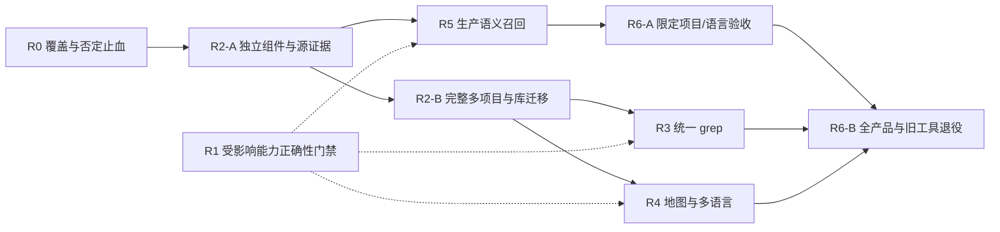

# 增强索引分阶段施工计划

本文件是 [ADR-089](../07_architecture/103ADR-089Agent统一检索与渐进展开工具链ADR.md) 的施工真源。组件、工具参数和性能口径以[正式设计](增强索引统一检索与代码地图设计方案-2026-10-18.md)为准，不在本文件复制另一套 schema。缺陷严重性与复现边界见[基线审阅](../14_reports/2026-10-18-增强索引设计与实现审阅.md)及[现场反馈与源码核对](../14_reports/2026-10-30-增强检索现场反馈与源码核对.md)。

## 1. 顺序与交付规则

**先 R0 修错误否定 → R2-A 公共合同/四组件/项目身份/源证据 → R5 生产语义闭环 → R6-A 限定范围产品验收。** R2-B 完整多项目/物理库迁移、R3 统一 grep、R4 地图和语言扩展随后汇入 R6-B 完整交付。R1 既有正确性任务保留：受影响能力发布前必须闭环，不把未证明的历史修复标为完成，也不要求无关完整地图阻塞语义召回。

箭头表示依赖，不是并行派发授权。本轮只形成 ADR/设计/计划；代码、产品部署和评测由后续实施任务交付。既有现场正例作为回归保护，不重复宣称尚无任何工具可用；现状及 12 项差距来源见[证据核对](../14_reports/2026-10-30-增强检索现场反馈与源码核对.md)。

每阶段均按[组件化交付规程](../10_conventions/组件化交付规程.md)执行 S1–S5：独立工程/合同、独立测试、组件实现、依赖/质量门禁、最后 slnx/DI/Host 接入。只修已有组件时沿用已有边界，但必须补独立回归；新的测试不得为方便加载整个 Runtime/Host。Host、配置与模板改动只发生在对应阶段 S5。

每个工作包单独提交已验证代码、受影响 code_map 和 changelog；报告记录命令、commit、数据/模型版本、通过/未通过项及剩余问题。阶段编号 R0–R6 与缺陷优先级、代码分块 P0/P1/P2、历史 U0–U5 分开。每个工程搬迁/命名空间迁移后做覆盖全部工程的构建，不能只测主产物。首次组件的纯测试只引用被测组件，跨组件集成测试另建适配器测试工程。不因本计划写完就把既有看板任务标完成，也不自动派发历史任务。

### 1.1 R0：立即阻断错误否定，冻结当前基线

R0 在既有组件边界内修复，不等待四个新组件，不同时进行大搬迁。其验证通过后可独立发布。

| 工作包 | 交付位置/动作 | 退出门禁 |
|---|---|---|
| R0-01 / P0 | CodeIndex `RetrievalResult`、空结果策略、`RetrievalPortV1.BuildEmptyStep`；机器可判定的已查/未查面、claim 与提示共同修复 | 中文概念 auto+词面-only 返回缺 vector 的 partial；semantic 健康零召回也不能 AcceptAbsence；完整精确零匹配正对照成立；容器零边继续提示成员未展开 |
| R0-02 / P0 | `RetrievalEval`/`RetrievalEvalProbe` 增生产端口探针入口，冻结数据、模型、合同和源码身份；记录真实当前产品基线 | 词面/关系/分页/ref 正例保留；概念反例可复现；未配置模型单列未执行，不伪造向量数字；报告与原始证据可重跑 |
| R0-03 / P1 前置 | capability 明确区分词面、syntax/static binding、vector；建立项目/语言/provider 覆盖矩阵 | 字段名 Semantic 或 UnsupportedIntents 为空不能当向量已接入证据；缺字段/解析失败不产生不存在结论 |

R0 退出只表示“空结果可信”，产品仍为部分可用。保留用户已验证的符号命中、分页、关系、声明跨度及 Fresh/Stale 行为；回归应绑定冻结源码定位，不能把本次行号和调用者数量写成永远不变的全仓断言。

## 2. R1：先修已确认 P1，建立真实性门禁

目标：消除可复现的漏检、同名合并、语义失效和错误图边；同时排除静态审查发现的 reader 生命周期风险。该阶段不等待多项目新 API 或向量工程。

| 工作包 | 修改位置与交付 | 必须先建立的回归及通过条件 |
|---|---|---|
| R1-01 / P1-01 | FullTextIndex 的 Lucene 查询过滤；Runtime SearchGrepTool 的残余 glob/排除处理。存储可下推过滤则先过滤再 TopK；不能下推时分批继续，修正计数/complete | 30 个高排名 txt + 1 个较低排名 cs，maxResults=2、扩展名=.cs，必须返回 cs；子目录/glob/排除、limit 边界和大量噪声参数化。预算耗尽只能 incomplete，不能成功零命中；生产 Jieba 与基准 analyzer 都测 |
| R1-02 / P1-02 | CodeQueryService 去重、Roslyn 身份、CodeIndex 符号/关系键。先在现有合同补足物理项目与编译上下文，不以扩大 maxResults 规避 | 两根同名 `T:Acme.Service` 均返回；同 solution 内两程序集同名不覆盖；两个 worktree 分开；partial 两声明保留；重叠 scope 同源不重复，引用仍连接正确项目。数据库约束与查询去重同时验证 |
| R1-03 / P1-03 | CodeFileSemanticDiff、CodeSourceUpdatePlanner、CodeSourceMaintenanceCoordinator；新增声明影响 lookup/rebind，保守安全回退 | `Pick(object)` 调用在新增 `Pick(string)` 后改绑；新增扩展方法、未解析引用变可解析、using/import、继承/项目引用变化均重算；故障中断时旧水位不冒充 current；被删/移动源边及时移除 |
| R1-04 / P1-04 | RoslynCSharpIndexer 的引用/调用提取，补编译器关系边 | `Action a=Target` 只能 references；真实 `Target()` 和构造调用产生 calls；base/interface/override fixture 产生 inherits/implements/overrides，端点与源位置正确；动态/虚调用有精度标注 |
| R1-05 / P1-05 | Lucene reader/searcher 生命周期；静态审查项，先补可控竞态再修租约 | 用 barrier 控制“查询持有 reader→refresh/invalidate→查询继续→释放”；不得 ObjectDisposedException、错误空结果或泄漏。含多 scope eviction、取消、Windows 文件回收。该项不得标成此前已并发复现 |

R1-02 的新键若要求重建，必须显式版本化并在隔离数据上重建测试；不直接试改生产库，不加永久旧格式兼容层。R1-03 在完整 lookup 依赖尚未建成时允许先按编译项目保守重绑定；性能成本如实记录，不能为了快继续漏算。

**退出门禁**：五个工作包最终全部闭环，回归测试能在修复前暴露对应错误、修复后通过；现有 Lucene 测试和受影响 CodeIndex/语言测试全过。基础存储/调度测试不加载 Roslyn，语义 fixtures 在独立语言测试进程；现有引用 Runtime 的大测试工程不能单独证明该边界。后续工作包逐项列出所依赖的 R1 门禁：身份冲突、reader 租约和源失效影响语义链时先修；完整继承/调用图的缺口阻塞对应图能力，不能被向量验收掩盖。未影响的组件可独立构建/测试；缺所需门禁不得进入其 S5。

P2 的 ProjectMap 根文件漏出与截断计数在 R4 必修；第一阶段不把目录树补丁当完整代码地图交付。

## 3. R2：跨项目身份、ProjectLocal 和会话项目集合

R2-A 依赖 R0 及所需 R1 正确性，交付四个核心组件和单个显式授权项目的身份/语料闭环；R2-B 扩展完整持久会话集合与 ProjectLocal 迁移。A/B 是同一实现的范围切片，不建第二套合同、调度器或兼容存储。

| 工作包 | 实施内容 | 验收 |
|---|---|---|
| R2-00（A） | 创建 Retrieval.Contracts / Retrieval / Grep / Retrieval.Adapters 及各自独立测试、code_map；Contracts BCL，Retrieval 只引用 Contracts；Grep 先完成独立匹配内核，全文接入留 R3 | 每个组件 S1–S4 独立通过才允许对应 S5；空目录/空工程不算完成；Grep literal/regex 与独立 oracle 一致，Adapters 用真实组件隔离夹具，不引用 Host/Runtime |
| R2-01（A） | 收敛跨 provider DTO/IRetrievalPort 至 Contracts；CodeIndex 的存储读取迁到 Adapters，编排迁到 Retrieval；既有 CodeIndex 内部合同保留；消费方一次性迁移 | 编译依赖 allowlist、无反向边、基础测试不加载重组件；Contract 不得传递引用 CodeSymbolKind/CodeIndex；完整解决方案及所有外部测试工程构建；R0 行为不回退 |
| R2-02 | 实现 worktree/library/compiler-project/symbol/occurrence 身份与全局引用格式 | 非 Git、多个 worktree、Windows 大小写/junction、同 solution 多 target framework、复制索引目录均有 fixture；不会跨根复用身份 |
| R2-03 | 每根 ProjectLocal 存储，中央只登记；manifest/格式检查、重建切换、配额及单 writer fencing | 隔离数据演练从中央库重建到本地库；中断恢复、只读根、离线盘、1 GiB 配额/全局配额、WAL/staging计费、重复初始化、不双写、不误删 |
| R2-04 | 持久会话项目集合与 CAS；load 原子加入、异步 readiness；unload 租约隔离 | 两会话共享 A/B，一方卸载 A 不影响另一方；本会话后续搜索不能访问 A；重启恢复；子 Agent 继承后隔离；并发变更冲突可重试；无默认 cwd 猜测 |
| R2-05 | S5 接入三工具、配置与状态投影、索引运维权限 | load不等于授权、不等于ready；unload绝不调用默认 RemoveIndexData=true；search/open 拒绝未加载范围；purge 独立权限且核验 library identity |
| R2-06（A） | IProjectCatalog / ICodeCorpus 及适配器：显式根→project/worktree/library→源 hash/清单/dirty/读取租约；hit 补 project_id 与来源，签发 source/chunk/symbol ref | 同名不同项目不串；重叠 scope 不加权；当前/索引版本、删除/新建/重命名/不稳定文件准确区分；有效命中全部可打开，缺身份必须 partial+原因，不能靠 skip_reason 宣告完成 |
| R2-07（A） | 状态走 GetProjectIndexStatusAsync 并汇合 provider 水位；注册流程终态/中断恢复；`workspace_open(view=status)` | Registering 不当 freshness；idle/failed/abandoned/current 分离；unknown 不造时间；根 status 无 path 也能返回真实投影 |

**退出门禁**：上述异常矩阵和32项目上限通过；项目集合可从持久状态恢复；进程重启/取消后无双 writer 或租约遗留；无自动修改 tracked `.gitignore`；登记/索引/会话状态可区分。旧单项目 index_load 提案不落地为另一套入口。

**A 的最小边界**：R2-00/01/06/07，以及 R2-02 的完整身份规则和 R2-03 的 manifest/代际/配额/单 writer 基础必须先过。首个 S5 仅开放一个显式项目：由可信会话上下文记录授权成员快照，scope_revision 和撤权校验已经成立；不得猜 cwd 或把根扫描当授权。复用现有注册与存储的直接适配，向量按 ProjectLocal 落盘；中央图库全量迁移与多会话 load/unload 属 B，不增双写或旧格式兼容层。R2-04 的多项目持久化及 R2-05 完整工具到 B 才声明交付；A 的服务必须拒绝尚未支持的多项目请求，不能表面成功。

R2-A 退出产物为生产语义前置清单：公共合同、授权快照、身份、源读取/覆盖、向量库基础、模型端口接缝、四组件独立验证。R2-B 完成后才有完整 R2 退出结论。

## 4. R3：统一 grep 与毫秒级选择性查询

复用 R2-A 的 Grep 内核和适配器；单项目闭环可先做，完整多项目交付依赖 R2-B。代码图和 semantic 是否就绪分别按 capability 返回，不相互假定。

| 工作包 | 实施内容 | 验收 |
|---|---|---|
| R3-01 | 固定 literal/regex/Unicode/路径过滤合同；所有内置代码 grep 共用匹配器 | 与独立扫描 oracle 比对；unsupported pattern 显式失败；regex超时、取消、二进制/编码排除准确报告 |
| R3-02 | FullTextIndex 的字符 trigram postings/字段、候选 AST、增量更新与版本证明 | 三字符以下/可选分支/OR/宽正则无漏检；候选无必要字面量即扫描；dirty/new文件补扫；新文件不被旧负缓存抑制 |
| R3-03 | 有界规划、continuation、总量关系、ref/freshness、源验证 | TopK不影响真值；首屏无强制全量导出；旧ref/cursor/卸载/权限变更拒绝；no_match 必须有完整性证明 |
| R3-04 | 将 Runtime SearchGrepTool 的范围/匹配/候选验证逐段收归 Grep+Adapters，旧工具仅保留授权/参数/序列化；文件检索、Harness 固定映射转为同一服务 | 语义搬迁与性能变更分提交；先冻结当前 literal/regex/ignore oracle；同参数经旧新入口结果与审计身份相同；不改写任意 Shell 管道；Runtime 不再保留第二匹配器/扫描器 |

**退出门禁**：设计 §9 的 W1/W2、单根/8根、并发1/8、冷暖和维护竞争基准完成；选择性 grep 达到 p95≤50 ms、p99≤150 ms（W2暖态并发1），并发8及资源门禁同时通过。达不到则优化或缩小经用户确认的目标，不能通过省略原文验证/误报完整性取得数字。

## 5. R4：可分析依赖和引用的代码地图

依赖 R2 身份/源证据与 R1 对应图门禁；多项目地图依赖 R2-B，不要求 R3 完整 grep 成为语言分析前置。交付 CodeIntelligence 的图投影及 workspace_search 关系 intent、workspace_open outline/relations/map/summary。已有关系/outline 功能先保留，不用“新设计”抹去已验收结果。

| 工作包 | 实施内容 | 验收 |
|---|---|---|
| R4-01 | 完善 declaration/occurrence、imports/references/calls/inheritance 边和语言 capability 矩阵 | C# 编译器真值 fixtures；跨项目引用按编译绑定连接；同名无误连；unsupported语言只报告已有能力 |
| R4-02 | 持久清单/图投影、分层 map、根文件与真实计数修复 | 根下直接 .cs及其他受支持语言文件可见；超过50文件统计准确；不逐请求枚举源码；project/module/file/type可渐进展开 |
| R4-03 | 批量邻接查询、循环处理、关系方向、impact深度/节点预算 | 循环图不无限展开；incoming/outgoing正确；动态/反射边标推断；图预算截断可续页且不谎报完整 |
| R4-04 | 增量图变更与地图缓存失效、跨 provider源版本核对 | 新增/删除/重命名/重载/分支切换不残留旧边；语义重绑定期间 map显示水位；outline与open源位置一致 |
| R4-05 | summary 从同版本声明/文档/关系生成确定性摘要，复用已有 CodeSummaryService 中经核验的规则，再迁为适配层消费 | 无 LLM 也能返回有来源摘要；缺能力准确披露；不会默默落到 excerpt；所有 ref 可打开且版本一致 |

**退出门禁**：结构与关系金标全过；设计 §9 的 map/outline/单跳查询门禁通过；Agent 能用地图回答模块依赖和引用路径并打开支持证据。只有文件树截图不算通过。

### 5.1 多语言工作包

公共语言中立字段在 R2-A 冻结；下列 provider 拆分/扩展按 S1–S5 单独交付。沿用设计 §6 的能力矩阵，禁止用“有文件扩展名”作为语言准入。

| 工作包 | 交付 | 退出门禁 |
|---|---|---|
| R4-L0 | CodeAnalysis.Contracts；在新 provider 工程抽取现有 C#/TS/Python 实现；CodeIntelligence 留协调/图投影；先搬迁后改行为 | 新 provider 只依赖分析合同+必要包；没有对调用方的引用；全工程构建；TS/Python 独立测试不加载 Roslyn/MSBuild；抽取前后已声明能力一致 |
| R4-L1 | C# 基线能力描述；统一 symbol/context/span、解析器指纹、失效与错误降级 | overload/partial/泛型/接口/方法组/动态/多 target framework；源码变更与配置变更均使水位准确变化；无旧行号打开新源码 |
| R4-L2 | TS/JS 项目级绑定；固定编译器资产/运行环境；TSX/JSX 源位置 | alias、re-export、path mapping、monorepo、类型/值空间、JS 动态未解析、缺 Node/依赖/tsconfig、取消/崩溃全部有 fixture；syntax 与 binding 分别评级 |
| R4-L3 | Python AST 与环境/import 分析；经能力探测按需补语言服务 | 相对 import、namespace package、venv、decorator、动态属性与 monkey patch；不能证明的 calls 标 unresolved/heuristic；Python+中文查询单独过语义门禁 |
| R4-L4 | 按真实项目需求逐种引入 Go/Java/Rust/C/C++，确定 parser/编译器/LSP provider | 每语言均有独立包、版本、能力、资源和检索金标；不修改 Retrieval/Grep 核心；缺编译环境仍可 text，不能伪报完整引用图 |

第一批范围为 C#、TS/JS、Python；R6-A 可先限定经实测达标的语言/能力。后续语言的具体先后在取得目标项目和环境后确定，当前不承诺全语言同日交付。中文/英文是查询语言维度，与这些编程语言正交；至少覆盖中文查询英文标识符和同项目多语言混合检索。

## 6. R5：生产向量管线与融合检索

依赖 R2-A 的身份、覆盖/版本、向量库基础与 R1 对应门禁；分块可消费现有已验收 outline 或通用文本兜底，**不等待完整 R4 地图或所有语言 binding**。EvalProbe 可提供基准输入，不能整体搬进 Runtime 当生产服务。

| 工作包 | 实施内容 | 验收 |
|---|---|---|
| R5-01 | outline驱动chunk、symbol/parent/span/version、语言中立描述、长函数与单行实现保留；无 parser 用有来源文本块 | 代表语言fixture无正文缺失；注释/声明/文档来源可区分；P0/P1/P2不改变grep/图覆盖；纯文本块签 source/chunk ref，不冒充符号 |
| R5-02 | 资源池embedding端口、配置路由、模型元数据、缓存与有界批处理 | 不读凭证文件、不直连HTTP；模型缺失/限流/取消明示；不同模型同维度不可混查；变更模型可重建切换 |
| R5-03 | 向量upsert/delete/持久化/崩溃恢复；float基线、int8、按门禁引入ANN | 删除/更新/重启一致；Recall@10≥0.95 对float基线；10万chunk规模延迟/容量/构建代价均记录；int8不得标ANN |
| R5-04 | intent=semantic/auto 路由、RRF融合、证据去重及源版本约束 | 按设计 §9 冻结至少200条独立验收集；限定发布逐启用语言桶过门禁，完整交付全量过门禁；overlap scope不加权；每个结果可打开当前/指定版本证据 |
| R5-05 | 经生产组合根 S5 接通构建/增量/查询；继承既有 Runtime/Host 的同源注册入口，验证 ValidateOnBuild | 工具真实执行 vector 分支；概念复现命中 SymbolRefIssuer.Issue 并能打开；模型离线/限流/未建库/错维度/同维不同模型/重启半写/删除陈旧块均诚实降级；移除 DI 注册的变异必须取红 |

**退出门禁**：设计 §9 向量索引与含 query embedding 的端到端两套延迟同时报告；本地参考模型达标，远程/冷模型单列。不允许隐去生成向量耗时。模型不可用时其它能力可服务，显式semantic不能静默假成功。

先过持久化/取消/故障门禁再接宿主；首次小范围查询成功不等于 10 万 chunk 性能达标。R5 输出注明覆盖语言/项目/容量、模型与 generation；未通过的规模或语言不得进入默认可用清单。未满足模型条件时停止在组件就绪，产品结论保持部分可用。

## 7. R6：工具收敛、管理面板和产品交付

**R6-A** 依赖 R0、R2-A、R5 及相应正确性门禁，验收限定项目/语言的语义闭环，结论只能写清该范围。**R6-B** 依赖完整 R1–R5（第一批语言按声明能力验收；R4-L4 后续语言不阻塞第一批），完成多项目/grep/地图与退役后才宣布完整增强检索交付。清点所有注册、默认模板、权限映射、Harness别名、提示词、测试与遥测调用方；删除无调用者旧入口，默认目录只保留统一查询/展开及项目集合工具。索引维护工具单独授权。

| 旧入口组 | 替代能力 | 删除前门禁 |
|---|---|---|
| code_callers / code_callees / code_impact | workspace_search 关系 intent；workspace_open relations | 精确 symbol_ref、方向/深度/预算、容器零边与 Fresh/Stale 不回退 |
| code_outline / code_summary / project_map | workspace_open outline / summary / map | summary 真正实现，根文件/计数/截断/版本正确；无只删名称未补能力 |
| search_grep 及同类文本入口 | workspace_search text → PuddingGrep | Runtime 不留第二套 grep；参数/权限/Harness 迁移完成；oracle 等价 |

先让旧入口转同一服务，再切默认目录，最后删除实现及无调用者 alias；每组独立提交。持续新调用或旧模板尚未迁移时记录调用方并修复，不无限延长双实现。

管理面板消费同一控制面，展示项目集合、库身份、覆盖、水位、dirty/backlog、路由、配额、构建/错误/重试，不再创建第二套维护服务。任何前端改动按仓库规则递增前端版本、构建部署并核对徽标。

交付证据分开：

1. **组件通过**：独立工程测试、编译依赖、正确性、性能、资源、故障矩阵报告；输出 `ready-for-external-deploy`，不宣称已上线。
2. **进程外部署**：外部控制器经 `bootstrap_reboot target=core`/Guardian 部署到明确 commit/构建，按 requestId 等到 healthy，核对工具 schema、构建身份和配置；202/built 均不算部署完成。先用隔离 DataRoot，数据兼容试验只用备份副本，不用 dev-up 管理产品进程。
3. **新构建内功能**：R6-A 先跑限定项目的概念检索→证据打开→编辑/删除后失效→模型不可用降级；R6-B 真实 Agent 完成加载A/B→同名符号消歧→精确grep→outline→caller→map→semantic→卸载A→隔离验证，产出带范围的 `in-product-functional-complete`；记录工具次数、输出Token、延迟和检索质量。
4. **进程外生命周期**：外部控制器验证重启、崩溃恢复、Desktop单实例、退出回收、索引句柄与WAL回收；内部 Agent 不能独自证明承载自身的进程生命周期。

全部完成才可宣告统一增强检索产品交付。回退以功能开关切回上一个已验收 provider/构建并保留安全可读代际；旧代码不打开新格式库。回退不得重新启用已确认错误的完整性声明，无法安全服务时明示 unavailable。

## 8. 与历史计划的对应关系

| 历史工作 | 本计划承接 | 不再沿用的前提 |
|---|---|---|
| U0检索合同、U1/U2搜索与展开 | R1真实性、R2合同、R3搜索、R4展开 | 单一IndexVersion、每次精确总数/同步溢出落盘 |
| U3维护与组件拆分 | R1语义失效/租约、R2库生命周期、各阶段增量门禁 | 把拆分写成尚未存在、用一条全局线程承担所有provider |
| U4分层/结构化/向量试验 | R4图、R5生产向量 | 试验=生产接入、量化=ANN、scope重复=佐证 |
| U5端到端与运行验收 | R6 | 单测通过=运行产品已加载/已验收 |

历史任务ID、测试数字、部署记录保存在归档或报告中，不在本计划重复登记为新任务。正式施工时按 R1-01 等工作包建立新任务并显式关联旧任务，避免两套计划并行派发。

## 9. 本次 12 项差距与施工闭环

编号对应用户现场审计，状态证据只在报告中维护；此表定义责任和门禁，不是完成清单。

| # / 原优先级 | 承接工作包 | 最小可验收结果 |
|---|---|---|
| 1 / P0 向量接 workspace_search | R5-01～05、R6-A | 生产 vector 分支、真实中文概念召回、可打开当前证据、故障降级 |
| 2 / P0 空结果声明覆盖 | R0-01/03、R2-01 | 机器字段与文案一致；错误否定 0；健康 semantic 零召回仍不否定 |
| 3 / P0 四组件 | R2-00/01 | 四个真实独立组件+独立测试/依赖门禁；S5 前不改宿主 |
| 4 / P1 IRetrievalPort 迁出 | R2-01，提升为语义接入前置 | Contracts 无 CodeIndex/Runtime 依赖；完整调用方编译通过 |
| 5 / P1 旧工具退役 | R3-04、R4-05、R6-B | 七项明确替代能力达标后撤目录/删实现/迁模板与权限 |
| 6 / P1 grep 单一真源 | R2-00、R3-01～04 | 匹配/覆盖/扫描归 Grep，Runtime 仅工具适配，Lucene 仅候选/相关性 |
| 7 / P1 语料/目录端口 | R2-06，提升为语义接入前置 | 授权项目、稳定源 hash、dirty、完整性证明可落地 |
| 8 / P1 评测重跑 | R0-02、每阶段、R6 | 冻结基线与当前生产端口对照；模型/语料/构建可复现，未测显式列出 |
| 9 / P2 summary | R4-05 | 结构摘要有同版本来源、非空壳/非 excerpt |
| 10 / P2 status | R2-07 | GetProjectIndexStatusAsync+provider 水位真源 |
| 11 / P2 Registering | R2-07；新鲜度隔离先做 | 注册终态/中断有归因；注册状态不充当源版本 |
| 12 / P2 hit project_id | R2-06，提升为语义接入前置 | 每条有效 hit 身份完整，source/chunk/symbol ref 可验证 |

优先级提升的理由是依赖事实：没有项目身份/源版本，向量只会增加不可核验候选；没有可信覆盖，向量故障仍会回到错误否定。

## 10. 里程碑与排期依据

| 里程碑 | 交付判定 | 必须留下的证据 |
|---|---|---|
| M0 / R0 | 空结果可信；仍部分可用 | 当前基线、错误否定反例/精确零匹配正例 |
| M1 / R2-A | 独立组件与生产语义前置就绪 | 四组件 S1–S4、依赖负向门禁、身份/源快照与 status 测试 |
| M2 / R5+R6-A | 限定范围增强检索可用 | 真实模型生产召回、增删改/重启/模型故障、范围与质量/延迟报告 |
| M3 / R2-B+R3+R4 | 首批多语言统一检索完整 | 多项目隔离、grep oracle、语言矩阵、summary/map、逐语言评测 |
| M4 / R6-B | 完整产品交付 | 旧入口收敛、Guardian 外部验收、新构建内部 smoke、生命周期证据 |

每次只领取有可独立验证输出的工作包；先完成 M0，再核定 M1/M2 的工期。估算依赖目标模型/硬件、存量合同迁移量、实际索引规模、TS/Python 环境和多项目部署条件，本设计不编造确定日期。向量模型与未见金标是 M2 的关键外部输入；后续语言优先级以实际目标项目为依据，不阻塞第一批。第一次评测后可调整批次范围，但不得事后降低既定正确性或覆盖门禁。
