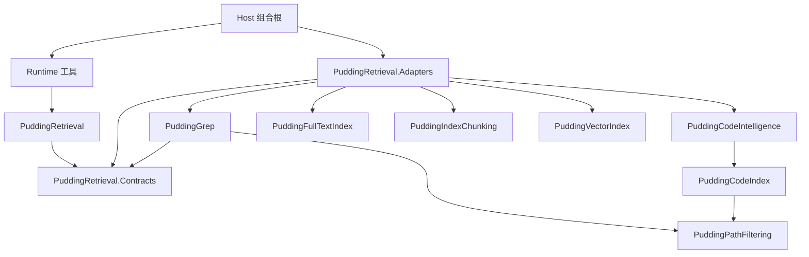

# 增强索引统一检索与代码地图设计方案

本文件是 [ADR-089](../07_architecture/103ADR-089Agent统一检索与渐进展开工具链ADR.md) 的详细设计真源，定义目标状态，不表示新工具或新组件已经接入生产。施工顺序和通过条件只在[分阶段施工计划](增强索引分阶段施工计划-2026-10-18.md)维护；现状、缺陷与复现证据见[基线审阅](../14_reports/2026-10-18-增强索引设计与实现审阅.md)及[现场反馈与源码核对](../14_reports/2026-10-30-增强检索现场反馈与源码核对.md)。

## 1. 目标与范围

统一 Agent 的文件定位、代码文本匹配、符号定位、结构展开和关系查询，使 Agent 在明确的项目集合内分析项目结构、依赖和引用。增强索引由源文件清单、outline、符号与关系图、精确文本候选索引、语义分块和向量组成；全文命中不能代替代码语义关系。

- **统一 grep**：内置代码/文件内容检索和可确定映射的结构化 grep 调用，共用一个范围合同、匹配器、过滤规则、版本与结果合同。记忆、日志、业务数据库检索仍属于各自领域。任意 Shell 管道不承诺被拦截、改写或加速。
- **毫秒级**：对已加载、已就绪且有选择性的查询设立 p95/p99 门禁。全库宽正则、首次构建、冷启动、远程 embedding 不承诺相同延迟；必须有预算和明确的未完成状态。
- **多项目**：会话可同时加载多个物理项目根，默认检索已加载集合，显式参数可收窄。加载集合不等于进程 cwd，也不授予额外文件权限。
- **代码地图**：从持久符号/关系图投影出项目、模块、文件、类型、成员和跨边界关系；文件树是地图的一种视图。
- **向量检索**：补足意图描述与实现名称不一致的召回，结果必须回到可打开的代码证据；不能替代精确 grep 或证明调用关系。

## 2. 组件边界与依赖方向

### 2.1 归属表

新增工程名是本方案的施工目标，尚未存在时不得登记为已实现组件。拆分以独立测试为目的，不在第一阶段修缺陷时顺手搬迁整条链路。

| 组件 | 职责与允许依赖 | 明确不承担 |
|---|---|---|
| `PuddingRetrieval.Contracts`（拟新增） | BCL 叶子；会话检索范围、跨 provider 身份、请求/响应、证据引用及 provider 端口；零 ProjectReference | Tool SDK、数据库、Roslyn、模型资源池 |
| `PuddingRetrieval`（拟新增） | 只引用 Contracts；查询规划、会话项目集合规则、预算分配、融合、分页与引用校验；存储/授权/时钟经端口注入 | 读配置密钥、解析源码、直接查 SQLite、引用 Runtime |
| `PuddingGrep`（拟新增） | 引用 Contracts 与 `PuddingPathFiltering`；统一 literal/regex 语义、保守候选规划、原文验证、有界扫描；候选索引与源文件读取经端口注入 | 分词相关性充当精确匹配；语言语义解析 |
| `PuddingPathFiltering`（已有） | 统一规范化路径、glob、忽略合同的基础能力；保持独立测试 | 会话状态、授权决策；过滤规则不能代替权限校验 |
| `PuddingCodeIndex`（已有） | 文件清单、源版本、索引账本、scope/库登记、符号/关系持久化、变更协调、调度与维护端口；可依赖 PathFiltering | 引用 CodeIntelligence、Runtime、Host；加载 Roslyn/MSBuild |
| `PuddingCodeIntelligence`（已有，目标拆出具体语言实现） | 语言分析协调、代码图查询与地图投影；引用 CodeIndex 与语言分析合同，经端口调用 provider | 引用具体语言 provider；会话状态、工具权限、向量 HTTP、独立维护队列 |
| `PuddingFullTextIndex`（已有） | Lucene 存储与 reader 生命周期、词法排序；新增字符候选字段或 postings 作为 trigram 候选实现 | 定义 grep 真值、会话工具 DTO、借 TopK 声称完整覆盖 |
| `PuddingIndexChunking`（已有） | 由 outline 和源码产生稳定、有来源的语义块；保持叶子合同，不引用语言实现 | 裁剪 exact grep 的语料、假造符号关系 |
| `PuddingVectorIndex`（已有） | 向量写入/删除、代际持久化、精确或近似近邻算法及数值校验；保持叶子 | 解析 provider 配置、HTTP、模型密钥、项目授权 |
| `PuddingRetrieval.Adapters`（拟新增） | 引用以上组件，翻译跨组件 DTO，提供查询/存储适配；重依赖留在本层及语言 provider | 反向引用 Runtime/Host；重新实现索引调度 |
| `PuddingCodeAnalysis.Contracts`（多语言阶段拟新增） | BCL 叶子；语言分析请求、能力、声明/边/诊断载荷和分析器端口；零 ProjectReference | 检索工具 DTO、Roslyn/LSP SDK 类型、数据库、模型服务 |
| `PuddingCodeAnalysis.<Language>`（多语言阶段按需建立） | 只引用 CodeAnalysis.Contracts 及该语言所需包；解析、绑定与增量分析；CSharp / TypeScript / Python 为首批拆出对象 | 直接写索引、引用 CodeIntelligence/CodeIndex/Runtime；自行建立全仓维护队列 |
| Runtime / Platform / Host | Runtime：工具和授权上下文；Platform：配置、会话持久化与管理投影适配；Host：DI 和 Core 生命周期，注入模型服务端口 | 在 Host、UI、Desktop 写第二套查询、队列或索引器 |

模型资源池侧按配置路由提供 embedding 服务实例，资源池适配器位于既有能力实现一侧，由 Host 注入。检索/分块/向量组件不得读取 `llm.providers.json`、持有凭证或直连模型 HTTP。配置只保存 provider/model 标识和索引参数。

Everything作为路径候选provider由适配层连接；它未安装或水位不足时使用已授权文件清单/有界枚举，不让平台专属候选决定权限或完整性。多语言扩展通过CodeIntelligence语言端口接入语法解析器、编译器或LSP；语言服务器生命周期由能力适配层管理，不把LSP进程依赖带入CodeIndex或纯检索编排。



图中为编译依赖，不是调用时序。`PuddingRetrieval` 经 Contracts 端口调用注入的适配器，不能反向引用适配器。Contracts 中只放跨组件合同；CodeIndex 内部维护合同、Chunking/Vector 自有算法合同不整体搬入公共包。

### 2.2 编译期门禁

按[组件化交付规程](../10_conventions/组件化交付规程.md)逐组件执行 S1–S5：先独立构建/测试，再登记解决方案及 Host。检查直接与传递 ProjectReference，禁止上述反向边；基础合同测试进程不得加载 Roslyn、MSBuild、ASP.NET Core 或 Runtime。语言集成测试单列，进程级 MSBuild 注册不污染基础测试。

现有 `PuddingCodeIndex.Contracts.Retrieval` 与 Core 工具检索 DTO 的重叠在第二阶段一次性收敛到 Contracts，并更新全部调用方；不永久保留两份同名合同或双向转换层。第一阶段修复仍在既有组件完成。

### 2.3 组件端口

以下为目标端口语义，正式类型在Contracts/能力侧独立测试后落地；不宣称与当前同名接口签名完全一致。异步操作统一接收deadline、CancellationToken与规范化QueryScope，不能由provider自行扩大范围。

| 端口 | 输入/输出及边界 |
|---|---|
| `ISessionProjectContextStore` | Get与CompareExchange；输入可信SessionKey、expected_revision和成员集合，返回新revision或冲突快照；持久化由上层适配器实现 |
| `IProjectCatalog` | 根据授权后的真实根解析project/library身份，返回manifest、capabilities和maintenance状态；创建/重建交给已有维护协调端口 |
| `ICodeCorpus` | 获取文件清单水位、dirty集合和带source_version的读取租约；不能用“上次扫描完成时间”代替内容版本/覆盖证明 |
| `IGrepCandidateProvider` | 输入规范化模式的必要条件、过滤和snapshot；输出可续页file候选、源版本及是否保证superset；不能证明superset时Grep补扫或partial |
| `IRetrievalProvider` | DescribeCapabilities、Search、Open；输出有身份/版本的证据、覆盖、计数关系、continuation及诊断；统一 facade `IRetrievalPort`由编排实现，provider不引用它的实现 |
| `IEmbeddingProvider`（沿用 VectorIndex 自有合同） | 已绑定配置路由的Describe/EmbedBatch服务；返回向量与模型元数据，支持取消、并发/Token预算；资源池侧适配器实现，由 Host 注入，不迁入/复制到 Retrieval.Contracts |

CodeIndex的语言索引、变更协调和存储写入合同继续由CodeIndex拥有；Vector/Chunking算法合同继续由各叶子组件拥有，适配器进行明确转换。跨域公共端口不吞并内部算法接口。

`IRetrievalPort` 及跨域请求/结果/身份/覆盖 DTO 从 `PuddingCodeIndex.Contracts.Retrieval` 迁入 Retrieval.Contracts；其中引用的 `CodeSymbolKind` 等存储类型转换为公共规范化类型，转换在 Adapters，不能为迁名把整个 CodeIndex 引进 Contracts。`RetrievalPortV1` 的规划/排序/否定策略进入 Retrieval，存储读取进入 Adapters。算法搬迁与行为变更分提交，不保留双定义或永久 type-forwarder。`PuddingGrep` 在独立验收后接现有工具；各组件 S5 分开，不要求为了创建四个目录同时改 Host。

语言分析合同是另一条生产侧边界，与 Retrieval.Contracts 无相互引用。将具体语言实现抽出后，额外编译边为 `CodeIntelligence → CodeAnalysis.Contracts`、`CodeAnalysis.<Language> → CodeAnalysis.Contracts`、`Adapters → CodeAnalysis.<Language>`；纯编排及存储不得引用具体 provider。以无禁用引用的工程编译验证类型不可见，并用引入反向 ProjectReference 的变异让依赖门禁失败；普通引用规则不会自动阻止开发者改 csproj，必须同时检查传递依赖闭包。

## 3. 项目、身份与存储模型

### 3.1 身份必须分层

| 身份 | 定义及不变量 |
|---|---|
| `project_id` / `worktree_id` | Agent 可加载的物理根身份；同一 Git 仓库的不同 worktree 是不同身份。非 Git 根按规范化真实路径登记。Windows 大小写、junction/symlink 别名统一解析并重做边界校验 |
| `library_id` | 该物理根的索引库实例 UUID，绑定格式版本与根身份；复制 `.pudding/index` 到另一根不能复用旧身份 |
| `compiler_project_id` | 语言编译项目/模块与编译配置（如 target framework）的身份；solution 根可含多个此类节点，不等于 Agent 加载的 project |
| `symbol_key` | `(worktree_id, compiler_project_id, language, provider_symbol_id)`；C# documentation ID 只是最后一段，不能单独全局去重 |
| `occurrence_key` | symbol 下的具体声明/引用位置，含 file_id、源版本和 span；partial 声明保留多个 occurrence，不把一个类型强行压成一个文件 |
| `scope_id` | 同一库内逻辑路径/过滤范围；父子 scope 是覆盖关系，不是独立代码证据 |
| `scope_revision` | 会话已加载项目集合的单调修订号；区别于 provider generation 与文件内容版本 |

同一真实文件、同一编译上下文被重叠 scope 覆盖时可合并证据；不同 worktree、程序集或编译配置中的同名符号分别保留。图边在声明实体与 occurrence 间显式选择端点类型。跨项目引用必须经实际 project reference、模块解析或编译绑定确认；同名字符串相等不是跨项目关联依据。

### 3.2 物理库与容量

保留每个物理根一个 ProjectLocal 库：`<root>/.pudding/index/`，内含 manifest、代码数据库、文本候选、向量段与 staging。中央登记只记录根映射、会话成员关系和运维元数据，不做另一个代码主库。当前中央代码数据库向 ProjectLocal 的转换是第二阶段交付项，不能在文档中当作已完成。

新格式从源码重建，以 FormatVersion 检测不匹配；切换前旧库只读，切换后不双写、不长期兼容旧格式。明确旧库归属、备份/回收策略后才删除；卸载项目不触发删除。只读根返回 `index_unavailable/read_only_root`，可在授权范围执行有界扫描，不静默另建中央库。

每库默认容量上限 **1 GiB，可配置**；统计数据库、WAL/SHM、Lucene、向量、staging 和退休代际，另有全局磁盘/RAM配额。构建前预留 staging 空间，配额不足保留可读旧代际、报告阻塞原因；不得先删唯一可用索引来腾空间。降低向量覆盖/缓存占用不能悄悄降低精确文本覆盖。索引目录硬排除；Git 项目可幂等写入经根校验后的 `.git/info/exclude`，不自动修改受版本控制的 `.gitignore`。

### 3.3 状态与生命周期

分开表示 `coverage=owned|covered_by|uncovered`、`serving=empty|ready|degraded|corrupt`、`run=idle|queued|running|succeeded|failed|cancelled|abandoned`；`desired_version` 与各 provider `committed_version` 独立。一次 run 成功不等于所有 provider 当前，也不等于当前会话已加载该库。

项目注册状态 `Registering/Active` 仅表示登记流程，不是索引版本。`IProjectCatalog` 的状态适配器先复用 `ICodeQueryService.GetProjectIndexStatusAsync`，再汇合源清单和各 provider 水位；`workspace_open(view=status)` 与运维状态共用该投影。注册过程必须有完成/失败/中断及原因，孤儿运行在恢复时转 `abandoned` 并重新协调；不能靠把所有 `Registering` 强改 `Active` 修新鲜度。无真实 generation/覆盖证据时返回 unknown；不得用状态名加 UpdatedAt 拼成有效源版本。

会话成员关系持久化；Core 重启后恢复授权仍有效的项目列表，reader 按需重新获取，不持久化活动句柄。主/子 Agent 继承创建时的集合快照，随后各自修改；同会话并发改集合用 CAS。卸载只释放本会话成员关系和租约；已接受的查询持有短时快照租约可结束，后续请求不能访问卸载项目。权限撤销即时生效，不能被查询租约延后。

## 4. 源码一致性、增量维护与索引快照

### 4.1 一条维护链，多 provider 水位

复用 CodeIndex 协调链：文件事件提示 → 有界合并队列 → 持久 dirty 账本 → 文件清单/源版本 → 语言分析、精确文本候选、分块 → 图/词法/向量分别提交 → 事件通知缓存失效。每个 library/provider 只有一个受 fencing token 约束的 writer；允许不同库并行，不建跨全机单线程瓶颈。

Watcher 不是事实真源。队列溢出、重启、rename、忽略规则变化、Git checkout、解析器/编译参数变化触发相应校准；运行中再次变更必须保留下一轮 dirty。只有完整且根可访问的清单扫描可以 sweep。离线盘、权限失败不能等同全库删除。已确认删除须清除该源拥有的图边、符号 occurrence、chunk、词法候选、向量和缓存。

### 4.2 语义失效

新增声明、重载、扩展方法、using/import、继承层次、项目引用和编译选项变化都可能改变既有绑定。维护 symbol incoming 边之外，还要记录名称/重载组、类型/模块 lookup 依赖及未解析引用依赖。无法证明影响范围时，退回受影响编译项目或依赖闭包的安全重绑定，并受队列预算调度；不能把 `ChangedSymbolIds=[]` 视为语义无变化。

只有重绑定及源拥有边替换完成后才提升相应 semantic committed 水位。多文件 partial、跨文件移动、删除、重命名及编译配置变化要以 occurrence 与 binding provenance 清理，避免删掉其他文件贡献的声明或关系。

### 4.3 查询快照与新鲜度

查询快照记录 scope_revision、库集合、各 provider generation、源文件版本、过滤规则版本。各存储独立提交，不引入跨 Lucene/SQLite/向量的全局事务；融合仅连接同源版本的证据，落后的 provider 分别标注 stale/partial。负缓存键含这些版本，不能只用 Git HEAD；无可靠 dirty/epoch 证明时不得负缓存短路。

Lucene reader 使用 Acquire/Release 租约（例如 SearcherManager），刷新与 invalidation 只退休旧代际，最后读者释放后才 Dispose/GC。其他存储遵守相同租约语义。Windows 下删除旧文件必须等待句柄释放，不以强删绕过占用。参考 [Lucene.NET SearcherManager](https://lucenenet.apache.org/docs/4.8.0-beta00016/api/core/Lucene.Net.Search.SearcherManager.html)。

`consistency=current` 对索引后新增/修改文件补扫，并对命中原文验证；若无法证明变更清单完整，做范围校准/扫描或返回 coverage incomplete。扫描期间持续写入的文件报告 unstable_source，不伪造全文件系统同一时刻的原子快照。`consistency=indexed` 可读已提交旧快照，但明确 source_version 和 stale；引用到当前文件时重新校验版本。

## 5. 统一 grep 与查询规划

### 5.1 精确语义

`intent=text` 的 literal/regex 由一个匹配器定义，Lucene 分词得分只可用于相关性检索。首版 regex 合同沿用 .NET Regex 方言、逐行匹配：普通分组/选择/量词/锚点，以及该方言支持的环视、反向引用都必须有fixture；后两者无法安全提取候选时扫描，不能为加速偷偷改变匹配语义。跨行匹配不在v1范围，明确请求时返回 `unsupported_pattern`；外部rg/PCRE方言也只映射已证明等价的子集。单次regex执行超时不超过50 ms与请求剩余时间的较小值，兼容模式可用非回溯实现加速，其余仍受有界超时约束。返回 UTF-16 span 和 1-based 行列；literal 默认区分大小写，`case_sensitive=false` 使用冻结的 invariant 规则；不得让候选层采用不同大小写/Unicode归一化规则。二进制、不可解码与超出配置大小的文件在 coverage exclusions 中说明，不能算作已完整扫描文本。

路径过滤顺序：授权根 → 项目集合/范围 → 固定内部排除 → Git/用户忽略及 include/exclude globs → extension/language → 匹配。glob 只由 PathFiltering 解释，不能每个工具各写一套；忽略策略经请求显式选择受允许的 profile，并回显其版本。筛选必须先于最终 TopK；存储不支持下推时继续分批取候选至足够结果或耗尽/预算终止，不能只取 `limit * 常数` 再过滤并报完整。

### 5.2 Trigram 候选与验证

采用 tgrep 的“保守候选筛选 + 原文验证 + 无可用候选约束时扫描”原则，自行实现适配现有组件的字符 trigram 候选层。首选 FullTextIndex 内独立字段/postings，匹配语义归 Grep；是否改用专门存储由同一合同基准决定。用户无需选择引擎。参考 [tgrep README](https://github.com/microsoft/tgrep)。

- 从 literal 或 regex AST 提取**必需**三元组；选择分支用保守并集，必要条件可求交，不能把可选子式当必需项。
- 短于三字符、宽正则、大小写折叠无法安全映射等情况返回全范围候选，进入有界扫描；优化不能制造漏检。
- postings 覆盖水位不足时，联合 dirty/new 文件并补足缺口；仅验证已有候选不能证明新增文件不存在。
- 原文验证发现版本变化时重读或报 unstable；命中附真实源码 span。candidate budget、正则超时、权限/IO失败、取消分别报告原因。
- 优先返回首屏和 continuation，不同步遍历全量结果求总数/导出。`total.relation` 见工具合同。

### 5.3 查询路由与融合

显式 intent 是约束。`auto` 按标识符、路径与自然语言选择必要 provider，允许有界并行，不强制所有请求跑遍所有引擎。符号精确匹配/声明优先；语义意图可融合 BM25 与向量，用 RRF 或经评测的排名策略。融合实体为 symbol/chunk occurrence，保留 provider 得分与源版本；文件聚合只是展示。

规划器输出 `requested_intent`、`resolved_intent`、`required_providers`、`executed_providers`、`skipped_providers` 及原因。明确自然语言描述和无法可靠分类的概念查询计划 lexical+vector；精确标识符/路径可优先精确面，没命中时在预算内扩展语义面。不能仅凭 ASCII/中文判定查询意图，中文也可以是合法标识符。必要分支未执行只能 partial/unavailable；可选分支跳过不伪造调用记录。规划不用额外 LLM 回合，也不强制翻译查询。语言能力分类是代码语言，查询文本语言是另一字段。

多项目共享本次deadline和输出预算，按库公平调度、有界扇出；不能给每个库独立用满同一总预算而把端到端时间放大32倍。未执行到的项目逐项报告coverage缺口。跨项目图目标不在已加载/授权集合时只披露允许显示的边界标识，不隐式加载或返回目标源码。

重叠 scope 命中不增加“交叉佐证”权重。关键词长度、数字过滤、停用词与 P0/P1/P2 策略只影响语义块选择或排序，不改变 exact grep、代码图与文件清单覆盖。不把代码声明、注释、文档混成同一种证据。

## 6. Outline、代码图与地图

### 6.1 图模型

节点至少含 worktree/project、compiler project/module、directory、file、namespace、type、member；符号实体和源 occurrence 分开。边统一记录 `kind/source/target/source_occurrence/source_version/provider/resolution/confidence`，同名外部目标未解析时保存 unresolved 节点，不伪装成本地符号。

首批精确边为 `contains`、`imports`、`references`、`calls`、`inherits`、`implements`、`overrides`。C# calls 从实际 invocation/constructor operation 产生；method-group、delegate 赋值仅为 references。虚调用的静态目标与可能派发目标分别表示，不能声称是唯一运行时被调函数。DI、反射、动态调用只能形成带依据的推断边或 unknown。

每个语言 provider 发布 capability 矩阵：parse/outline、declarations、imports、resolved references、calls、inheritance、incremental binding 的 supported/partial/unsupported 及原因。首期 C# 语义能力完整验收；其他语言可提供语法 outline/import 图，但必须显式降级，不能把正则提取包装成编译器解析。

### 6.2 地图投影和渐进展开

`map` 从已提交图和文件清单查询，不逐次扫描仓库重建。支持 project/module/file/type 层级、depth、node/edge/token 预算；先聚合再按 cursor 展开。必须显示根目录直接文件；总文件数来自完整清单，不能以 `.Take(50)` 后的数量充当总数。

输出节点/边、模块依赖摘要、入口候选、循环依赖和高连接节点；入口与“关键模块”是可解释的分析投影，附推断规则，不宣称业务语义真值。impact/references/callers/callees 支持方向、边类型、深度和节点预算，批量邻接读取，避免每个节点一次 SQL。图遍历遇到循环保留边但不重复扩张。

`outline` 是单文件语法结构；`summary` 是有来源的结构化摘要；`map` 是多文件图投影。三者共用 symbol_ref 与 source_version。默认 summary 无需 LLM；若未来启用生成摘要，独立标注生成版本与依据，不污染事实图。

### 6.3 多语言能力合同

“支持一种语言”必须展开为下表，**向量召回与静态语义绑定没有包含关系**。

| 能力轴 | 可交付内容 | 不能由此声称 |
|---|---|---|
| text | 授权文件的 literal/regex、文件定位、词法召回 | 已解析符号或调用 |
| syntax | 语法树/outline、声明、语法 import、结构分块 | 同名引用已绑定；无语法错误才有结果 |
| binding | 经项目环境解析的 references/calls/inherits/implements/overrides；每种边独立声明 | 动态运行时唯一目标、全语言行为穷尽 |
| vector | 自然语言→有源版本的代码/文档块，跨查询语言召回 | 零结果证明不存在；相似块之间存在调用关系 |

每个 `LanguageCapability` 描述 `language_id`（如 csharp/typescript/javascript/python）、dialect、provider_id/version、能力轴/边种类、support=`supported|partial|unsupported`、precision=`exact_text|syntax|static_binding|heuristic|similarity`、限制原因。每次请求再给运行状态 `ready|building|unavailable|failed` 和 coverage/freshness。`Semantic` 不再兼指“编译器绑定”和“向量相似”，旧能力枚举在合同迁移时拆解；名称或字符串命中不能被标为 similarity/static_binding。

`language_id` 为可注册字符串，未知值可保留并退到 text，不能依靠全局 switch 修改核心才能新增语言。chunking 和 eval 当前封闭枚举需收敛为语言描述/策略注册；存储的通用 kind/edge_kind 保留 `unknown` 和 `language_raw_kind`，新语法不强塞成 C# 类型。

### 6.4 语言 provider 与运行边界

`ILanguageAnalysisProvider` 属于 CodeAnalysis.Contracts，提供 DescribeCapabilities、ResolveProject、AnalyzeBatch；输入包含项目/模块身份、解析配置指纹、源文本与 source_version、变更集、deadline/取消令牌；输出 AnalysisSnapshot（声明 occurrence、关系及 resolution、未解析目标、diagnostics、分析覆盖、输入指纹、可用增量能力）。载荷只使用 BCL 类型；不回传 SyntaxNode、ISymbol、LSP SDK 对象或可逃逸的文件系统路径句柄。CodeIntelligence 协调调用并映射为 CodeIndex 写入载荷，CodeIndex 继续独占账本/提交/调度。

- **环境身份**：记录编译器/解析器版本、target framework、tsconfig/module resolution、Python 环境/import path 等输入；相关锁文件、工程引用、生成文件及构建参数变化使绑定水位失效。解析环境不完整时允许 syntax，binding 必须 partial/unavailable。
- **位置统一**：公共 span 使用从 0 开始的 UTF-16 offset，区间为 `[start,end)`；行列从 1 开始，excerpt 的显示行范围含末行，由 span 投影。provider adapter 从 LSP 编码、UTF-8 byte offset、AST 坐标转换。emoji、中文、CRLF/LF 必须有夹具。`symbol_ref` 含 provider symbol identity、编译上下文、源 hash；临时/位置身份不能承诺跨编辑稳定。
- **生命周期**：Node/Python/LSP/编译工作进程由 Core 能力适配层启动、限流、取消和回收；每 provider/编译项目有并发及 RAM 上限。进程崩溃只使该能力降级，不能拖垮全文检索。重依赖测试分别启动，不使 TS/Python 的独立测试加载 Roslyn/MSBuild。
- **LSP 接入**：初始化/动态 capability、文档同步版本、请求取消、超时、退出、重启与诊断都须处理。references/callHierarchy 是否支持逐项协商；服务端只覆盖打开文件、项目尚未加载或无法说明覆盖时，不得签发全项目无引用证明。不把交互式 LSP 查询当作已持久化全库图。
- **混合文件**：TSX/JSX、模板内脚本、notebook 等以宿主文件+虚拟文档/source map 建身份。缺可靠映射时降到宿主文本，禁止返回指向生成临时文件的假源码位置。首批只承诺独立文件及已验收的 TSX/JSX。
- **静态/动态边**：alias、re-export、泛型/重载、宏、decorator、反射、monkey patch 分语言处理；没有解析证据就保留 unresolved/heuristic。跨语言边须额外桥接 provider，不在第一批精确图范围。

这套划分依据：Tree-sitter 提供增量语法树；Roslyn 的 SemanticModel 区分语法节点与实际引用实体；TypeScript 的 Program/TypeChecker 可解析类型与符号。它们分别支持语法层和绑定层的选型，**本项目的能力等级仍由测试证明**。[Tree-sitter 文档](https://tree-sitter.github.io/tree-sitter/)、[Roslyn 语义模型](https://learn.microsoft.com/en-us/dotnet/csharp/roslyn-sdk/work-with-semantics)、[TypeScript Compiler API](https://github.com/microsoft/TypeScript/wiki/Using-the-Compiler-API)、[LSP 3.17 规范](https://microsoft.github.io/language-server-protocol/specifications/lsp/3.17/specification/)。provider 固定具体版本/资产校验和，升级独立验收；不将某个版本 SDK API 冻结成跨语言公共合同。

### 6.5 语言引入顺序与准入

以下是**目标，不是现有能力评级或上线清单**。

| 批次 | 编程语言/文件 | 目标与选择 |
|---|---|---|
| 第一批 | C# | 保留 Roslyn；text/syntax/静态 binding 基线，加 vector；工程加载失败仍准确披露能力 |
| 第一批 | TypeScript/JavaScript（含已验收 TSX/JSX） | 保留提取器，syntax 先验；绑定升级采用固定版本 Program/TypeChecker 或经门禁的服务适配，不能把当前导入名关联当完整绑定 |
| 第一批 | Python | 保留 AST；text/syntax/vector 先交付，import/引用解析按实际环境标 partial；动态调用不追求伪完整 |
| 后续候选 | Go / Java / Rust / C、C++ | 逐语言按项目需求排序；先 syntax+vector，再选择编译器或语言服务器补 binding；每种语言独立门禁，不承诺一起上线 |
| 通用兜底 | 未登记语言、Markdown、配置与纯文本 | text + 带来源的文本分块；模型适用性通过后开放 vector；无语法树不伪造 symbol_ref 或关系图 |

新增语言提交必须包含能力描述、独立 fixtures、环境发现与失败策略、版本/位置转换、变更失效、资源/打包测试，以及该语言的 query→源码证据评测。默认开放能力逐项受门禁控制。新增 provider 时，Retrieval/Grep 核心不增加语言特例；通过插件装配与合同适配扩展。

## 7. 向量与语义分块

分块优先类型/成员声明及其实现、相关 doc comment，再补独立文档与未覆盖文本；超长函数按结构切分，保留父符号和范围。单行方法/表达式体的实现必须保留，不能因“声明行已消费”丢失正文。每块含 chunk_id、symbol_key（可空）、parent_key、file_id、span、source_hash、语言、分块器版本和文本来源类型。

embedding 缓存键含 source/chunk 内容 hash、provider/model revision、维度、tokenizer/preprocess/normalization 版本；所有元数据写入库 manifest。相同维度的不同模型也不能混查。更换模型后台重建并切换向量代际，词法和图继续服务。

向量 provider 支持幂等 upsert、按 source/chunk 删除、批量提交、持久化与重启恢复；文本删除必须清除向量。先保留 float 精确扫描作为召回基线，int8 是压缩表示，复杂度仍为 O(ND)，不能称为 ANN。按规模门禁引入 HNSW 等 ANN 时，须与精确基线测 Recall@K、内存、构建/删除开销和 p95，达标才启用。

由资源池提供配置路由的服务；不硬编码某个模型当作所有机器均存在。默认可配置为本地 embedding。无模型/超时/限流返回 semantic unavailable，auto 可返回词法结果并标注缺失分支；显式 semantic 请求不能静默替换为文本检索并声称成功。

### 7.1 生产闭环与故障行为

```text
CodeIndex 源清单/dirty账本 → ICodeCorpus 稳定源版本
  → outline 或文本兜底 → Chunking → 内容 hash 与模型身份去重
  → 注入的 IEmbeddingProvider → VectorIndex staging → 校验 → generation 提交
workspace_search → Retrieval 规划 → lexical + query embedding/vector
  → Adapters 核对项目/版本 → 融合 → 可打开 ref + 覆盖/来源
```

VectorIndex 拥有持久格式、批次原子提交、校验、upsert/delete/恢复；存储 IO 经其自有端口注入，目录与配额由 Adapters 配置，不引用 CodeIndex。评测探针的 `VectorStore` 仅作格式/测量参考，不能用“探针写过磁盘”证明生产生命周期已实现。启动先读 manifest 和提交代际，半写 staging 不可服务；删除 tombstone 与替换 chunk 同代提交，dirty 账本只在匹配当前源版本时确认。构建失败保留旧代际、显式 stale；已删源命中不因旧向量仍在而返回可打开的假引用。

首次交付可对明确项目/语言/容量启用，超出范围列出 exclusions；不得因限制向量范围缩减 text/graph 覆盖。查询热路径不全量重建/同步嵌入仓库。配置包含路由标识、模型 revision、维度、分块版本、允许语言/根、批大小、token/并发/deadline、RAM/磁盘配额；只保存标识，不保存到检索组件的密钥。模型无可验证 revision 时绑定本地 route revision 和配置指纹，变更后强制新代际，禁止同维度混查。

RRF 为首版融合策略，rank 常数/权重/候选上限随评测配置冻结；精确符号保留优先级，不混加不可比较的原始 cosine/BM25 分数。相同 occurrence 合并来源，不重复加权；不同源版本不融合成同一证据。query embedding 缓存绑定模型及预处理身份，结果缓存另绑授权、scope、generation；不缓存“概念不存在”。维护/查询分别计时、计费；限流重试不得超出请求预算。

没有授权模型或跨语言质量未达标时交付状态保持部分可用，功能可明确 unavailable；不得拿随机/固定向量替身作为真实语义验收。中文→英文代码的门禁使用实际模型，语义正文/注释只作检索数据，不作为执行指令。

## 8. Agent 工具契约

以下是目标合同，不代表当前工具 schema 已实现。session_id、执行身份和权限来自 ToolExecutionContext，不接受模型自行指定。所有列表、字符串、输出和递归深度有上限；参数错误在规划前拒绝。公共返回形状仅在本节定义，其他文档引用本节。

### 8.1 项目集合工具

| 工具 | 请求 | 成功返回与语义 |
|---|---|---|
| `workspace_projects_load` | `projects:[{path} 或 {project_id}]`，`ensure_index=missing\|none`（默认 missing），可选 `expected_scope_revision` | 原子验证全部成员后加入集合，返回 scope_revision、每项 project_id/library_id、能力与 readiness、异步 job_id；重复加载幂等，不重新全量构建。初始化可排队，加载成功不等于索引就绪 |
| `workspace_projects_unload` | `project_ids:[]`，可选 expected_scope_revision | 仅移除本会话成员；重复卸载幂等；返回剩余集合和新 revision；不调用旧 unregister 的默认删库行为 |
| `workspace_projects_list` | 无必填参数 | 完整已加载集合、scope_revision、每项 readiness/capabilities/维护状态；数量有界（首版最多 32 个项目），禁止分页导致隐藏默认检索成员 |

多项目 load 参数每项 path/project_id 二选一，最多 32 项且总成员不超过 32；验证失败不部分改变集合。索引初始化的异步执行失败只影响 readiness，不撤销其他已加载项。CAS 冲突返回 `scope_changed` 和新 revision，不覆盖他方更新。

list始终返回全部成员的紧凑身份与状态；详细provider诊断通过status展开，不因输出预算悄悄省略集合成员。

没有隐式“唯一当前项目”；省略 project_ids 表示当前加载集合，未加载返回 `no_project_loaded`，不猜测 cwd。`search/open` 的 project_ids 必须是集合子集；超出返回 `scope_not_loaded`。跨根重叠登记用真实路径与 worktree identity 去重，并披露 covered_by。

### 8.2 `workspace_search`

| 字段 | 合同 |
|---|---|
| `query` / `symbol_ref` | 二选一；query最多8192个UTF-16 code unit，用于 auto/file/symbol/text/semantic；implementation/references/callers/callees/impact 必须给精确 symbol_ref，禁止模糊取首项 |
| `intent` | `auto\|file\|symbol\|text\|semantic\|implementation\|references\|callers\|callees\|impact`，默认 auto |
| `project_ids`、`paths`、`include`、`exclude`、`languages` | 选填；project_ids为字符串数组，paths为`[{project_id,relative_path}]`（`.`表示根）；include/exclude为glob字符串数组，languages为provider登记的语言ID数组。不同项目同名路径不得合并；过滤规则统一回显 |
| `match`、`case_sensitive`、`name_match` | `match=literal\|regex` 仅 intent=text 支持，默认 literal；其他 intent 携带 match 返回 invalid_arguments。`name_match=exact\|prefix` 仅 intent=symbol 支持，默认 exact；不借 regex 猜图关系 |
| `consistency` | current（默认）或 indexed，见 §4.3 |
| `limit`、`cursor` | 默认 20、上限 100；cursor 为服务签发的不透明值，绑定 query hash、scope_revision、授权 epoch、provider generations 和排序位置 |
| `max_bytes`、`max_tokens`、`deadline_ms` | 默认模型输出上限8192 bytes/2048 tokens，允许的硬上限32768 bytes/8192 tokens（同时约束）；普通查询默认 250 ms、上限 2000 ms；显式 semantic 默认 1000 ms、上限 5000 ms。调用方更严预算优先；auto 的向量分支只能使用剩余预算 |
| `depth`、`edge_kinds` | 仅关系 intent；默认 depth=1，上限 5；另有服务端节点/边上限与 continuation |

稳定排序为相关性/意图优先级后追加全局 occurrence 身份，不以字典遍历顺序分页。cursor 租约默认 60 秒，代际不可恢复、授权或集合变化时返回 `cursor_expired` / `scope_changed`，不能换库继续读旧游标。查询快照与 continuation 有数量/内存上限；不能为分页无限保留 reader。

intent=file将query按规范化项目相对路径的literal子串匹配，路径大小写语义遵循已登记文件系统；glob只放include/exclude，不自动解析query中的通配符。intent=symbol按name_match比较简单名或限定名，返回全部同名候选供消歧；intent=auto必须回显实际选择的intent/provider，不能在同一结果中隐藏匹配语义。

分页请求可只带cursor及更严输出预算；重复传query/intent/filters时必须与签发快照相同，否则invalid_arguments。每页重新分配不超过原请求的deadline，范围不变；服务同时限制cursor累计扫描量、续页次数与租约时长，超限返回partial及收窄建议，不能无限续扫。`references`包含读/写/类型使用/方法组等实际引用，可通过edge_kinds收窄；`implementation`沿implements/overrides找实现，不做语义相似猜测。

返回至少包含：

```json
{
  "status": "ok",
  "scope_revision": 7,
  "snapshot_ref": "opaque",
  "hits": [{"ref": "opaque", "project_id": "p1", "kind": "symbol", "path": "src/A.cs", "source_version": "sha256:...", "evidence": "declaration"}],
  "coverage": {"complete": true, "exclusions": [], "providers": []},
  "total": {"value": 37, "relation": "exact", "unit": "occurrence"},
  "page": {"returned": 20, "has_more": true, "next_cursor": "opaque"},
  "timings_ms": {"total": 18},
  "warnings": []
}
```

`coverage.providers` 每项必须含 project_id/provider、language_id、能力、desired/committed generation、source_snapshot、freshness、scanned/eligible（未知可空）、执行/跳过/完成或缺失原因。coverage.complete 表示请求计划需要的 provider 已执行且声明的语料/快照覆盖完整，**不表示首屏包含全部结果，也不表示概念空间已经穷尽**。`total.relation=exact|lower_bound|unknown`；unknown 时 value=null，不能把候选窗口数当总数；semantic/概念 auto 的相关结果总量为 unknown，实际候选数另报。`page.has_more=true|false|unknown`；有可续扫状态才返回 cursor，否则附缩小范围的 next_step。

`status=ok|partial|no_match|no_candidates|unavailable|error`。exact 模式只有覆盖完整、验证穷尽且total为exact/0才能 no_match；任何范围缺口、预算中止或未支持语义都不能据此否定代码存在。semantic 的零结果只能 no_candidates。部分项目成功时返回 partial 和逐项目原因；全不可用返回 unavailable。分页本身不使 ok 变 partial；无法证明覆盖才是 partial。

### 8.2.1 零结果与否定的判定表

每次响应给出 `claim.kind=none|no_candidates|no_match_in_scope`；后者必须携带 scope/过滤、匹配规则、snapshot、exhaustive 证明，文案只能说“该范围/版本内无符合此规则的匹配”。`no_candidates` 表示未找到证据，不是无实现；`none` 表示执行/覆盖不足以形成否定。旧 `GenuinelyAbsent`、`AcceptAbsence` 只能在显式精确查询且满足证明条件时映射为限定范围的声明。

| 请求及观察 | status / claim.kind | 必须说明 |
|---|---|---|
| 自然语言 auto，仅词面执行，vector 未配置/未接线 | partial / none | `required_providers` 含 vector；已查词面、语义未查，不能排除相关实现 |
| 显式 semantic，无模型/索引/支持能力 | unavailable / none | 能力缺失原因及配置/构建建议，不静默换词面成功 |
| semantic 或 auto 所需分支完成，零候选 | no_candidates / no_candidates | 当前范围内未召回候选；即使全量扫描向量也不能证明概念不存在 |
| 显式 text literal/regex 或 symbol/file 精确规则；完整当前快照、匹配穷尽、零结果 | no_match / no_match_in_scope | 限定匹配规则/范围/版本，不升级为“功能不存在” |
| 索引落后、解析局部失败、扫描超时、预算耗尽、未知覆盖 | partial / none（全无法服务则 unavailable） | 分项目/语言/provider 缺口；不能报 exact/0 总数或缓存否定 |
| 关系零边且该锚点/边种类覆盖完整 | no_match / no_match_in_scope | 仅所选静态关系；容器是否展开成员，动态/反射边不在证明范围 |

自然语言与标识符分类不能决定能否输出无条件否定：**所有 auto 零结果都禁止 AcceptAbsence**。`degraded=false` 只能描述已执行分支，不能替代 coverage/claim。即使旧 DTO 暂不能承载全部字段，止血切片也必须添加机器可判定的已查/未查面及否定类型，再迁入公共合同，不只修改提示句。

覆盖不足的目标响应示例（省略与 §8.2 相同的分页字段）：

```json
{
  "status": "partial",
  "requested_intent": "auto",
  "resolved_intent": "semantic",
  "required_providers": ["lexical", "vector"],
  "executed_providers": ["lexical"],
  "skipped_providers": [{"provider": "vector", "reason": "not_configured"}],
  "hits": [],
  "coverage": {"complete": false},
  "total": {"value": null, "relation": "unknown", "unit": "occurrence"},
  "claim": {"kind": "none"},
  "next_steps": [{"kind": "enable_semantic", "text": "词面未命中；语义召回尚不可用，不能排除相关实现。"}]
}
```

### 8.2.2 证据身份与合同切换

每个 hit 必须带 project_id、worktree/library、language_id、provider、source_version、规范化 path/span 和 evidence kind；symbol hit 另带编译上下文和 symbol identity，才能签发 symbol_ref。纯文本/向量块可以签发 source/chunk ref，不伪造符号。缺身份/源版本时不能标为可用证据：partial+skip_reason，同时修复生产者；skip_reason 不是永久替代 project_id 的设计。

迁移从当前 namespace/type/member/any/comment 等意图到目标 symbol/text/semantic 时，先列完整调用方/schema/枚举映射。能够等价的内部调用一次性迁移，不能等价的显式拒绝；不永久保留两套检索含义。改变 token/cursor 格式时携带 contract_version，旧不兼容引用明确 stale_ref/cursor_expired 并重检索；不能复用旧 payload 猜新身份。迁移须保留 Fresh/Stale/重定位和关系锚点禁止退回名字匹配的不变量。

常见 reason/code：no_project_loaded、scope_not_loaded、scope_changed、permission_denied、unsupported_pattern、ambiguous_symbol、stale_ref、index_building、capability_unsupported、deadline_exceeded、unstable_source、index_unavailable。错误不伪装成空命中。

### 8.3 `workspace_open`

请求 `ref` 或 `{project_id,path}` 二选一，`view=excerpt|outline|summary|relations|map|status`，可选 lines/depth/cursor 及同一输出预算。项目根 map/status 可只给 project_id；其他 path 必须在已加载项目与授权范围。map 默认 depth=2、上限 5，节点默认 100/上限 500，边默认 200/上限 1000，仍受 byte/token 上限约束。relations 必须给 symbol ref 与 `relation=references|callers|callees|implementation|impact`，使用 §8.2 的同名关系语义，不按文件名猜符号。

ref 绑定身份、源版本、scope 和 provider generation，本身不授予权限。源码变化后不得沿旧行号打开当前代码：能读取仍授权的指定历史快照则回显版本，否则 stale_ref 并返回重新定位建议。summary、outline、map 需在头部携带能力和覆盖；缺少语义解析不能假装有完整引用图。

summary 默认从同版本声明/关系/文档注释生成确定性结构摘要，并附证据 ref；缺某部分则披露。status 经 §3.3 的 IProjectCatalog 适配器调用 `GetProjectIndexStatusAsync` 和 provider 水位，不能复用注册状态或文件 excerpt。未实现视图必须明确 unsupported，不能因为枚举/分支遗漏落到 excerpt。项目根 status/map 不要求伪造文件 path。

示例链路：

```text
workspace_projects_load(projects=[{path:"D:/src/api"},{path:"D:/src/web"}])
workspace_search(query="PaymentService", intent="symbol")
workspace_search(symbol_ref="返回的唯一符号引用", intent="callers", depth=1)
workspace_open(project_id="已加载项目标识", view="map", depth=2)
workspace_projects_unload(project_ids=["不再参与本会话检索的项目标识"])
```

### 8.4 运维与旧工具退役

`workspace_index_status(project_ids?)` 为只读；`workspace_index_rebuild(project_ids,providers?)` 为独立维护权限，返回 job_id；`workspace_index_purge(project_ids,expected_library_ids)` 为显式删除权限，并校验活动租约/库身份。purge 的停止维护与 reader 退休走统一运维流程，不能作为卸载副作用。默认搜索工具目录不暴露 purge。

旧 `search_grep`、路径/符号/outline/map 工具在迁移期只作为相同服务的薄入口；搜索参数、权限投影、prompt、Harness 映射、遥测全部切换后退出默认 catalog，并在验收阶段删除无调用者入口，不永久双实现。旧 register/unregister 管理磁盘索引，不能改名冒充 load/unload。`index_init/index_load` 旧提案不再新增独立工具。

显式退役清单含 `code_callers`、`code_callees`、`code_impact`、`code_outline`、`code_summary`、`project_map`、`search_grep`，并审计路径/符号同类入口。替代视图及权限等价门禁通过后逐组退役，不为了目录数字好看提前删掉唯一可用能力；兼容入口有明确移除工作包，禁止新业务继续调用。

## 9. 性能与质量验收口径

以下是**目标门禁，不是实测结论**。固定 Windows/.NET 10 基准机（至少 8 物理核、32 GiB RAM、NVMe，记录 CPU/电源/SDK），记录数据 hash、ignore profile、模型路由与构建 commit。W1：1万文件/100 MiB 文本；W2：10万文件/1 GiB 文本；单项目与 8 项目总量相同对照。W2基准显式配置单库上限4 GiB、全局索引磁盘16 GiB、查询/索引缓存RAM 4 GiB；默认1 GiB配额另做耗尽用例，不能为测延迟关闭配额。每类至少 100 个不同查询、每个 10 次，报告 p50/p95/p99、冷/暖、并发 1/8；不把同一结果缓存的重复调用当作唯一证据。

| 场景 | W2 暖态、并发 1 目标 | 正确性/资源门禁 |
|---|---|---|
| 文件/符号精确定位 | p95 ≤30 ms，p99 ≤100 ms | 不跨 worktree 丢同名符号；全局稳定分页 |
| 有必需 trigram 且匹配文件≤1%的 literal/regex 首屏 | p95 ≤50 ms，p99 ≤150 ms | 与独立 oracle 一致；过滤不漏检；包括原文验证和工具序列化 |
| 已提交图的 outline、单跳引用、首层 map | p95 ≤50 ms，p99 ≤150 ms | 不在查询热路径全库重扫；图边语义 fixtures 全过 |
| 无可用 trigram、宽结果/索引缺口 | 不要求全量扫描≤50 ms；在请求 deadline 内有界返回 | 完整性未知就 partial；取消后 100 ms 内释放扫描工作，返回额外调度容差≤100 ms |
| 向量索引查询（不含生成 query embedding） | 10万 chunk、冻结 768 维语料：p95 ≤100 ms，p99 ≤250 ms | ANN/int8 对 float 基线 Recall@10 ≥0.95；额外以实际配置模型维度复测 |
| semantic 端到端（含 query embedding） | 本地参考模型 p95 ≤1000 ms；冷模型、远程模型单列 | 不排除 embedding 时间来宣称端到端毫秒达标 |

并发 8 时选择性词法查询 p95 ≤200 ms，图/文件/符号 p95 ≤200 ms；与维护同时运行亦需测。单库逻辑文件修改到 lexical/graph current 的 p95 ≤1 s（小改动），全局重绑定/大规模 checkout 单列吞吐和期间降级，不套用小改动门槛。100次装卸/重建循环后无持续句柄泄漏，回收静置后句柄基线增幅≤5%、服务缓存内存增幅≤10%；全局内存/磁盘配置硬上限始终有效。

精确检索 oracle 使用独立全文扫描与手写真值；与固定版本 rg 比较其共同支持的语法子集，不能把两种 regex 方言全等当假前提。覆盖大小写/Unicode、中文、短词、OR/可选分支、忽略、编码、删除、新增、未提交修改及部分失败。语义金标分训练/调参/验收集，独立验收集至少 200 条：Recall@10 ≥0.90，融合 nDCG@10 不低于独立 BM25 基线；每种语言和 intent 分层报告，禁止只给总体均值掩盖空能力。

冻结验收集至少 200 条且不参与调参；第一批 C#、TS/JS、Python 各至少 50 条（JS 与 TS 另拆子桶），另含文档/混合项目用例。每个声明可用的编程语言桶独立达到 Recall@10 ≥0.90、nDCG@10 不低于自身 BM25；至少一半是中文概念查询，并有与标识符无字面重叠的 hard positives。训练/调参/验收按仓库或独立代码族隔离，记录模型/语料/标注集/配置 hash，不能因看过失败样例再调门槛。符号/文本/关系正确性沿用各自金标，不用向量分数代替。

限定范围 R6-A 可先发布通过上述阈值的语言桶，每个启用桶至少 50 条，其他桶必须明确未通过/未执行并保持未启用；不能按已过桶重新计算一个“全语言通过率”。完整 R6-B 才要求整个独立验收集和第一批全部已声明能力通过。范围收窄不改变每桶质量、覆盖、证据和故障门禁。

必含 `签发符号引用的令牌 → SymbolRefIssuer.Issue` 的复现回归（行号由冻结源码定位，不硬编码 133–191）；另需未见过的同类概念，避免只对示例写同义词特判。先确认冻结片段确实承担该概念，不以单个失败证明所有模型无效。真实语义 smoke 必须在生产 IRetrievalPort 路径记录 vector 分支执行和模型/代际，单独探针成功不算接入证据。

错误否定为零容忍：所有覆盖缺口/未支持/模型离线/预算终止/语义零候选 fixtures 中，误报 `AcceptAbsence` 或 `no_match_in_scope` 必须为 0。另设真正精确零匹配的正对照，避免实现靠永远报 partial 蒙混。变异取红至少覆盖：跳过 vector 却标已执行、丢 project_id、复用旧模型向量、删除后返回旧块、把 syntax 当 binding、容器未展开却报无人调用。

基线在实现前冻结；每次合同、分块、模型、解析器、绑定规则或检索路由变化后重跑同一套，新建报告保留旧结果。探针增加**生产端口适配器**，仍让 Eval 仅依赖自己的 ISearchProbe；离线 lexical/vector/fusion 消融与产品端口结果分别列出。报告除质量/性能外记录 code commit、实际程序集身份、source/index generations、scope、语言能力、查询语言、模型 revision、未执行桶、错误否定率和可打开证据比例（有效 hit 应为 100%）。硬件/模型不具备时记录未验证，不得继承旧日期报告冒充新基线。

生产验收包含真实 Agent 的“加载两项目→同名消歧→检索→打开→追引用→地图→卸载隔离”完整链路。源码门禁、进程外部署、新构建内功能 smoke、进程外生命周期验收分别出证据；不得用本设计文件充当上线完成证明。

## 10. 文档承接与变更管理

ADR 只维护决策；本文件只维护技术合同；施工计划只维护阶段工作包与门禁。既有 2026-09-13/23/24 多份 ADR-089 设计、计划、二轮裁定转为历史入口，原文保存在 `Docs/90_archive/adr_089_legacy_20261018/`，不再作为并行规范。历史实测、缺陷台账保留证据语境；当前状态引用审阅报告，后续完成事实进入 changelog/验收报告。

主要替换：单库会话绑定→项目集合；不建 trigram→可证明召回的字符候选；所有分支必跑→按意图有界规划；强制精确总量和全量落盘→带关系的计数与分页；重叠 scope 加权→同源去重；中央代码库现状→ProjectLocal 目标重建；int8 规模试验→经质量/延迟门禁选择算法。保留 CodeIndex/CodeIntelligence 依赖边界、资源池提供 embedding、ProjectLocal、配额、异步维护及渐进展开原则。
