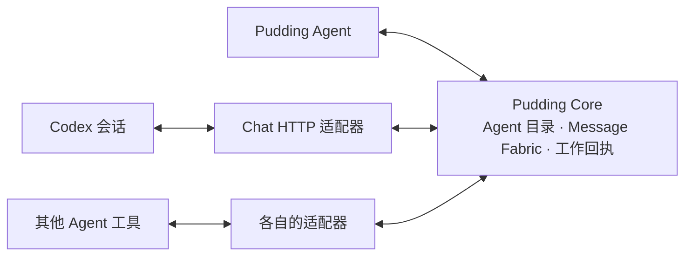

# 外部 Agent 接入与集中消息总线

每种 Agent 工具提供自己的插件或适配器。适配器负责它所在产品的会话、身份和执行方式，向 Pudding Core 注册一个工作区内稳定的 Agent ID。调用方通过目录找到可用 Agent，再用同一套消息和任务接口通信。接入 N 种工具时，需要维护 N 份工具到 Core 的适配，广播的投递量仍取决于实际接收者。

## 总线与传输

用现有 Message Fabric 作为消息总线。它负责持久收件、稳定投递 ID、领取、重试和死信。先用认证的本机 HTTP，适配器只领取分配给自己的投递。后续可用长轮询或事件提醒降低延迟，重连仍从持久收件箱恢复。现有 MQTT 连接器负责连接 broker 并转发通道消息。如果接入方需要 MQTT，可把它作为另一种传输接到同一份目录和收件箱。

平台目录用 `(workspaceId, agentId)` 寻址。兼容现有 Agent 调用方的方式是在路由时由 Core 区分本地和外部执行后端。外部投递采用独立的持久目标类型，以免现有本地 Agent dispatcher 领走外部工具的消息；逻辑 Agent ID 对调用方保持一致。流式通知和审计订阅走现有 Eventing，消息收件和工作回执各自保留已有权威入口。

## 插件注册和授权

1. 安装时由工作区管理员绑定插件安装、逻辑 Agent ID 和能力。运行时从已认证凭据解析绑定，再创建在线租约。请求可以指明目标 Agent，发件人、工作区权限和预算来自 Core 绑定。
2. 同一个工作区 Agent 只有一个有效领取租约。心跳续租，断开后释放或到期。需要立即重连时，同一安装提交原租约作为替换条件，Core 发新租约。旧连接和其他安装的续租、释放及结果提交被拒绝。租约用于隔离新旧连接，认证仍使用插件凭据。
3. 目录展示已获准的能力和在线状态。适配器凭据仅允许读取自己的收件箱，跨工作区发现、送达或复用已失效租约均被拒绝。内容订阅与诊断订阅分别授权。
4. Core 重启时在线连接重新登记。已经受理的消息和任务按持久存储恢复。生产接线时，收件和回写须在实际持久更新处检查领取者和租约，防止路由查询后连接已被替换。

## 管理界面和 HTTP 文档

在系统配置中增加「外部 Agent」。管理员选择工作区和工具名称即可签发 AK/SK。页面展示 Agent ID、工作区、注册状态、在线状态、最后心跳、有效期和撤销操作。已签发、已注册和当前在线分别显示。直接复用 External Access Token 的格式、密钥摘要、到期和撤销，使用 `Authorization: Bearer pdt_v1_<AK>.<SK>` 认证。凭据只授权这一适配器身份，工作区和发件人由 Core 从绑定解析。

每一行提供「复制接入提示词」，包含服务地址、Agent ID、AK、注册和订阅步骤，以及 Swagger 文档链接。长期 SK 通过外部工具的密钥输入或本地安全存储提供。创建时单独显示一次 SK。提示词可重复复制，内容保持可公开的接入参数。API 指南在首版与实际端点同时发布。

对外入口使用 HTTP 和 JSON。注册、续租、领取、确认和回执以版本化路径公开。给这些端点单独生成 OpenAPI 文档，并提供 Swagger UI。文档按照外部 API 的暴露策略提供，仅包含外部 Agent 合同。

## 投递、委派和回执

| 操作 | Core 所有的状态 | 适配器负责 |
|---|---|---|
| 发消息 | 验证发送权限，按目标持久化，同一幂等键同内容重放原回执 | 领取自己的消息，按意图通知或交给工具 |
| 委派任务 | 校验父任务、能力、预算和时限，返回稳定的操作 ID，按工作回执观察或取消 | 把操作 ID 写进本机执行映射，汇报运行及终态 |
| 断线恢复 | 保留未执行的投递和状态，校验领取者，按退避或死信策略处理 | 用已知请求 ID 查询实际接单结果，再决定能否重投 |

`queued` 表示 Pudding 持久接单，适配器接单、实际启动和按结果结算各有独立的回执。只有对应操作的权威终态携带最终结果。接单结果不确定时先回读，`unknown` 可供诊断。被动通知、普通结果和回复沿用 Message Fabric 的意图规则，避免回信自动唤醒双方形成循环。

现有本地 Agent Work 后端要求一个属于调用者的本地主会话。接入外部 Agent 时在后端选择处增加路由，外部工具的任务保留在自身执行器，Pudding 关联工作 ID、领取回执和外部运行 ID。外部子任务仍经过现有委派授权和父预算约束。

## Codex 首个适配器

Chat HTTP 保持管理 Codex 会话和访问 app-server。适配器把获准的逻辑 Agent ID 映射到一个显式配置的 Codex `sessionId`，通过指定会话的消息接口投递，使用稳定的 `messageId` 处理重放。调用方只看到逻辑 Agent ID，无需读取本机连接文件或默认会话。

如果 Codex 回执仅到 `queued`，继续等该消息对应的执行轮次。能观察到 `turnId` 后才关联终态。会话由另一客户端拥有时保留排队与所有权，适配器按配置的交接方式处理。回复关联由本机收件记录和该轮结果提供。

## 接入顺序

| 切片 | 交付与验收 |
|---|---|
| 注册和在线租约 | 独立验证三条适配路由、工作区隔离、并发注册、到期和重连围栏 |
| 管理和 HTTP 入驻 | 管理员签发并撤销凭据，外部插件注册和续租，列表反映在线状态，提示词与 Swagger 文档指向实际接口 |
| 接 Core 的收件和回执 | 两个模拟插件加一个本地 Agent 完成有向消息和委派。关闭接收方、重启 Core、重放同操作，各检查一次接单和可追溯终态 |
| Chat HTTP 首个实际适配器 | 在专用测试聊天上证明通知、委派、重连、终态和权限隔离。用可控的第三个适配器证明接入时已有两个客户端无需改动 |
| 可选 MQTT 接入 | 当接入方需要 MQTT 时复用同一合同，增加传输一致性验收 |

关联 [Message Fabric ADR](../07_architecture/46ADR-045双向消息系统与聊天室客户端ADR.md) · [外部 Agent 消息 API ADR](../07_architecture/96ADR-082Pudding外部工作空间Agent消息APIADR.md) · [Chat HTTP](../../Tools/CodexPlugins/plugins/chat-http/README.md)。
