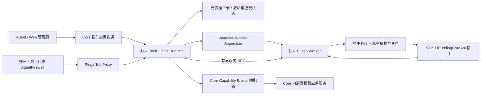

# 工具插件化架构与实施方案

> 本文是待实施的设计提案。现有实现与目标实现分别说明；本文中的新程序集、接口、工具名和协议均为拟新增项。此次任务只交付规划，不实现或部署运行时。

## 1. 目标与需求对应

目标闭环：**Agent 根据任务发现插件 → 开发或导入插件包 → 校验 → 显式加载并挂载到自身 → 下一模型轮次调用 → 查询失败证据 → 卸载或修复后重新加载**。全过程无需重启 Core，其他 Agent 不受失败插件的常规故障影响。

| 用户需求 | 设计位置 | 完成判据 |
|---|---|---|
| 1. 插件契约、JSON、目录和资产 | §4、§5 | SDK 示例独立编译；清单可验证；依赖和资产有明确归属 |
| 2. Core 接口，依赖接口而非实现 | §3、§6 | 插件只引用 SDK/契约；宿主能力经接口和授权 RPC 使用 |
| 3. 动态加载与卸载 | §7 | 运行中加载真实 DLL；卸载后工具不可调用、工作进程退出 |
| 4. 加载或运行失败不拖垮宿主 | §8 | 初始化异常、进程崩溃、不响应、输出超限都有独立故障注入验收 |
| 5. Agent 能诊断加载 | §9 | 失败返回 errorId；按身份查询阶段、因果码、证据和建议动作 |
| 6. Agent 自己开发后加载 | §10 | 使用独立 SDK 构建新插件，在同一 Core 生命周期内完成开发闭环 |
| 7. 核心、领域、外部工具分类与自主管理 | §11 | 管理工具保留；业务工具按 Agent 挂载；来源和信任单独记录 |
| 8. 管理界面 | §12 | 复用能力管理页，展示目录、实例、挂载与失败；操作共用应用服务 |
| 9. 启动仅扫描元数据 | §4、§7.1 | 启动不加载外部程序集、不执行入口、不启动插件 Worker |
| 10. 运行中导入 DLL、使用、诊断、卸载 | §7、§10、§14 | 实际 DLL 正常与故障两条端到端链都通过，Core PID 不变 |

本轮聚焦工具贡献项，不同时改造 Model、Session、Storage、Hook 和 Connector 的全插件微内核。与[已有插件总蓝图](../19_references/deepseek_harness/deepseek-harness-pi-plugin-hook-event-architecture-2026-08-14.md)保持贡献项、激活单元、能力 facade 和资源归属语义；后续其他贡献类型复用契约思想，分别立项。

## 2. 当前代码基线与必须修正的差距

| 权威代码 | 当前行为 | 目标变化 |
|---|---|---|
| [PluginManifestCatalog](../../Source/PuddingRuntime/Services/Plugins/PluginManifestCatalog.cs) | 从 PluginsRoot 读取 pudding-plugin/v1；缓存目录；ManifestOnly 占位工具；检查清单入口相对路径 | 保留发现功能，分离元数据目录与可执行实例；补预算、版本、哈希、重解析点等校验 |
| [PluginPackageInstaller](../../Source/PuddingRuntime/Services/Plugins/PluginPackageInstaller.cs) | ZIP 结构/路径/大小校验，替换插件目录 | 演进为内容不可变的安装、原子提交和版本并存；不能覆盖活动 DLL |
| [PluginCatalogController](../../Source/PuddingRuntime/Controllers/PluginCatalogController.cs) | list/get/upload/reload/diagnostics；reload 只刷新元数据 | 复用 API 入口，增加明确 load/unload/bind/unbind 操作；不把 reload 偷换成执行 |
| [PluginDiagnosticsSink](../../Source/PuddingRuntime/Services/Plugins/PluginDiagnosticsSink.cs) | 插件事件 JSONL 与近期查询 | 复用存储出口，接入统一因果码、有界脱敏证据与身份过滤 |
| [PuddingToolRegistry](../../Source/PuddingRuntime/Tools/Platform/PuddingToolRegistry.cs) | DI 工具稳定；动态源每次建快照；ToolId 重复抛异常；Workspace 级动态源 | 插件预准入、原子发布、Agent 挂载过滤、冻结世代；坏插件不能破坏全部目录 |
| [ToolExposurePlanner](../../Source/PuddingRuntime/Services/Tools/ToolExposurePlanner.cs) | search_tools 按需暴露 schema，下一模型轮次生效；稳定追加排序 | 保留轮次边界，区分 schema 发现与 DLL 加载；卸载/版本替换有显式变化原因 |
| [PuddingToolContracts](../../Source/PuddingCore/Tools/PuddingToolContracts.cs) | IPuddingTool 和宿主工具执行上下文，SourceKind/RuntimeStatus | 由宿主适配器桥接新叶子契约，外部 SDK 不依赖完整 PuddingCore |
| [能力管理页](../../Source/PuddingPlatformAdmin/src/pages/capability-management/index.tsx) | 工具、插件包、上传、清单刷新、诊断 | 扩展实例与挂载操作；文案准确区分扫描和执行 |

特别注意：现有测试允许 ManifestOnly 只读工具进入 ListAvailable；这只证明目录能看到声明，不能证明 DLL 已加载。目标中它们可被插件目录检索，但不得作为当前可执行工具 schema 暴露。

注册表构造当前会读取动态源，因此不能只新增后台扫描服务而保留旧占位工具源。接入时改成订阅已提交快照，外部候选的重复 ID 在发布前逐插件拒绝；核心 DI 工具冲突仍视为产品构建/装配错误，不用静默忽略掩盖。

## 3. 架构与依赖方向

**推荐采用每个隔离激活实例一个 Plugin Worker 进程。Core 只持有工具代理与状态，不加载外部 DLL。** DLL 在 Worker 中加载，Core API 在 Worker 中表现为接口代理，实际业务执行仍在 Core。

.NET 的 AssemblyLoadContext 提供程序集依赖隔离，卸载是协作式的；仍被线程或引用持有的程序集可能无法卸载。官方文档也明确指出不能在受信任 .NET 进程内安全加载不受信任代码。因此使用独立进程作为本设计的故障回收边界；ALC 只用于 Worker 内依赖解析。[插件教程](https://learn.microsoft.com/en-us/dotnet/core/tutorials/creating-app-with-plugin-support)、[卸载说明](https://learn.microsoft.com/en-us/dotnet/standard/assembly/unloadability)。



以下为计划中的工程边界，路径只是施工命名，不表示已存在，故不登记到根代码地图 §2：

| 拟新增程序集 | 职责与允许依赖 |
|---|---|
| Pudding.ToolPlugins.Contracts | BCL-only；manifest DTO、插件入口、工具 DTO、Core 能力接口、生命周期/监督端口；不得引用 PuddingCore 或任何消费方 |
| Pudding.ToolPlugins.Sdk | 只引用 Contracts；作者基类、schema 帮助函数、示例；不含宿主 DI、数据库和业务实现 |
| Pudding.ToolPlugins.Protocol | 只引用 Contracts；版本化 RPC 信封、有界帧编码、请求关联与取消；不复用 Desktop 协议 |
| Pudding.ToolPlugins.Runtime | 引用 Contracts/Protocol/PuddingDiagnostics；目录、安装协调、状态机、激活、租约、命令幂等、纯授权输入；进程/文件访问经端口注入 |
| Pudding.ToolPlugins.Windows | 引用 Contracts/Protocol；真实文件与 Windows 进程监督适配，Job Object、Named Pipe 和退出观察；不引用 Runtime/Host 实现 |
| Pudding.ToolPlugins.Worker | 引用 Contracts/Sdk/Protocol/PuddingDiagnostics；控制台可执行文件、DLL 解析和执行、Core API 代理；无 ASP.NET、WinUI 或数据库 |

Runtime 中的宿主适配器引用这些下层程序集，将现有执行上下文转换成叶子 DTO；Core 组合根装配接口。边界测试读取 csproj、程序集依赖闭包，并注入反向引用验证门禁能变红。SDK 示例必须在不引用宿主仓库实现工程的情况下构建。

业务仍在 Core；Desktop Shell 不装配插件运行时、不加载插件 DLL。Worker 由 Core 的插件监督器启动与回收，随产品发布到 core/tools/plugin-worker，不能用 dev-up 充当产品主管。

## 4. 插件包、目录与元数据契约

### 4.1 包的形态

一个插件包是一个具有明确入口的目录，可 ZIP 分发。一个插件可贡献多个工具，共享该激活实例的生命周期。第一版只支持 net10.0、产品进程兼容的 Windows RID/架构；纯 IL 和 win-x64 依赖分别声明，其他目标显式拒绝。

```text
sample.text-analysis/
  plugin.json                         # 必需，唯一清单入口
  bin/
    Sample.TextAnalysis.dll            # 必需，入口 DLL
    Sample.TextAnalysis.deps.json      # 有私有依赖时必需，SDK 模板默认生成
    Some.Dependency.dll               # 私有依赖，可选
    runtimes/win-x64/native/*.dll      # 原生依赖，可选且须许可
  assets/                             # 只读词典/模板/静态资源，可选
  README.md                           # 用法与已知限制，SDK 模板提供
  LICENSE                             # 分发许可，模板提供
  tests/                              # 可选测试夹具，运行时不自动执行
```

不包含 PuddingHost/PuddingRuntime/PuddingPlatform 实现 DLL，也不包含契约程序集的私有副本；Worker 对 SDK/Contracts 的程序集身份使用共享合同，不从包目录替换。开发源代码在 Agent 工作空间，安装目录只存发布产物；运行中不编译源代码。

### 4.2 plugin.json 示例（拟定 v2）

```json
{
  "schema": "pudding-tool-plugin/v2",
  "id": "sample.text-analysis",
  "name": "文本分析",
  "version": "1.0.0",
  "description": "统计指定文本中的词频，不直接访问文件或网络。",
  "sdkApi": "1.0",
  "coreApi": "1.0",
  "runtime": { "framework": "net10.0", "rid": "win-x64" },
  "entry": {
    "assembly": "bin/Sample.TextAnalysis.dll",
    "type": "Sample.TextAnalysis.TextAnalysisPlugin"
  },
  "requestedCapabilities": [],
  "limits": { "executionTimeoutSeconds": 30, "maxConcurrentCalls": 1 },
  "tools": [
    {
      "id": "word_count",
      "name": "词频统计",
      "description": "返回输入文本的词频。",
      "category": "Query",
      "effects": ["none"],
      "inputSchema": {
        "type": "object",
        "properties": { "text": { "type": "string", "maxLength": 100000 } },
        "required": ["text"],
        "additionalProperties": false
      },
      "outputSchema": {
        "type": "object",
        "properties": { "total": { "type": "integer", "minimum": 0 } },
        "required": ["total"],
        "additionalProperties": false
      }
    }
  ],
  "assets": [{ "path": "assets/stopwords.txt", "kind": "text" }]
}
```

本例假定 assets/stopwords.txt 随包存在。资产列表声明所有供执行使用的非程序集文件；安装记录另行枚举全部文件，计算 SHA-256 与总 contentHash，包含清单与依赖。安装后的信任结论、来源、作者 Agent、创建任务、校验结果和 contentHash 由宿主生成，不相信插件自行声明的“可信”。

冻结 manifest 的字段、必填条件、枚举和 JSON Schema 子集，禁止未知权限/效果值回退成低风险。第一版不接受任意 $ref、schema 远程抓取、动态默认表达式。sdkApi/coreApi 用独立协议版本协商，不跟前端或产品版本绑定；首版要求已支持的 major/minor，未知版本拒绝，不实现旧清单兼容执行层。现存 v1 包保留“需重新打包”的可诊断条目，不执行旧占位工具。

Tool 的包内 ID 使用 ASCII 字母/数字/下划线。管理 API 使用 pluginId + toolId 作为身份；模型函数名由宿主生成稳定命名（规范化前缀 + 包身份哈希 + toolId），受当前支持 Provider 的共同长度上限约束并做碰撞检测。算法版本、映射和 definitionHash 存安装记录；同一包升级保留函数名，definitionHash/activationGeneration 改变。外部插件不得覆盖既有 file_read、search_tools 或 plugin_* 管理工具。

### 4.3 运行时布局（拟定）

```text
<InstallRoot>/plugins/                 # 随产品发布的第一方领域包，只读
<DataRoot>/plugins/<pluginId>/<version>/<contentHash>/
  plugin.json + bin/ + assets/         # 安装后不可变，版本并存
<DataRoot>/config/tool-plugins.json    # 目录索引、允许来源/权限/预算；无 DLL 自动激活列表
<DataRoot>/plugin-state/<workspace>/<agent>/<pluginId>/
                                      # 有界私有状态，经 SDK 状态接口访问
<DataRoot>/temp/plugin-staging/        # 导入暂存，提交前不进目录
<DataRoot>/temp/plugin-runtime/<activationId>/
                                      # 活动只读副本/工作目录，停机后回收
<DataRoot>/logs/diagnostics/plugins/   # 诊断事件与有界工作进程日志，沿用现有路径解析
```

这是产品运行时目录，源码构建/测试仍只用仓库 temp/build 与 temp/test-out。路径由 PuddingDataPaths 的宿主适配器解析，不硬编码 D:\\data。不可变目录不靠插件自律：安装写入与运行读取分开，发布前检查文件全集与哈希；激活前再次验证，运行副本按相同 contentHash 固化。第一版禁止活动实例中的文件更新。

校验拒绝绝对路径、..、UNC、设备路径、alternate data stream、符号链接/reparse point、路径别名冲突和包外依赖。路径校验同时覆盖 ZIP 条目、清单资产与本地目录导入。暂存时不跟随链接；完整复制和复核后才提交，防止检查后替换源路径。无效候选留诊断，不能污染已安装版本。

DLL 是执行载体，**裸 DLL 不提供完整元数据合同**。plugin_import 支持目录/ZIP，或 dllPath + 显式 manifestPath；SDK 生成清单，不在 Core 中反射 DLL 推断工具。缺清单返回 plugin.manifest_missing，Agent 可补清单后重试。

## 5. 作者 SDK 与生命周期合同

接口草案，具体 DTO 在 P0 冻结；这里不提供完整可编译实现：

```csharp
public interface IToolPlugin
{
    ValueTask InitializeAsync(IPluginContext context, CancellationToken ct);
    ValueTask<PluginToolResult> ExecuteAsync(PluginToolCall call, CancellationToken ct);
    ValueTask ShutdownAsync(CancellationToken ct);
}

public interface IPluginContext
{
    IPuddingCoreApi Core { get; }       // 能力 facade 的 RPC 代理
    IPluginAssets Assets { get; }      // 只读包资产
    IPluginState State { get; }        // 当前隔离身份的有界私有状态
    IPluginLog Log { get; }            // 有界日志，归属当前激活
}
```

工具定义以清单为权威；Worker 完成初始化后报告实现工具 ID/definitionHash，必须与清单一致才允许原子发布，不让插件初始化后悄悄扩大能力。外部入口不直接实现宿主 IPuddingTool，Core 中 PluginToolProxy 实现该接口。

PluginToolCall 包含 package/tool 身份、activationId/generation、callId、arguments、绝对 deadline 和调用范围；身份由 Core 创建，不信任插件传入的 agentId。PluginToolResult 包含 success、canonical JSON value、结构化 error、effectOutcome 和有界诊断引用；Core 校验 outputSchema，再映射现有 ToolExecutionResult，避免同时要求全工具结果系统重构。

InitializeAsync 与 ShutdownAsync 只获得显式生命周期能力，默认不能读会话/记忆或写业务状态；每个 ExecuteAsync 的 Core API 权限来自当前调用租约。插件可在 Worker 内保存状态，但必须以插件私有状态接口持久化，不把进程内静态字段当共享 Core 状态。

背景循环、定时器、事件订阅首版不开放；工具实现不得依赖无人监管的后台活动。Shutdown 超时由进程回收兜底，不能靠要求插件“正确 Dispose”保证卸载。后续开放订阅时必须带所属 activation 与 disposer，不得直接接 root event bus。

## 6. Core API：接口、授权与回调

### 6.1 能力面

IPuddingCoreApi 是能力分组入口，插件通过接口调用，Worker 提供 RPC 代理，CoreAdapter 调用现有应用服务。首版 SDK 功能按必要性分批交付，不因为内部已有一个服务就全部公开。

| 能力接口族（拟定） | 首版范围 | 权限与边界 |
|---|---|---|
| Execution | 当前 call/turn 的只读身份与剩余预算 | 不修改 Agent、Goal、模型、权限和会话 |
| Assets / State / Diagnostics | 读清单资产、私有状态、写诊断 | 绑定插件/工作空间/Agent，限制容量与频率 |
| Artifacts | 创建/读取受授权 Artifact 引用 | 按现有 Artifact 服务准入，不能给任意绝对路径 |
| WorkspaceFiles | 在冻结根内读；写为独立授权能力 | broker 重新检查路径/符号链接、沙箱与本次写授权 |
| Memory | 受限查询；写操作后续单独开放 | 当前 Agent 范围，受现有记忆应用服务治理 |
| Network | 经宿主代理请求授权地址 | 域名/目标策略与响应预算；凭据不返回插件 |

首个可用切片只承诺 Execution、Assets/State/Diagnostics 和一个 WorkspaceFiles.Read 示例；Artifacts/Memory/Network 必须分别有端到端消费者测试才算开放。其他能力返回 plugin.core_capability_unavailable，不能悄悄退回直接数据库/HTTP 访问。

首版不提供 IServiceProvider、DbContext、仓储实现、原始 ControlToken、LLM Secret、任意工具调用和任意反射入口。后续确需 LLM 调用时另增受计费/预算约束的接口，禁止读取 llm.providers.json 绕过准入。

### 6.2 调用授权

有效能力 = **系统可开放能力 ∩ 插件声明请求 ∩ 安装/信任许可 ∩ 当前 Agent 能力 ∩ 当前执行租约**。声明只表达需求，不授予权限；自生成插件与外部插件都走同一准入，不因出自 Agent 而可信。

plugin_load 获准不能替代后续工具执行的 AgentFirewall 检查。每个 Core API 回调再验证 callId/租约、scope、PermissionEpoch、deadline、额度和 activationGeneration；暂停/撤权/卸载后已保存的代理不可继续使用。子代理只继承明确授权子集，ConfigurationAgentInstanceId 不替代真实执行 Agent 身份。

会改变文件或业务状态的回调使用现有批准与执行服务，不能因入口工具在 manifest 写了 ReadOnly 而放行。副作用由能力面约束、宿主确认；manifest 的 effects 是审批输入，不是安全证明。首版禁止 Core API 再次调工具，避免插件递归调用自身和循环等待；不建立平行审批体系。

### 6.3 IPC 与回调调度

Windows 第一版选 ACL 约束的 Named Pipe，使用协议专用、长度前缀、有界 JSON 信封。Worker 继承的启动通道完成一次握手，绑定 Core PID、启动 nonce、协议版本、activationId 和 generation；Worker 不持有 Core HTTP ControlToken。进程环境按白名单构建，不继承宿主 LLM 凭据环境变量，不在命令行或日志放秘密。

信封包含 protocolVersion、requestId、replyTo、messageKind、activationGeneration、deadline 和 payload；消息族覆盖 Hello/Initialize/Execute/CoreCall/Cancel/Shutdown/Reply。最多 1 MiB 单帧、有限队列与 inflight 数；错误帧、未知 requestId、过期 generation 显式拒绝。启动端点只允许一次合法绑定，关闭时撤销；身份基于受监督进程与启动通道，nonce 不能单独当用户授权。

传输读循环、工具执行、Core 回调分开调度：等待 Execute Reply 时仍能处理 CoreCall，不能持注册表/激活状态锁跨 RPC await。执行入口和 Core 回调都有独立并发额度；同一调用共享绝对 deadline，插件不能用回调延长自身运行时间。取消是请求，不是停止证据；强制停止后还须观察进程真正退出。

## 7. 元数据、激活与 Agent 挂载

### 7.1 三类事实分离

| 事实 | 状态 | 权威所有者 |
|---|---|---|
| 安装目录中的包 | Discovered / Invalid / Validated / Incompatible / Blocked | PackageCatalog，持久元数据 |
| 某隔离实例的执行资源 | Loading / Active / Draining / Stopping / Unloaded / Failed / Quarantined / StopFailed | ActivationCoordinator，运行时状态 |
| Agent 使用某工具包的资格 | Binding + Lease：workspace/agent/session/task、权限、到期时间、generation | BindingStore + LeaseCoordinator |

已加载不代表全部 Agent 可用；已扫描不代表已加载；已卸载不代表删除安装包。扫描仅验证小清单、静态声明与已安装记录，不反射程序集或运行插件测试。

启动时受预算扫描产品插件目录与 DataRoot 插件目录。建议首版最多 1000 包、清单≤256 KiB、扫描切片≤2 秒；超量/慢目录输出 pending 或 truncated，继续后台扫描，不能报告“完整但无插件”。安装时完整哈希，启动时使用索引，显式 load 前复核。逐目录失败隔离；根目录不可访问返回目录级诊断，Core 就绪不被可选插件阻塞。

元数据扫描服务在 S5 接入，注册表读已提交缓存。Core 启动后没有外部 Worker；上次 Active/Binding 持久记录只用于显示与清理，不自动恢复执行。在运行态由 Agent 或用户显式 load；文件监视只能触发去抖的扫描，不能自动加载代码。

### 7.2 激活与作用域

第一版隔离实例键包含 workspaceId + executionAgentId + pluginId/version/contentHash + 授权集合指纹；同一 Agent 的会话可在权限相同情况下共享实例，但业务调用与状态仍带各自会话租约。不同 Agent/权限集合不共享 Worker，降低跨 Agent 故障与状态串扰。默认 task 租约，未绑定 Task 则 session；显式长期绑定需要已授予的管理权限。

Agent 用完卸载自己的租约；有其他同 Agent 会话租约时返回 released + remainingLeaseCount，实例仍存在。最后一个租约释放才回收 Worker。普通 Agent 不能停止其他 Agent 的实例；管理员按 activationId 强制停止时显示和记录受影响租约。

### 7.3 加载事务

1. 命令带 operationId、精确 package identity/contentHash、expectedRevision；解析调用者身份，授权插件来源、能力与作用域。
2. 校验不可变包、平台、API 版本、入口/依赖、工具名冲突和预算；重复 command 返回原操作结果，不能启动两个 Worker。
3. 将候选 activation 标成 Loading，启动受监督 Worker、完成握手与 Initialize；任何失败撤销候选资源，不修改 Active 快照。
4. Worker 工具集合/定义哈希与清单一致；原子提交 activation + binding + 工具代理，CatalogRevision 推进一次。
5. 返回 operationId、activationId/generation、工具列表、目录版本和生效边界；当前模型请求保持冻结，**下一模型轮次**加入新 schema。

Loading 超时与并发 unload 都在每一步复检同一状态修订。若 unload 先取消 Loading，迟到的初始化成功不能发布，必须回收。一个包有多个工具时全部提交或全部不提交。

### 7.4 卸载与异常回收

1. unbind 当前租约；无剩余租约或管理员停止时原子进入 Draining，同时撤销新调用和 Core 回调准入。
2. 已在执行的调用在剩余授权范围内收尾，或按明确 force 策略取消；目录即时不可再执行，后续模型轮次移除 schema。
3. 发送 Shutdown 并等待有限时间；不响应就终止受监督进程树，观察退出、端点关闭与资源回收。
4. 真正退出后才记录 Unloaded；强制退出标注 forced=true。若 OS 回收失败，则 StopFailed，工具保持禁用，报告 PID/原因并支持再清理，不能假报成功。

旧轮次已经暴露 schema 但尚未启动的调用，执行前用冻结 definitionHash + generation 重新检查；返回 plugin.unloaded 或 plugin.generation_stale，不路由到新版本。进行中的调用持执行租约，记录它是完成、取消或结果未知。多个模型并行工具调用中包含 unload 时按调用准入线性化点处理，不靠模型返回的列表顺序推断。

schema 变化写入现有 Composition/Exposure 记录：PluginBound、PluginUnbound、PluginDefinitionChanged 等显式原因。正常发现保留稳定追加顺序；卸载撤权必须移除，不能为保持缓存而继续留可执行代理。历史工具结果和 Provider replay 保留原调用身份，不因卸载抹除或重写。

### 7.5 更新、刷新与移除

scan/reload 只刷新元数据。install/import 写新内容版本；版本升级采用显式 unload → load，首版不做透明热换。新版本加载失败仍保留可重新加载的旧包。remove 删除已无活动实例/租约的指定版本，与 unload 是不同动作；配置 CAS 和 operationId 记录防止 UI/Agent 同时覆盖。

## 8. 鲁棒性、资源预算与信任

| 故障 | 核心处理 | 对 Agent 的结论 |
|---|---|---|
| 坏 JSON、路径非法、SDK 不匹配、缺依赖、入口类型错误 | 候选拒绝，目录可查询，不发布工具 | Failed + 阶段 + 因果码，其他包可用 |
| 初始化/构造器异常或卡死 | Loading 失败，回收 Worker | initialize_failed / initialize_timeout |
| 可控业务失败 | 返回结构化失败，实例保持 Active | 参数/业务错误，给修正建议 |
| 未捕获异常、FailFast、StackOverflow、原生崩溃 | 根据进程退出和 pending 调用投影失败，撤销绑定执行权 | worker_exited，执行副作用可能未知 |
| 死循环、不合作取消、Shutdown 挂起 | 截止后取消，宽限后终止进程树 | execution_timeout / shutdown_timeout，是否强制与是否回收明确 |
| 资源/日志/输出超限 | 队列背压、输出截断或拒绝、OS 资源上限；必要时回收 | resource_limit / output_limit，显式截断 |
| 重复 ID、schema 与实现不一致 | 发布前拒绝整个候选插件 | tool_conflict / descriptor_mismatch |
| 诊断文件不可写、磁盘满 | 有界内存故障环仍可查询，标持久化缺失 | diagnostics_degraded，不因写日志递归崩溃 |

参数错误与普通业务失败不熔断插件；协议破坏/进程崩溃立即禁用该实例；滚动窗口中的基础设施超时达到阈值则 Quarantined。计数域按 contentHash + 身份限定，不能让一个 Agent 的失败污染全部 Agent。默认不自动重启失败 Worker；显式 reset/load 新建 generation，诊断指出是否允许重试。

可调预算初值：握手 15 秒、初始化 15 秒、单调用 60 秒、取消宽限 3 秒、Shutdown 5 秒、每实例并发 1、每 Agent 活动实例 4、Core 总实例 16、Worker 内存上限初值 512 MiB。全局 CPU/内存还有总预算与准入排队，避免逐实例上限叠加拖垮机器；具体值由独立探针实测后冻结。清单和 Agent 只能收紧已授权预算。大结果走受治理 Artifact，模型仍沿用现有有界工具摘要。

Windows Supervisor 用 Job Object 管理进程树、退出回收与资源限制；应在插件代码执行前完成监督归属，禁止子进程 breakaway；先暂停创建/归属再运行，避免启动竞态。Core 正常退出与崩溃都必须回收 Worker。Job Object 的资源限制与关联进程管理能力见[官方说明](https://learn.microsoft.com/en-us/windows/win32/procthread/job-objects)。

**故障隔离与恶意代码沙箱分开验收。** 同用户子进程仍可能直接访问文件/网络或攻击其他进程，SDK 接口和 Job Object 不是完整安全沙箱。首版普通 Worker 只允许已获执行许可的本地/第一方/外部包，界面记录 containmentLevel=process；来源为 third_party 不自动授信，自生成代码同样需要策略许可。要求真正不受信任代码时，必须先交付受限身份/AppContainer 或同等 OS 沙箱及真实逃逸边界测试，否则返回 plugin.isolation_unavailable，不宣称已安全执行恶意 DLL。第三方插件功能不等于任意恶意代码的绝对安全保证。

已提交外部副作用不会因杀进程回滚。Core broker 为写回调按 callId + effectId 做幂等记录；进程断开而未拿到工具结果时返回 effectOutcome=unknown，禁止自动重复非幂等写操作。若能查到宿主提交事实，附已知 effect 收据；网络外部副作用无法确认时保持未知。

## 9. Agent 可诊断基础设施

复用 [PuddingDiagnostics 设计](可诊断基础设施设计-2026-10-07.md)，不在插件模块另造一套只有自由文本的错误分类器。插件分类器、码表与故障场景资产在叶子组件内扩展；Runtime 只负责产生真实事实与存储，不通过 grep 日志猜最终状态。

每次安装、扫描、加载、绑定、调用、回调、卸载至少可关联：operationId、errorId、traceId、callId、workspace/agent/session/turn、pluginId/version/contentHash、activationId/generation、CatalogRevision、phase、causeCode、retryable、effectOutcome、duration、Worker PID/exitCode、证据截断与日志定位。

阶段码：discover / validate / install / spawn / handshake / initialize / publish / execute / core_callback / drain / stop / cleanup。拟定稳定因果码族：

| 因果码 | 可操作结论 |
|---|---|
| plugin.manifest_missing / manifest_invalid / path_rejected | 补清单、修字段/包路径后重新校验 |
| plugin.api_incompatible / platform_incompatible | 用匹配 SDK/RID 重新构建 |
| plugin.dependency_missing / entry_invalid / descriptor_mismatch | 补依赖、修入口或与清单对齐 |
| plugin.capability_denied / isolation_unavailable | 查看缺失许可/隔离能力，不重复调用加载 |
| plugin.tool_conflict | 修改身份/工具名，不能覆盖核心工具 |
| plugin.worker_start_failed / handshake_failed / initialize_failed | 读取 Worker 阶段证据，修复后重新加载 |
| plugin.execution_failed / execution_timeout / worker_exited | 查看错误及副作用状态；基础设施失败可卸载修复 |
| plugin.core_capability_unavailable / core_callback_denied | 使用首版已支持能力或收缩请求范围 |
| plugin.unloaded / generation_stale / quarantined | 当前实例不可用，检查租约与新 generation |
| plugin.output_limit / resource_limit / stop_failed | 收缩负载/输出或管理页执行进程清理 |

新增码必须有“注入事实 → 期望因果码/阶段/处置”的独立测试；未知错误保留诚实 unknown，不猜缺依赖等具体原因。每条证据复用≤32 键、单值≤512 字符、总量≤8 KiB 与写入期脱敏，触顶明确 truncated。stdout/stderr 是预算内附件，不能把整份源代码/清单/输入/密钥作为诊断。

持久事件、近期内存环、查询 API 和 Agent 工具使用同一事实模型。查询按实际身份授权，不允许普通插件/Agent 读取其他 Agent 的调用输入和错误细节；管理员视图单独授权。诊断正文视为不可信数据，不执行其中命令，不把 DLL 异常文本提升成系统指令。

提供 diagnosis 的 status、cause、stage、evidence、recommendedActions（结构化动作类型）和 nextCursor/hasMore/truncated；返回 suggested_action 不等于自动获得加载/删除权限。错误发生后管理工具与诊断工具仍由核心提供，不能一并卸掉。

## 10. Agent 自主管理工具与开发闭环

### 10.1 工具面（拟定）

| 工具 | 语义 | 默认授权范围 |
|---|---|---|
| plugin_catalog | 分页检索已扫描元数据、兼容性、工具摘要、安装身份 | 当前身份可发现的目录，不加载 DLL |
| plugin_scan | 刷新配置目录或指定已授权目录的元数据 | 只读发现，不能无限遍历任意磁盘 |
| plugin_import | 导入目录/ZIP/带清单 DLL，验证并原子安装 | 当前工作空间来源或明确授权路径 |
| plugin_validate | 静态校验；mode=probe 时启动隔离测试 Worker | probe 明确执行代码，不在启动扫描时调用 |
| plugin_load | 创建/复用激活并挂载自己的租约 | 当前 Agent + session/task 默认作用域 |
| plugin_unload | 释放自己的租约；最后租约回收实例 | 不删除包；管理权限可 force 指定实例 |
| plugin_status | 查目录/激活/挂载、inflight、资源和世代 | 自身；管理员可跨 Agent |
| plugin_diagnostics | 查 errorId/operationId 的有界证据与推荐动作 | 身份过滤，只读 |

plugin_load/unload/import/scan/validate 的变更类参数包含 operationId；命令使用 expectedRevision，冲突返回明确当前状态。LLM 可以选择 id/version/contentHash 与本次租约作用域，不允许提供任意 actorAgentId 冒充身份，也不能自行把 package 标可信。

plugin_catalog、plugin_status、plugin_diagnostics 是具备对应发现权限的 Agent 的常驻恢复入口；plugin_load/unload 在获动态工具管理权限后常驻。plugin_import、probe 只对有开发/安装权限的 Agent 暴露。所有工具仍经统一执行准入；已授权范围内允许自主操作，不能每加载一次都强制人工确认。首次来源/权限超出许可范围时复用现有审批服务。

search_tools 继续发现**已激活且已挂载、已授权的可执行工具**；匹配未加载包可返回插件目录引用/加载建议，不谎报 LoadedToolIds，也不在搜索过程中隐式执行 DLL。避免把“LLM schema 渐进披露”与“插件进程激活”混为一事。

### 10.2 自开发流程

1. Agent 从受维护 SDK 文档/模板获取契约版本和示例，在其工作空间创建项目，引用 SDK NuGet 或发布的引用程序集；不得引用 Runtime/Host 源码项目。
2. 实现工具、声明参数/输出 schema 和请求能力，写有意义的独立测试；修改行为不能只改 DLL 而沿用旧版本/哈希。
3. 调用已授权构建工具构建到隔离输出目录，SDK 生成 plugin.json、依赖与发布资产。插件管理服务不把 Core 内嵌编译器当必要依赖。
4. plugin_validate 静态校验；如需 smoke，显式 probe，使用隔离测试身份、根目录和 Core API 替身，不能直接操作生产数据。
5. plugin_import 安装不可变内容；plugin_load 绑定当前任务。下一轮模型看到工具 schema，直接按正常 function calling 调用函数名，无绕过审批的 plugin_execute 后门。
6. 失败时 plugin_diagnostics 读取证据，plugin_unload 释放错误实例；修源码 → 独立测试 → 递增版本 → 导入/加载新内容。
7. 使用完成 plugin_unload；任务完成/会话销毁/租约过期作为兜底释放，直到最后租约与调用资源回收。源码保留在工作空间，卸载不删除源码和安装资产。

该流程不允许插件修改其管理器、给自己加权限或自行批准。没有开发权限的 Agent 仍可使用获许可的已安装插件。

## 11. 现有工具分类与迁移

“核心/领域”表达产品职责，“第一方/第三方/Agent 生成”表达来源，二者不能用一个枚举混在一起。新增 responsibility=core/domain、origin=first_party/third_party/agent_generated、delivery=built_in/package/mcp、containmentLevel 和 trustDecision 字段；现有 SourceKind/SourceId 由适配器派生，前端与 LLM 读取同源 DTO。

| 工具范围 | 归属建议 | 迁移策略 |
|---|---|---|
| plugin_* 管理/诊断、search_tools、最低运行状态 | 核心控制面，默认保留 | 不可被外部包覆盖或卸载，保证故障后恢复 |
| Goal、消息、子代理等运行控制工具 | 首轮保留现有核心/系统配置语义 | 先不为“全部插件化”强拆，逐项评审其消费者与授权 |
| 文件/检索/Git/Browser/SSH/网络等业务执行 | 第一方领域工具；各自有显式能力范围 | 逐族移植，保持公开工具 ID 和审批语义；低耦合示例先行 |
| 第三方 DLL / Agent 生成 DLL | 外部包 | 同一包协议与生命周期，根据许可隔离加载、按 Agent 挂载 |
| MCP 工具 | 外部协议工具源 | 保持既有 MCP client 生命周期，本轮只统一目录投影，不强转 DLL |

现有自有工具可先成为“第一方内置贡献项”，已有宿主耦合部分记录留在消费方的原因；不能把全部 DI 工具复制到包目录就宣称可卸载。只有实际从 registry 脱离并回收全部执行资源的包才标为动态可卸载。

先移一个无 Core 依赖的纯计算样例，再移一个只需要 WorkspaceFiles.Read 的领域示例，最后才处理 Browser/子代理等跨组件链路。复杂工具要通过 Core capability facade 调用原有组件，不把业务复制到 Worker 或 Shell。每个迁移保持默认授权/工具名称守恒、旧实现移除后无双重注册，独立测试先于宿主装配。

## 12. Web 管理界面与应用 API

复用现有“能力管理 → 工具 / 插件”页，不在 WinUI Shell 新建业务设置页。三块视图：可发现的包、活动实例、Agent 挂载；同一列表也可通过 tabs 或过滤呈现。

包卡片显示名称、版本、来源、内容哈希短值、校验/兼容性、请求能力、隔离等级、工具摘要；实例显示 Agent/会话/任务、generation、状态、进程、inflight、最后错误和资源使用。首页用人可读状态，详细诊断展开稳定码、阶段和定位；不要只显示“失败”。

操作：扫描、导入、校验、隔离试运行、加载并挂载、释放挂载、停止实例、查看诊断、移除无活动版本。loading/draining 操作展示 operationId 与实际进度，不提前 Toast “加载成功”。“刷新目录”和“加载运行”用不同按钮；强制停止显示受影响租约，复用已有管理授权。

保留 /api/plugins 的 list/get/upload/diagnostics；reload 文档明确只扫描，新增 scan、validate、load、unload、activations、bindings 和 operations 查询端点。对长操作返回 202 + operationId/Location，轮询有终态；并发更新使用 ETag/expectedRevision，其他拒绝返回结构化 code/errorId。服务端认证绑定调用者；Controller 与 Agent 工具都调用同一 IToolPluginManagementService，不通过内部 HTTP 自调，也不各维护状态机。

后端 DTO 为清单/激活/绑定三事实投影，前端不从“工具数量>0”推断 Active。第一版不执行第三方 JS/React UI，只呈现受验证元数据。前端实现时独立递增 package.json 次版本号，并构建部署 wwwroot/admin，核对版本徽标；本次文档任务不改前端版本。

## 13. 分阶段施工与交付门禁

调用 identity、owner、工具前后扩展点、outcome 与事件语义，先对齐[全生命周期注册点目录](Agent全生命周期Hook事件与动作注册点目录-2026-10-09.md)及其架构/代码设计。插件管理贡献项通过同一中央 Registry 的受控事务接入，不能另开授权、观察者或动作旁路；外部 Worker/包协议仍独立交付。本文的 P0 冻结应包含这项对齐。

每个新组件严格执行[组件化交付规程](../10_conventions/组件化交付规程.md) S1→S4 后才 S5。**P0–P3 独立交付时不修改宿主 DI、解决方案登记、运行时执行路径或前端。** P4 接入后每个新增组件仍重复此门禁，不能把阶段名当绕过 S1–S4 的理由。

| 阶段 | 交付物 | 可验收门禁 |
|---|---|---|
| P0 契约冻结与 SDK | Contracts、SDK、清单 schema、接口/权限/版本/工具名映射、模板和纯计算示例 | 作者示例脱离实现工程独立编译；无反向依赖；非法合同拒绝；边界变异取红 |
| P1 元数据和安装组件 | PackageCatalog、静态校验、不可变安装/回滚、诊断分类与查询合同 | 无 DLL 执行；遍历/reparse/包大小/坏目录/重复工具/TOCTOU 夹具；旧 Active 不受新候选失败影响 |
| P2 Worker 与监督器 | 真实 DLL 加载、协议、双向回调替身、Windows Supervisor | 成功执行；构造器/初始化故障；崩溃/死循环/取消/输出洪泛；进程树真实回收；Core 替身存活 |
| P3 激活与挂载协调 | 租约、状态机、命令幂等、原子快照、隔离键、世代/版本、故障熔断 | load/unload 竞态、迟到成功、并发引用、陈旧 generation、权限撤销；用接口替身测试，无宿主引用 |
| P4 S5 Core 接入 | CoreAdapter、PluginToolProxy、统一授权/Composition、启动扫描、管理工具/API、一个只读 Core API 示例 | 真实 Core 运行中扫描/加载/调用/卸载；当前 Agent 范围；同进程重建工具轮次；原有工具测试回归 |
| P5 Web 管理与自开发闭环 | 扩展能力管理页；SDK 分发；Agent 从零创建插件 smoke | Agent 自开发两个版本与故障修复；Web/Agent 状态一致；产品静态资源版本确认 |
| P6 第一方领域迁移与强化 | 分族插件包；高级能力接口/OS 沙箱按独立切片交付 | 默认权限与工具 ID 守恒；每族真实消费者和故障矩阵；需要不可信执行时额外隔离验收 |

P0–P3 不是“只有状态机假测试”：P2 必须使用独立控制台探针跑真实 Worker/DLL 和 Windows 进程退出，不依赖 PuddingAgent。组件程序集不反向引用探针；真实探针中的假 Core API 仍需覆盖完整协议往返。

P4 必须替换现有 ManifestOnly source 的执行目录语义与冲突入口，再登记解决方案/DI。不保留两套有权发布执行工具的管理器，旧插件 controller/sink 可作为薄适配器延续现有入口。

建议首个可用里程碑到 P4：**真实 DLL + 一个 Core 只读接口 + Agent load/use/diagnose/unload + 不重启 Core**。P5 完成管理页与自开发闭环后满足用户完整交互目标；存量全部迁移可以持续按族交付。当前不报未经估算的日期和总工期。

## 14. 验收矩阵与两段式产品验证

| 场景 | 必须观察的事实 |
|---|---|
| 启动发现正常/坏包，入口中放执行标记 | 目录有状态/诊断；入口标记未生成；零外部插件 Worker；Core 正常就绪 |
| 运行中导入、加载真实插件并调用 | contentHash/definitionHash/generation 一致；下一轮 schema 可见；输出符合 schema；Core PID 不变 |
| DLL 调用 WorkspaceFiles.Read | 真正经 Core broker 返回受授权文件；越界/其他 Agent 文件被拒；未暴露实现对象 |
| 缺依赖/错误入口/Initialize 异常 | 零工具发布、Worker 回收；Agent 可用 errorId 获取具体失败阶段；原有工具正常 |
| FailFast/原生崩溃/不可取消死循环 | Core 和另一 Agent 继续可执行；失败实例禁用；真实进程树退出或诚实 StopFailed |
| 并发 load/load、load/unload、两会话租约 | 幂等只建一次；迟到 Initialize 不能重发表；单会话释放不误杀另一租约 |
| 旧 schema 在卸载/新版本之后提交调用 | 明确 unloaded/generation_stale；不执行已卸载实例，也不静默改调新版本 |
| 输出洪泛、坏 RPC、诊断磁盘写失败 | 内存/队列有界；Core 可响应；截断/降级明确；诊断查询仍能解释失败 |
| 写回调成功但 Worker 结果丢失 | effect 收据可查；未知副作用不自动重试；相同 effectId 不重复提交 |
| Agent 自创建 V1→运行→故障 V2→修复 V3 | 源码独立测试、包版本/哈希、加载/卸载、诊断/修复链完整，过程中 Core 无重启 |
| Core 正常退出/强制崩溃后检查 | 外部控制器证实 Worker/子进程与 IPC 资源回收，不靠内置 Agent 自证 |
| 管理页操作与 Agent 同时操作 | 状态来自同一权威；revision 冲突明确；已停止实例不显示 Active |

产品验证遵循[Desktop/Core 边界](ADR-Desktop-Shell-WebUI-Separate-Core-2026-09-29.md)：内部开发交付 ready-for-external-deploy → 外部控制器切到明确新构建 → 内部新会话执行功能 smoke → 外部控制器验证 Core/Worker 崩溃、退出、进程树回收。旧 Core 内部 Agent 不能证明新管理器代码已加载。

测试使用隔离 DesktopHome/DataRoot/端口与 temp/test-out 数据，不能拿 D:\\data 的秘密或生产数据库做独立探针。构建/发布产物仅在 temp/build；Desktop 相关构建与验证串行。逐组件验证后再跑宿主相关回归；发生工程/命名空间迁移时执行全解决方案构建门禁。

## 15. 本提案采用的默认决策与后续范围

默认决策：外部和 Agent 生成 DLL 都走 Worker；启动只扫描；SDK/Contracts 独立；默认任务/会话租约；管理工具留在 Core；未知权限、API、schema 明确拒绝；首版显式卸载再升级，不做透明热换；来源信任与 OS 隔离独立表达。

后续单独设计：非工具贡献项、后台订阅、插件间能力依赖、通用跨插件调用、在线市场/签名分发、不同 Runtime/RID、透明热换、不受信任 OS 沙箱的具体工程实现。以上不阻塞首版已许可外部 DLL 的开发/加载/诊断/卸载闭环；任何能力未实现须在目录明确标 unavailable，不以提案当成品宣称。
