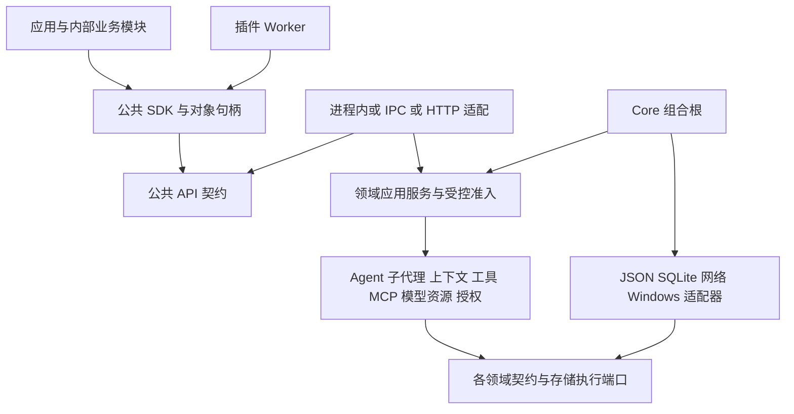

# 核心组件与插件公共 API 规划

Pudding 向应用、内部业务模块和插件提供一致的领域能力：获得 Agent，修改其配置，提交工作，观察结果，使用工作区与工具，并按权限扩展执行行为。调用方无需装配上下文、模型资源池、数据库、文件存储或内部执行服务。

本方案覆盖基础设施组件化、公共 API、通用功能插件三条交付线。插件既可提供 Agent 工具，也可增加软件功能、改变已声明的业务策略、响应跨组件事件；无需伪装成工具或依附一次模型调用。**基础设施和通用插件机制是 Goal 的实现前提；Goal 是上层消费者，不是为其临时绕过组件边界的理由。** 下文接口及新增能力为目标设计，不能视为已经发布；第 2 节保留最初规划的代码入口定位，实际接入状态需按源码与验收报告核对。

近期交付分为 **A 基础设施可独立使用、B 组合最小原型**，具体范围和放行证据见[两阶段目标](基础设施服务生命周期与最小原型两阶段目标-2026-11-07.md)。A 包含组件服务/API、所有权与实例生命周期、事件/订阅/Hook 的定义及实现；B 再用真实组件和两类插件证明可组合性。Goal 位于 B 之后。

## 1 设计决策

1. **按领域提供组件与服务**。配置、执行、上下文、工具、MCP、模型资源、授权分别维护自己的状态与不变量；公共 SDK 提供简洁的组合入口。
2. **一个业务事实只有一个写入者**。SDK、Web、插件、渠道和内部模块调用同一应用服务；更换 JSON、SQLite 或其他存储不改变领域 API。
3. **配置、运行状态、资源租约分开**。配置通过版本化更新；暂停、取消通过命令；池中的实例通过租约使用；运行结果由执行器提交。
4. **同一合同支持进程内和进程间调用**。可信组件可以使用接口与工厂；插件使用 Worker 中的 SDK 代理；外部应用使用认证客户端。接口相同，授权仍由服务端执行。
5. **组件化以独立构建和测试为准**。只有包装服务但仍引用整个 Runtime 的代码属于接入适配，不能标为组件抽取完成。
6. **插件扩展软件功能，领域组件维护事实与不变量**。插件可提供工具、业务服务实现、渠道适配、上下文贡献、策略、事件处理和受控界面贡献；用户取消、权限、预算和状态版本仍在统一准入与提交边界检查。
7. **任务推进由执行事件驱动**。心跳只负责巡检与恢复，不是正常任务继续运行的前提。
8. **扩展点归组件，功能归插件**。组件声明有版本的扩展端口、输入输出及应用规则，不引用具体插件；新增功能通过注册/订阅和受权服务组合完成，禁止为每个插件在其他模块新增名称判断或专用分支。

### 1.1 组件、功能插件与贡献项

组件是可独立构建、测试、复用的领域实现；插件是可安装、配置、激活、撤销的交付与扩展单元；贡献项是插件向宿主声明的某一种能力。一个插件可组合多个组件并注册多类贡献，也可以不提供任何 Agent 工具。官方随包功能与用户扩展遵守同一贡献合同，不因“内置”而获得隐式权限。

| 插件贡献 | 软件能力示例 | 组件消费方式 |
|---|---|---|
| Tool | 文件处理、领域检索、自动化动作 | 统一工具目录与派发端口 |
| Feature / Action | 工作区产物归档、报告导出、命令处理 | 通过有类型应用服务/命令端口受理，不要求先有 Agent 会话 |
| Provider / Policy | 分类或验收实现、检索排序、上下文选择、受权模型路由策略 | 领域组件在声明的 slot 选择实现，冻结版本后调用；不替换任意 DI 服务 |
| Event subscriber / Job | 配置变更后刷新索引、完成后生成审计记录、通知任务 | 已提交事实 → 受权订阅 → 幂等命令/持久 Job |
| Typed Hook | 对声明字段变换、增加业务约束、提供建议 | 输入/输出 schema、顺序、超时与错误语义由扩展点定义 |
| Connector | 消息渠道或外部业务连接器 | 领域消息/连接端口；统一身份、重连、回执与权限 |
| UI contribution | 功能面板、菜单、状态与诊断投影 | 后续版本通过 Web UI 注册点提供；不把业务迁入 Desktop Shell，不开放任意脚本注入 |

这些是通用插件系统的目标覆盖范围，不代表每种贡献现已实现。工具是其中一类，Goal 验收也是一个案例，二者都不能代表全部插件化完成。现有 `Pudding.ToolPlugins.*` 可作为包、Worker、授权和生命周期底座；是否调整命名在实现切片中单独决定，不机械重命名或新建平行插件管理器。

组件化不要求把所有基础设施都改成可热卸载插件。激活主管、强制授权、预算账本、持久提交与恢复规则保持稳定；业务实现经声明 slot 可选择或替换。增加新种类的扩展点时，允许其所属组件一次性增加通用端口与验收；后续插件实现该端口，不反复侵入其他组件。

本方案细化[插件方案](工具插件化架构与实施方案-2026-10-09.md)中的 Core API，并复用[生命周期注册点目录](Agent全生命周期Hook事件与动作注册点目录-2026-10-09.md)和 [ADR-098](../07_architecture/112ADR-098Core事件驱动与严格分层基础设施ADR.md)。事件持久化、扩展注册表和 Goal 状态均不得另建平行真源。

## 2 当前可复用基础与缺口

| 领域 | 当前权威入口 | 需要完成的工作 |
|---|---|---|
| 插件 | `Source/Pudding.ToolPlugins.Contracts/PluginContracts.cs`、`Source/Pudding.ToolPlugins.Runtime/PluginManager.cs` | 已有独立 Worker、工具和结果建议 Hook；Core API 只有工作区文本读取、资产读取、私有状态读写，不能直接创建 Agent 或启动验收 |
| Agent 配置 | `Source/PuddingPlatform/Services/WorkspaceAgentFileService.cs`、`AgentTemplateFileService.cs` | 单写入者已有基础；公开 DTO/接口仍与 Platform 文件服务交织，需要领域契约与存储端口 |
| Agent 会话 | `Source/PuddingRuntime/Services/AgentSessionManager.cs` | 运行会话与工作区配置不是同一对象；需要统一目录投影、句柄与工厂，避免把内存 Dictionary 作为公共 API |
| 子代理 | `Source/PuddingCore/Abstractions/ISubAgentManager.cs`、`ISubAgentPool.cs`、`Source/PuddingRuntime/Services/SubAgentInvocationService.cs` | 已有池和预算调度；请求仍要求 LlmConfig、LlmProfile、上下文快照等内部信息，应由服务入口解析 |
| 上下文 | `Source/PuddingRuntime/Services/ContextPipeline.cs`、`ContextWindowManager.cs` | 已有分层与容量策略；装配依赖记忆、技能和 Runtime 具体类型，需按输入端口与不可变贡献拆分 |
| MCP | `Source/PuddingPlatform/Services/Mcp/McpConnectionManager.cs` | 已有工作区连接与工具投影；连接管理同时依赖 EF、凭据和工具注册，需要连接组件与配置适配器分离 |
| 核心循环 | `Source/PuddingRuntime/Services/AgentExecutionService.cs` 及 Buffered/Streaming partial | 依赖范围大、两条路径收口不同；需要共同执行语义与端口，传输流式不决定业务状态 |
| 工具和授权 | `Source/PuddingRuntime/Tools/Platform/`、`Services/AgentFirewall.cs` | 注册、发现、授权、执行已有实现；公共入口和动态贡献必须共用同一准入管道 |
| 模型资源 | `Source/PuddingCore/Abstractions/ILlmResourcePoolService.cs`、`Source/PuddingPlatform/Services/LlmProviderFileService.cs` | 当前该接口只读取配置，不能当作调度池合同；配置目录、路由、执行配额与客户端连接须分开 |
| 持久工作与 Goal | `Source/PuddingCore/Platform/IConversationAcceptanceStore.cs`、`Source/PuddingPlatform/Services/Goals/` | 已有原子受理、Goal outbox 和结算；须统一内存 Gate、旧注入队列与持久 Goal 的责任，避免重复派发 |

`goal.md` 是 Agent 的目标便条，当前 `goal_update` 修改这个文件；它不等于修改持久 GoalRun。两种能力在公共目录中必须明确区分。

## 3 分层与依赖方向



图中箭头表示编译依赖；SDK 的实际请求由选定的传输适配处理。公共契约不能引用 SDK；组件不能引用其宿主、Controller 或传输实现。Host 装配服务和管理生命周期，业务状态转换留在领域组件中。

### 3.1 公共层与内部端口

拟新增 `Pudding.Api.Contracts`，只含 BCL 类型、外部 DTO、命令/查询合同和稳定错误；`Pudding.Api.Sdk` 只引用这份契约，提供 `PuddingClient`、`Workspace`、`Agent`、`WorkHandle` 等便利对象。宿主适配器将这些合同映射到领域服务。

公共 DTO 是面向调用方的投影；内部 Kernel/Context/Model 合同是组件协作端口。两者可有不同结构，但不得各自维护状态。API 投影中的 Agent 配置必须来自配置服务；模型目录必须来自模型配置组件；运行状态必须来自运行账本。

不把现有 `PuddingCore` 整包作为 SDK 引用。它包含业务类型、分词器、执行依赖等；也不把现有 `PuddingRuntime` 改名后称为独立内核。

### 3.2 使用既有宿主与独立装配

- 产品内模块通过显式注入得到作用域 API 或领域服务，不查找全局 ServiceProvider。
- 插件从宿主颁发的 `IPluginContext` 得到作用域 SDK，不能选择调用者身份。
- 外部应用通过 `PuddingClient.ConnectAsync` 连接已存在的 Core；创建 Agent 不自动启动第二个 Core。
- 可复用组件提供 `CreateAsync` 工厂与显式 Options/Ports；完整独立环境由后期 `PuddingEnvironmentBuilder` 装配，支持内存或自有存储，不要求 WinUI、Web 或 ASP.NET。
- 独立环境必须有自己的存储所有权。不能与产品实例同时占用同一 DataRoot；沿用目录租约，不能删除锁绕过。

同步 `new Agent(...)` 如有提供，只构造已绑定服务与引用的句柄，不执行 I/O；真正创建配置、会话和资源使用异步工厂。工厂也提供获取既有实例的操作，避免每次获取都创建新 Agent。

## 4 对象模型与所有权

本节对象模型由[两阶段目标](基础设施服务生命周期与最小原型两阶段目标-2026-11-07.md) §2～§5 的组件合同卡、实例所有权、生命周期转换、事件及 Hook 合同补全。定义必须能对应真实代码与测试；服务绑定、持久对象、执行租约和不可变快照不能混为一种可启动/停止的实例。

| 对象 | 身份和用途 | 谁持有与释放 |
|---|---|---|
| Workspace | 工作区定义、允许访问的资源与 Agent 集合 | 工作区服务；普通句柄释放不删除工作区 |
| AgentDefinition | Agent 的持久配置与模板绑定 | Agent 配置服务；创建、更新、归档都是命令 |
| AgentSession | Agent 在一个会话中的上下文和执行生命周期 | 会话目录与 Session coordinator |
| Work | 调用方提交的一次工作及总预算，可以包含多次执行 | 持久工作服务；完成不能以一次 idle 判断 |
| Run 和 Turn | 一次执行及受理输入的因果身份 | 执行内核与现有 canonical Turn 账本，适配时显式映射 |
| Goal | Work 的持续推进策略与目标状态 | 唯一 Goal 服务；不由 SDK 或插件保存影子状态 |
| SubAgent | 带父 Work 身份和权限继承的 Agent 句柄 | 委派服务；复用会话必须持独占 lease |
| ModelLease | 有截止时间的模型并发和额度预留 | 模型调度器；不能把凭据或 provider 客户端交给插件 |
| PluginActivation | 插件某次加载、注册、授权与资源所有权 | 插件管理器；代际变化使旧授权和旧贡献失效 |

同一持久 Agent 可以拥有多个会话。公共目录显式区分“已配置 Agent”“活跃会话”“池中可复用实例”。每个句柄包含稳定引用与观察到的版本，方法调用时仍重新核对授权和存在性。

借用句柄的 `DisposeAsync` 只关闭订阅或归还 lease；停止、销毁、取消必须显式调用。工厂创建的临时子代理由父 Work 管理；插件卸载撤销它持有的租约，未授权脱离父任务的工作不得成为孤儿。持久 Work 的后台所有权转移必须是单独受理的操作。

## 5 公共能力目录

下列方法名用于说明语义，P0 合同切片中冻结具体签名。所有接口都支持 CancellationToken，并按第 6 节约定返回分页、版本、回执或句柄。

| 能力入口 | 首批操作 | 有意保留的边界 |
|---|---|---|
| `Capabilities` | Discover、GetLimits、GetEffectiveGrants | 返回支持/授权/当前可用三种状态及原因；不自动授予权限 |
| `Environment` | GetSnapshot | OS/架构/运行时/时区/路径语义/环境指纹；无原始环境变量、Token、私钥 |
| `Workspaces` | List、Open、GetConfiguration | 只枚举有权访问的工作区；创建/迁移工作区是独立管理能力 |
| `Agents` | List、Get、Create、Archive | 返回配置或会话的明确投影；Create 不自动调用模型 |
| `Agent.Configuration` | Get、GetResolved、Validate、Update | 类型化补丁、配置归属、版本冲突与生效时机 |
| `Agent.Work` | Submit、StartGoal、Get、Observe、Cancel | 回执与执行结果分开；持续目标不以首轮回复终结 |
| `Delegation` | Spawn、GetChild、ListChildren、AcquireReusable、Release | 父身份由服务端绑定；权限和预算只能继承或缩小 |
| `Context` | GetSnapshot、ReadSection、AddContribution、RequestCompaction | 快照不可变；贡献有来源和寿命，不允许改系统权限或伪造用户消息 |
| `Tools` | Discover、Describe、Invoke | 使用同一授权/审批/结果管道；动态工具带绑定代号 |
| `Mcp` | ListConnections、GetStatus、ListTools | MCP 工具执行统一走 Tools；连接配置和重连属于单独授权管理命令 |
| `Models` | ListProfiles、Describe、GetAvailability、Generate | Generate 仍走路由、预算、授权和审计；不暴露原始客户端或凭据 |
| `Workspace.Files` | List、Read、Stat、ApplyPatch | 相对路径/受控资源引用、分页、内容哈希和冲突回执；删除与批量移动后续单列 |
| `Artifacts` | Publish、List、Read、GetEvidence | 大内容引用化，绑定 Work 与内容版本；引用本身不代表已验证 |
| `Events` | Subscribe、ReadSince、Ack | 可靠事实流与可丢弃实时增量分开；有游标和积压上限 |
| `State` | Read、CompareExchange | 插件私有、带版本；不提供全局数据库查询 |
| `Authorization` | Inspect、RequestGrant、ReadApproval | 调用方不能批准自己的请求；审批等待不占用模型并发槽 |
| `Reviews` | Submit、Get、SubmitFinding | 验收建议绑定交付版本；Goal 状态仍由结算服务提交 |

目录不是全能接口：插件 manifest 声明所需 capability，服务端按调用者授权和资源范围取交集。SDK 提供同样的语义，当前未实现项返回 `capability.unsupported`，不得返回空数组冒充成功。

## 6 通用请求和回执契约

### 6.1 身份与命令元数据

受信入口冻结 `WorkspaceId / AgentId / SessionId / WorkId / RunId / ActorId / AuthorityId`，插件调用另有 `PluginId / ActivationId / Generation`。调用方可指定被操作的资源引用，不能通过请求体改写调用者身份。

命令携带 `OperationId`、目标引用、可选 `ExpectedRevision` 和客户端截止时间。服务端计算最终截止时间与预算，不能大于父 Work 的剩余许可。SDK 为新命令生成 OperationId，重试复用同一值；相同身份和 ID 的不同载荷返回 `operation.conflict`。

TraceId 用于观测，不构成授权。模型自主启动 Goal、事件消费者和插件后台任务都保留最初授权来源；重新创建 Goal、重连客户端或换子代理不得重置上层预算。

### 6.2 查询与命令结果

- 查询返回类型化快照、`Revision`、`ObservedAt`；目录另含 `Items / NextCursor / Complete`。部分扫描不能证明未返回对象不存在。
- 命令的 `Accepted` 只表示持久受理，返回 OperationId、关联 Work/Run/Message ID 和查询入口。
- 操作状态与业务结果分开：受理成功后仍可能审批拒绝、执行失败、等待或取消。
- `WorkOutcome` 携带状态、交付引用、用量和证据；`Verification` 单独标明 NotRequested、ModelAssessed、CheckVerified、HumanAccepted 或 Unknown。
- 大载荷返回 ArtifactRef、完整性哈希与截断说明；失败输出也必须能通过证据引用读取。

稳定错误至少覆盖 `permission.denied`、`approval.required`、`revision.conflict`、`resource.not_found`、`resource.busy`、`lease.expired`、`capability.unsupported`、`budget.exhausted`、`deadline.exceeded`、`owner.unloaded`、`operation.unknown`。错误包含 Stage、ErrorId、Retryable、EffectOutcome；超时后若无法证明副作用未发生，返回 unknown，并用同一 OperationId 查询，不能盲目重发。

`CancellationToken` 取消客户端等待不等于取消已经受理的持久 Work；后者必须发 `CancelAsync` 并读取确认。服务关闭、父任务取消和插件卸载则按资源所有权规则级联。两种取消语义须在 SDK 方法文档中逐项声明。

## 7 配置服务与属性边界

### 7.1 领域服务隐藏存储

`Agent.Configuration` 是配置应用服务的便捷门面。后台由 `IAgentConfigurationService` 校验领域规则，经 `IAgentConfigurationStore` 读写；File/SQLite 实现位于外层适配器。内部模块也调用该服务，不直接改 manifest.json 或数据库行。

配置读取得到值和版本；修改使用类型化 `AgentConfigurationPatch`，明确区分字段未提供、设值与清空。未知字段、不可写字段和非法组合明确拒绝。状态、身份、预算消费数、运行结果不是配置字段。

读取返回不可变快照，不返回带自动持久化副作用的实体。插件自定义配置放在 `PluginId` 命名空间中，按声明的 schema 和版本校验；它不能用扩展字段覆盖系统属性。多个字段的原子更新限定在一个配置聚合内，跨 Agent、模板或授权的修改需显式工作流，不能伪装成一次全局 Save。

以下示例表达期望用法，省略类型定义：

```csharp
var workspace = await pudding.Workspaces.OpenAsync(workspaceRef, ct);
var agent = await workspace.Agents.GetAsync(agentId, ct);
var before = await agent.Configuration.GetAsync(ct);

var change = await agent.Configuration.UpdateAsync(
    new AgentConfigurationPatch { DisplayName = "交付验收助手" },
    new UpdateOptions
    {
        ExpectedRevision = before.Revision,
        OperationId = operationId
    }, ct);

// change 区分已保存、已应用和等待下次执行；调用方不接触存储格式。
```

领域更新的处理次序固定：解析身份 → 授权 → 校验补丁和归属 → CAS 写入 → 持久化变更事件 → 通知运行目录应用 → 返回变更回执。失效通知可重投，恢复时按配置版本对账。

### 7.2 配置归属和生效时机

| 类别 | 写入入口 | 默认生效语义 |
|---|---|---|
| 名称、头像等展示配置 | Agent 配置 | 持久化后更新投影；不重启执行 |
| 模板种子、实例模型路由、上下文策略 | 各自拥有者的配置服务 | 实例变更在下一次 Run 冻结新快照；修改模板不隐式重写已创建实例 |
| Agent 模板绑定 | Agent 显式 Rebind 命令 | 下一次 Run；不悄悄修改被其他 Agent 共享的模板 |
| 权限收紧、冻结、取消 | 授权或运行控制命令 | 下一动作准入立即检查；必要时取消在途工作 |
| 增加权限或预算 | 受授权的变更命令 | 通过审批/授权后生效；模型不能自批 |
| 正在运行、已完成等状态 | 执行状态机 | 只读；没有通用 setter |
| 池容量、连接重建等资源配置 | 资源管理服务 | 声明 drain/重建需求，不隐式重启产品 |

当前实际写入路径与旧注释不同：模板在创建时种子化实例，`AgentInstanceManifest` 保存实例的 provider/model；`AgentRuntimeProfileResolver.ResolveConsciousLlm` 从实例解析主模型。首批配置 API 仅开放名称和描述，保持现有模型归属；后续模型配置接口必须明确实例配置、模板种子和服务商目录的区别，不能修改一个 Agent 时连带修改共享模板。`GetResolved` 的后续设计应展示这些真实来源与版本。

`ConfigurationChangeReceipt` 包含 `PreviousRevision / PersistedRevision / AppliedRevision / EffectTiming / PendingReason`。保存成功但运行投影尚未应用时不返回“已生效”。敏感值使用 CredentialRef；普通读取不返回明文，更新日志只记录字段名和脱敏差异。

`AppliedRevision` 必须标明目标投影，不能把“目录已刷新”理解为“所有在途 Run 已换配置”。每个 Run 单独记录实际使用的配置版本；返回 `NextRun` 时明确说明当前 Run 仍使用旧快照。

### 7.3 存储适配器一致性

同一 Agent 配置只有一个活动 Store。File 实现需要原子替换、版本检查与可恢复变更记录；SQLite 实现使用事务。状态更新与待投递变更事实必须具有恢复协议，不能采用“先写文件，再随缘发内存事件”。若文件后端暂时达不到保证，应拒绝声称具备该能力，先以配置服务封装现有单写入者，再交付持久性改造。

两个适配器复用合同一致性测试，覆盖冲突、重复命令、进程中断与恢复。配置迁移是显式维护操作，不在普通 getter 中双读双写，不引入长期兼容分支。

## 8 Agent 工厂与工作提交

公共对象表达用户需要的能力：聊天、交付任务、持续目标分别有明确请求语义。接口不要求调用方传 LlmConfig、内部 SessionRecord、SSE 对象或预算池实现。

```csharp
var agent = await workspace.Agents.CreateAsync(new AgentSpec
{
    Template = "general-assistant",
    DisplayName = "项目助手"
}, commandOptions, ct);

var work = await agent.Work.SubmitAsync(new WorkRequest
{
    Input = "完成需求并核对交付",
    Mode = WorkMode.Goal,
    ReviewPolicy = "delivery-review"
}, commandOptionsForWork, ct);

await foreach (var change in work.ObserveAsync(cursor, ct))
    Render(change);
```

`SubmitAsync` 返回已受理的 Work 句柄，不等待完整模型执行。调用方可以查询、订阅，或调用 `WaitForOutcomeAsync` 等到完成、需要用户输入、暂停、预算耗尽等稳定结果；返回值明确 `IsTerminal`，等待子代理不被误报为完成。Goal 跨轮保持同一 GoalRun 预算根，各 Work/Run 经显式关系归属该根；不改写既有单轮 WorkId 语义，也不以新轮次重置额度。

消息发送与执行提交分开：通信回执确认 Message 已受理/投递，Work 回执确认执行被受理。不能把“目标 Agent 的最后一条回复”当成当前调用的结果；结果按 MessageId、TurnId、WorkId 的因果映射关联。

复用子代理通过 `AcquireReusableAsync` 获得排他 lease；在租约失效后调用返回 typed error。权限、配置版本、模型路由或上下文隔离域不兼容的实例不能复用。默认重置前一次任务的私有执行上下文；显式 ContinueChild 才承接旧会话，并沿用同一上层预算权威。

## 9 核心组件划分

下表是抽取目标，候选工程不代表已经存在；按域逐项交付，不能一次机械搬空 Runtime。每个领域拥有自己的 Contracts，公共 API 通过适配器映射它们，避免一个不断膨胀的全局 contracts 项目。

| 组件及候选工程 | 对外核心端口 | 抽取来源与职责 |
|---|---|---|
| `PuddingAgentConfiguration` | IAgentConfigurationService、IAgentConfigurationStore、ITemplateCatalog | WorkspaceAgentFileService / AgentTemplateFileService；配置规则、归属、版本与生效；文件和 EF 适配器留外层 |
| `PuddingAgentSessions` | IAgentDirectory、IAgentFactory、IAgentSessionService | AgentSessionManager / WorkspaceAgent 目录；配置与活跃会话投影、创建/获取、生命周期 |
| `PuddingDelegation` | IDelegationService、ISubAgentPool、ISubAgentRunStore | SubAgentManager / Pool / InvocationService；父子关系、任务归属、预算继承、复用与级联取消 |
| `PuddingContext` | IContextAssembler、IContextSnapshotReader、IContextContributor、ICompactionCoordinator | ContextPipeline / WindowManager；继续复用已有 ContextPolicy、Pruning、Handoff、Tokenization 组件 |
| `PuddingAgentKernel` | IAgentExecutionBody、IContextPort、IModelPort、IToolPort、IRunCommitPort | AgentExecutionService；循环与状态收口，Buffered/Streaming 消费同一事实；复用既有 Kernel.Contracts 提案 |
| `PuddingTools` | IToolCatalog、IToolInvoker、IToolContributionRegistry | PuddingToolRegistry / Schema / ExecutionService；MCP、内建工具、插件统一发现和执行 |
| `PuddingMcp` | IMcpConnectionService、IMcpSessionLease、IMcpConfigurationSource | McpConnectionManager；网络/子进程连接、协商、工具投影与重连；不引用 EF 或 Host |
| `PuddingModels` | IModelCatalog、IModelRouter、IModelScheduler、IModelInvoker | LlmProviderFileService、Runtime LLM clients、Gateway 接缝；配置、路由、额度/并发租约与调用各有清晰职责 |
| `PuddingAuthorization` | IAuthorizationService、IApprovalService、ICapabilityGrantStore | AgentFirewall / ToolPermissionPolicy / Approval；纯判定、审批工作流、授权持久化分层 |
| `PuddingWorkspace` | IWorkspaceCatalog、IWorkspaceFileService、IArtifactStore | 工作区与制成品现有入口；资源身份、路径、内容版本、受控修改 |
| `PuddingEventing`、`PuddingInvocationPipeline` | 可靠事件端口、扩展目录、类型化 Hook 端口 | 延续 ADR-098 与生命周期方案；不另建插件事件总线 |
| Goal 与验收模块 | IGoalService、IGoalContinuationPolicy、ICompletionReviewer | 复用持久 GoalRun/Outbox/Settlement；插件只实现可替换策略 |

核心循环只依赖内层 Ports，不直接引用 MCP SDK、具体模型协议、EF、Windows UI、HTTP Controller 或插件 DLL。编译器允许的依赖闭包由 csproj 白名单和负向构建探针约束。

上下文贡献器从各自服务读取事实后生成有来源的不可变片段，Context 不反向引用 Memory/Skill/Workspace 业务实现。完整历史、压缩提交和资源路由留在相应领域；SDK 只暴露受控选择和状态。

模型配置目录提供 Profile 和能力；路由器选择配置快照；调度器持并发/额度租约；Invoker 调用协议适配器并计费。排队、审批、等待子代理和等待用户时释放模型执行槽。令牌、成本、墙钟和并发上限由父 Work 传递，子代理、验收和压缩的用量都必须有明确记账归属。

首批池枚举返回脱敏描述、状态、剩余额度和观察时间，不能返回连接对象、Semaphore、SDK Client 或 API Key。列出 idle 不代表已经租到实例，实际使用仍经过原子 Acquire。

## 10 Hook 事件与策略的执行合同

沿用生命周期目录中的 Observer、Guard、Transform、Around、Action 分类。已有 `IAgentLoopHook` 保持建议层容错；新控制型策略使用独立合同，不把其异常语义偷偷改为审批。

| 种类 | 调用时机与返回 | 故障处理 |
|---|---|---|
| Observer | 已提交事实，只读通知 | 独立重试/死信；不改变已经发生的结果 |
| Transform | 允许变换的字段与原始快照，返回新值 | 可选装饰失败保留原值；受影响动作重新校验 schema 和权限 |
| Guard | 提交动作前返回 Allow/Deny/NeedsApproval/Defer | 系统授权先执行；业务插件只能进一步约束，不能放宽系统拒绝 |
| Review/Continuation policy | 提交交付后、目标结算前返回结构化意见 | 必需项失败为待验收/未知；可选项明确记录 skipped |
| Action handler | 受理后执行有权命令 | 返回真实副作用和结果；不能自行发布其他模块的完成事件 |
| Provider / Policy slot | 提供声明能力的一种实现或决策，不限于 Agent 执行 | 宿主显式选择实现；必需能力缺失返回 unavailable/等待，可选能力仅按预先声明的默认策略回退 |

注册项固定 pointId、contractVersion、owner、scope、order、timeout、required、failurePolicy。顺序与冲突规则复用生命周期目录；不是运行时“最后返回者覆盖前一个”。一次操作读取冻结的注册快照，最终提交前重验授权、资源版本和卸载 fence。

可靠事件包含 EventId、StreamId、Sequence、SchemaVersion、CausationId、Scope、OwnerGeneration 和 PayloadRef。服务状态与 outbox 同事务/恢复协议提交；消费者至少一次投递，使用独立 checkpoint 与 DeliveryId 去重。实时 token delta 可以丢失，不能承载必须完成的验收工作。

依赖事件触发的写入要么把消费确认与命令受理放在同一事务，要么使用可恢复的幂等交接。外部副作用不能宣称 exactly-once；不确定时保留 unknown 与原始回执。

### 10.1 使用服务与提供能力是两种权限

公共 API 用于消费已有能力，扩展注册端口用于提供能力，二者分开授权。例如允许调用分类器，不等于允许替换全工作区的分类策略；允许读取事件，不等于允许向 canonical 日志写入完成事实。插件通过应用服务提交命令，业务组件仍是唯一事实写入者。

可替换策略的 slot 声明允许单选或组合、适用 scope、默认实现、选择权威及失效处理。单选由配置/授权快照确定，多实现冲突须拒绝或返回明确选择结果，不能最后注册者胜出。插件不能自行声明为全局必需项；required、failurePolicy、优先级和生效范围须受宿主策略验证。Around 仅在明确授权、可验证“最多调用下一步一次”的端口开放，不提供任意方法拦截。

Hook 不替代所有调用：需要立即结果或同事务约束时用类型化服务/同步策略端口，已提交事实的跨模块协作用事件，耗时任务用持久 Job。不得用事件拼装隐式同步调用链，也不得在持有数据库事务时等待插件 RPC。建议型 `IAgentLoopHook` 继续异常隔离，控制型 Guard 使用独立端口；注册扩展不改变现有 Hook 的容错语义。

### 10.2 非 Agent 功能的作用域与生命周期

Activation 可以绑定受权的应用、Workspace、Agent、Session 或 Work 范围，身份由宿主选择对应类型。工作区级事件插件无需虚构 AgentId/SessionId；付费模型和长任务仍需另行取得有预算的执行/Job 作用域。新增 scope 类型需要主代理修订可编译协议和 grant 校验，旧协议不支持时明确拒绝，不填默认 Agent 绕过。

插件声明贡献种类、所需服务/版本、依赖与可配置项。加载验证依赖、schema 和 grant，初始化成功后原子发布全部注册；任一必需贡献失败，撤销本次发布与资源。卸载同时撤销工具、订阅、策略、命令和 UI 贡献的新准入；已有调用按冻结版本排空，迟到结果仍受 generation 检查。依赖插件被卸载时先处理依赖者，不能留下指向不存在 provider 的活动句柄。

组件只记录扩展点和标准处理规则；观测记录包括 PluginId/ActivationId/Generation、PointId、所选策略版本、前后值 hash、效果和因果链。级联事件带 CausationId，避免订阅自身输出无限触发；跨模块写入有稳定 OperationId。插件私有状态不是业务数据库的第二份真源。

## 11 Goal 验收插件作为纵向案例

Goal 参考用户指定的 `F:\github\deepseek\deepseek-harness`。该参考的 `packages/goal/goal`、`tool-goal`、`command-goal`、`goal-round-driver` 将状态服务、模型工具、人类命令和自动续跑分开；driver 源码声明注入 agents/goals/sessions 服务。Pudding 借鉴这一分工及版本围栏，使用自己的 canonical 受理、预算、取消和事务机制，不复制另一套状态机。参考分析见[Goal 实现解剖](../19_references/deepseek-harness-goal-mode-解剖-2026-11-01.md)。

Goal 策略、driver 和评审贡献必须消费已成立的基础设施与扩展端口。可先独立开发纯策略，但完整 Goal 闭环的接入放行要求：Agent/Work 服务、预算/取消、持久事件/Job、真实插件注册与卸载已通过对应验收，并有一个不提供工具的功能插件证明通用性。不能靠 Goal 专用回调或直接调用 Runtime 内部对象跳过这些前置。

WorkMode 分为 Chat、Task、Goal。Chat 默认不验收、不自动推进；Task 根据策略有界修正；Goal 在用户授权的范围和预算内持续推进。用户设置优先；允许自动进入时，模型只能基于当前受信请求申请，Core 记录原因、目标、预算与验收政策。

Chat 仍运行正常的一轮模型与工具循环，直到回答本轮请求；这里“不自动推进”仅指不因为终轮事件再启动一轮 Goal 工作。任务模式的选择也不能代替工具副作用的授权。


质询器读取目标、验收条件、交付版本、实际工具/检查证据及必要上下文引用。默认不复制整段聊天，不允许写被验收内容，不再触发同一验收策略；需要执行检查时使用受授权检查能力，输出放隔离区域。

意见词表固定为 Satisfied、NeedsWork、NeedsUser、Inconclusive，并附 CriterionId、EvidenceRefs、缺口和建议动作。小模型的 Satisfied 只能形成模型评估事实；必需测试失败、用户取消、权限撤销或剩余预算不足均不能被它覆盖。

ReviewId 绑定 WorkId、GoalRevision、IterationId、交付指纹和 PolicyVersion。新输入改变目标或文件版本后，旧意见作废。重试同一验收 Job 不重复创建子代理，不以改写 Objective 的方式清零停滞计数或预算。

本案例会经过 Agent、Delegation、Context、Models、Authorization、Workspace、Artifacts、Events 与 Goal 的公共端口。验收插件不得引用 Runtime/Platform，不能自行组装内部请求快照。

## 12 插件执行环境与协议演进

现有工具插件的 Core 回调仅在 execute 租约内开放；建议 Hook 限时 3 秒且禁止 Core 回调。这个合同不能直接承载长时间质询器调用。

新的运行环境增加可声明的 Agent/配置/事件/验收能力及后台工作所有权。短 Hook 只返回决定或提交持久工作回执；长验收交给 Job 调度，完成后再投递结果。协议必须让取消、卸载与心跳诊断不被长业务请求阻塞；第一片先支持异步 Submit/Get/Observe，不在单条串行 RPC 内等待任意子代理完成。

如果子代理又需要调用正在等待它的同一个单并发插件，必须在准入时识别依赖环并返回明确原因，不能无限等待。后续支持可重入执行需要单独合同和并发验证，不能通过增大超时掩盖。

加载先验证 API/协议版本、capability 和贡献类型，再原子发布注册。卸载先停止新准入、撤销 generation，再取消/回收所属订阅、Job、子代理租约与 Worker；清理使用独立 deadline。无法确认退出时记录 StopFailed；必需验收仍保持未满足，不因插件消失而自动完成。

插件升级使用不可变包和新 activation，旧回执不得完成新世代的工作。公共 API 版本、插件 SDK/manifest 版本、wire 版本分别声明并协商；不兼容组合在初始化前拒绝。P0 输出具体版本变更清单，开发阶段不维持双套隐式兼容实现。

Worker 仍以当前 Windows 用户运行。API 权限和进程隔离约束合作插件的调用路径与故障回收，不能阻止任意原生代码直接访问同用户 OS 资源；只能加载可信代码。公共接口不得把这种进程边界描述为恶意代码沙箱。

## 13 实施切片与交付顺序

每个新增组件先走独立 S1–S4，之后才接入解决方案和宿主 DI。抽取和改变业务语义分成不同切片；接口适配用于明确边界，不能长期保留两份业务实现。

P0～P5 是 A 的工作分解，不能把某个局部消费示例当作 A 已完成。A 放行后单独交付 B：在隔离环境以真实组件、脚本模型、工具插件和非工具功能插件完成最小闭环；P6 Goal 接线在 B 后。独立组件的真实适配测试允许在 A 内开展，不要求等到 B 才发现接口无法使用。

P0/P1 配置切片的固定调用面、窄补丁范围与可独立派发工作见 [DeepSeek 施工任务书](Agent配置API-P0P1-DeepSeek施工任务书-2026-11-05.md)。总规划中的示例表达目标语义；施工以该任务书及真实接口为准，不把尚未开放的能力当作现有 API。

| 切片 | 交付范围 | 退出条件 |
|---|---|---|
| P0 契约与现状冻结 | 对象/权限/回执、配置归属、已有消费者清单、扩展点与版本清单 | 形成可编译 Contracts 和示例消费者；契约不引用 Host/Runtime/Platform；所有未实现能力显式标记 |
| P1 配置与环境 | Agent 配置组件、工作区/环境只读目录、SDK Get/Update 与工厂入口 | 无宿主的存储一致性测试通过；外部消费者不知 JSON/DB；冲突和保存未生效可取红；S5 后 Web 与 SDK 共用写入者 |
| P2 模型资源与授权 | 配置目录/路由/调度端口、资源租约、授权与审批合同 | 无凭据泄漏、并发上限与队列取消有效；直接调用与 Agent 调用统一预算和授权 |
| P3 工具 MCP 上下文 | 工具组件、MCP 连接组件、上下文装配端口 | MCP/插件/内建工具共用准入；上下文无宿主依赖；异步结果与取消协议一致 |
| P4 Agent 执行与子代理 | 核心循环端口化、工厂/目录/工作回执、子代理池与 SDK | 普通应用仅引用 SDK 即可创建或获取 Agent 并完成工作；两条执行路径等价；复用与级联取消可验证 |
| P5 通用功能插件与可靠事件 | 注册代际、工具/功能/策略贡献、持久 Job、跨模块事件；先交付一个非 Agent 功能插件 | 不声明工具、不创建 Agent 会话仍能扩展软件；加载/卸载有效；事件幂等；冻结策略与故障处理可取红 |
| P6 Goal 验收插件 | 唯一 Goal 状态源、质询器、策略切换和管理投影 | 故意半交付 → 质询 → 自动补齐；普通聊天零验收；用户停止不复燃；所有首批组件确已抽取 |

P1 可先在消费方用现有执行服务的适配器演示提交接口，但 P4 完成前不能声称核心循环已经组件化。每个组件登记三个独立状态：ContractReady、FacadeConnected、ComponentExtracted；最终还需 ProductVerified。文档、命名空间或类数量不作为完成判据。

P5 的独立内核与非付费事件示例可在所需公共端口稳定后开发；P6 的完整集成必须等待 A 基础设施及 B 最小组合原型门禁。后续 UI/渠道等扩展类型可逐类实现，不要求所有插件类型齐备才启动任何开发，也不以未开发类型为由省略 Goal 所依赖的生命周期和授权。

**Agent 配置与 SDK 是 A 的单组件交付切片**：一个外部示例在隔离环境获取 Agent、读取配置、CAS 改名称、读取生效状态、观察变更事件；重复同一命令不会再改一次，旧版本更新明确冲突。它验证存储透明性与现有单写入者约束，不代替 B 的跨域原型。

### 13.1 首批文件落点

以下路径均为拟新增或后续调整，不表示工程已存在；S1–S4 不登记宿主依赖。

| 路径 | 首批内容 |
|---|---|
| `Source/Pudding.Api.Contracts/Agents/` | AgentRef、AgentConfigurationSnapshot、类型化补丁、配置查询/更新接口 |
| `Source/Pudding.Api.Contracts/Operations/` | CommandOptions、变更回执、稳定错误、作用域和版本值对象 |
| `Source/Pudding.Api.Sdk/` | PuddingClient、Workspace、Agent 与 Configuration 门面；不维护第二份配置状态 |
| `Source/PuddingAgentConfiguration.Contracts/` | 配置领域模型、Store 与变更发布端口；不引用公共 SDK |
| `Source/PuddingAgentConfiguration/` | 更新规则、版本冲突、字段归属、幂等命令和生效计划 |
| `Tests/PuddingAgentConfiguration.Tests/` | 领域测试、File/SQLite 适配器共用合同测试与中断恢复测试 |
| `Tests/Pudding.Api.ContractTests/` | 消费者编译探针、SDK/传输合同一致性、权限与错误投影 |
| `Samples/AgentConfigurationClient/` | 只依赖 SDK 的获取、读取、改名与回执观察示例 |
| `Source/PuddingPlatform/Services/WorkspaceAgentFileService.cs` | S5 才改为配置组件的消费者/文件适配接缝；既有 Web 调用不另建写入路径 |

存储适配器与配置组件分程序集；具体适配器名称在 P0 消费者清单中按现有代码归属确定。公共传输端点、认证映射和 DI 只在宿主装配层加入；HTTP 请求和插件 RPC 必须共享配置服务，而不是各自实现 Update。

## 14 必须能取红的验收

| 场景 | 成功判据与负向对照 |
|---|---|
| 编译边界 | 示例只引用公开 SDK；注入反向 Host/Runtime 引用必须编译失败 |
| 存储透明 | File/SQLite 合同一致；并发旧 revision 必须冲突，不能最后写覆盖 |
| 配置发布 | Persisted 与 Applied 分开；阻断投影消费时保持 pending，恢复后只应用一次 |
| 模板归属 | 单 Agent 编辑不能隐式修改共享模板；越权更新被拒绝 |
| 实例枚举 | 分页与 partial 明确；查询后 lease 被抢占，Acquire 返回 busy |
| 身份隔离 | 伪造 Workspace/Agent/Actor 或旧 activation 无法扩大访问范围 |
| 调用因果 | 同会话两条并发输入，回执分别对应自己的 Work，不能返回“最后一条回复” |
| 资源池 | 活跃调用不超上限；排队取消释放等待；重复租约释放不导致超发 |
| 权限变化 | 工具曝光后撤权，实际执行仍被拒绝；插件不能自行批准权限申请 |
| 目录执行统一 | MCP/插件工具不能绕过同一审批和副作用回执链 |
| 零工具功能插件 | 无 Tool 贡献、无 Agent 会话，Workspace 产物事件仍触发归档/审计功能；不得通过假工具或隐藏模型调用实现 |
| 跨模块扩展 | 发布方只发标准事实；插件调用既有受权服务，新增第二个实现无需修改发布/消费模块的业务分支 |
| 策略替换 | 相同输入可由显式选择的两个策略产生不同合法结果；冲突、必需策略缺失、非法输出均有确定行为 |
| 完整卸载 | 工具、事件、策略、命令等全部撤销；旧回调/句柄不能提交，reload 不继承旧授权 |
| 功能可见性 | 没有聊天会话时仍可查询插件状态、注册贡献、Job、失败及归属；不能只在聊天工具卡上显示 |
| 上下文 | 子代理不会继承未授权工作区资料；压缩后保留目标和证据引用，贡献不能篡改身份 |
| 两种执行模式 | 相同脚本模型在 Buffered/Streaming 下产生等价状态、工具事实与预算 |
| 事件恢复 | 提交后消费前崩溃，恢复恰好受理一个幂等工作；不能只看入队成功 |
| Goal 续跑 | 第一轮故意漏交付，自动产生第二轮；禁用 driver 后该测试失败 |
| 普通聊天 | 不启动质询器；不能凭“使用了工具”自动升级 Goal |
| 过期验收 | 交付/目标变化后的旧 Satisfied 不能完成新目标 |
| 失败与卸载 | 必需质询器失败/超时/卸载不标成功；停止后无孤儿子代理和复燃续跑 |
| 预算 | 子代理、验收和重建 Goal 不重置根预算；预算耗尽留下部分成果与明确状态 |

组件测试使用 fake ports 和脚本模型验证确定性行为；集成测试使用真实 Worker、存储和调度。产品验收再验证真实模型、公开 API 与前端状态。修改运行库或迁移命名空间后，按仓库规程补全解决方案构建，不能只构建主入口。

## 15 首版边界与参考

首版默认连接现有 Core；独立完整环境在核心组件抽取完成后交付。默认 Chat 不验收；持续 Goal 的自动进入由用户/Agent 配置显式启用，并受每次 Work 授权范围限制。必需验收失败保留待处理状态，暂停与停止以用户命令为最高优先级。

暂不交付任意服务替换、无约束全局事件订阅、任意历史篡改、凭据读取或浏览器前端代码动态注入。扩展接口按具体业务需求逐项增加，不提供反射内部对象的通用 Escape Hatch。

参考本地 `F:\github\deepseek\deepseek-harness`，核对版本 `22ddee3792`：`packages/goal/goal-round-driver/src/index.ts` 的预约/准入/持久检查点、人类输入优先与子代理等待；`packages/goal/tool-goal/src/authority.ts` 的调用来源校验；`packages/sdk/client/` 的客户端与运行时分离。Pudding 保留自己已有的 canonical 受理、持久 Goal 与资源边界，不移植 Cordis 实现。

架构相关入口：[组件交付规程](../10_conventions/组件化交付规程.md)、[生命周期代码设计](Agent生命周期与Hook管道代码设计-2026-10-09.md)、[Core 事件基础设施](Core事件驱动基础设施施工与代码设计-2026-10-18.md)、[当前运行时插件使用说明](../04_tools_and_skills/运行时工具插件.md)。
