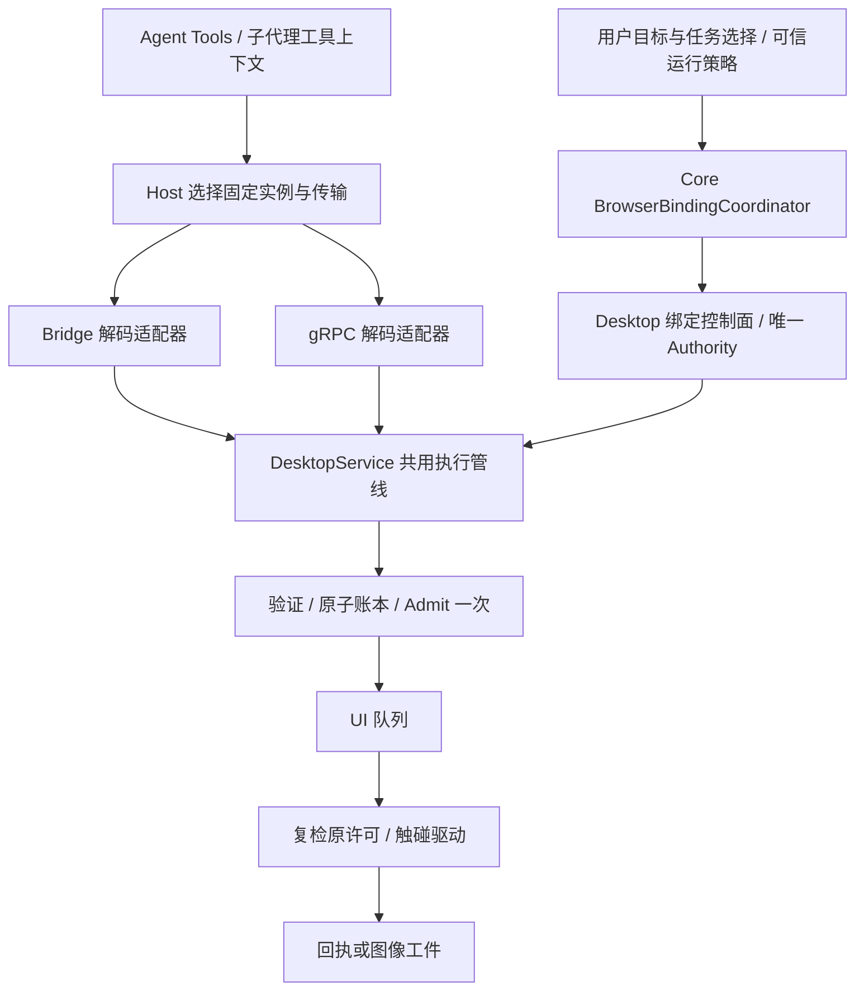

# 浏览器交付修订施工方案

本方案是 [前次 A 决策](B1身份准入接线与浏览器交付下一阶段实施方案-2026-10-09.md) 的代码级修订，不重新选择身份架构。范围包括 Host、Broker、RPC、DesktopService、WinUI 链接源和 Runtime 的必要接线；跨目录本身不是阻塞原因。依据见 [复核报告](../14_reports/浏览器交付代码复核与拒收依据-2026-10-12.md)。以下新类型/新方法均是**待实现规格**，代码段为接口与流程草案，不表示仓库已存在或已经编译。

## 1. 不变量与最终链路

1. 身份由可信执行上下文产生，页面内容、模型工具参数不能自行指定 caller 或签发授权。
2. 用户选页必须绑定具体任务运行及范围；同页可共享，但共享须有独立的显式授权来源。
3. 一条写操作只准入一次；执行前复检同一许可/租约，接管后恢复不会复活旧队列。
4. Bridge 和 gRPC 只负责协议转换，所有浏览器副作用进入同一个 Desktop 执行器。
5. 同一连接世代的同一 operationId 只产生一次执行；改变身份或任何语义载荷即冲突，禁止复用他人的结果。
6. 暂停/接管期间，已授权的只读观察继续；无授权观察仍拒绝。管理和写操作停止。
7. 工具成功返回 screenshot 不等于模型看见图片，必须有持久工件和可验证的 native image part。



不得在连接不可用时绕到另一条路径重做已经开始的动作。通道切换只能发生在新操作选择路由时。

## 2. 施工顺序与提交切片

| 切片 | 必须修改的边界 | 产出与验收 |
|---|---|---|
| R1 | Contracts / Automation / DesktopService | 不变执行许可、原租约复检、全路径释放；三条服务反例转绿 |
| R2 | Contracts / Broker / DesktopConnection / Bridge | 完整指纹和原子账本，跨身份/并发反例转绿 |
| R3 | Host / DesktopService / WinUI 组合根与 Bridge handler | 可信任务绑定、管理授权、两条传输共用执行器；任务隔离反例和组合根矩阵通过 |
| R4 | DesktopConnection / Runtime / Platform | 身份统一解码、真实委派/回收；两条子代理线缆反例转绿 |
| R5 | AgentTools / Host / Vision 存储适配 | 截图工件及 native image part 闭环 |
| R6 | 常规测试 / 交付清单 / 外部验收 | 固定构建、产品 smoke、生命周期、性能校准 |

R1/R2 的独立组件测试通过后再进入 R3 宿主装配。R4 的 Runtime 装配同样先完成组件侧测试。每个切片精确暂存、独立日志与提交；不要顺手改 unrelated flake 或前端。必须改用户选目标的 Web UI 时，按仓库规则单独递增前端版本并部署核对；纯 WinUI/后端修改不改前端版本。

## 3. R1：把“准入一次、复检原许可”写进类型

### 3.1 修改文件

- `Source/Pudding.Contracts/Desktop/BrowserControlContracts.cs`：增加不变 `BrowserExecutionPermit`，持有初次请求、控制/授权世代及可选写租约；增加 `IBrowserAutomationAuthority.RevalidatePermit`。
- `Source/PuddingBrowser.Automation/BrowserAutomationAuthority.cs`：实现统一许可复检，共用现有身份、连接、grant 和控制策略，不复制第二套判据。
- `Source/Pudding.DesktopService/DesktopService.cs`：拆开纯验证和签发，`RunOnUiAsync` 传递 permit 到 `ExecuteOnUiAsync`；取消 UI 回调中的再次 Admit。
- `Source/Pudding.Contracts/DesktopCallContext.cs`：承载由连接解码设置的不可变连接世代；不得向模型暴露该字段。
- `Source/Pudding.DesktopConnection/Mapping.cs` 与 Bridge 解码适配器：入站时捕获连接世代，后续 UI 回调不得调用“当前世代 provider”重建请求。

建议类型轮廓：

```csharp
// Contracts 内的新类型；构造仅接受已由 Authority 裁定的数据。
public sealed record BrowserExecutionPermit(
    BrowserAutomationRequest Request,
    BrowserControlSnapshot AdmissionControl,
    BrowserAutomationLease? Lease);

// 新方法；只检查，不签发新租约，不刷新 grant，不改变请求身份。
BrowserAuthorizationDecision RevalidatePermit(BrowserExecutionPermit permit);
```

复检行为必须按操作分类：页面写操作验证原 `LeaseId`、请求、世代、授权；管理操作无页面租约时仍验证初次控制世代、原连接世代及管理 grant；只读操作验证当前身份/连接/阅读 grant，不因单纯接管而拒绝。不能直接对无租约操作调用现有 `Revalidate(lease, request)`，也不能把所有无租约操作直接放行。

### 3.2 RunOnUiAsync 改造流程

```csharp
// 流程草案：Fail/ValidatePure/Map/Release 等需接入现有领域返回类型。
BrowserAutomationLease? lease = null;
try
{
    // 参数、deadline、取消、能力、目标、trust、版本均先做纯验证。
    var invalid = ValidatePure(request, context, cancellationToken);
    if (invalid is not null) return Fail(invalid);

    // 使用本次入站捕获的 generation；只构造一次。
    var automation = Map(request, context);
    var admitted = Authority.Admit(automation);
    lease = admitted.Lease; // 即使后续判定异常，也进入 finally。
    if (!admitted.IsAllowed) return Fail(admitted.Error);
    var permit = new BrowserExecutionPermit(automation, admitted.Control, lease);

    return await dispatcher.InvokeAsync(async token =>
    {
        var race = ValidatePure(request, context, token);
        if (race is not null) return Fail(race);
        var valid = Authority.RevalidatePermit(permit); // 不再 Admit。
        if (!valid.IsAllowed) return Fail(valid.Error);
        return await ExecuteSurfaceAsync(request, permit, token);
    }, cancellationToken);
}
finally
{
    if (lease is not null) Authority.ReleaseLease(lease.LeaseId, "completed");
}
```

实际 `BrowserAuthorizationDecision` 的快照属性为 `Control`，草案以此现有契约为准。纯验证不得在失败时改变租约或 grant。框住签发后的全部退出路径，包括版本竞态、dispatcher 拒绝、取消、超时、surface 异常。

移除 `DesktopService.ValidateAdmission` 中“未注入 `_connectionGeneration` 就跳过浏览器准入”的行为：生产浏览器调用必须带有效入站世代，缺失返回 Unauthorized；单元测试通过明确的 fake connection 上下文走同一入口，不用省略依赖来关闭闸门。

驱动包含多个有副作用的步骤（如按下/移动/释放）时，每一步之前通过 permit guard 检查取消和世代；校验与该步 UI 输入提交置于同一 UI 序列，中间不插入可恢复旧操作的异步间隙。已开始的操作被中止时用 `mayHaveSideEffects=true` 或 unknown 回执，禁止自动重新点击/提交。清理已按下按键/鼠标的收尾动作需单独定义为释放资源，不能继续业务输入。

### 3.3 必须测试

使用可控 dispatcher 与 fake clock，不加 sleep。入队后接管再恢复、切页再切回、重连、关闭、授权撤销均不得让旧写请求触碰 driver。各拒绝/取消/异常分支终态无残留租约；成功只 Admit 一次且只释放原租约。读操作在接管期间能成功，但阅读 grant 被撤销后拒绝。管理操作接管前排队、恢复后也必须失效。

## 4. R2：完整指纹与单次执行账本

### 4.1 完整语义指纹

修复 `Source/Pudding.CapabilityBroker/WireMapping.cs` 的 `CoreCommandEncoder.Fingerprint`、`Source/Pudding.DesktopConnection/Mapping.cs` 的 `Fingerprint`、`Source/Pudding.CapabilityBroker/DesktopSession.cs` 和 `Source/PuddingDesktop.WpfArchive/Browser/BrowserBridgeCommandDispatcher.cs`。

在 `Pudding.Contracts` 中定义无 protobuf/WebView2/Host 引用的 `BrowserOperationIdentity` 与规范化语义载荷生成器；两条传输转换成同一领域请求后使用它。指纹至少包括：

```text
schemaVersion
desktopInstance + desktopProcessInstance + capturedConnectionGeneration
caller.kind + caller.callerId + caller.taskId + caller.parentTaskId
capability + concreteAction
target.contextId + target.pageId + frameId + expectedPageVersion
完整 typed payload：selector/ref、文本、坐标、截图 observationId、键、滚动值、
JS/function/参数、截图区域与格式、绑定 actor/scope/expiry/parentGrant/selectionRevision 等
```

OperationId 是账本键，不必重复放进 hash；deadline、correlationId 等非语义元数据不进 hash，但每次接收仍检查当前请求是否过期。字段使用长度前缀或确定顺序的规范 JSON，避免拼接分隔符碰撞；字典递归排序，数字用不依赖区域性的规范表示。保留 null/缺失差别中有业务意义的部分，明确默认值归一化。

禁止 `_ => []` 或“不认识的 payload 也生成 hash”。新增能力/oneof 未有映射必须编译门禁或穷举测试失败，运行时明确 unsupported。所有 binding.apply/revoke 也必须覆盖。指纹本身不含日志可见的原文敏感输入。

### 4.2 原子账本

在 Desktop 共用执行边界对 `(desktopProcessInstance, connectionGeneration, operationId)` 原子 `TryBegin`：

| 情况 | 处理 |
|---|---|
| 不存在 | 写入 fingerprint + Pending 完成源，唯一获胜者执行 |
| 存在且指纹相同、Pending | 等待同一完成源，不能再次进入 handler |
| 存在且指纹相同、Completed | 在身份/会话有效性检查后返回同一终态 |
| 存在但指纹不同 | `operation_id_conflict`，不得透露原结果 |

优先扩展已有操作账本/registry，不为 Bridge 再造一个按 Guid 缓存。副作用开始后未知结果也记录终态，不能删除记录导致客户端重传再执行；记录保留期和有界容量明确，过保留窗口的未知操作不得默认为安全重试。

Broker 发送去重同样比较 caller+完整请求；将 `_authorizer.AuthorizeAsync` 和入站身份校验置于复用结果之前。运行中副作用命令不能因容量驱逐丢失账本。一个等待方取消只结束该等待，不取消其他等待者；执行取消必须由操作所有者或控制面触发。

### 4.3 必须测试

有授权 A 的同一请求并发两次：首次成功且 driver 恰好 1 次；同 operationId 改为 B、改 target/text/ref/action/parentTaskId/generation 分别拒绝或落入新的合法世代命名空间；不能返回 A 的结果。覆盖所有浏览器能力的字段差异，不能只测 navigate。重传未知副作用结果不重执行，断连和完成竞争有单一终态。

## 5. R3：可信任务绑定与统一传输入口

### 5.1 控制面负责授予，普通调用只消费

修改 `BrowserTaskBindingService.Accept` 为接收 **绑定消息 + 已认证 envelope + 已登记选择许可**，而不是只收 payload。

新增领域数据可放 Contracts，许可登记与签发在 DesktopService，Core 协调器在 Host：

```csharp
// 新契约：来自可信任务选择/策略事件，不来自 browser_* 参数。
public sealed record BrowserSelectionConsent(
    string SelectionId, long Revision,
    BrowserCallerIdentity Task, DesktopPageTarget Target,
    BrowserPageGrantScope Scope, DateTimeOffset ExpiresAtUtc);

// 接受消息时校验：当前实例/连接、调用者与 subject 的授权关系、
// 选择记录中的 task/target/scope/expiry，以及父授权链。
BrowserBindingAcceptance Accept(
    BrowserTaskBinding binding,
    DesktopCallContext authenticatedEnvelope,
    BrowserSelectionConsent registeredConsent);
```

绑定消息增加稳定 bindingId、selectionId/revision；subject、scope、expiry、parentGrantId 明确进入协议。`Source` 字符串仅用于审计，不是授权凭证。许可由用户“交给当前任务”事件或明确受限的可信运行策略产生；Desktop 所有者登记它，来自 Core 的任务身份要与已认证执行会话及 UI 选择关联。普通页面不能通过 web message 自己登记许可；消息必须校验来源、页面实例及 nonce，且不暴露 ControlToken。

任务切换/共享必须产生新的明确选择事件。相同 bindingId/revision 重试返回原 grant/epoch，不撤销重签；同 id 不同语义返回 conflict。控制面 apply/revoke 与选页/关闭/断连在同一串行控制序列执行，取消和 deadline 在进入序列前检查，字典不能被多线程无锁修改。

子授权要求完整父 grant 身份，不仅按 ParentTaskId 随便找到一个 grant；验证父 caller/run、实例/连接/目标/frame、scope 子集、绝对到期时间。父撤销递归撤销子 grant。用绝对 `ExpiresAtUtc = min(requested, parent.ExpiresAtUtc)`，去掉用“减 1 秒”掩盖相对时长竞态的做法。按完整任务运行身份撤销，不误撤同一个 Agent 的其他 run。

### 5.2 Core 生产者与传输

- 在 `Source/PuddingHost/BrowserBridge/` 增加 `BrowserBindingCoordinator`，由可信目标选择、任务启动/结束、子代理授权事件调用；session 必须按本次 browser route 的 DesktopInstanceId/连接世代解析，禁止 `Sessions.FirstOrDefault()`。
- `CapabilityChannelBindingGate` 改为确认匹配的已授权绑定及有效 ack，或由 coordinator 替代。删除“普通调用创建固定 Read|Write”的行为；缓存以 grantId/bindingRevision/connectionGeneration 为准，遇到断连、撤销、expiry 失效。
- `TransportRoutedBrowserCapabilitySurface` 的两条路径都消费同一绑定状态。Bridge-only 必须支持控制消息运输与准入，或在不可用时明确拒绝；无 channel 时 no-op 不能成为授权绕过。
- 在 `BrowserBridgeCommandDispatcher` 增加协议到 `DesktopCapabilityRequest` 的适配器，页面命令统一调用 `DesktopService.ExecuteAsync`。`BrowserWorkspaceController` 的旧 handler 不得绕过共用执行器直接操作 DOM。
- `DesktopCapabilityChannelComposition` / WinUI workspace 组合根始终构造并注入同一个 lifecycle、authority、taskBindings、executor；执行器不能只在可选 gRPC 开关开启时存在。Desktop 只装配组件，不引用 PuddingHost。
- 收敛 Bridge 暂停/接管布尔粗闸门，让共用策略按操作拒绝写和管理，保留授权阅读；状态显示只投影同一个 authority。

### 5.3 管理动作与具体 action 映射

把 `DesktopCapabilityOperations.TryGetBrowserOperation(capability, out operation)` 替换为 **request-aware** 映射，输入完整 `DesktopCapabilityRequest`。`BrowserTabs` 的 list/new/activate/close 必须分别映射；补齐相应 operation 枚举/策略，未知 action 拒绝，不统一当 TabClose。

| 动作 | 最小准入要求 |
|---|---|
| contexts.list、tabs.list | 可信任务身份；返回范围受任务可见性策略限制，只返回有界元数据 |
| snapshot/locate/wait/pageState/screenshot | 对目标页的 Read grant |
| navigate/fill/click/scroll/坐标/native 输入 | 目标页 Write grant + 本次执行租约 |
| 任意 JS evaluate | 视为可产生副作用，不能按调用方声称“只读”降级 |
| tabs.activate | 目标页 Write，并按 UI 焦点副作用走控制许可 |
| context.create/close、tabs.new/close | 当前任务的显式 Management grant，限定可管理上下文/页面 |

管理 grant 由可信运行策略或用户操作签发，与浏览器 RW 不互相替代。创建新页的管理操作成功后，按创建者许可原子登记页面和授权；没有现成页面不能成为创建功能永远不可用的循环依赖。关闭操作用原有的唯一 lifecycle 回收登记、授权、lease 和观察缓存。

### 5.4 组合根矩阵是必交付证据

两列分别是 Bridge-only 和 gRPC-enabled，必须经过**真实 DI/工厂和生产协议适配器**（可用假 driver），不能每例手工替换成更安全的 executor。每列覆盖：合法任务读写、无绑定拒绝、同页无关任务拒绝、只读任务不能写、接管读成功写拒绝、管理授权创建/关闭、任务结束撤销、断连新世代旧请求拒绝。

## 6. R4：身份解码与 B6 Runtime 装配

### 6.1 解码修复

`Source/Pudding.DesktopConnection/Mapping.cs` 中 envelope、binding.apply.Task、binding.revoke.Task 统一调用一个 `TryDecodeBrowserCaller`。至少传齐：

```csharp
new BrowserCallerIdentity(kind, message.CallerId, message.TaskId,
    string.IsNullOrWhiteSpace(message.ParentTaskId) ? null : message.ParentTaskId);
```

未知 kind、必需身份缺失、子代理缺 parent 返回 InvalidRequest，不让构造异常逃出 decoder。不要通过移除 SubAgent 的 parent 校验使测试转绿。Task 与 envelope 的关系由 R3 控制面校验：自身绑定要求完整一致，可信父任务可以按受限委派契约给 child 申请；普通 A 不得替 B 签发或撤销。

### 6.2 Runtime 接线

- 在 `Source/PuddingRuntime/Services/SubAgentInvocationService.cs` 的两种 `BuildSpawnRequest` 路径传递可信父执行身份与新的 browser delegation 描述；在模型参数进入这里之前投影，不接受模型填 caller/runId。
- 在 `Source/PuddingPlatform/Services/SubAgentManager.cs` 子运行实际产生 execution/run identity 后向 Host coordinator 申请子集 grant。以真实子 runId 绑定，不能复用 parent runId 或模板 id。
- 通过 Runtime 已有宿主端口/DI 注入新的窄 `IBrowserDelegationLifecycle`（在不依赖 Host 的契约层声明），Runtime/Platform 不得引用 Host 实现或 Desktop。
- 工具注册必须遵从委派能力投影，授权后才开放约定 browser 工具；`BrowserAgentToolBase` 继续从可信 ToolExecutionContext 投影 caller。不得把父 scope token 塞进 prompt。
- 子任务成功、失败、取消、超时、父终止统一 finally 撤销；断连时本地标记撤销，新世代不得自动恢复旧 grant。异步 spawn 不依赖父 turn 的 AsyncLocal 长期存活。

交付一条真实 Runtime 装配测试：父任务持有页 A 的 Read，创建子任务，子调用 snapshot 成功，navigate/访问页 B 拒绝；父撤销后子再次 snapshot 拒绝。同步、异步及批量生成路径都应有身份保持和回收覆盖。

## 7. R5：截图字节进入模型视觉通道

### 7.1 代码归属

- `Source/PuddingBrowser.AgentTools/BrowserScreenshotTool.cs`：消费 capture 后调用新窄端口 `IBrowserScreenshotPublisher`，不要只返回 chunks.Count。
- 在 AgentTools 所属工具组件内声明 publisher 接口和返回值，不引用 `PuddingHost`、`PuddingPlatform` 或 WebView2。
- `Source/PuddingHost/BrowserBridge/` 新增 publisher 实现，注入现有 `VisionArtifactStorageService`；由 Host 组合根注册。遵循 [ImageReaderTool](../../Source/PuddingHost/Tools/ImageReaderTool.cs) 的 `OkWithParts` / `LlmImagePart` 输出方式。
- 调整 browser 工具响应适配，确保 native parts 从 ToolExecutionResult 到调用 Agent 的模型请求完整保留；如果 `BrowserToolResponse.Success` 只能返回文本，应新增有 native parts 的出口，不能把图像 base64 塞入 JSON 文本。

```csharp
// 返回值字段示意；输入采用已有截图 transfer 类型，避免复制另一份图片契约。
public sealed record PublishedBrowserScreenshot(
    string ArtifactId, string MimeType, long ByteCount,
    int Width, int Height, string ObservationId);

// Host publisher：按 workspace 保存有界图片，再返回 artifact 引用。
// 工具出口：支持视觉且 transport 支持 native parts 时：
return ToolExecutionResult.OkWithParts(metadataJson,
    [new LlmImagePart(published.ArtifactId, detail)]);
```

### 7.2 字节与权限约束

验证 chunk 顺序/偏移/总长度、实际图片解码尺寸、mime 与预算；预算超限返回明确错误。存储在调用 workspace 的工件域，生成 `artifact://...` 引用，跨 workspace 无权解析。复用现有内容寻址与幂等存储，不能泄漏文件路径或会话凭据。

区分 `capture` 与 `read`：capture 可返回可解析 artifact 和 metadata；read 只有调用模型支持视觉且协议支持 native parts 才返回图像，否则明确 `model_capability_mismatch` 或 `tool_output_not_supported`。不能 silent success 让模型以为已经看图，也不自动换模型。`observationId` 继续关联坐标变换与 PageVersion；工件供长期查看不意味着旧 observation 永久可用于点击。

测试必须断言 native `LlmImagePart` 中的 artifact 可解析成非空合法图片；文本模型仍可 capture 后由用户查看，但不能谎报视觉读取成功。真机再覆盖隐藏/最小化/后台 tab，未支持的表面明确拒绝或按已说明的激活策略捕获，不以黑图冒充成功。

## 8. R6：交付方式和拒绝空转的门禁

1. 将 [本次 11 条反例](../../TestScripts/BrowserDeliveryReview/README.md) 迁入常规测试；R3 后升级 fixture 为真实合法授权，保留首次成功断言，防止“一律拒绝”也绿色。
2. 每个切片提交代码、对应回归及日志；只在代码/断言变化或出现新不确定性时重跑关联套件。修复完成后跑一遍规定整链，已知时序 flake 单独记录原始失败及归因，不靠重试覆盖。
3. 交付 manifest 绑定源码 commit、dirty 状态、每个测试 TRX、产物 hash、Core/Desktop/frontend build identity；缺任何证据不可宣称 complete。不要再用连续绿色轮数替代行为覆盖。
4. 外部控制器从隔离 DesktopHome/DataRoot 部署该构建，确认真实运行 identity；进程内新会话执行 G1–G11 包括截图看图/坐标、滚动和授权撤销。内部 Agent 不能证明其自身承载进程已加载刚编译代码。
5. 外部控制器判定启动、重启、崩溃恢复、退出回收四步终态；未做则明确 external acceptance pending。
6. 250ms 先当待校准目标。记录机器、Runtime 版本、页面语料、节点数、DOM 复杂度、p50/p95/p99、超时截断语义，再更新配置/设计；不能凭纯函数测试拍定阈值。

只有 R1–R5 与矩阵通过才接收新的 `ready-for-external-deploy`；只有第 4–6 项证据齐备才签署产品验收。任何环境缺失都具体列出，不重复产出空轮次，也不把“文件属于另一模块”作为新增授权问题。

## 9. 后续交互作品能力的衔接

继续采用 [Agent 生成式交互界面与浏览器应用运行时设计](Agent生成式交互界面与浏览器应用运行时设计方案-2026-10-08.md)。在本轮 P0 修复后另起功能切片：作品身份/版本 → 本地隔离 origin 的 HTML 加载 → SDK 状态与具名函数 → 用户提交事件 → 表单/SVG/图表/涂鸦组件库。

作品 grant 绑定 task + artifact + revision；持久化状态通过有 schema/版本/并发校验的宿主存储，localStorage 仅作页面缓存。具名函数只返回可序列化、有限大小结果，闭包局部变量必须由作品显式导出 getter，不能承诺任意读取 JavaScript 局部作用域。页面提交携带作品版本和输入快照，Agent 更新草稿不能无声覆盖用户未提交内容。把浏览器底层执行器的权限与回执复用到此层，但外部网页不能获得作品 SDK 的宿主能力。
