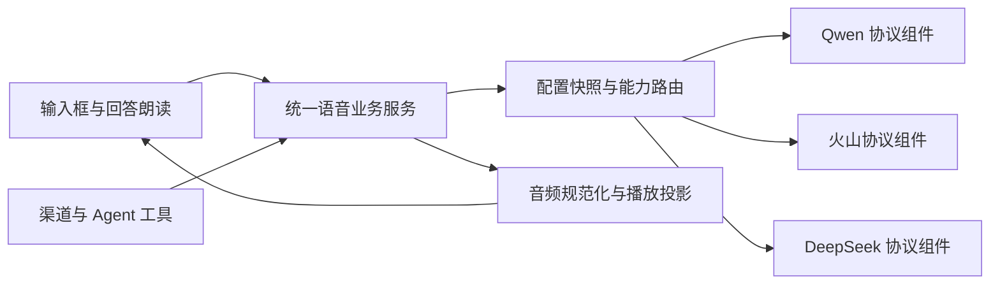

# 统一 ASR/TTS 能力与聊天语音体验优化方案

## 1. 产品决策

**ASR/TTS 是当前第一优先级。先让输入框语音输入和回答朗读稳定、可感知、可取消，再扩展更多服务商。** 目标是业务代码只表达“识别这段声音”“朗读这段回答”，由 Pudding 底层决定 Provider、模型、协议、凭据、格式和回退策略。

首个闭环：ASR 使用用户指定的 `qwen-audio-3.1-asr-flash-message`；TTS 先完善已配置的 `qwen3-tts-flash`。新的 Qwen-Audio-TTS、火山和 DeepSeek 是后续适配，不以换模型代替体验优化。

截图指向现有输入框右下角麦克风。优化在该入口和现有消息朗读入口内完成，不新建另一套聊天界面。用户进入业务流程不需要选择“DashScope HTTP”“火山 WebSocket”等实现细节。

本文件是方案，不表示故障已修复或新模型已上线。证据、当前配置快照和未验证项见 [核查报告](../14_reports/2026-11-15-ASR-500与语音链路源码核查.md)。

## 2. 已确认的问题及先后关系

| 问题 | 已确认事实 | 方案动作 |
|---|---|---|
| ASR HTTP 500 | 对应请求上游是百炼 403 `AllocationQuota.FreeTierOnly`，异常被通用中间件包装 | 保留供应商错误分类，显示额度/免费模式限制；管理端处理开通与付费策略后再 smoke |
| 更换 ASR 模型不能只改 ID | 当前实现为 HTTP 提交任务并轮询；指定的新模型是 WebSocket run-task 协议 | 增加正确协议适配与能力校验，再设为默认模型 |
| 音频格式声明不可信 | 前端录 WebM；multipart 请求在 Controller 中可能按 WAV 处理，Provider 未知格式也标作 WAV | 内容检测与真实转码，或直接采集约定 PCM/WAV；禁止改 MIME 冒充转码 |
| “停止”和“取消”混用 | 录音 handle 只有 stop；当前 stop 会收集音频并提交识别 | 区分完成输入、取消、关闭；取消不再提交，迟到结果不回填草稿 |
| TTS 标称流式却整段等待 | Provider StreamAsync 先 ReadAsStringAsync 整个响应；Web API 返回整段 Blob | 逐块读写、可播放增量、可靠终态；先恢复完整音频，再交付首音延迟优化 |
| 取消合成没有传到网络 | useTtsPlayer 创建 AbortController，API 包装函数不接收 signal | 取消贯通 UI→Core→上游；同一消息/会话按 generation 隔离 |
| 两套朗读路径 | 消息气泡走后端 TTS；语音面板默认浏览器 speechSynthesis | 所有云端朗读使用同一业务服务与播放管理器；本机语音作为显式备用能力 |

第一行是本次 500 的直接原因；格式、协议和取消问题是源码确认的独立缺口，不能混写成本次 403 的原因。

## 3. 服务商与协议选择

| 实现 | 用途与接入方式 | 产品策略 |
|---|---|---|
| 百炼 Qwen-Audio-ASR-Message | `qwen-audio-3.1-asr-flash-message`，WebSocket，短语音/语音输入场景 | ASR 首选。开启 intermediate_result 后提供实时预览；润色默认关闭，最终草稿由用户确认 |
| 现有百炼 Qwen3-TTS | 当前配置 `qwen3-tts-flash`，既有 HTTP/SSE 路径 | 先跑通正确音色、输出格式和取消，再改真流式播放 |
| 百炼 Qwen-Audio-TTS | 官方新接口支持完整文本 HTTP/SSE 与分段文本实时合成 | 单独 protocol adapter；不得套用当前“模型名以 qwen 开头”的旧请求体 |
| 火山豆包语音 | 官方提供 ASR 和 TTS 的独立语音协议；Agent Plan 有专属 Key、资源 ID 与 `/plan/` 端点 | 用作第二个独立 Provider 验证透明切换；按账号实际开通产品选择协议，不能拿普通方舟聊天地址推定语音地址 |
| DeepSeek ASR/TTS | 整段 ASR、HTTP/WS TTS | 后续可选；不把整段 ASR 包装为实时识别 |

依据：[Qwen ASR 场景指南](https://help.aliyun.com/zh/model-studio/real-time-speech-recognition-user-guide)、[指定模型信息](https://help.aliyun.com/zh/model-studio/qwen-audio-3-1-asr-flash-message)、[非实时 TTS](https://help.aliyun.com/zh/model-studio/non-realtime-tts-user-guide)、[实时 TTS](https://help.aliyun.com/zh/model-studio/realtime-tts-user-guide)、[火山语音接入](https://console.volcengine.com/ark/region:cn-beijing/docs/agent-plan-personal-voice-model)、[DeepSeek ASR](https://api-docs.deepseek.com/zh-cn/guides/asr/)。

上表不是账户权限清单。控制台链接用于配置入口；模型存在不等于当前 Key 有权限、额度或对应地区能力。不要自动更换区域、关闭免费模式或改动付费开关。

## 4. 底层抽象：统一语义，保留真实能力差异

### 4.1 业务入口

沿用并落实既有 `IVoiceRecognitionService` 与 `IVoiceSynthesisService`，不另建平行的业务调用链。收紧现有业务请求：

- ASR：音频输入、可信 workspace/session/participant 身份、language、是否需要中间结果和热词等业务需求。
- TTS：text/messageId、逻辑 voiceProfile、locale、可选语速及输出需求。
- Provider/Model/Endpoint/Key 从底层路由快照解析，放入内部 `ResolvedVoiceRoute`，不要求业务调用方填入。现有请求里暴露的 Provider/Model 以及 TTS HTTP 请求的提供商字段，在接入时统一收口。
- 上层取得规范化 Transcript、AudioChunk、Completed、Failed、Cancelled；不解析供应商的 `task_id`、`output.choices` 或二进制包头。
- 上层可以按“支持边说边转写”“支持暂停播放”等能力决定交互；不按提供商名字分支。能力不支持时返回明确结果，不伪装成已实现。

ASR 与 TTS 分别选默认路由，可来自不同服务商；它们与聊天 LLM 的默认模型独立。渠道、Agent 工具、Web 输入框和消息朗读共用业务服务，避免“聊天能说、渠道不能说”的分叉。

### 4.2 组件边界

Qwen/火山/DeepSeek 组件只包含供应商协议、格式合同、错误分类与会话状态机，传输通过端口注入；不得引用 Runtime/Platform/Host。Runtime 侧 adapter 实现现有 Provider 端口，映射组件 DTO；Platform 业务服务处理配置、会话身份、持久化和调用治理。

先交付 Qwen 组件的独立测试与边界断言，再进入 S5 接线。已有公共语音合同优先复用和收敛，归属不明的业务文件留在调用方；不为这次优化大规模搬迁所有音视频模型。用于统计和引导的 Hook 仍是建议层，不能代替取消、鉴权或终态状态机。

### 4.3 注册和配置

扩展 `voice/providers.json` 的模型配置，显式声明 `protocolId`、区域、业务空间/资源标识、实际音频能力与凭据引用。协议由注册表分派，例如 Qwen Message ASR WS、Qwen3 TTS HTTP、Qwen-Audio TTS、火山 Agent Plan 语音；不得只按 ProviderId 或 `StartsWith("qwen")` 猜协议。

模型能力至少包括：上传/实时 ASR、中间结果、时间戳、输入编码/采样率、单段时长、完整文本/分段文本 TTS、输出编码/采样率、音色、指令/语速支持。Unknown 保持未知；不单凭配置里 `supportsStreaming=true` 宣称实际端到端流式。

启动和保存配置时验证默认路由、协议、模型与音色关系。管理页提供设备/权限检查、ASR 试录、TTS 试听、最近脱敏错误；这些是显式测试，不能每次打开设置都发计费请求。

## 5. ASR：从录音到草稿

### 5.1 两步交付

**先交付短录音可用，再交付边说边转写。** 原有 `POST /api/voice/asr/recognize` 可继续作为统一的完整录音入口，内部也可以通过 Qwen WebSocket 分块送入并等待最终结果；上层 HTTP 不限制下层必须 HTTP。

实时阶段使用统一、认证的语音会话通道。客户端发送音频帧及 sequence，Core 转成 Provider 协议；传回规范化的 `segmentId/revision/text/isFinal`，界面按 segment 替换中间结果，最终只提交一次。不得把多次中间结果直接拼接成重复文字。

### 5.2 Qwen Message ASR 适配

按 [WebSocket API](https://help.aliyun.com/zh/model-studio/qwen-asr-message-websocket-api) 实现连接→run-task→等待 task-started→二进制音频与结果并发→finish-task→收齐最终结果→task-finished。客户端事件的模型、格式与采样率规范见 [客户端事件](https://help.aliyun.com/zh/model-studio/qwen-asr-message-client-events)。

首期约定 16 kHz、单声道、16-bit PCM，短录音可用 PCM WAV；优先 AudioWorklet 采集/规范化，或经已验证转码器转换。服务端检查真实内容、长度和会话上限；不接受把 WebM 数据声明为 WAV。音频分片有有界缓冲与背压，握手未成功前不无限积压麦克风数据。

使用用户指定模型、正确区域与业务空间端点；不能沿用现有 multimodal-generation POST + async polling。启用中间结果时才承诺实时预览。默认不上传完整聊天历史；上下文和热词只传受控、必要的短文本。

### 5.3 输入框交互

| 状态 | 输入框体验 | 可用操作 |
|---|---|---|
| Idle | 原麦克风入口，悬停提示“语音输入” | 开始录音 |
| RequestingPermission / Connecting | 明确显示权限或连接阶段，避免伪装正在听 | 取消 |
| Recording | 麦克风高亮、音量/波形、计时，中间文本为临时预览 | 完成输入、取消 |
| Finalizing | “正在整理文字”，保留已识别内容 | 取消等待 |
| Ready | 转写结果进入原有可编辑草稿，不另起发送流程 | 编辑、发送、继续录音 |
| Failed | 保留已有键入草稿；显示可操作原因和 errorId | 重试、回到键盘 |

点击截图中的按钮应立即有状态反馈。键入草稿与临时转写分开管理，按录音开始时的光标插入最终结果；不得覆盖用户在等待期间新输入的文字。权限拒绝、无声音、设备拔出均提供具体提示。

完成输入触发 Commit/Finish；取消触发 Cancel，释放麦克风、终止上传并丢弃该 generation 的迟到结果；切换会话、关闭面板和组件卸载执行 Cancel。两者不能再共用一个会自动上传的 stop。初始本地上限建议 120 秒，作为产品策略，不冒充 Qwen 的供应商上限。

## 6. TTS：从回答到可控播放

### 6.1 收敛播放入口

现有消息喇叭、语音面板朗读和自动朗读共用一个播放管理器，以 `workspace/session/message/delivery/generation` 关联状态；同一时间只允许一个可听会话。状态为 Loading、Buffering、Playing、Paused、Completed、Cancelled、Failed，按钮和错误直接绑定当前消息。

先修通完整音频：让前端明确显示“正在生成语音”、取消和失败；播放停止后释放 Audio/ObjectURL，切会话和卸载时清理；API 请求真正接收 AbortSignal。连续点击不同消息采取“取消旧请求、播放新消息”，不因旧 pending 标志直接吞掉新点击。

### 6.2 真正的流式

分清三种能力：完整文本一次提交并返回音频；完整文本一次提交但音频逐块返回；文本与音频均分段输入输出。分别记录能力，不能统一成一个 boolean。

现有 DashScope `StreamAsync` 需要改为边读 SSE 边解码、边产出音频，Core 再向客户端传递可播放帧，避免先 `ReadAsStringAsync` 或拼完整 Blob。流式播放器需处理采样帧边界、编码/容器差异、背压、取消和失败终态；不能把多个 WAV 文件简单串成 PCM。

首期保留当前 Qwen3 TTS 的模型、音色协议，先用抓取到的音频事实核对格式。升级到 Qwen-Audio-TTS 是独立路由，不复用旧 Qwen3 请求体。voiceProfile 由服务端映射为当前模型支持的音色，UI 不写死 Cherry、stella 或火山资源名。

默认只朗读最终回答，排除工具日志、内部思考、URL 和不适合朗读的代码；文本归一化结果绑定正文版本，缓存键包含正文 hash、路由/凭据代际、音色、语言、格式及参数。不缓存失败、截断或未完成音频。

分句朗读正在生成的回答属于下一步：只消费已确认正文片段，去重并按顺序合成；回答被修订或切换 generation 时取消剩余队列。已播出的内容无法撤销，不能默认为所有对话启用。

## 7. 统一 HTTP/实时合同与错误

### 7.1 业务 API 提案

沿用 `/api/voice`，管理配置仍在现有 `/api/voice-providers`。以下是待实施的合同，不是已存在端点清单：

| 入口 | 业务输入/输出 |
|---|---|
| GET `/api/voice/capabilities` | 返回当前会话可用的输入/输出模式、逻辑音色、限制与可用性原因；普通 UI 不依赖 Provider 名字 |
| POST `/api/voice/asr/recognize` | multipart audio 与会话/录音身份；返回统一最终转写、语言、可选时间戳 |
| POST `/api/voice/tts/synthesize` | text 或授权消息引用、voiceProfile、locale；返回核验 MIME/编码的音频 |
| POST `/api/voice/sessions` 及实时通道 | 创建受权语音会话，交换规范化控制事件和音频帧；支持 Finish/Cancel/Close |

workspace/session 从认证与授权上下文解析，移除 TTS Controller 硬编码 `WorkspaceId="default"` 的做法。实时通道优先复用既有认证设施；Provider Key 不到前端。录音字节不经 LLM 请求或聊天事件日志转发。

### 7.2 错误分类

错误结果统一含 code、用户可理解 message、retryable、errorId；管理诊断另存脱敏 providerCode/requestId/阶段。供应商 401/403 不直接作为 Pudding 登录失败返回，以免前端错误登出。

| 统一 code | 例子 | HTTP 建议 / UI 行为 |
|---|---|---|
| `voice_quota_exhausted` | 本次 FreeTierOnly | 503；提示语音服务额度或免费模式限制，联系管理员；retryable=false |
| `voice_credentials_invalid` / `voice_model_unavailable` | Key/区域/模型权限不匹配 | 503；明确配置不可用，避免盲目重试 |
| `voice_unsupported_audio` | 内容与格式不符 | 415；说明格式错误，保留草稿 |
| `voice_input_too_large` | 超过本地/模型限额 | 413；展示限制 |
| `voice_rate_limited` | 服务商限流 | 429；合法 Retry-After 与有界重试 |
| `voice_timeout` / `voice_provider_failed` | 超时、上游异常 | 504/502；只在安全边界允许重试 |
| `voice_no_speech` | 未检出语音 | 正常空结果状态；不作为内部错误 |
| `voice_protocol_error` / 未预期异常 | 事件顺序、格式异常或内部 bug | 502/500；可追踪 errorId，不展示原始响应 |

实时连接已经建立后通过统一 Failed 事件结束，不尝试再修改 HTTP 状态。取消是独立终态。重试不会自动重新发出用户消息、重新跑 Agent 或重播已听片段。

回退仅在用户/管理员预配置的路由集合中执行；音频已经交给其他服务商或已经播出时，禁止静默中途切换。费用按供应商实际单位记录，未知保留 Unknown；不会因业务层无感知而省略后台审计。

## 8. 施工顺序与验收

| 阶段 | 交付 | 完成门禁 |
|---|---|---|
| V0：故障可解释 | FreeTierOnly 等错误映射、配置预检、音频格式核验 | 403 夹具得到统一额度错误；前端无通用 500；不会自动改付费开关 |
| V1：首个可用闭环 | Qwen Message ASR 协议、统一识别服务、现有 Qwen TTS 可靠合成与播放、Commit/Cancel 分离 | 独立组件 S1–S4 后 S5；真实录音→最终草稿→编辑发送；真实 Qwen TTS；取消/切会话不产生迟到文本与声音 |
| V2：主要体验优化 | 原输入框中间转写、波形/计时、真流式 TTS、统一播放状态与错误 | 实时分片、final 去重、保留键入草稿、麦克风释放、首音测量与取消贯通 |
| V3：透明性证明 | 火山第二 Provider 与同一能力目录/服务端路由 | 更换后台路由后聊天、渠道、工具的调用代码不改；供应商契约和错误矩阵都通过；已授权账号真实 smoke |
| V4：可选扩展 | DeepSeek、新 Qwen TTS、分句播报及更高级语音会话 | 按能力开放；不得让非实时适配器冒充实时；全双工语音另立任务 |

V0–V2 优先于 DeepSeek 搜索/文档等新功能。V3 的假适配器合同验证应从 V1 开始；真实火山上线取决于已开通产品和凭据，不阻塞 Qwen 首个闭环。

必要测试不以“接口存在”或“11/11 通过”的数字代替体验：

1. Qwen 协议：等待 task-started、音频分片/最后一帧、最终结果晚于 finish、task-failed、断线与超时。
2. 音频：16 kHz PCM/WAV、真实 WebM 转换或拒绝、空音频、限额、采样率与 MIME 不匹配。
3. UI：权限拒绝、开始后取消、停止并完成、切会话/卸载、用户同时打字、重复中间结果、迟到 final。
4. TTS：首块到达前即取消、播放中停止、新点击替换旧请求、ObjectURL 清理、音频中途失败、后台自动朗读冲突。
5. Provider 透明性：至少两个假适配器执行相同服务级测试；Qwen/火山真实样例分别验收，不用一个 Provider 的成功代替另一个。

性能指标先测基线，再确定门禁。初始体验目标可取：本地按钮反馈小于 100ms、停止可听声音小于 200ms；网络首转写/最终文字/首音分别记录 P50/P95、模型/地区/网络和音频长度。这些是待测目标，不是已取得成绩。

## 9. 发布边界

本次只修订文档和保留诊断结论。后续实现每个原子阶段提交，前端功能递增版本并使用 pnpm；部署通过 Guardian，核对新前端徽标和 Core 构建。功能由新产品内会话验收，重启/退出由外部控制器验收。真实服务调用与付费策略分别记录，不能以一个界面动画或一次离线测试宣称 ASR/TTS 已完成。
