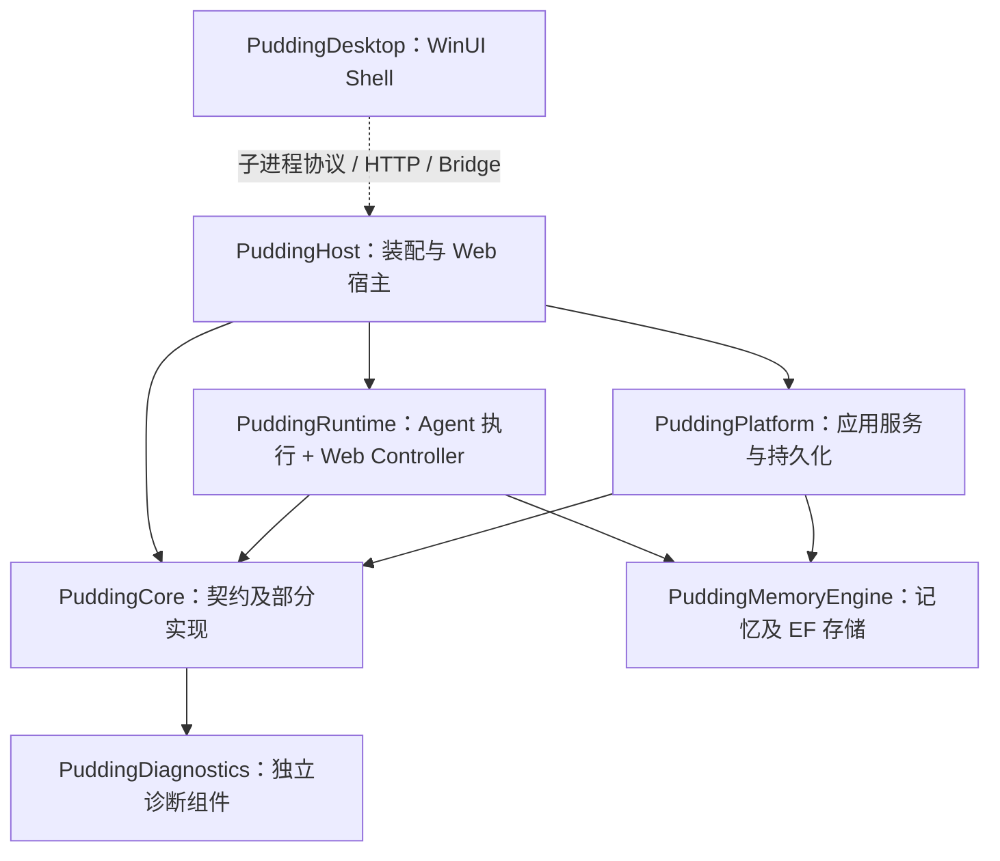

# PuddingAgent 生命周期与 Hook 边界审计

## 1. 结论与范围

**PuddingAgent 有生命周期控制、依赖倒置和扩展基础，但尚未形成统一的 Agent 生命周期与具有明确控制语义、资源归属的 Hook/过滤器基础设施。** 不能判定为“完全没有架构”；也不能依据接口名、Pipeline 类名或设计文档判定已经完成组件化。

| 用户要求 | 当前结论 | 主要依据 |
|---|---|---|
| 明确生命周期与组件边界 | 部分具备 | 有状态枚举、执行租约、取消与终态记录；Agent 实例、Session、执行、流终止分散管理，缺少统一转换与收口合同 |
| 多个 Hook、管道和拦截器 | 多 Hook 已有；控制管道不足 | Loop Hook 顺序 await，但异常全部继续，无 typed decision；事件总线有订阅句柄，但异步分发不承担权限决策 |
| 模块职责与注释 | 局部良好，核心协调类负担过大 | 执行服务 7,288 行、52 个构造参数；存在直接数据访问与诊断日志解析；注释元数据未统一 |
| Core 与 ASP.NET/Desktop 无关 | 项目方向部分成立，语义边界不足 | Core 不引用上层；Runtime 为 Web SDK 并包含 Controller；部分 Core 契约携带 SSE 传输类型 |
| 防火墙注册到调用前、结果处理注册到调用后 | 当前未达到 | 防火墙已有返回决定的接口，但执行器显式依赖并构造具体防火墙；没有统一可注册的阶段过滤器 |

本报告是静态代码审计，不是运行时 smoke、性能测量或生命周期验收。源码快照、文件 SHA-256、调用点和扫描口径保存在[审计快照](2026-10-09-Agent生命周期与Hook边界审计-snapshot.json)。检查时 HEAD 为 `0286f20ff69f766a47096e5552baaaef1ec58871`；SHA-256 对工作树字节计算，九个关键文件与该提交的文本在规范化 CRLF/BOM 后一致。并行工作的其他提交不属于本报告结论。

## 2. 当前依赖与职责

下图箭头表示项目依赖，省略非关键叶子组件；“Core”在产品中指业务子进程，不能与 `PuddingCore` 程序集混用。

正面证据：

- `PuddingCore.csproj` 只有 Diagnostics 项目引用；扫描未发现 Core 对 Runtime、Platform、Host、Desktop 或 ASP.NET 命名空间的 using。Runtime 没有 Platform/Desktop 项目引用。不能把所有模块描述为相互反向依赖。
- `PuddingDesktop.csproj` 有禁用 Host/Runtime/Platform/ASP.NET 引用的构建约束，产品进程边界应继续保持。
- Diagnostics、ContextPolicy 等已有独立组件，为新管道提供可复用的交付方式。
- `ILlmInvocationService`、`IToolInvocationService`、`IHookPublisher` 等端口已存在，避免全量重新设计基础能力。

不足：Runtime 引用 MemoryEngine，编译器同时允许使用其 DbContext/实体；没有把“Agent 只可使用记忆端口”限制为程序集边界。`PuddingCore` 同时包含契约和实现，也不能直接作为第三方插件的最小 SDK。

## 3. 生命周期：存在状态，但缺少统一权威

| 机制 | 已具备 | 仍缺少 |
|---|---|---|
| [SessionState](../../Source/PuddingCore/Abstractions/ISessionStateManager.cs) | Created、Running、Waiting、Stopping、Stopped、Faulted、Recovering、Completed 等明确状态 | Session 的持久状态、流结束和 Agent 执行终态没有共同的转换合同；StreamCompleted 别名不表示子代理全部收口 |
| [RuntimeControlService](../../Source/PuddingCore/Runtime/RuntimeControlService.cs:544) | 取消、熔断、恢复；Faulted 转出受限制 | SetSessionState 不是完整的合法转换矩阵；发出停止请求与资源已回收需要分开表述 |
| [RuntimeAgentDispatcher](../../Source/PuddingRuntime/Services/RuntimeAgentDispatcher.cs) / 执行注册表 | busy 准入，finally 释放；executionId 匹配，防止旧执行释放新执行 | 可用状态不是 Session/Run/Agent 的完整生命周期 |
| [AgentSessionManager](../../Source/PuddingRuntime/Services/AgentSessionManager.cs) | 实例创建、等待标识、过期清理和终止记录 | 终止实例记录本身不协调运行中的取消与资源 drain；状态与等待集合分散 |
| [执行租约协调器](../../Source/PuddingRuntime/Services/Messaging/AgentExecutionAdmissionCoordinator.cs) | 前台/后台准入、抢占、可释放租约 | 应并入统一 Run ownership，不能用 Hook 完成通知替代释放租约 |
| [SessionStateManager](../../Source/PuddingPlatform/Services/SessionStateManager.cs) | 持久化后通知、事件序号与会话投影 | 1,756 行包含多类职责；应拆分状态命令、存储、事件流和投影 |

现有 cleanup 中已有 finally，不能说资源完全不回收。真正的差距是：**清理、终态提交、Hook 完成通知、等待与重新执行没有统一的作用域定义**。需要明确一个 AgentSession 可包含多个 Run，一个 Run 内多个 Round/ToolCall；Waiting 结束本次 Run，唤醒创建新 Run，而不是长期保留一次调用栈。

## 4. 三种 Hook 机制不能混用

### 4.1 Core 回调

[IAgentHook](../../Source/PuddingCore/Abstractions/IAgentHook.cs) 有工具前后、回复前后回调；Core 的 AgentOrchestrator 遍历这些 Hook 并捕获异常。当前生产 Host/Runtime/Platform/Agent 搜索未找到其装配使用证据。它不应作为“产品已支持统一 Hook”的证据，也不应未经迁移直接再开一套内核。

### 4.2 Runtime Loop Hook

[IAgentLoopHook](../../Source/PuddingRuntime/Services/AgentLoop/IAgentLoopHook.cs) 定义 12 个生命周期回调，支持多个注入实例与默认空实现。工具结果参数引用 Runtime 的 SkillResult，不适合作为独立扩展契约。

[FireHooksAsync](../../Source/PuddingRuntime/Services/AgentExecutionService.cs:1283) 对每个 Hook 顺序 await，并对所有 Exception 记录警告后继续。它适合容错通知，但不具备权限阻断、参数变换、返回值组合、显式顺序或超时语义。取消异常也进入统一 catch；未完成的 Hook 可以一直拖住 Agent。

| 回调 | Buffered 实际调用点 | Streaming 实际调用点 |
|---|---|---|
| LoopStart | 505 | 483 |
| RoundStart / RoundComplete | 616 / 1627 | 未发现 |
| ToolCall / ToolResult | 1081、1807 / 1440、2038 | 未发现 |
| Completed | 1661 | 1911 |
| Failed / Waiting / MaxRounds / LoopError | 有 | 未发现对应调用 |
| Cancelled | 有多个分支 | 2042 |
| LoopComplete | 2348 | 1912，成功分支内 |

表中行号分别属于 Buffered/Streaming partial，完整调用点见快照。“未发现”限定于这套 Loop Hook 的调用点，不代表 Streaming 没有其他工具遥测或失败事件。

关键缺陷：

1. [Buffered 异常路径](../../Source/PuddingRuntime/Services/AgentExecution/AgentExecutionService.Buffered.cs:2213) 调用 LoopError/Failed 后直接 return；finally 做部分清理，但跳过 2348 的 LoopComplete。接口宣称“任意原因结束后触发”，代码没有满足这一合同。
2. [Streaming 成功回调](../../Source/PuddingRuntime/Services/AgentExecution/AgentExecutionService.Streaming.cs:1909) 在计算最终 streamSuccess 之前触发；其他失败退出不具有同等完成回调覆盖。应由统一终态提交结果驱动通知，不依据局部分支推断。
3. 主类通过具体 `SubconsciousConsolidationHook` 类型判断扩展是否存在（201 行）；内核认识某个功能扩展，职责边界倒置。

### 4.3 Hook v2 与事件总线

[HookPublisher](../../Source/PuddingRuntime/Services/Hooks/HookPublisher.cs) 发布生命周期事实；[InternalEventBus](../../Source/PuddingRuntime/Services/Events/InternalEventBus.cs:82) 支持多个订阅和取消订阅，实际处理通过 Task.Run 脱离发布调用。发布成功不表示订阅处理已经完成，也没有 typed allow/deny 结果。

这是事件机制，不是同步审批机制。不能让“tool.before 事件已经发布”成为允许工具执行的证据。已有优先事件队列、EventDispatcher 和持久工作队列是其他执行机制，也不能与这条 fire-and-forget 总线等同。

正面例子：[SessionCompressedMemoryMaintenanceHook](../../Source/PuddingRuntime/Services/Hooks/SessionCompressedMemoryMaintenanceHook.cs) 在后台服务启动时订阅，退出时取消订阅并释放句柄，将工作写入具有幂等键的持久队列。它符合“观察事实后创建独立工作”的边界方向。

## 5. 防火墙与横切功能

[AgentFirewall](../../Source/PuddingRuntime/Services/AgentFirewall.cs:63) 已经通过 EvaluateAsync 返回决定，并有模式、会话、能力、授权、沙箱、工作空间、资源和状态八类门禁。不能声称它在任意篡改 Agent 主循环。

边界问题在于：[PuddingToolExecutionService](../../Source/PuddingRuntime/Tools/Platform/PuddingToolRegistry.cs:564) 直接持有 IAgentFirewall，604 行还有 `new AgentFirewall(...)` 回退，665 行显式调用。门禁顺序写在具体防火墙内部，不能以注册一个新策略过滤器的方式扩展。Loop 的 ToolCall Hook 则没有可阻断返回值，二者是两个独立的前置机制。

目标迁移必须保留八类门禁的现有语义，先通过适配器注册到工具授权阶段，再逐个拆分。删除显式防火墙调用却没有确保必需授权过滤器存在，会造成审批绕过。只读延迟统计不能混进这一 fail-closed 控制机制。

## 6. 职责入侵的实证与限度

| 证据 | 判断及处理方向 |
|---|---|
| [EmbeddingGenerationHook](../../Source/PuddingRuntime/Services/EmbeddingGenerationHook.cs:47) 多处 Task.Run，直接读取 MemoryLibraryDbContext.Chapters | 有全局并发守卫，但工作未交给有 owner/drain 的后台工作设施；读存储与调度混合。应使用记忆查询端口和持久任务端口；不能仅凭未见 workspace 条件就宣称租户漏洞 |
| [SqliteCompositionStore](../../Source/PuddingRuntime/Services/SqliteCompositionStore.cs) 实现 ICompositionStore，却位于 Runtime 且直接依赖 EF/SQLite | 接口设计是正面基础，存储适配器程序集归属需要调整；不能把接口实现本身称作没有分层 |
| [ContextCompactionService](../../Source/PuddingRuntime/Services/ContextCompactionService.cs) 等策略类直接依赖 DbContext | 压缩策略与数据读取混合；提取仓储端口，让数据模块承担实体及事务 |
| [AgentDiagnosticsTool.compaction_stats](../../Source/PuddingRuntime/Tools/BuiltIns/Diagnostics/AgentDiagnosticsTool.cs:487) 读取整个 JSONL 并解释日志字段 | 绕过统一诊断查询面、文件大小不受 limit 约束。该工具其他分支已使用诊断接口，应补齐查询端口，而不是重复解析日志格式 |
| [FeishuStreamingProjectionWorker](../../Source/PuddingHost/Services/FeishuStreamingProjectionWorker.cs:63) 从 Host 直接查询 PlatformDbContext 和应用表 | 组合根承担了渠道投影业务，宜迁到渠道/应用组件并通过投影仓储访问；专用存储维护组件访问其负责数据库则是合法职责 |
| [ContextLayerContracts](../../Source/PuddingRuntime/Services/ContextLayerContracts.cs:11) 的 IContextLayerBuilder | 存在接口，但搜索未发现实现或注册；实际 ContextPipelineOrchestrator 手工组合。不能将类名 Pipeline 当作可注册管道的证据 |
| Core ISessionStateManager 等契约包含 ServerSentEventFrame，Runtime 向上返回 SSE，适配器再转换 Turn 事件 | 编译期未引用 ASP.NET 仍可能有传输语义泄漏；应由上层将领域事件编码为 SSE |

LLM 方面已有 ILlmInvocationService，但 AgentExecutionLlmInvoker 保留可选 facade 与直接客户端路径。建议收敛为一个必需调用端口，将 Provider 故障分类及协议重试留给 LLM 模块。本次没有足够证据把所有上层反馈和重试一概定性为“非法干涉 LLM”。

## 7. 类职责与注释

AgentExecutionService 主文件 2,771 行，Buffered 2,453 行，Streaming 2,064 行，共 7,288 行；构造参数 52 个，其中 35 个可选。partial 文件分割没有改变同一类的职责和依赖集合。ContextPipeline 三个文件共 2,069 行。行数是审阅风险线索，不是质量评分。

对五个生产项目的顶层 public/internal 类型声明做启发式扫描，排除 bin/obj/生成文件；partial 声明分别计数，非 Roslyn 语义分析，多行属性等可能漏计。XML summary 存在不代表内容正确。

| 项目 | 类型声明 | 检出 summary | 同时具备四项指定元数据 |
|---|---:|---:|---:|
| Core | 1,530 | 1,204 | 0 |
| Runtime | 712 | 390 | 0 |
| Platform | 852 | 571 | 0 |
| Host | 144 | 104 | 0 |
| Controller | 39 | 36 | 0 |

扫描头部没有发现 related_files、related_docs、categories 的统一字段；少量 description 字样不构成完整规范。因此用户要求的类注释合同尚未落实。应先规范新组件与改动类型，再逐步补齐现有关键类型，避免全仓库机械灌注无价值注释。

## 8. 与 Pi、ASP.NET Core 的对照

Pi 参考固定到提交 `6fb2e7815167e6b19006fc526d1a5d0f5f998787`，不沿用仓库旧研究中未落地的设想。

- [Pi Agent 类型](https://github.com/earendil-works/pi/blob/6fb2e7815167e6b19006fc526d1a5d0f5f998787/packages/agent/src/types.ts) 将工具前的阻断结果、工具后的结果变换定义为不同合同。
- [Pi Extension Runner](https://github.com/earendil-works/pi/blob/6fb2e7815167e6b19006fc526d1a5d0f5f998787/packages/coding-agent/src/core/extensions/runner.ts) 顺序执行工具前处理器并在阻断时短路；结果处理逐步传递已修改结果。
- [Pi 扩展文档](https://github.com/earendil-works/pi/blob/6fb2e7815167e6b19006fc526d1a5d0f5f998787/packages/coding-agent/docs/extensions.md) 区分资源启动/关闭、处理器快照和最终 settled；agent_end 后仍可能有自动工作。其扩展权限模型不能替代 Pudding 外部 DLL 的进程隔离。
- [ASP.NET Core Filters](https://learn.microsoft.com/zh-cn/aspnet/core/mvc/controllers/filters?view=aspnetcore-10.0) 区分请求中间件与动作过滤器，并为授权、资源、动作、异常、结果提供不同阶段；多个包裹式过滤器的退出顺序与进入顺序相反。

本项目采用它们的边界思想，并自行定义 Agent 状态、副作用、异步工作和插件信任合同；不依赖 MVC Controller 或把 HttpContext 作为内核上下文。

## 9. 优先级与后续入口

| 顺序 | 必须解决的问题 | 验收方向 |
|---|---|---|
| A0 | 冻结作用域、控制 Hook 与观察事件语义 | [架构方案](../12_features/Agent生命周期与Hook管道架构设计-2026-10-09.md) 与 [代码设计](../12_features/Agent生命周期与Hook管道代码设计-2026-10-09.md) |
| A1 | 单一工具调用管道，必需授权过滤器，注册快照 | 内嵌/流式/委派/插件调用同样经过门禁；拒绝不执行 |
| A2 | Run 统一终态与最终收口 | 所有异常、拒绝、取消、Waiting、预算退出都有一次终态，收口通知覆盖一致 |
| A3 | 订阅和后台工作 owner、诊断查询端口 | 卸载停止接收、真实 drain；无日志格式跨模块解析 |
| A4 | 抽离数据与传输适配器、消除可选双路径 | 编译期禁止新内核引用 HTTP/EF/宿主；必需端口在装配期验证 |

现有 ArchitectureGuardTests 主要保护 Runtime 不引用 Platform，不能证明上述完整边界。后续需要独立组件边界变异测试与故障矩阵；本次没有运行 dotnet 测试，也未修改生产运行路径。
