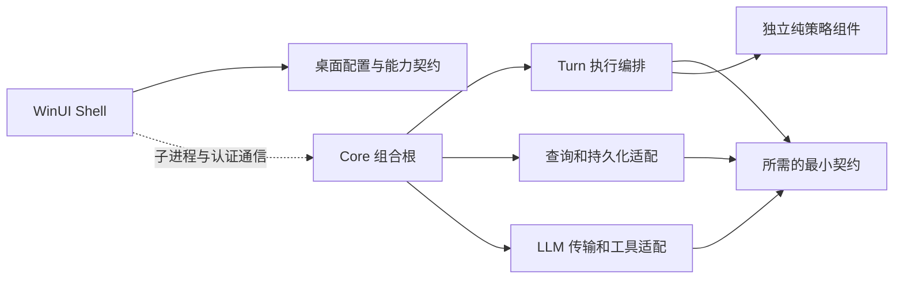

# PuddingAgent 代码取样与优化架构目标

建议优先修复消息检索的完整性，再收敛执行与投影的重复计算、缩小契约依赖范围。现有“WinUI Shell + Web UI + 独立 Core”产品边界应继续保持；ContextPolicy、Desktop.Foundation 和会话读模型已经提供了可复用的组件化样板。

## 取样范围和证据强度

对 Git 跟踪的 `Source/**/*.cs`、`*.ts`、`*.tsx` 做规模筛查，按路径排除测试、迁移、常见生成文件、构建和依赖目录，再按职责集中程度与调用边界选样。筛查得到 **2,522 个候选文件，其中 64 个超过 1,000 行**。行数包含空行和注释，只用于选样，不直接代表缺陷或性能。

对 **31 个源码、工程、测试及索引文件**检查相关代码段，覆盖执行、查询、契约、前端投影、桌面和交付门禁。抽样清单、过滤规则、文件 SHA-256、行数与测试计数保存在[取样快照](2026-10-18-代码取样与优化架构目标-snapshot.json)。这属于按风险选样，并非随机抽样或全仓审计；规模榜中的编排存储、记忆引擎等大文件未据行数单独下结论。

开始检查时 HEAD 为 `b68a41e`，采集快照时因并行工作推进至 `817a72585fda5c793c62683b535ac4d7f30dfeb0`。31 个样本的文本均与快照 HEAD 一致（比较时归一 BOM/换行）。工作树中的他方未提交改动不属于本报告交付。

| 样本 | 观察结果 | 判断用途 |
|---|---|---|
| `AgentExecutionService` 三份 partial | 合计 7,547 行；构造函数 54 个参数，其中 37 个默认为 null | 执行编排的依赖和行为分支集中 |
| `RawSessionLogService` 与搜索 Controller | 先取最多 10,000 条，再按日期及关键词过滤 | 查询完整性与有界查询合同 |
| `PuddingCore` 工程及 Responses 网关 | 契约项目同时含 HTTP 实现、Tokenizer、CliWrap 等依赖 | 契约与基础设施的隔离范围 |
| `ExecutionFlowProjectionIndex` 与 `TurnSurfaceStore` | 已按 Turn 聚合，但变化 Turn 仍用全部事件重算 | 长 Turn 的累计计算成本 |
| 前端 `api.ts` / `useSessionEventProjection.ts` | 分别 4,915 / 1,849 行 | API 契约归属与投影编排边界 |
| `MainWindow.xaml.cs` | 1,936 行，兼有 WebView 生命周期、设置、外观、工具面板和关闭处理 | UI 框架外的可测试性 |

## 目标一 消息搜索完整且查询有界

**优先级 P1。这是取样中最明确的正确性问题。**

入口 [MessageSearchController.cs:42](../../Source/PuddingPlatform/Controllers/Api/MessageSearchController.cs:42) 调用 `GrepMessagesAsync`。[RawSessionLogService.cs:139](../../Source/PuddingPlatform/Services/RawSessionLogService.cs:139) 先以 `MaxScanRows` 加载消息，再在内存中过滤日期和关键词；[加载器第 272 行](../../Source/PuddingPlatform/Services/RawSessionLogService.cs:272) 实际执行 `OrderByDescending(CreatedAt).Take(pageSize)`。`HasMore` 仅由这批消息中的匹配数决定。

因此，只要工作区有超过 10,000 条较新消息，位于窗口以外的旧消息即使符合指定日期和关键词，也不会被检索到；还可能返回 `HasMore=false`。这是从查询顺序直接推出的失败场景，本次未执行该服务的复现测试。

另一个局部风险是 [ReadMessagesAsync:185](../../Source/PuddingPlatform/Services/RawSessionLogService.cs:185) 的下一页游标仅携带时间，加载条件为 `CreatedAt < before`。同毫秒消息横跨页边界时会漏读。新 [ConversationOpenQueryService.cs:130](../../Source/PuddingPlatform/Services/AgentChat/ConversationOpenQueryService.cs:130) 已要求时间与消息身份共同组成游标，应复用其合同方向。

优化目标：

- 将工作区、Agent、日期范围下推到查询层；明确普通关键词、子串和正则的不同语义，不能直接换成分词检索并宣称行为不变。
- 消息搜索建立稳定索引或有界扫描协议，返回游标以及扫描是否完整；截断不能被表现为“已搜索全部”。现有 Agent Markdown 日志 FTS 与消息搜索的语料不同，不能直接当作同一索引。
- 首屏、历史、过程分页沿用既有会话读模型；搜索另有查询端口，但共享消息身份和分页规则。

验收标准：10,001 条以上消息的旧日期命中；同时间戳跨页无重复无遗漏；多工作区和 Agent 隔离；索引落后或扫描截断可辨识；用真实 SQLite 的查询计划和返回字节预算验证有界性。检索修复应单独提交，不与数据模型重构混做。

## 目标二 一个 Turn 共用执行决策与工具调用路径

**优先级 P1。**

[AgentExecutionService.cs:131](../../Source/PuddingRuntime/Services/AgentExecutionService.cs:131) 的 54 参数构造函数说明编排器直接掌握了过多协作者。Buffered 与 Streaming 各自包含轮次循环、预算、压缩、工具调用和终态处理；例如 [Buffered:1150](../../Source/PuddingRuntime/Services/AgentExecution/AgentExecutionService.Buffered.cs:1150) 和 [Streaming:1623](../../Source/PuddingRuntime/Services/AgentExecution/AgentExecutionService.Streaming.cs:1623) 都保留了 facade 与 SkillRuntime fallback 分支。拆成 partial 没有形成编译边界。

37 个可空参数不等于 37 个缺失注册，也不能据此判断生产当前失效。已有 [Host 组合测试:78](../../Tests/PuddingHost.Tests/Hosting/PuddingApplicationHostCompositionTests.cs:78) 专门检查可选依赖静默为 null 的问题，应保留这项防线。

架构目标是由同一执行决策推进 Turn，流式与非流式适配器负责输出形式。先选择预算、停止判定或工具调用结果归一中的一个稳定职责，独立测试后接入，逐步缩小编排器；不通过“依赖大礼包”隐藏构造函数复杂度。

验收标准：相同脚本化模型/工具响应分别走流式和非流式，最终消息、工具调用次数、预算消耗、取消与完成裁决一致；同会话单写者与当前 Turn 围栏保持；生产必需端口遗漏时组合测试明确失败。测试专用 fallback 在替身迁移完成后退出生产分支，不能先删分支再修测试。

## 目标三 契约叶与基础设施实现分开交付

**优先级 P1，按消费方逐项迁移。**

`PuddingCore` 被代码地图定位为跨层抽象，但 [ResponsesLlmGateway.cs:17](../../Source/PuddingCore/Core/ResponsesLlmGateway.cs:17) 直接执行 HTTP、解析 SSE 并处理服务商错误；[工程文件:10](../../Source/PuddingCore/PuddingCore.csproj:10) 引用 CliWrap、Tokenizer 数据包和 Serilog。[Desktop 工程:28](../../Source/PuddingDesktop/PuddingDesktop.csproj:28) 也引用 `PuddingCore`。这证明契约程序集的职责和包依赖范围偏宽，不能仅据此断言这些实现已在 Shell 中执行或导致了多少内存开销。

目标依赖方向如下，方框表示职责，新增程序集名称由具体切片确定：

先把 Shell 需要的配置/协议合同缩到可独立引用的边界，再将 LLM 协议实现、进程执行和工具基础设施移到各自适配组件。`PuddingGateway` 实际具有 CLI/Email/WebChat 消息适配器（[GatewayAdapterHost.cs:16](../../Source/PuddingGateway/GatewayAdapterHost.cs:16)），不能因名称中有 Gateway 就直接放入 LLM 传输实现。

验收标准：契约叶不引用调用方及不必要的网络、存储、Tokenizer、进程执行包；新组件不依赖 Runtime/Host；边界由工程构建约束和依赖闭包测试验证。纯迁移保持行为，确需改变协议时另开原子任务。

## 目标四 长 Turn 增量投影并明确前端契约归属

**性能部分 P1，API 模块整理 P2。**

[ExecutionFlowProjectionIndex.ts:62](../../Source/PuddingPlatformAdmin/src/pages/chat/projections/executionFlowProjectionIndex.ts:62) 已按帧合并、仅处理变化 Turn，并在终态释放原始事件，这是应保留的优化。但每次 flush 仍执行 `projectExecutionFlow(state.events)`；[TurnSurfaceStore.ts:210](../../Source/PuddingPlatformAdmin/src/pages/chat/projections/turnSurfaceStore.ts:210) 也重新投影整轮。底层 [projector:492](../../Source/PuddingPlatformAdmin/src/pages/chat/projections/executionFlowProjector.ts:492) 每次从头去重、排序和折叠。

在固定小批量不断追加事件的条件下，累计至少会重复扫描 `1+2+…+N` 规模的历史；真实耗时还取决于批次、事件结构和浏览器。当前代码已经限制了跨 Turn 重算，优化重点应落在单个长 Turn，不能把它描述为每个 token 都刷新全会话。

优化目标：顺序追加走增量 reducer，乱序/快照到达走可解释的重建路径；保持 canonical eventId/sequence、终态单调和会话切换代次。用已有全量 projector 作为参考实现做等价性测试，再考虑淘汰重复状态。

验收标准：重复、乱序、重连、快照与 delta 交错、会话切换和工具配对场景下，新旧投影等价；顺序追加时处理事件数随新增事件线性增长；测量 1千/1万/5万事件时的 flush p95、分配量及终态后保留对象，不以主观“更流畅”验收。

另外，[api.ts:1](../../Source/PuddingPlatformAdmin/src/services/platform/api.ts:1) 把多个业务域 DTO 和请求函数集中在 4,915 行文件中，还从页面目录导入任务类型。应按会话、任务、编排、配置拆出契约及客户端，页面依赖客户端；客户端不依赖页面私有类型。拆文件本身不代表 bundle 或运行速度改善。前端改动按仓库规则递增版本，并验证部署后的徽标。

## 目标五 Shell 生命周期能够脱离窗口测试

**优先级 P2。**

[MainWindow.xaml.cs:31](../../Source/PuddingDesktop/MainWindow.xaml.cs:31) 同时管理 WebView、闸门、计时器、浏览器和窗口状态；[1273 行](../../Source/PuddingDesktop/MainWindow.xaml.cs:1273) 开始的工作台加载、[1517 行](../../Source/PuddingDesktop/MainWindow.xaml.cs:1517) 设置加载及 [1690 行](../../Source/PuddingDesktop/MainWindow.xaml.cs:1690) 关闭处理也在窗口中。它没有因此违反业务留在 Core 的边界，但增加了生命周期行为对 WinUI 的测试依赖。

目标是延续已有 Foundation 的做法：将加载代次、取消、超时、关闭策略等规则留在无 UI 组件，WebView 和 DispatcherQueue 通过窄端口适配。窗口主要绑定状态和转发交互。下一步若提取 Launcher 程序集，先迁出 WpfArchive 中被链接的无 UI 文件；保留现有产品进程边界，不把 WPF 或业务宿主装入 Shell。

验收标准：无窗口测试覆盖加载取消、迟到完成、重启时旧代次回调、隐藏托盘与退出的区别；进程外控制器单独验证单实例、崩溃恢复及 Core 回收。纯逻辑单测不能替代真实生命周期验收。

## 目标六 交付门禁与实际工程状态一致

**优先级 P2，并贯穿前五项目标。**

- **装配单一来源。** [Runtime 注册:231](../../Source/PuddingRuntime/DependencyInjection.cs:231) 和 [Host 注册:526](../../Source/PuddingHost/Extensions/PuddingServiceCollectionExtensions.Runtime.cs:526) 都有执行服务装配。不同宿主可以有不同配置，但公共注册规则应复用一份；必要端口与可选能力分开声明，继续检查消费者实际获得的实例。
- **构建约束可执行。** [Desktop.Foundation 工程](../../Source/PuddingDesktop.Foundation/PuddingDesktop.Foundation.csproj) 已直接拒绝包和项目引用；ContextPolicy 目前无引用并有闭包测试，但其工程没有同样的禁用 Target。应明确“目前无依赖”“测试会拒绝”“构建即拒绝”三个层次，为有此要求的叶子统一门禁，并用违规引用取红验证。
- **性能门禁实际运行。** 已有 [百万事件查询测试:23](../../Source/PuddingPlatformTests/Services/ConversationOpenQueryPerformanceGateTests.cs:23)，用 `PUDDING_QUERY_GATE=1` 显式开启，门槛为 open/history/process p95 分别 200/300/250 ms。应给专用流水线登记 fixture、硬件与执行记录，避免默认跳过被当作性能验收通过。本次未运行这一重型门禁。
- **产物路径符合约定。** [Directory.Build.targets:18](../../Directory.Build.targets:18) 将覆盖率默认写入源码 `TestResults`，即使传了 `--results-directory` 也仍会写那里。本次测试实际观察到了这一点，已将生成的两个覆盖率文件移入本任务临时目录。目标是让默认覆盖率输出也遵守 `temp/test-out`，且并行测试项目互不覆盖。
- **索引反映现状。** 根地图仍称 ContextPolicy 尚未 S5 接入，而实际 Runtime 已引用它，[WarmPrefixCompaction.cs:231](../../Source/PuddingRuntime/Services/WarmPrefixCompaction.cs:231) 也已消费其校验。地图中的 Gateway 定位亦与取样实现不一致。应由工程清单核对组件/引用事实，人工维护用途；阶段进度进入修改日志。本次只登记差异，不据旧索引重复建设已存在能力。

## 施工顺序和停止条件

| 顺序 | 原子任务 | 完成判据 |
|---|---|---|
| 1 | 为搜索截断与同时间戳分页补失败用例，再修查询 | 旧消息命中、分页守恒、截断事实可见；无跨域数据泄漏 |
| 2 | 建长 Turn 可复现基准，提取增量投影 | 全量参考实现等价；追加处理量线性；实测资源预算通过 |
| 3 | 选一个 Turn 执行职责做组件切片 | S1–S4 独立通过，再 S5 接入；两种输出模式的行为矩阵一致 |
| 4 | 缩小 Shell 契约依赖，再迁 LLM/工具适配实现 | 无反向引用；依赖违规构建取红；消费方组合测试通过 |
| 5 | 按需提取 Shell 生命周期规则及前端 API 域 | 无 UI 行为测试与外部生命周期验收；API 类型边界通过 |

目标六随每个切片一起落实。遵守[组件化交付规程](../10_conventions/组件化交付规程.md)：S5 前不改宿主，归属不确定的文件留在引用方，抽取时不夹带行为重构。首批工作建议聚焦顺序 1、2，避免同时重构数据库、Turn 主循环和 UI 状态。

## 本次验证与留白

已执行 `PuddingContextPolicyTests` 独立测试，**43 通过、0 失败、0 跳过**；构建有一条 MSTEST0001 并行化声明警告。命令与 TRX 计数已写入取样快照。收尾删除隔离产物时，自动审批审核返回 `blocked by policy`，因此 `temp/build/recovery/code-sample-review` 和 `temp/test-out/code-sample-review` 仍保留，未提交入库。

报告写入后的全量 Front Matter 检查扫描 1,552 个 Markdown，0 不合规；全量链接检查有 24 处失效目标、0 失效锚点。已逐项核实这 24 处链接及其缺失目标在 HEAD 中原本如此，清单保存在取样快照；不将全仓链接门禁报告为通过。

新增修改日志后再次检查 Front Matter：1,553 个 Markdown，0 不合规。使用同一链接检查器的解析规则定向检查本次两份 Markdown：32 个链接，0 失效。

本次交付代码取样、架构目标和验收标准，没有修改业务代码。未运行全仓构建、完整前后端测试、搜索缺陷复现、长 Turn 性能测量及 Desktop 外部生命周期验收；上述优化收益属于待验证目标，不是已实现或已测量的改善。相关现有入口见[会话首屏方案](../12_features/会话首屏与渐进加载架构优化方案-2026-10-18.md)及[生命周期与 Hook 审计](2026-10-09-Agent生命周期与Hook边界审计.md)。
